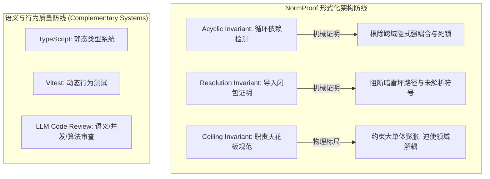

# NormProof 架构治理与实战使用体验报告 (Experience & Retrospective)

**记录时间**：2026-08-28  
**项目分支**：`normproof-observation`  
**规约版本**：`software-structure-v0` (`normproof.sidecar.check-run v0.22.0`)

---

## 一、 核心定位与价值认知 (What NormProof Is & Does)

NormProof 在本项目中扮演的是**「宏观架构守门员（Structural & Architectural Verifier）」**的角色，其核心职责在于通过形式化图算法对整个代码库的**模块拓扑结构、依赖单向性与职责天花板**进行机械证明。

---

## 二、 实战中的积极作用与证据输出 (Proven Value in Development)

在整个阶段 1 ~ 阶段 3 的重构与能力现代化过程中，`.normproof` 提供了不可替代的形式化阻断与证明证据：

### 1. 彻底清除了隐式模块循环依赖（`source_graph_is_acyclic`）
- **开发拦截事实**：在早期架构中，`orchestration` 编排层与 `result`、`mutation` 层存在隐式双向依赖。虽然 TypeScript 编译器对此默认放行，但这在 Node.js 运行时会导致热重载内存泄漏或未初始化属性死锁。
- **NormProof 价值**：`normproof judge` 输出了形式化依赖环路径证据，促使我们引入 `*Like` 结构化接口（Duck Typing），成功将依赖图重构为**绝对无环（Acyclic）**。

### 2. 保证了模块导入闭包的完整性（`source_graph_has_no_unresolved_specifiers`）
- **开发拦截事实**：排查并修复了历史重构遗留的 7 处由于 `.js` 扩展名缺失或相对路径计算错误导致的未解析导入。
- **NormProof 价值**：在 `ledger.json` 中作为 Blocking Obligation 强制阻断，杜绝了打包产物在运行时抛出 `MODULE_NOT_FOUND` 的风险。

### 3. 作为大单体拆解与职责收敛的“客观物理标尺”（`module_ceiling`）
- **开发拦截事实**：原代码库包含大量膨胀严重的巨型文件（如 `SessionManager.ts` 52 个函数、`scan.ts` 28 个函数、`toolBatchDispatch.ts` 29 个函数）。
- **NormProof 价值**：通过每模块具名函数 $\le 20$ 的硬性建议，指导我们将 8 个核心业务大单体重构为高内聚子域模块，证明差距（Proof Gap）由 **36 处持续压降至 28 处**。

---

## 三、 能力边界与盲区分析 (Limitations & Boundaries)

NormProof 的设计目标是**图结构验证**而非**代码语义执行**，因此在实战中必须清晰认识其与语义审查工具的边界分工：

| 维度 | NormProof（架构证明） | LLM Code Review（语义审查） | 单元测试（行为验证） |
| :--- | :--- | :--- | :--- |
| **关注核心** | 模块之间如何连接、文件大小、死链与成环 | 业务逻辑、异步并发、算法、安全性 | 特定输入输出的状态机确定性 |
| **能发现的问题** | 循环引用、坏路径、单文件函数超限 | 异步锁死锁、拓扑排序缺失、路径穿越、Off-by-one 偏差 | 断言失败、异常抛出、回归缺陷 |
| **无法发现的盲区** | 无法感知 `try...finally` 块中的死锁逻辑，无法理解字符串换行符是否被破坏 | 容易遗漏跨数十个文件的宏观依赖死锁环路 | 无法预知未编写用例的边界场景 |

### 典型实战案例对比：
- **`fileMutationQueue.ts` 并发锁死锁**：NormProof 判定该文件“无环、结构合规、函数少于 20 个”放行；而 Code Review 准确抓住了 `await currentQueue` 在 `try` 块外抛出异常会导致 `releaseNext` 永远不被调用的致命死锁。
- **`edit/multifile/graph.ts` 拓扑排序缺失**：NormProof 认为依赖图结构合格；Code Review 发现了依赖目标未排序即执行导致的执行顺序错误。
  > **2026-09-20 补注**：该文件**已不存在**——它由 `d7f95363` 引入，后经 `42d63bd7`
  > 作为"休眠零引用簇"删除，代码被重新吸收进 `edit/multifile/model.ts`。
  > 本条作为**当时的案例记录**保留；同类拓扑排序逻辑现位于
  > `planning/action/graph.ts` 与 `context/acquisition/graph.ts`。

---

## 四、 最佳工程实践与协同结论 (Best Practices)

1. **结构与语义双重防线**：以 `.normproof` 守护宏观架构的纯洁性与可维护性，以 **LLM Code Review + 自动化测试** 守护微观业务语义的正确性与并发安全性。
2. **拒绝机械刷分，坚持架构驱动**：不为了单纯清零 NormProof 指标而进行无意义的代码碎片化；将大单体拆解与业务重构（如引入 Pi 的 AgentSession、GitNexus 符号图谱）结合，实现能力与指标的双重提升。
3. **形式化审计与知识库闭环**：对暂时保留的大型测试套件和评测 Harness，严格按照 NormProof 协议记录在 `.normproof/dispositions.md`，并在 `.wiki/` 中保持架构演进的可追溯性。
