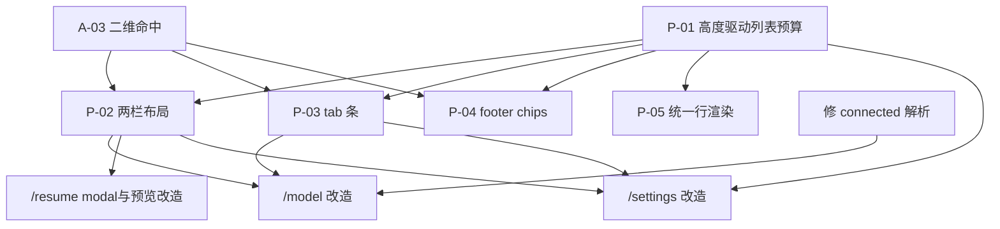

# 面板改造方案

只读研究产出的方案文档。未修改产品源码。参考快照 oh-my-pi `c2cb79e4`；Cheers 基线 `0d30d589`。

**2026-10-17 源码复核**：本次仅修订文档，未新增产品代码、动态或PTY验证。此前渲染实测为历史快照；任务使用 `34/P-xx`、`34/Q-xx`、`34/A-xx`，不与其他文档重号混用。用户已定的两栏、tabs与补齐面板范围保留；明确排除的 `/omfg` 不因旧清单再次纳入。

前置阅读：[33参考面板映射](33-omp-panel-mapping.md)、[35面板清单](35-panel-inventory-full.md)、[30面板与设置契约](30-panels-and-model-picker.md)。旧35–39来源已合并进33，不是五份独立现行文档。

## 1. 现状与目标的差距（一句话）

Cheers 已有共享OptionModel、overlay及panel/modal两种布局，领域picker提供各自动作。问题是panel额外封顶8项、缺少可复用的两栏/tabs及二维命中。参考也有多种面板基类，HubFrame不是全部overlay的统一骨架；只比较适用的预算、搜索与交互决策。

| 维度 | Cheers 现状 | omp 目标 | 出处 |
|---|---|---|---|
| 列表可见行 | panel至多8项；modal按height/detailRows计算 | 由分配高度扣各自chrome，不复制固定减数 | [33 §1](33-omp-panel-mapping.md#1-hubframemodel-hub-与-agents-hub-的骨架) |
| 布局 | 单栏 | sidebar + body（`width - sidebar - 7`） | [33 §2](33-omp-panel-mapping.md#2-两栏几何精确) |
| 分组 | 平铺 / 单一 group 字段 | tab 条 + 分组 + 分隔线 | [33 §A.4](33-omp-panel-mapping.md#a4-分组两层-tab) |
| 搜索 | 子串过滤 | 字面快路径 + 临时 fuzzy + 噪声阈值 | [33 §A.5](33-omp-panel-mapping.md#a5-搜索带成本论证的三段设计) |
| footer | 单行提示 | 可点击 chip 条 + 鼠标命中 | [33 §5](33-omp-panel-mapping.md#5-footer-chip-条与鼠标) |
| 行内容 | label + detail + note | icon + label + 右对齐 annotation + 三态样式 | [33 §6](33-omp-panel-mapping.md#6-sidebar-行渲染) |
| tab 原语 | **无** | `TabBar` / `renderSegmentTrack` | [33 §B.2](33-omp-panel-mapping.md#b2-布局10-个-tab) |

## 2. 需要补齐或扩展的 5 个共用原语

按依赖顺序，先原语后面板。

### P-01 高度驱动的列表预算

**目标**：去掉 `MAX_OPTIONS` 对可见行数的封顶。

现状代码（[panel.ts:42-43](../../packages/ts-shell/src/presentation/tui/chrome/panel.ts#L42)）：

```ts
const overflow = capacity >= 4 && model.total > Math.min(MAX_OPTIONS, capacity - 2);
const listRows = Math.min(MAX_OPTIONS, Math.max(0, capacity - (overflow ? 3 : 2)));
```

目标形态：

```ts
// 去掉 Math.min(MAX_OPTIONS, …)；仅保留 header/footer/overflow 的预留
const listRows = Math.max(0, capacity - (overflow ? 3 : 2));
```

`overflow` 判定也要相应改为基于 `capacity - 2`，不再引用 `MAX_OPTIONS`。

**验收**：先以显式capacity验证纯渲染：51个单行候选、capacity=18/34/54时，在此简化header/footer/overflow模型下应可见15/31/51项；不能把这些capacity直接写成24/40/60行终端。真实surface会先扣composer、suggestions、hints与activity，端到端验证实际预算内无溢出、增长到足够空间时超过8项。modal独立验证每项行数与小屏降级。

**风险**：OptionModel已有窗口能力，但共享panel行为、鼠标行映射与小屏chrome都受影响；不能仅凭一处常量判为低风险。输入框16行正文的新预算也必须同步纳入surface分配。

### P-02 两栏布局

**目标**：`sidebar + body`，比较参考几何后按Cheers实际chrome成本分配。

目标算术（对齐 [overlay-box.ts:64-101](https://github.com/can1357/oh-my-pi/blob/c2cb79e4c227aa4b22c4ccb933ff72fd88bceba4/packages/tui/src/chrome/overlay-box.ts#L64)）：

```ts
const splitBodyWidth = (width: number, sidebarWidth: number) => Math.max(0, width - sidebarWidth - 7);
```

sidebar 宽度按内容测量并钳到每个面板声明的 `{min, max}`（对齐 [hub-frame.ts:198-206](https://github.com/can1357/oh-my-pi/blob/c2cb79e4c227aa4b22c4ccb933ff72fd88bceba4/packages/tui/src/overlays/hub-frame.ts#L198)）：

```ts
sidebarWidth(entries) = clamp(longest(label + annotation) + 5, min, max)
```

**窄屏降级**：空间不足时整体退化为单栏（对齐 [split-pane.ts:255](https://github.com/can1357/oh-my-pi/blob/c2cb79e4c227aa4b22c4ccb933ff72fd88bceba4/packages/tui/src/components/layout/split-pane.ts#L255) 的双条件判定），而非压坏两栏。

**验收**：宽屏两栏、窄屏单栏；切换宽度时无内容错位。参考的7列成本不是Cheers永久常量；每行可见宽度不超预算，详情下钻仍能检查完整来源/状态。

**风险**：中。需要每个面板声明 sidebar 的 `{min, max}` 与 `bodyMinWidth`。

### P-03 tab 条原语

**目标**：新增 `TabBar` / `renderSegmentTrack` 等价物（Cheers 目前**完全没有** tab 原语，已检索确认）。

omp 的形态（[model-hub.ts:2474-2482](https://github.com/can1357/oh-my-pi/blob/c2cb79e4c227aa4b22c4ccb933ff72fd88bceba4/packages/tui/src/overlays/model-hub.ts#L2474)）：

```ts
const track = renderSegmentTrack(MODEL_KIND_TABS.map(kind => ({ label: kind })), Math.max(0, active));
return truncateToWidth(` ${theme.fg("dim", "Kind:")} ${track}  ${theme.fg("dim", formatKeyHints(["alt+left","alt+right"]))}`, width);
```

要点：分段轨道、当前项高亮与可发现键位。参考使用Alt方向键；Cheers接现有可重映射action，不硬编码一套绕过keybindings的按键。Tab/Shift+Tab仅在当前焦点域路由。

**验收**：渲染N段、高亮当前、跳过不可用项；窄屏采用短标签/窗口并保持当前tab可见，截断不能留下不可达tab。鼠标命中按实际列矩形重建。

### P-04 footer chip 条

**目标**：可点击的横向 chip，记录鼠标命中范围。

omp 形态（[hub-frame.ts:288-315](https://github.com/can1357/oh-my-pi/blob/c2cb79e4c227aa4b22c4ccb933ff72fd88bceba4/packages/tui/src/overlays/hub-frame.ts#L288)）：选中项渲染为 `[ … ]` + 背景色；溢出前缀 `… `；`selectChipAt` 按列命中。

**风险**：中。需要把渲染行的列范围回传给指针处理（Cheers 已有 `choiceRegions` / `onOptionRow` 类似机制可复用）。

### P-05 统一行渲染

**目标**：`icon + label + 右对齐 annotation`，三态样式（muted / active+focused / hovered），分隔线条目。

omp 形态见 [33 §6](33-omp-panel-mapping.md#6-sidebar-行渲染)。Cheers 现有 `renderRow`（[panel.ts:79-110](../../packages/ts-shell/src/presentation/tui/chrome/panel.ts#L79)）已有 marker/label/detail/note 四段，**可扩展而非重写**：加 icon 列与 hovered 态即可。

## 3. 逐面板改造清单

按功能与适用参考给出目标形态。优先级由用户报告、依赖与行为风险决定，文件大小不作优先级或完成度依据。

| 优先级 | 命令 | Cheers 现状 | omp 对应物 | 改造要点 |
|---|---|---|---|---|
| **P0** | `/model` | `picker/model.ts`，panel | `model-hub.ts` | P-01/02/03；共享配置可用性投影；profile/预设/overlay/账号池按25的已定范围 |
| **P0** | `/resume` | `picker/session.ts`，modal | `session-selector.ts` | modal密度、两栏预览、搜索/时间分组；不是去8项上限 |
| **P1** | `/settings` | `picker/settings.ts`，panel | `settings-selector.ts` | P-02/03；现有7组tab化；保留30中的来源/保存/preview契约 |
| **P1** | `/tree` | `picker/tree.ts`平铺入口 | `tree-selector.ts` | 层级gutter、循环/条目预算、稳定展开/选择与详情 |
| **P1** | `/usage` | 文本 | `usage-dashboard.ts` | header/body/footer、已测量与未知配额分开；不能捏造quota |
| **P1** | `/jobs` | 文本 | `jobs-panel.ts` | 状态列表/详情，取消与后台结果归属不由关闭面板改变 |
| **P2** | `/copy` | `picker/copy.ts` | `copy-selector.ts` | turn→块下钻与预览，复制回源内容 |
| **P2** | `/mcp` | `picker/servers.ts` | `mcp-add-wizard.ts` | 字段校验、scope、确认与取消 |
| **P2** | `/hub` `/agents` | 缺专门面板 | `agent-hub.ts` / `agents-hub.ts` | 按域能力设计，不因参考同名移植未实现动作 |
| **P3** | `/marketplace` `/plugin` | 已有picker | 对应selector | 增强现有owner；`/extensions`作为同一`/plugin`别名，避免第二条生命周期 |
| **P3** | `/git` | `picker/git.ts` | `GitUi` | 并排diff与逐hunk审批已纳入；独立显示与授权契约见31 |

## 4. 必须先修的阻塞项

`/model` 与 `/model list` 的配置可用性投影应先收敛，否则新UI继续误标。普通model行当前仍可选，不存在源码支持的“51行全禁用”结论。

- 现状：`connected = new Set(normalizeConnections(config).map(c => c.provider))`（[picker/model.ts:34-35](../../packages/ts-shell/src/cli/interactive/picker/model.ts#L34)、[modelCommandRuntime.ts:104](../../packages/ts-shell/src/core/commands/modelCommandRuntime.ts#L104)）。
- 合成反例：providerConnections缺失而credentials路径可解析时，metadata connected集合为空；这不代表运行时无凭据或远端不可用，禁用仅涉及无model的占位行。
- 修法见 [25](25-model-configuration-and-relays.md)：统一报告安全的配置可用性及来源投影，两处共用；不为UI改写持久connections语义。

omp 的对照做法：未连接 provider **单独分组**，不整体置灰（[33 §A.8](33-omp-panel-mapping.md#a8-cheers-对照model)）。

## 5. 建议执行顺序



**基础批**：P-01预算与P-05行投影、A-03二维命中，随后P-02/03/04；同步收敛配置可用性投影。先锁定交互/保存/权限契约再迁移业务。

**第一迁移批（P0）**：`/model`与`/resume`，消费已完成的两栏/tabs及预算；model先修配置状态，resume独立改modal密度与预览。

**第二迁移批（P1）**：`/settings`、`/tree`、`/usage`、`/jobs`。

**后续批**：`/copy`、`/mcp`、`/hub`、`/agents`、插件及§7范围内其余面板；不是把未列入前三批的用户已定任务静默排除。

## 6. 验收口径

每个面板改造后需满足：

1. **高度**：在候选充足、实际预算增加时可见项数增加；0/1/极小预算不溢出。panel和modal分开验证，不能由去8项常量证明modal完成。
2. **窄屏**：两栏面板在窄终端退化为单栏且不丢内容。
3. **搜索**（有搜索的面板）：字面命中与 fuzzy 命中都能找到；无命中时给出明确空态。
4. **空态/加载/错误**：保留Cheers已有三分（[overlay.ts:191](../../packages/ts-shell/src/cli/interactive/overlay.ts#L191)），并覆盖取消、重试、目录变化；不能失败时清空stored限制。
5. **关闭语义**：单纯取消不自动提交草稿或执行动作；已有结果note、恢复草稿与后台完成提示按原契约保留，不概括为所有关闭都不输出。预览回滚幂等。
6. **不回归**：实现后运行真实存在的相关picker/settings/session测试，新增行为反例；本文文档修订不宣称这些测试已运行。
7. **命中与焦点**：同一行左右区域、tabs与footer分别按列命中；resize/过滤/异步刷新后旧矩形失效，禁用/heading不可执行，Tab遵循当前焦点域。
8. **事实与授权**：设置来源/信任/保存结果、配额未知、后台运行归属、permission及hunk授权都由域owner提供。面板只能投影，不能把preview变applied、关闭变cancel成功、整patch批准变任意hunk批准。

## 7. 已定决策（2026-10-15）

用户裁决：**引入 P-02（两栏布局）与 P-03（tab 条）**。因此本方案从「只去上限」升级为「重建面板骨架」。

| 决策 | 结果 | 影响范围 |
|---|---|---|
| Q-01 两栏布局（P-02） | **引入** | `/model`、`/resume`、`/settings`、`/tree`四个已有面板及新增`/agents`按需求采用；[参考HubFrame只有两个生产消费者](33-omp-panel-mapping.md#0-2026-10-17-重要更正hubframe-只有两个生产消费者)，不是所有overlay的形态。[基类分组](35-panel-inventory-full.md#2-参考组件的真实基类与分组)只供比较，不决定Cheers按实际consumer扩展的范围 |
| Q-02 tab 条（P-03） | **引入** | `/model`（kind/role tabs）、`/settings`（分组 tabs） |
| Q-03 `/settings` 分 tab | 随 P-03 引入 | 现 7 组 → tab 化 |
| Q-04 `/resume` 搜索与分组 | 技术决定：保留原语法，UI按字面优先/fuzzy回退与时间分组，选中详情可预览 | 不新增或删除顶层命令 |
| Q-05 `/tree` 树形渲染 | 技术决定：实施层级渲染与稳定展开/过滤 | 不改变持久会话树语义 |
| Q-06 `/usage` `/jobs` 新建面板 | **新建**（随 Q-08） | — |
| Q-07 执行顺序 | 按 §5 建议 | — |
| **Q-08 原17个入口的面板覆盖** | **按用户后续排除/合并裁决全补** | `/omfg`排除、theme进入settings、extensions合并plugin；见§7.2 |

### 7.2 Q-08 的影响（2026-10-17 消歧）

用户裁决“面板则全补”覆盖功能面板，同时需应用后续明确的排除与合并：`/omfg`不做，theme集成settings，`/extensions`为增强后的`/plugin`同一别名。旧17个命令行不能等同17个新owner或独立面板：

```text
/hub /agents /usage /advisor /plan-review /effort(=/thinking) /history
/extensions(=/plugin) /report /cleanse /btw /login /logout /pin /debug /theme(进入/settings)
```

这些是能力入口，逐项按 [35](35-panel-inventory-full.md) 的真实owner和后续裁决落实：复用已有picker、集成settings、兼容alias与新建交互面板分别记录。不能用旧“17+5=22”算式证明任务覆盖或复用率。

§2原语按真实需求复用：列表消费预算/行投影，hub或详情型消费两栏，其他报告/表单不被强制装进列表骨架。P-02不成为所有新面板的前置。

逐面板规格与任务映射由35及phase20统一收敛，不能把未取得的子代理产物当作已存在的实施规格。

因此 §2 的 P-01…P-05 **全部进入实施范围**，不再是候选。

### 7.1 因「引入两栏」而新增的前置工作

两栏布局在当前架构下不是纯渲染改动，需要先确认三件事：

| # | 前置 | 现状 | 需要 |
|---|---|---|---|
| A-01 | overlay行数组承载 | 当前返回已渲染行，不禁止行内多栏 | 技术决定：presentation拼接列，返回行及交互几何；surface只分配实际可用矩形 |
| A-02 | 面板宽度来源 | renderPanel已收width | 技术决定：presentation测量各列并按声明min/max钳制，不让入口猜固定列宽 |
| A-03 | 鼠标命中范围 | 当前onOptionRow按行记id | 技术决定：以稳定id和行列矩形回传，当前viewport重建；保留父区域到局部坐标转换 |
| A-04 | 窄屏退化判定 | 缺通用两栏降级 | 技术决定：同时检查断点与左右最小内容宽；不足转单栏详情下钻，完整来源/失败原因仍可检查 |

**风险最高的不是渲染，是 A-03**：`choiceRegions` 目前按行记录，两栏后同一行会有左右两个可选区域。

## 8. 未验证项

- 未实现任何原语，因此 §2 的「目标形态」代码片段是**设计草案**，非已验证实现。
- P-02设计可在presentation行内拼接，尚未实现或动态验证；行数组本身不构成两栏不可行的证据。
- P-04 的鼠标命中需要与现有 `choiceRegions` 机制对接，未验证兼容性。
- `/git`、`/mcp`向导、agent-hub的参考组件未全面逐行研究；已核对的端口、入口和关键流程见[33 §F](33-omp-panel-mapping.md#f-其他面板)，不冒充完整运行验收。
