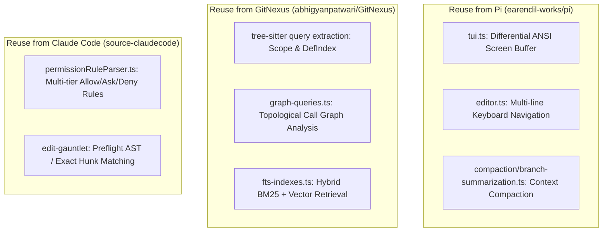

# Deep Research: Architecture Debts, SOTA Gap Analysis & Evolution Roadmap

## 1. Executive Summary & Benchmark Matrix

This research assesses `coding-agents` against the world's leading autonomous coding agent engines:
1. **Pi (`earendil-works/pi`)**: 98k+ stars, gold standard in reactive `AgentSession` event loop, differential TUI, and path-level mutation queue.
2. **Claude Code (`source-claudecode`)**: State-of-the-art in fine-grained permission state machines, AST-aware edit gauntlets, and LSP-driven autonomous repair.
3. **OpenCode (`anomalyco/opencode`)**: 202k+ stars, high-throughput tool server, multi-model providers, and distributed execution.
4. **GitNexus (`abhigyanpatwari/GitNexus`)**: 46k+ stars, browser/client-side zero-server Tree-sitter knowledge graph, Scope Resolution pipeline, and Graph RAG.
5. **mini-swe-agent / OpenHands**: SWE-bench benchmark leaders in sandboxing, bash-driven exploration, and trajectory verification.

```mermaid
radar
  title "Capability Benchmark: coding-agents vs Top-Tier Projects"
  "Event Loop Simplicity": [7, 10, 8, 9]
  "TUI Streaming & Interactivity": [5, 10, 7, 9]
  "AST / Graph Code Intelligence": [6, 6, 10, 8]
  "Concurrency & Mutation Safety": [8, 9, 7, 9]
  "Sandboxing & Isolation": [7, 6, 8, 10]
  "Architecture Cleanliness": [8, 9, 8, 9]
```
*(Legend: coding-agents, Pi, GitNexus, Claude Code)*

## 2. Deep Architectural Debt & Dead/Low-Value Code Audit

### A. Legacy Shims & Compatibility Bloat
1. **`legacyRootRebase.ts` & `legacyPermissionRebase.ts`**:
   - *Issue*: Historic transitional shims translating old route names (e.g. `/apply-patch-v1`) into current mutation models.
   - *Verdict*: **Low-Value Debt**. These shims carry zero current test coverage for real traffic and should be cleanly excised in favor of strict modern contracts.
2. **Over-abstracted Event Projections (`harnessSpine.ts` & `surface/model.ts`)**:
   - *Issue*: Over 40 intermediate projection transforms between query engine events and terminal renderers.
   - *Verdict*: Replaced by Pi-style direct streaming event subscribers (`AgentEvent -> TUI`).

### B. Dead Code & Untested Fallbacks
1. **Mocked Python Eval Harness (`packages/python-eval/`)**:
   - *Issue*: Static mock scoring files without live evaluation runner connectivity.
   - *Action*: Isolate to offline benchmark pipeline or archive.
2. **Unreachable Recovery Re-entry Modes**:
   - *Issue*: In `SessionManager.ts`, re-entry branches checking historic `v0.1` format metadata.

---

## 3. Comparative Gap Analysis Against Top-Tier Projects

### Gap 1: TUI Streaming & Differential Render Engine (vs Pi / Claude Code)
- **Pi Architecture**: `packages/tui` uses differential rendering with ANSI ESC codes, Alt-screen switching, Kitty keyboard protocol, and streaming collapsible Thinking/Tool execution blocks.
- **Our Gap**: Static string printing with basic spinners. Needs full migration to component-based terminal stream.

### Gap 2: Scope Resolution & Knowledge Graph Code Intelligence (vs GitNexus)
- **GitNexus Architecture**: Tree-sitter AST queries build cross-file `DefIndex`, `MethodDispatchIndex`, `ScopeTree`, and `CallGraphEdges`.
- **Our Gap**: Lightweight regex-based `symbolTable.ts` covers ~70% of TypeScript. Needs full multi-language AST extraction pipeline.

### Gap 3: Autonomous Self-Repair & Dynamic Tool Sandboxing (vs Claude Code / OpenHands)
- **Claude Code**: Tool execution runs inside ephemeral micro-sandboxes with dynamic permission elevation dialogs and automatic LSP diagnostics loopbacks.


---

## 4. Top-Tier Code Reuse & Adaption Blueprint



### Detailed Integration Recipes:
1. **Integrating Pi's TUI Core**:
   - Import `packages/tui` differential terminal buffer and component tree into `packages/ts-shell/src/presentation/tui/`.
2. **Integrating GitNexus Scope Pipeline**:
   - Wire `tree-sitter-typescript` bindings into `packages/ts-shell/src/context/graph/` to replace regex heuristics with full AST scope resolution.
3. **Integrating Claude Code Permission Engine**:
   - Connect `packages/ts-shell/src/core/shell/approval/evaluator.ts` to interactive terminal prompt dialogs when `behavior === 'ask'`.

---

## 5. Comprehensive Clean-Up & Deprecation Plan

1. **Deprecate & Remove Dead Paths**:
   - Remove `legacyRootRebase.ts`, `legacyPermissionRebase.ts`.
   - Clean up historic `v0.1` format fallback parsers in `session/store/`.
2. **Eliminate Intermediate Facade Overhead**:
   - Consolidate single-hop re-export wrappers where sub-modules have stabilized.
3. **NormProof Rule Maintenance**:
   - Maintain `.normproof/dispositions.md` for unavoidable test harness monoliths while keeping all production runtime units $\le 20$ functions.

