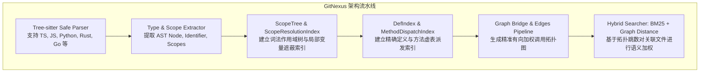

# RFC-002: 基于 Tree-sitter 的无服务端代码知识图谱与作用域解析引擎

- **状态**：Draft / Proposed
- **作者**：Coding Agents Architecture Working Group
- **参考架构**：`abhigyanpatwari/GitNexus` (`/home/wang/projects/GitNexus/gitnexus/src/core/ingestion`)
- **日期**：2026-08-28

---

## 一、 为什么当前的正则表达式检索已达极限？

当前 `packages/ts-shell/src/context/` 中的代码定位主要依赖：
1. 文件名和路径分词匹配 (`scorer.ts`, `ranker.ts`)
2. 基于正则表达式的轻量符号提取 (`symbolTable.ts`)

**致命瓶颈**：
- **无法理解作用域（Scope Blindness）**：正则无法区分同名局部变量与顶层导出函数。
- **无法理解类继承与方法派发（MRO & Dispatch Blindness）**：无法分析接口实现、类继承调用。
- **无法跨文件精确追踪调用链**：跨文件调用仅靠单词级搜索，容易被同名单词污染。

---

## 二、 吸收 GitNexus 核心算法与详细架构设计



### 1. 核心数据结构定义

```typescript
export interface ASTScopeNode {
  readonly id: string;
  readonly kind: "global" | "module" | "class" | "function" | "block";
  readonly range: { readonly start: number; readonly end: number };
  readonly parentId?: string;
  readonly declarations: readonly ASTSymbolDeclaration[];
  readonly references: readonly ASTSymbolReference[];
}

export interface ASTSymbolDeclaration {
  readonly name: string;
  readonly qualifiedName: string; // e.g. "SessionManager.markRunStarted"
  readonly kind: "class" | "method" | "function" | "interface" | "type" | "variable";
  readonly filePath: string;
  readonly isExported: boolean;
  readonly scopeId: string;
}

export interface MethodDispatchEntry {
  readonly className: string;
  readonly methodName: string;
  readonly superClasses: readonly string[];
  readonly implementedInterfaces: readonly string[];
  readonly declarationFilePath: string;
}
```

### 2. 多阶段解析流水线 (Ingestion Pipeline)

1. **Phase 1: Parse AST**：使用 Tree-sitter 解析源文件为 CST/AST。
2. **Phase 2: Scope Extractor**：遍历 AST 构造词法作用域树，正确处理 `let`/`const`/`function` 提升与局部屏蔽。
3. **Phase 3: Def & Dispatch Indexing**：为所有全局符号、类成员方法建立全局唯一全限定名（Qualified Name Index）。
4. **Phase 4: References-to-Edges Resolution**：将所有 AST 引用解析为其真实的定义节点 ID，输出精准的 `CallGraphEdge[]`。
5. **Phase 5: Topological Graph RAG**：当用户下发修改任务（如“重构 SessionManager 状态转移”）时，从种子节点出发在图上做衰减游走，精确拉取上下游关联文件，装填到 Agent Context 中。

---

## 三、 复用方案与集成里程碑

- **复用来源**：可以直接复用 `/home/wang/projects/GitNexus/gitnexus/src/core/ingestion/scope-resolution/` 与 `languages/typescript/`。
- **阶段规划**：
  - **M1**：在 `packages/ts-shell` 引入 `tree-sitter` 与 `tree-sitter-typescript` 绑定。
  - **M2**：实现 `src/context/graph/ast/scopeExtractor.ts` 与 `defIndex.ts`。
  - **M3**：将 `context/discovery/ranker.ts` 升级为真正的 Graph RAG 混合检索器。
