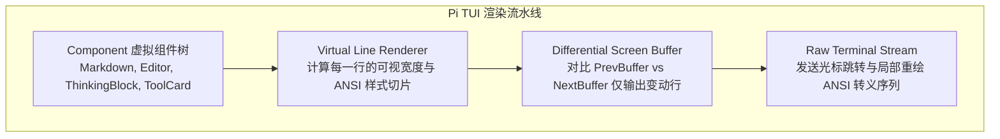

# RFC-003: 差分 ANSI 屏幕缓冲区与流式响应式 TUI 终端引擎

- **状态**：Draft / Proposed
- **作者**：Coding Agents Architecture Working Group
- **参考架构**：`earendil-works/pi` (`/home/wang/projects/pi/packages/tui`)
- **日期**：2026-08-28

---

## 一、 当前终端交互的严重缺陷 (Current Surface Limitations)

当前 `packages/ts-shell/src/presentation/` 的控制台交互存在明显代差：
1. **静态单向输出（No In-Place Differential Updates）**：每次状态变化都往控制台打出一长串新的日志行，导致终端疯狂滚动刷屏。
2. **缺乏 Alt-Screen 全屏应用模式**：无法提供类似 `Pi` 或 `Claude Code` 那样具有完整编辑器、快捷键、历史命令翻找和多层弹窗的高级交互界面。
3. **无法优雅展示流式思考块与长工具输出**：模型的 `<thinking>` 输出与大型命令的 stdout 无法折叠，容易冲垮终端视口。

---

## 二、 吸收 Pi TUI 架构的核心设计与算法



### 1. 差分渲染算法原理 (Differential Rendering Algorithm)

```typescript
export interface TerminalLineSegment {
  readonly text: string;
  readonly width: number;
  readonly ansiStyle: string;
}

export class DifferentialTerminalBuffer {
  private prevScreen: string[] = [];
  private currentWidth: number = process.stdout.columns || 80;
  private currentHeight: number = process.stdout.rows || 24;

  render(nextScreen: string[]): void {
    const output: string[] = [];
    const maxLines = Math.max(this.prevScreen.length, nextScreen.length);

    for (let i = 0; i < maxLines; i++) {
      const prevLine = this.prevScreen[i] ?? "";
      const nextLine = nextScreen[i] ?? "";

      // 仅当该行内容或 ANSI 样式发生物理改变时才进行局部光标重绘
      if (prevLine !== nextLine) {
        output.push(`\x1b[${i + 1};1H\x1b[2K${nextLine}`);
      }
    }

    if (output.length > 0) {
      process.stdout.write(output.join(""));
    }
    this.prevScreen = [...nextScreen];
  }
}
```

### 2. 流式交互组件树 (Streaming Component Hierarchy)

1. **`ThinkingBlock` 组件**：
   - 在流式生成阶段：展示微动 Spinner 与动态字数提示。
   - 在生成完成阶段：自动折叠为 `[✓ Thinking (450 tokens)]`，按 `Enter` 或快捷键可展开查看完整推理过程。
2. **`ToolExecutionCard` 组件**：
   - 包含实时计时器、参数摘要、以及动态进度条；在命令输出超长时自动启用内嵌滚动视口（`ScrollView`）。
3. **`InteractivePermissionDialog` 组件**：
   - 当收到 `PermissionBehavior === 'ask'` 时，在屏幕中央弹出高亮模态窗，捕获 `[y/n/always/never]` 单键响应，完全不打乱底层主终端流。

---

## 三、 复用方案与实施步骤

- **复用来源**：可以直接移植 `/home/wang/projects/pi/packages/tui/src/` 中的 `tui.ts`, `terminal.ts`, `terminal-colors.ts`, `components/`。
- **集成路径**：在 `packages/ts-shell/src/presentation/` 下新建 `tui/` 模块，替换掉原先基于 `console.log` 的简单打印。
