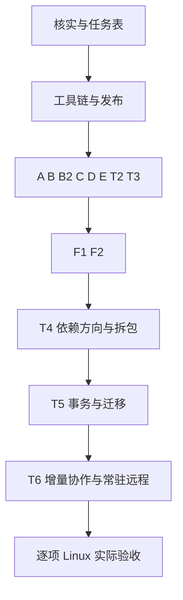

# Design and evidence

## Current architecture and risk

只有一个 workspace 包。单个模块的 import 图无环不等于可以直接搬目录成为无环包：browser/core、workflow/core、planning/session/provider 的双向边存在。现有分支树、CAS 状态写入、任务日志、远端作业派发栅栏均已实现；问题是事务权威和独立模块边界未完成，不能重造另一套执行器或任务系统。

起始工具链为 TypeScript 5.9.3、Vitest 0.34.6、Vite 5.4.21；实际 Undici 7.18.2 要求 Node >=20.18.1，和声明／CI 的 >=20.3.0 冲突。Node API 静态门不能代替依赖下限运行证据。TypeScript 编译器由 graph parser、language scanner、扩展转译和 post-mutation diagnostics 直接消费，移除运行时依赖会损坏产品。此条研究主张予以纠正，保留编译器依赖。

当前静态包 export 宣告 14 个非根入口，但 publisher 只保留 stable index，其余目录被清理。实际导入证实全部失败。公开 SDK／子路径和 CLI 需要共用一个 immutable generation，不能把每条入口独立打包而产生多份 WeakMap／单例。

## Reuse decisions

构建参考的相关决定是：在 TypeScript 类型检查后一次构建多个 ESM entry，共享 chunk；保留 SDK 路径，显式检查动态资源和 worker。采用 shared graph 与 asset 检查；保留本项目现有 build input digest、journal、immutable publication、launcher 和单文件 executable 边界。不照搬较高 Node floor 或参考命名。目标 Node 20.3；Vitest 3.2.7 与 Vite 6.4.6 满足声明下限，显式单 worker 取代旧环境变量约定。

静态检查使用直接依赖的工具和非修改式命令，先启用有实际缺陷检测价值的规则。格式工具可单独运行，批量机械排版不得混在本次行为修改里。门禁自身需要反例，不能只证明当前树“恰好通过”。

首次规则试跑发现 26 项，其中 cleanup finally 的显式未知结果覆盖和 Node 模块内名为 escape 的局部变量不是当前契约下的通用缺陷；这两条高误报规则不纳入首批阻断集，不为通过 lint 改写清理语义。生成器夹具里 throw 后的不可达 yield 删除，异常行为保持。保留重复键／case／参数、不可达语句、const 赋值及 constructor/super 检测；真实重复键反例验证门禁工作。规则集覆盖范围不等于全规则无告警。

存储参考的决定是：追加确认记录、失败 owner 失效、事件化编辑／书签、持久 outbox、连续序号和快照重置。采用其事务与恢复语义，同时保留本项目 fsync、原文件保护、未知派发不重放与单执行边界；不复制其另一语言 daemon。当前独立目录结构先保留，待统一日志契约和迁移器通过后再切换权威。

## Implementation order

核实已完成的任务无需重写，但其缺少的实际消费者或证据仍列入验收。每批实现先给具体契约与失败场景，再由主线程串行运行静态门、合并的定向测试、构建及适用 Linux native／真实模型验证。参考比较只记录决定；源码不跨仓复制、参考仓只读。

## Known remaining risks

消息／缓存增量必须保留原始声明位置，不只维持顶层 tools 不变。Patch 混合删除不能丢失 unsupported 覆盖。codemode 无法读取真实会话时不能静默落到全局内存。RPC 队列模式需修改活跃队列，不能只更改展示配置。阶梯费率必须按请求选档后持久化，不按聚合 usage 再选。异步 UI／遥测必须沿用捕获的 owner。

真实提供方支持受当前配置和服务端能力限制；不以自定义 capability 或 synthetic 应答冒充真实兼容。用户已允许 Linux 真实测试，执行使用已有配置模型；需要人工同意的登录验证如未发生，明确保留缺证据。

## Loop preparation ownership (2026-11-15)

原研究的prepareNextTurn在本项目由prepareNextStep承担，含首次预算检查；不新增同义hook。定向参考确认finish在assistant/tool结果发布后、prepare在下一请求前、逐retry只做request准备，end不再poll或进入下一准备；本实现进一步在异步返回和turn_start observer后复验原history／signal，准备返回的carrier读取完后再复验。合法compaction仍由原onContextReplaced和requestContext.accept推进同一历史，无新durable权限。

参考的prepare后再接收steering保留；原PendingQueue通过同步hasItems只读选择续轮，prepare成功／turn_start返回后才drain单个lane。自然tool继续不提前取followUp，晚steering优先，准备中撤回唯一队列则结束；未提供peek的通用异步getter保留原poll合同，不宣称回滚未确认的外部取消息。取消后的已完成assistant保留，未取输入不丢失。

`.omx/artifacts/upgrade-loop-2026-11-15/`保存初6红、复审5红与observer单红；最终8套件161项、六门、0monoliths和build `3bed083698af`通过，限定只读复核CLEAR。两有效反转红，三个生产文件逐字节恢复后3/74通过；首npm12筛选拒绝、一次误并发后终止两测试以及不收敛反转另存失败记录，不当有效反转。当前编译loop入口经SDK adapter完成两次实际配置模型请求，hooks顺序和准备取消零写回／零派发通过；该adapter不证明整个CLI虚拟路由接通。

本批实际L、额外依赖1（复用原队列的非破坏peek），结构检查通过。静态路由核实仍有原credential／address／transport沿用、实际目标scope未复核及late state问题。T3.1当时发现loader消费generation撤权和compact settlement缺口；loader／dispose已由下述独立子批修复，compact仍未完成，不以本子批勾选C.1或全规划。

## SDK resource retirement (2026-11-15)

定向只读参考会话dispose会使旧扩展上下文失效，并在abort hook失败后仍清除listeners与会话资源。本项目保留既有SDK／loader／runtime owner与异步cleanup契约：普通abort只取消当前轮，dispose才撤销消费资源；清理失败继续其他cleanup，同时向所有调用者报告原首错，不采用吞错即成功。

create前捕获加载generation及其binding claim，在异步初始化后核对原代际；setHost先构造退休闭包再提交host，claim成功后才替换deny rules。失败的第二session不能更改caller资源；退休只释放消费generation，不释放随后reload创建的资源。旧`setHost(...): void` override类型兼容保留。一个dispose promise在执行外部回调前发布，取消等待、各独立cleanup和terminate都进行尝试；allSettled拒绝必须进入最终错误结果。

`c8d14775`的最终六静态门、6套件34项、0monoliths、build `1787d90736d1`和限定只读复核CLEAR有实际日志。两个WATCH分别补正常首次capture／第二次setHost capture失败后新claim成功，以及pending cache cleanup异步拒绝的等待／同错传播；两收尾反转均为真实AssertionError，原源码逐字节恢复后联合再绿。当前编译SDK实际加载inline和TS文件扩展，普通abort仍可读、dispose撤权、后继reload保留均通过；使用synthetic provider，回执和源码hash一致。证据位于`.omx/artifacts/upgrade-sdk-2026-11-15/`，临时driver已归档文本并删除。

本子批新增依赖仅原代际binding claim，未增加第二资源owner；不关闭T3.1。compact未纳入idle／取消等待及controller覆盖仍需反例和修复，当前安装包严格类型／真实模型／取消复用／dispose联合验收未运行。用户要求当前子批后暂停，因此这些后续工作保留为未完成。

## SDK compaction settlement (2026-11-15, resumed)

当前源码确认compact只占用controller而没有登记Promise，waitForIdle／cancelAndWait无法等待；状态机在压缩与prompt最后的持久化结算阶段均不能判定真实忙闲，重入可覆盖controller。用户已恢复执行，先建立反例再修复。

参考会话的决定：手动压缩有独立取消身份、isIdle包含压缩、abort后等待idle；压缩结束才退休身份，不接续中断的旧轮。本项目采用完整等待与同owner取消；保留原CompactionOutcome.busy而不自动中断正在执行的prompt，原因是三个现有SDK／CLI／RPC消费者共享明确的忙时拒绝契约。复用ShellCommandRuntime已有同步登记、取消controller与settled Promise，不新增并行运行时。prompt在进入drive前检查原活动操作，拒绝的请求不得替换currentRun或lastRun。SDK dispose后的compact与prompt保持相同撤权边界。

取消hook可同步抛错或创建后继：先捕获原controller和idle Promise，再在finally取消并等待；不得取消或等待回调创建的后继。实际默认goal scheduler仅看controller时在promptSettled尾部误提交，主线程真实反例红后改为isRunning；与prompt admission共用完整settlement，不添加新任务owner。

最终六门、16套件236项、0monoliths、build `d9acacbc4260`通过，限定独立只读复核CLEAR；四有效反转（settlement／prompt admission／cancel hook／scheduler）各真实AssertionError，逐字节恢复后完整16/236通过。初9红、hook1红、scheduler1红保留；错误Vitest路径与npm12 pack名称对象被误作数组的报告脚本失败不计行为证据。

当前同代npm包2203文件／2513226bytes，隔离安装15入口、严格TypeScript skipLibCheck=false通过；Linux Node24.15已配置模型实际四请求分别prompt／compact／reuse／reopen，原生SDK持久compact、重叠拒绝、取消零派发和零commit、迟到converter rejection、同ID重开、inline和TS扩展撤权以及后继loader代际保留通过。receipt核验五源文件和探针SHA256，旧两构建保留历史证据而不替代最新代码。T3.1本地完成，21/62；实际L、额外依赖2，原owner复用，未push或取得CI。

下一C.1只读核实确认生产没有virtual注册消费者，属于E.7前置依赖。模型metadata可复用session catalog contributions；可执行回调属于core/models和extension generation，不写ConfigState克隆目录。物理target必须先用现有凭据／account／scope owner重绑定完整URL、headers、credential identity、fetch和modelTransport；不能从turn/context直接import CLI step组装器而形成环。按这一依赖拆批，完整注册／分支状态／实际路由联合验收前不勾选C.1或E.7。

## Toolchain publication contract (2026-11-14)

公开入口与CLI由一次shared graph构建，元数据产生静态public.js，stable wrappers经唯一current.js共享运行时。别名由specifier和export name编码，新增入口不会重用旧别名；默认和live binding保留。manifest v3把全部wrapper、声明转发和pack规则绑定到输入与产物；journal v2记录旧字节/模式/不存在状态，兼容旧日志恢复。仅清理旧manifest记录且未被用户改动的managed files，不宽泛清目录。旧build保留在磁盘，dist/.npmignore仅打包当前代，防止安装包携带989代历史。声明目录复制原JSON资源，公开类型的Node依赖随包安装。

边界：静态聚合会提前求值所有公开入口；跨多个文件的导出形状变化无法对任意已运行直接importer原子可见，可能拒绝链接，不能混代或谎称恢复撤销了模块缓存。生产构建b57986b62aa3、本地打包/安装和Node20.3验收已完成；后续源码变化应重新绑定构建证据。首次pack fixture假定npm JSON为数组（npm12为名称对象），以及原生CLI fixture未建立HOME，已修fixture重验，不能作为产品失败或忽略失败。

## Approved patch inspection (2026-11-14)

写前判断复用原prepare/permission/bind/hook/authorize/consume路径，在普通批准后由patch owner重新规划所选组并核对确切revision，再封存完整write/delete目标及相应内容。选择一次设置且禁止重设，异常被hook吞掉也不能扩张授权；delete-only/noop同样需要参数身份。删除不虚构为空内容；supported写判断与unsupported缺口同时存在，unknown/block优先于unsupported，后者优先于ordinary allow。现有锁内原始字节检查仍是实际写入边界。匹配计数使用与实际匹配相同的长度剪枝，保持原始范围和歧义拒绝。

## Branch script storage (2026-11-14)

codemode复用已有会话state锁与transcript追加owner；没有新增全局或第二持久存储。读取真实保存会话失败立即拒绝，无会话的纯脚本可执行，但store写入明确unavailable。活动分支先校验保存的唯一root、ID和完整ancestry，再补齐未入树消息；锁内重读保留无关正规追加，写键CAS和当前预算拒绝冲突。capture保存原始字节长度与SHA256，current/before/confirmed及同一追加FD均重验前缀，避免inode未变却删改旧历史。append/fsync/readback/close后不能确定结果时报告unknown，不重试或伪装回滚。已await嵌套效果不会因后续store失败被擦除；无await调用的更广泛结算和确定性重放保留原独立任务。

## Terminal color admission (2026-11-14)

实际宿主在input-ready后查询OSC10/11/4，启动面adoption复用同一StdinBuffer。协议协商在其前发出并持有自己的DA1 fence，enhanced选择不能提前释放尚未收到的fence；250ms原截止回收匹配前缀，不刷新普通Escape/paste/appearance的独立预算。颜色查询100ms初始等待与晚到快照分离，16色按位置合并、冻结且去重；theme lease拒绝停止或替换后的答案，显式主题与preview优先，AppearanceReports独占DEC997亮暗选择。Linux PTY为真实OS流加受控协议应答；宿主regular/fullscreen生命周期由实际InteractiveMode集成fixture验证，未声称物理终端或真实模型验证。

## Foreground message conversion (2026-11-15)

convertToLlm在prepareRequest之后执行，普通无custom历史保留原身份路径；应用转换捕获有界inert raw与provider结果，持久化/路由保留raw，工具/图片/预算/发送使用provider投影。system文本统一加入请求system字段并参与systemDigest，非文本system明确拒绝。转换路径禁用不成立的raw-index前缀与opening测量证据，whole-request仍绑定raw可投字段摘要及最终wire摘要；该摘要不宣称custom.data等价。重试逐次准备但同raw复用capture，raw变化重新转换并换requestId。reference决定是上下文准备后转换、display与model content独立；本实现复用原loop和request owner，不另建运行时。

输入数组先descriptor检查，输出在Promise解析前捕获。异步合同接受普通native Promise并允许Node附属async context符号；constructor/then覆盖与Promise子类在观察前拒绝，native constructor/species描述符复查。受支持pending工作取消后仍观察迟到拒绝；无法安全观察的拒绝Promise形状由调用方负责，不谎称所有thenable均可处理。SDK追加限于完整run/observer/durable settlement后的idle，写入复用SessionManager。

证据目录为`.omx/artifacts/upgrade-messages-2026-11-14/`；conversion-delivery包含12套件391项、六静态门与build `48bafd6fec4c`，conversion-functions保留结构计数，conversion-native-wire.log为当前构建实际配置模型三次bodySent及重开/取消/复用的通过回执；conversion-native.json保留早期失败诊断。首次取消断言用了shell专属lifecycle.cancelled，新增真实terminal stop_state反例后补早取消分类；旧loop已取消fixture改为接受tool calls后取消，保留配对目标。诊断中跨root配置触发正常重载、global fetch遗漏Undici发送及错误私有符号属于夹具问题，最终通过实际请求onBodySent观察，所有失败日志保留。压缩和声明不在本批验收范围。

## Summary request capture (2026-11-15)

摘要使用相同有界converter叶，先解析summary目标，再转换raw，捕获完整system/history/body/url/shape并纯preflight。分段仍以raw的合法工具关系切分，budget读候选转换tokens；accepted handle被保留，实际send不会再次转换。候选增大、裁剪、merge可分别转换，非单调converter只保证发送已获准候选，不保证找到所有可行投影。prefix/merge独立capture，previousSummary仅第0段；512消息/64段/128发送上限保持。

complete serialized UTF-8限额在handle返回前检查，使工具文本能进入已有clamp；派发再复检。身份只摘要显式非秘密字段和实际body/url，headers不入identity。原compaction ledger追加preparedIdentity；同operation未知派发阻止changed capture绕过，旧含headers的operation不可安全映射，因此legacy unknown/无材料墓碑拒绝新capture，保持原证据和格式。manual/automatic/prefix及branch接通converter，branch复用navigation与connection取消信号，失败转换保持回退可用。

summary-final-suites保留18套件326项，summary-reviewed-gates-build为六静态门/build `5e1c8ee4afbb`，summary-native.json及summary-native-final.log为当前编译SDK配置模型三次actual bodySent、manual verified publication、branch和取消零派发。首次native计数预期单段而实际两段，失败回执单独保留。主请求threshold、候选wire缩小及C.6仍未验收。

## Complete caller compaction preparation (2026-11-15)

CompactionPolicy复用现有owner，加入请求局部prepare、estimateContextTokens及admission；不建立新ledger或全局capture缓存。先惰性捕获caller与operation.source，再准备完整caller决定阈值。stored raw仍决定legal cuts与summary；按caller重建checkpoint、精确tail及offset后准备candidate，统一比较完整estimatedBefore/After，force也不能发布变大的转换。preparedPolicy返回供既有commit与progress使用；async policies不加入旧pending join。

完整standard/custom应用字段均在descriptor-first有界snapshot后比较，storage id/timestamp除外；opening保留既有环境content后缀特例。候选与authority准入同时传给原commit。original prepare可能被owner重复调用，因此生产接线必须按完整inert raw值复用已获准capture，不能按array identity命中。

独立隔离批次`policy-isolated-final.log`为8套件160项、六静态门及build `c0a48b5abd86`；`compaction-source-head-red.log`为15失败/3通过反例。无原生主请求或完整C.3完成声明。未匹配到的segments.test.ts并未被Vitest运行，实际套件数按回执8计。

## Complete request capture (2026-11-15)

turn/context复用原step与attempt owner，提取route、转换结果、动态system/tool声明、图片归一化、closing、完整budget与serialized body。初始loop conversion直接复用；candidate由raw重新route后转换一次。accepted capture直接送出。same raw动态system/schema漂移最多refresh一次且沿用route与conversion；converter引用或purpose改动明确拒发。最终budget重计必须同步清掉旧overflow refusal，input byte拒绝仍独立保留。

purpose、agentMode、active provider/model与auxiliary sink在请求捕获时绑定；发送后的onRequestSent/stream callbacks不得把已发送usage重分到新owner。preflight/callback发生在attempt reservation之前；dispatch内freshness拒绝沿用原confirmUnsent。无新runtime/global capture cache/ledger。

`context-extraction-reviewed.log`为5套件199项、六静态门与build `0a240477cfd4`；限定独立复审CLEAR。该接口不是主请求threshold与candidate durable publication的完成证据。

## Converted foreground compaction admission (2026-11-15)

loop提供有界raw capture与live request owner；临时prepareRequest替换和外部streamStep无durable准入。完整caller capture复用deep value而非array identity，candidate用原prepare owner转换一次，budget／byte refusal和增长都先拒绝，再由原compaction authority提交。stored raw仍是切分和摘要权威，候选获准后同时替换loop与AgentCore当前历史；未建立新ledger或全局缓存。

overflow在生成候选前按下一步allowTools／purpose重建完整合同，消费时按实际调用再次核对，均保留原route与conversion。live fence覆盖声明refresh、reframe、candidate prepare的前后，并固定于step内部HTTP及effort fallback重试。持久writer不保存stopReason/errorMessage，因此authority明确排除这些瞬时字段，application metadata/origin等继续严格比较；applyCompaction补齐存储reader已有contextSummary marker以允许第二次压缩。manual从foreground实际prompt/tools/skills/thinking组装完整request，保留已解析serviceTier。

`context-wiring-reviewed.log`记录17套件446项、六静态门、函数上限及build `fed3b0f8c0d2`。`context-native.json`/`context-native-second.log`记录该编译产物Linux SDK配置模型7次actual bodySent，automatic候选、manual verified commit、实际rewind后重开和取消零派发通过，隐藏raw未送出。storage首次夹具使用不存在的constructor参数并遗漏实际prompt barrier，native首次转换规则误将历史自动prompt视为当前主请求，修正夹具后通过，失败日志保留。普通无converter/custom路径仍为早期policy，须下一批接通，不扩大本批CLEAR或Linux证据范围。

## Ordinary request preparation (2026-11-15)

完整准备能力由原StepFunction声明，handoff与delegated wrappers传递能力；普通请求也等到实际路由、system、schemas和最终body捕获后才决定压缩。候选raw归属由原RequestContextOwner接纳，providerMessages是否存在独立决定转换路径与测量对齐；goal closing不能因为sourceMessages存在而用空provider数组覆盖原history。

一次性compaction prepare与每次有效capture通知分离。native effort fallback可能再次route，latest bare capture必须到session recovery；原request owner在step内仍限制native prepare/refresh/dispatch。恢复时failed assistant的追加正常退休旧owner，因此不可把其fenced wrapper存为新恢复的准备源。恢复继续按显式next closing合同reframe，不重做相同raw转换。

`ordinary-retry-red.log`为两补充反例，`ordinary-delivery.log`为六静态门、16套件356项和build `c7e760063e80`；限定独立复核CLEAR。`ordinary-native-fifth.log`/`ordinary-native.json`为当前编译SDK配置模型6次actual bodySent、普通automatic verified commit和重开。首次6k窗口无法容纳系统开销、55s多段摘要截止及错误内部字段均保留诊断，最终只调整fixture数据与时限。两个tool discovery夹具在独立HEAD相同失败，full模式夹具提交`dae1b97`单列。C.6和完整C.3联合验收继续保留。

## Request declaration storage (2026-11-15)

声明由core/agent/declarations拥有版本1中立合同，完整function schema、provider/model/endpoint及非秘密64hex replayBinding和实际mapped effort；消息本身拥有ID／timestamp／顺序。仅空文本system载体允许声明，custom和错误role拒绝。复用既有inert snapshot，4MiB／100k nodes／depth40／4096 tools，显式undefined、访问器、proxy、serialization hook、循环、稀疏数组、非法schema或重复名称拒绝。双向message codec显式列出声明；reader把损坏声明判unreadable，不能静默去掉新字段。

声明沿用custom的append→metadata→state→live顺序，不新增writer。公开encode在序列化前捕获message，两种append在创建header／open前完成一次编码；实际写入后unknown错误保留原磁盘事实。直接入口三场景反例确实失败于`declarations-write-counterexample.log`，错误npm启动另保留`declarations-write-red.log`，不计测试执行。首轮两失败是旧createNew对象不跟随loadSession重新投影的夹具问题；改为实际当前manager对象并保留独立reopen／fork／顺序断言。最终`declarations-data-delivery.log`为六静态门、5套件93项和build `cd08cabeb2bf`，限定独立复核CLEAR。实际请求发布、协议历史投影和compaction spine属于后续批次，C.6仍部分。实际L，额外依赖1（公开append边界），结构复用既有storage及snapshot；无原生provider完成声明。

## Historical declaration projection (2026-11-15)

协议前carrier保留完整声明与id，普通system文本仍进入system prompt，声明不被system filter删除。converter可以多对多改变普通内容，但须每个声明恰好一次、原id／payload／role／空content和声明顺序一致；不能凭raw索引事后补位置，也不声称该检查能证明普通prose未跨边界移动。raw、provider reuse和converter output都在通用snapshot前严格捕获，step入口在preparation try内先capture再spread，避免undefined先被抹掉或getter先执行。raw digest保留旧无声明历史哈希，新增声明内容纳入身份；local fallback计量包含schema，最终完整wire重新估算涵盖原生controls。

native协议使用最后连续provider/model/endpoint/replayBinding段中的首个声明为固定tools baseline，随后相邻完整快照产生schema替换／删除／恢复增量。每个marker的工具／effort更新合并，协议先暂存到下一实际非空assistant或尾部；真实toChatMessages仅在工具结果未齐时跨过silent assistant，保留旧独立empty消息合同。不支持native的protocol忽略carrier。closing仅撤下当前schemas和工具control，raw/runtime不记removal；空baseline不发送deferred placeholder。没有原生auto reset的证据，active auto不发thinking／effort；历史含auto且当前explicit时回退当前numeric thinking，tools仍native，该转场不承诺缓存前缀稳定。

定向参考采用raw声明边界及pending到实际assistant两项决定；参考assistant metadata／尾部effort临时marker不满足本项目durable要求，因此不直接采用。`declarations-protocol-red.log`为7failed/1passed，`declarations-carrier-red.log`为9failed/6passed，`declarations-projection-review-red.log`为两补充失败／一已有拒绝。最终`declarations-protocol-delivery.log`为六静态门、13套件337项、build `2a1feaebbaa4`和函数上限0超限，限定独立复核CLEAR。前两次夹具未知端点名／固定conversation计数失败已保留。发送前发布与压缩spine按独立owner拆为下一两批，减少未提交范围；C.6仍部分，无实际provider完成声明。

## Declaration dispatch admission (2026-11-15)

准备保留committed source，prospective追加完整runtime tools／实际mapped effort声明再转换，二者不混为compaction source。原生prepared wrappers延后loop转换；普通非原生保留原合同，相同完整raw与converter引用由请求wrapper复用capture。首个native-capable模型开启tracking；已有声明后非native目标也记录target转场以隔离A→B→A。工具allowTools／allowedTools只限制当前请求，不变成runtime removal。pending工厂返回与inert capture相同形态；变化后重新转换，不偷偷替换marker。

唯一发送边界仍是原attempt：窄append先descriptor-first验证完整prefix+单marker，原onMessage同步成功才更新live，随后取消／owner／schema检查再handoff。持久化失败report-safe unsent，原confirmUnsent释放；callback中取消保留已落盘live事实，callback替换live不能覆盖后继。同步primitive返回兼容既有void callback，Promise／thenable拒绝；安全native Promise迟到拒绝仍被观察。声明不经过普通message_end，防止先live后persist与重复写。HTTP重试已发布capture复用，effort fallback按实际新mapped状态记录一次。成功promotion通知bare capture，避免failed assistant退休旧owner后recovery无法使用。

goal-budget-summary排除未发布pending并用committed raw重新转换；已发布历史的closing复用原capture，临时撤权不写持久工具状态。published与未发布reframe对缺省选项使用同一清除合同；独立复审发现并修复保留旧mode／purpose／allowedTools差异。`declarations-send-reviewed.log`为最终六静态门、18套件346项、build `c29d540a73fa`和函数上限0超限。原两个发送红例及新增7个边界通过；中间cache空值／prototype复用／类型收窄失败均保留。真实provider与compaction spine尚未验收，C.3/C.6保持部分。

## Declaration retention across compaction (2026-11-15)

raw cut和既有keptMessages仍是权威；discard范围内的声明按原ID／顺序保留到新checkpoint前，未discard声明保持tail位置，不进入dialogue摘要。checkpoint查找跳过首个临时system与连续声明；source首ordinary system保留旧拒绝合同，不能把caller瞬时例外扩为持久丢失。声明ID必须与source对应，其他普通message仍保留已验证storage差异。split turn的previous checkpoint只进previousSummary，替换计数排除声明且不重复计checkpoint。只剩previousSummary时仍以空history进入同一prepare/preflight/segment budget/runStep/unknown ledger，禁止直接不计预算地发出或冒充已缩小。

transcript无声明路径复用原快速投影；首次声明迁移一次，之后arena登记各出现一次，spine为连续前缀，tail通过链表消息／声明区间表示。compaction只移动discard范围，不按receipt重扫既有spine；kept越过spine时把最后声明区间移回tail，最终只展开一次。时间按事件与输出摊还，空间为声明出现次数和当前tail节点，不声称任意调用方总内存有界。outer、首次迁移、discard及最终expand保持每256步取消检查；中断时head／range／计数同步，局部projection不发布。

六初始压缩反例、补充取消／计数／stored-system／split双模式／checkpoint-only准入反例先红后修。去重后progress三项恢复回归真实存在，已由empty请求准入修复；一次初始count期望及dispatch对象／函数夹具错误单列保留。最终13套件231项、六静态门、0函数超限和build c7857153d401通过，四项反转失败并逐字节恢复后三套件32项再绿；限定独立只读复审CLEAR。C.3/C.6仍需Linux已配置模型跨轮／重开／压缩实际请求联合验收，不从本地retention通过宣称provider支持。实际L，额外依赖2（局部取消／checkpoint-only准入），复用原publication和summary owner，无新存储权威。

## Joint message and request acceptance (2026-11-15)

实际30个owner套件502项与六静态门全部通过，日志`context-joint-final.log`；先前主联合19/253及补充5/122不是完整联合，且其中5个指定路径不存在。最终调用补入turn/history、runtime/compaction、core/query/compaction/summarize、schedule/state和manual context实际消费者，重叠计数不累加。

账户刷新用例首次失败并非可直接修改的reason断言：诊断证实TurnPreparationError在账户更新前发生，renewal0／dispatch0，原默认4096超过fixture前台main的100 ceiling。仅把该fixture前台目录改16000 window／8192 output并同步配置window，独立摘要模型32000／100不变。保留Configuration changed、一次renewal、两次fresh credential、精确凭据持久化及无历史追加全部断言；history使用detached snapshot消除同引用假绿。单用例与最终联合均通过，限定独立只读复核CLEAR，没有生产放宽。

当前编译build c7857153d401和source e4d27485两组配置模型各7次实际发送，由Undici bodySent观察；转换system／完整raw／自动和手动压缩／rewind／重开／取消零派发后复用通过，隐藏raw没有进入请求，声明ID／顺序与复用保持。context-joint-native-evidence.json绑定两源脚本摘要；仍需强调nativeHistoryProtocol=false，历史marker种子不证明Anthropic原生协议实际被服务器接受。C.3此范围本地验收完成，C.6继续部分。此交付批只有测试和证据文档，无需重建未改变的生产内容；总目标active，后续B.1继续。

## Terminal cluster width acceptance (2026-11-15)

共享text/width是lineCells、layout、editor/composer映射和两种painter唯一格宽来源。精确匹配可选FE0F的ASCII keycap；双窄成员ZWJ只在计算影子中为未指定presentation的pictograph补FE0F，由原RGI_Emoji验证后宽2，明确FE0E和modifier不覆盖。显示字节／source offsets不变，孤立dingbat和旧wide-member fallback保持。参考区域符intermediate/completed两格决定有回归；参考实现也缺无FE0F keycap，未复制其缺口。

初始counterexamples.log为21失败／187通过，两个flag窄frame期望和一个旧text-ZWJ宽度期望需分类为fixture错误；改为明确borderless2cells，保留旧显式selector合同，几何失败回执不算产品缺陷。最终accepted.log/restored.log各7套件306项，六静态门、0monoliths和build12c748aff97c通过，限定只读复核CLEAR。撤掉keycap／ZWJ补充分支分别3／1红，生产文件按SHA256逐字节恢复。

native.json绑定当前compiled CLI build，两种Linux实际PTY各五样本；检查cursor ANSI字节、regular八次grapheme移动、fullscreen第二cell真实SGR点击后的精确插入原文并exit0。原native-first.log漏算cue margin，修正观察geometry后native-second.log通过，无生产改动。PTY不测字体pixel/cell物理渲染，也不承诺Ansi在grapheme内部的既有支持缺口或全平台普遍兼容。B.1为本地验收完成，B.3和原生协议继续开项。

## Terminal image admission (2026-11-15)

实际user/tool共用原image owner准入，调用既有inspectImage校验16MiB source、base64 canonical、MIME与格式头。metadata改为完整PNG signature／IHDR及VP8/VP8L bitstream signature，显式未知MIME不再猜测；无MIME的尺寸估算仍允许sniff。终端单图estimated RGBA>64MiB回退文字。此为header／envelope准入，不宣称完整像素解码或终端总内存硬上限。

针对参考image component的PNG-only、unknown refusal、conversion不可用fallback三项决定：同意PNG-only和明确fallback；本批没有可复用的同步transcoder，不在paint内新增native进程、WASM或第二套解码器。真实read仍返回JPEG、provider数据和history原文不变；Kitty使用文字，iTerm按原协议显示JPEG／image-jpg。N行reservation、C=1与cell-size invalidation已确认缺口，明确留后续，不由这批green推定完成。

复审发现拒绝MIME原样显示可发送ESC[2J，两个原字节反例先红后复用core/text/safety修复；正常mime原显示保持。初admission-red.log为8failed／19passed，复审两红在admission-review-counterexample.log，npm12筛选启动错误单列setup。最终六门和6套件124项、函数上限0monoliths、build320e22d14438通过，限定只读复核CLEAR。Kitty format／explicit MIME两反转分别红，生产逐字节恢复后联合再绿。

admission-native.json绑定当前build，真实Linux compiled CLI两模式×两协议四格、完整PNG与原生ffmpeg read JPEG、unknown安全fallback和exit0通过。首次seed从root导入未公开core factory及fullscreen CSI2J假定为probe错误，仅改actual subpath和字节观察，失败回执保留。此PTY证据不测物理图片pixel。实际M／额外依赖1（拒绝标签安全），B.3继续部分／本地18项不变。

## Image row geometry and cell-size (2026-11-15)

复用imageDimensions的cell owner：合法positive safe整数先detach／freeze，equal值不换identity；imageCellSize同时限48columns／48rows，按两约束缩放并ceil，避免极端aspect ratio创建巨大row array或宽1却输出c4。原image wire owner返回N行，Kitty传输与placement保留C=1；iTerm先清N−1空行，最后row保存cursor／CUU／OSC／恢复，后续文本不接收decoder的cursor变化。用户背景先画后CR锚定col0再graphics，payload之后不打印padding。

finalized带images/protocol的cache按冻结cell identity重建，普通text/source memo保持；source cache要求原rows identity。cell重排同时推进现有pane selectionRevision，使同width/document/transcript/top下Pointer旧drag无法copy，未新增选择owner。参考同意N-row／C=1／cell invalidation决定，采用本项目局部cache身份；crop与text-first/image-last确认是必要下一批，不由当前green补记完成。

layout-red.log为7初始红例，复审背景printing两红及真实Pointercopy=true单红随后修复；切payload后BEL被stripAnsi当普通文本的assert属于fixture错误，改在protocol terminator后检查。原view QUJD不是有效PNG，fixture替换为完整PNG，原布局／decorator断言保留。protocols颜色查询timeout在imageDimensions还原HEAD时同样失败，增强reply不释放DA1 ownership到250ms；只在fixture等待原deadline，不改product input。layout-delivery.log为六门和8/313，函数上限0monoliths、buildf3c7f85fd552通过，限定只读复核CLEAR。

layout-native.json为Linux当前compiled CLI regular/fullscreen×Kitty/iTerm四格真实PNG，split cell回复9×18→18×18使r10→20、后继文本重排、C=1／iTerm保存恢复与exit0passed。最初probe仍调用旧seed及覆盖第一批receipt，修正seed路径／output文件，恢复原admission receipt，失败日志保留。cache／selection反转均红、生产逐字节恢复后8/313再绿。实际L／额外依赖2（选择代际和背景顺序），B.3继续部分，physicalpixels／crop／lastpaint／全缓存预算未完成。

## Terminal image viewport (2026-11-15)

原image owner识别完整Kitty chunk run／placement及iTerm cursor包装；局部image/viewport owner复用同一控件识别，pane仅检查viewport上下47行内的最大48行图片锚点。Kitty源像素起点floor、终点ceil，保留payload与ID并传y/h/r，顶部重锚到原列；iTerm不完整容纳时显示有界文字，整个cursor包装和附着CR／CSI C一并移除。完整document与原transcript/cache/source/owners不改写，regular native scrollback不在这一批强行截断。

浮层检查完整reserved extent，覆盖任一行就移除整条图片控制、保留background及scrollbar。独立复审找到移除图后遗留CR导致滚动条写回第一列并让EL擦掉浮层的实际反例；scrollbar消费者与iTerm末行fallback两红例均修复。选择样式可能插入CR与graphics之间的推断经真实highlightSelection两用例反证，撤回该推断且不添加不可达SGR清理。document-tail的锚点已在交给overlay前被slice掉仍是WATCH，必须由后续regular painter/lifecycle处理。

crop-gates-final.log六门通过，既有119docs advisory保留；crop-restored.log为8套件243项，crop-structure.log为0monoliths，限定只读复审CLEAR。crop-reversals.json记录恢复原slice和仅检查anchor两有效反转红及原文件逐字节恢复。build `2443a54998eb`冻结后，crop-native.json记录Linux实际编译CLI fullscreen Kitty/iTerm小屏、PageUp与扩屏恢复各exit0；仅协议与生命周期字节，physical pixels=false、realProvider=false。首次child经RTK proxy丢TTY、测试名改动触发build input保护、小屏intro使初始图片不在viewport均归probe/setup错误；失败日志保留，不算产品通过。iTerm相同文字fallback可被diff复用，第二PageUp不强制重复输出该标签。实际L／额外依赖1；B.3保持部分，下一批处理text-first/image-last、placement清退、regular scrollback与预算精确阈值。

## Fullscreen graphics paint and cache retirement (2026-11-15)

render/images owner将完整graphics/decoder cursor串从背景／选区／滚动条分开，保留实际row/column/extent；任何前后anchor或covered row变化重建图层，先d=a移除旧placement再EL2逐行文本，最后position＋graphics，cached uploads不经ED释放。非覆盖普通text仍走原diff。同data双图首帧只upload一次，随后a=p多p0placement；不同位置均显示，避免第二次同ID上传删除首placement。

Kitty驱逐从小写d=i改大写d=I，真正释放ID像素；正常退出／让出终端也按全部known ID逐个I释放，d=A只用于可见整体清理，不假定其释放无placement的offscreen上传。失败不把unknown上传当cached；保留proposed/current及previousUploads snapshot，cleanup和eviction构造／write再失败仍恢复ID，下一成功paint先I删除再新upload，stop也释放，保留原throw。仅device write接受证据；不宣称emulator decode ACK。

完整PNG精确count16（17th old释放）、独立32MiB wire（小1pixel大tEXt，3项预算内/4项预算外）与64MiB decoded（两个32MiB offscreen正好保留，下一pixel超限）均通过，visible排除、oldest-first保持。不是整个终端总内存上限，regular native scrollback缓存另有保留契约。paint-gates-final六门/0monoliths，paint-restored9套件261项；paint-reversals两有效red＋exact恢复，限定独立复核CLEAR。build `e240273b687f`冻结后paint-native.json Linux当前CLI fullscreen两协议双图及cell reflow/text-before-graphics/exit0通过，Kitty首帧单upload/两placement/退出按ID清退；physicalImageRendering=false。实际L／额外依赖2；B.3仍部分，regular最后绘制和document-tail后续。

## Native scrollback image placement (2026-11-15)

regular图片预清完整reserved rows后绘制，独立occurrence ID和p=1避免重复source重传及叠加placement；完整visible隐藏按pair撤图、替换释放无历史upload，partial placement交给native LF，document替换先保存crossing残余。同步输出throw保留原cause并退休painter，后续paint/start/外部移交拒绝，stop仅恢复mode/cursor，不伪造物理回滚。原reference预清extent决策采纳，但reference重绘/删除整个历史的策略不适用于本项目“原生history immutable”合同：Kitty的EL2不影响graphics，按ID/pair删除或同placement更新会删除/移动跨入history的整张图。这里不为partial追加裁剪副本，完整仍visible的named placement可更新；同source重复出现使用各自ID，旧history不再由应用缓存/清退。

六静态门、7套件248项、0monoliths和build `d3c1c005a1a5`通过；Linux编译CLI regular Kitty/iTerm完整extent预清、同源双图、typing不重传、保留history退出均exit0。两个反转红且逐字节恢复；限定独立复核CLEAR。真实Screen double增加Kitty upload/pair/delete、save/restore及native LF解释，证明完整可见重绘不累加、replacement不残图、crossing先保留、实际caret不漂移。失败重试原设计经反例推翻：bindings回滚不等于已接受字节与光标回滚，删除uncertain ID还可能误删跨document history。删除该恢复系统，用明确fail-stop；所有sync写入路径覆盖BoundedWriter append阶段，保存含undefined/null的原cause，不复活失败实例。失败stop不发送relative move或graphics deletion。完整partial history重排／同row多control不宣称支持；tail overlay及fullscreen真实stop放下一小批。

Linux `regular-native.json`绑定冻结build，兩协议双图预清、输入不重传与退出保留native图片通过；初probe错误期待启动全程无1049h，实际startup短借后已有1049l归还，按原native合同修正并保留`regular-native.log`。`regular-tests.log`的两个失败是write封装显式传undefined callback造成spy arity差异，字节和实图层均正确，精确callback断言修正后重验。`regular-reversals.json`两项反转均red且bytes exact恢复。physicalImageRendering=false，realProvider=false；Linux PTY只证明字节与生命周期。

## Document-tail overlays and active-screen retirement (2026-11-15)

document浮层复用已有1049借屏，用原文档有界tail裁剪后composite，原native history/placement不改；进出screenRevision使旧选择失效，背景pointer/composer/choice坐标退休，浮层保留自身bounds。fullscreen清ID在真实terminal.stop恢复主屏之前，继续尝试全部cleanup并保留首错。上游Kitty main/alternate各自独立graphics manager，命令操作active screen；因此相同image ID跨屏不会天然冲突，但真实Terminal.stop包含1049l，清退顺序若落在restore之后会删除主屏保留图片。采用cleanup先于driver restore，不新增全局ID系统；normal/borrrowed/failure路径复用原release列表和首错合同。

六静态门、8套件244项、0monoliths、build `f78d9a11fe0d`通过；实际Screen证明partial主图层/cursor/scrollback关闭后精确恢复及同ID跨屏清退隔离，限定独立复核CLEAR。Linux当前编译CLI两协议通过临时input hook触发实际OverlayStack借屏／抑图／还屏且exit0，两反转红且逐字节恢复。初新增stop1红、tail overlay3红、retained Pointer1红均真实产品反例；新Screen双屏/graphics测试从真实Surface→TUI借屏，并模拟真实stop归还，再检查主native图/光标/历史。原label21字宽20被截断以及height30图全部可见是fixture错误，改短label和height23保证partial，未修改生产边界。`lifecycle-reversals.json`记录两red且bytes exact恢复；`lifecycle-native.json`绑定冻结build和hook/driver源码hash。首次独立模块probe误以dist提供内部文件，实际分块build仅发布公开入口，ERR_MODULE_NOT_FOUND归probe错误；改当前compiled CLI入口，通过同代chunk临时捕获Surface/engine引用触发既有OverlayStack，不替代TUI/Terminal/painter。该hook不是产品新功能，也不是直接模块公共API验收。physicalImageRendering=false、realProvider=false；跨平台/其他兼容emulator仍无证据。

## Terminal image acceptance closure (2026-11-15)

原roadmap:23和full-audit:58必需范围为PNG/JPEG/GIF/WebP头、CSI16t测量和Kitty离屏16／32MiB wire／64MiB decoded预算。各既有图片、layout、viewport、render和surface owner已覆盖实际consumer；最终补完整320×160 lossless WebP经user/tool block的10行reservation、iTerm完整payload、Kitty文字fallback以及坏bitstream头、截断头、MIME错配、decoded超限拒绝。fixture由ffmpeg/libwebp独立编码与解码，不以合成尺寸头充当有效图。completion-gates.log六门通过，completion-tests.log三套件56项通过，completion-fixture.json记录fixture来源。无生产改动，此小批不额外build/native；此前各冻结build的native证据仍各自绑定原代际。

最终只读审计找到证据目的文件错位：lifecycle driver复用paint-native.json，导致paint canonical指向lifecycle成功回执，而lifecycle-native.json仍是失败模块probe。分别从paint-native-first.log和lifecycle-native-cli.log恢复原成功JSON，逐个核对归档源码hash；原失败JSON保留于lifecycle-native-probe-failed.json，receipt-repair.json保存前后摘要和原始来源。原始日志与已冻结探针source不重写；修正后的driver另存lifecycle-receipt-owner-fixed.py.txt，避免后续覆盖。恢复是证据指针修正，不是新native执行。

B.3标本地验收完成（实际S、额外生产依赖0，复用owner）。原规划没有native主屏history重排要求；其不可重排合同继续保留，物理终端像素、全平台和真实provider未证明。所有路线图任务保留，19/62项本地完成，接着执行B2.1，不关闭整体目标。

## Status reporting lifetime (2026-11-15)

KeyboardNegotiation.begin允许已拥有的7501 query插入原DA1前，status probe随对应DA或250ms到期；TerminalInputProtocol中央消费完整nonpaste report，用32项最多的startup/color fence绑定真实KeyboardNegotiation和PendingColorQuery，保留取消／早收齐owner直到自己的sentinel或deadline。满额不发送新query，不删除旧owner；旧sentinel不结束新probe。同chunk查询确认动态读取状态。deadline后的无标记迟到DA1不能区分，明确保持保守兼容限制，不声明任意迟到全隔离。

stop/drain/restoreSync撤销supported和pending状态、清进度timer；Terminal setter拒绝停止／排空／断连／非TTY，progress interval先建立再write，使同步stop能够清除它。start每次generation及各write/resume后重验，stop重入不继续挂listener或建timer；满额color取消后检查当前query identity，防止回调新query被旧路径清掉。读写使用原device/parser/status owner，没有第二输入扫描器。原13用例最终19项，生产红9/4、reentrant1/13、review3/14、capacity1/17、cancel1/18均保留。六门status-delivery-gates、8/210 delivery-tests、0monoliths、build `744017336148`通过。两反转真实红且exact恢复后status-restored5/93；限定只读复核CLEAR，不替代主线程验证。

status-native.json为当前冻结CLI Linux regular/fullscreen×支持/不支持的loaded return四格，完整sharedDA／fallback、keepalive、实际StdinBuffer原始paste、让出与重探测、stop后迟到setter全部通过，实际SIGTERM宿主exit0如实记录。hook只触发现有TUI.suspend／Terminal setter并观察paste，不替代protocol/render或新增产品入口。初要求slash command回显保持反斜杠不成立：命令参数tokenizer有既有escape语义，原始paste实际完整；改从原parser观察同时保留原命令消费者，失败日志保留。初suspend前已执行本地命令使进度清除，恢复active fixture再验，不放宽cleanup。

真实bootstrap query早期输出后，模块加载期间stdin到约966ms才处理，超过250ms窗口；所有最终native的bootstrapKeyboardConfirmed=false。这是尚未修复的生产初始化缺口，不能把loaded green提升为完整B2.1。初build尚运行时启动probe是主线程序列错误，status-native-build-overlap-failed.json保留，最终等待冻结build后四格再验。B2.1维持部分，本地19/62项不变；下批修startup并验收133语义导航和真实tmux。

## Startup protocol acquisition (2026-11-15)

启动入口在heavy imports前同时等待原首帧write和TerminalInputProtocol的原DA1／250ms等待；收到enhanced回复仍保留DA哨兵，stop、drain、restore和disconnect结束当前等待，重启独立Promise。与只读参考terminal:304-312的先装stdin消费者再发shared query决定一致；本项目额外等原边界，使同步初始化不能占住回复窗口，没有第二timer或查询入口。Terminal拆到同域terminal/input和output，保留UTF8、deferred输入、64MiB pending字节与成功callback合同，各模块不超过20个命名函数。

复核发现构造期bind固化write，后来spy／recording不能观察协议输出，现有7项消费者反例先红再恢复动态call。首次联合9/231仅same-chunk颜色fixture失败；原HEAD同样失败且两个生产文件逐字节恢复，原因是缺keyboard的独立DA1。fixture显式能力并补两个哨兵，仍要求较晚颜色优先，生产颜色合同未放宽。初startup四红、disconnect红、write七红与baseline失败原日志保留。

startup-delivery-gates六门、startup-accepted-tests9/231、0monoliths及build 220cdd055d01通过；两有效反转分别移除启动等待和断连清退，均实际失败且字节完全恢复，startup-restored-tests3/77通过。限定只读复核CLEAR。startup-native.json绑定该build及两source SHA256，Linux当前CLI regular/fullscreen×支持/不支持四格全部bootstrapKeyboardConfirmed=true，shared query、原始paste、keepalive、suspend再probe、停止迟到setter清退和exit0通过。hook只触发现有生命周期入口；physicalTerminal=false、realProvider=false。实际M／额外依赖1（断连清退），本地19/62不变，133导航／真实tmux与整体目标继续开项。

## User prompt navigation (2026-11-15)

复用原block渲染、pane/scroll、keymap与宿主。用户块首行带内部133A；navigation必须同时满足原user owner首行，拒绝assistant／user续行中的伪marker。按最后paint的document/revision/viewport和pendingPage准入，resize沿原block/offset恢复；无前驱先到top0，下次paint后复用原revealEarlier保留锚点，再跳到新页prompt，不追加第二分页缓存。原binding提供Ctrl+Up/Down和Ctrl+Shift+Up/Down及重绑；复用isKeyRelease防止CSI箭头release重复跳转，CSI-u release由原parser过滤。实际overlay/search/Vim先消费，regular保持原生history且给明确fullscreen提示；prepareRows剥离marker避免133结束7501程序状态。

只读参考的提示标记／paint前剥离／从scrollTop按方向找边界决策已比较，未复制另一运行时。参考还包含没有tool调用的assistant边界，当前小批仅用户prompt，保留后续差距而不声称完整semantic parity。

navigation-delivery-gates六门、navigation-delivery-tests9套件280项、navigation-restored-build恢复后3/131及0monoliths/build `3154882609b3`全部通过；navigation-reversals.json两有效反转red且生产文件逐字节恢复，限定只读复核CLEAR。第一反转只删top fallback却保留新scrollPage路径仍绿，不作为反证；按原top===0合同恢复后的反转确实红。两次夹具调用不存在的remember/submit API，改原pushHistory后通过；加载页后立即跳旧提示断言与原锚点契约冲突，修为保留notice再按一次跳转，仍验证到达旧prompt。

navigation-native.json绑定当前build及seed/hook/driver哈希；Linux真实PTY当前编译CLI三格regular3、fullscreen3、fullscreen65全部exit0，前后跳／release／65条旧页／draft与原始user/assistant copy数据保持、内部133不外发。hook只观察实际Surface，不替代parser、按键、render或pane。第一次把recordingFrameProvider当Surface而没有report，第二次误以最晚prompt一定在viewport之外，第三次把分页notice更新当copy改变；失败原JSON/source/log全部保留，最终以原Surface和authored source核验。notice按原contract更新为All earlier messages are shown，未修改生产分页行为。实际M，额外依赖1（保留页消费者）；B2.1与总目标仍未完成，19/62保持，无真实provider／物理终端／push／CI声明。

## Completed assistant message navigation (2026-11-15)

在用户导航已提交`d644ccf7`之后，复用Block.hasToolCalls记录message.finished已知的true/false；live开始及非finished最终化保留undefined，不把停止更新当无工具调用事实。TurnProjection读取实际assistant.tool_calls，只有true追加到原事件，普通事件和RPC显式role JSONL保持。kernel先构造完整assistant并message_end，才执行tool batch；TurnSink在同一次transcript.update写工具事实再finalize。恢复从durable tool_calls取Boolean，raw／provider／session存储不新增字段。已确认结束且无调用的非空assistant首行加内部133A，pane再联查原owner首行与false资格，伪raw marker不能获额外边界。失败attempt的完整结束消息也可导航，不改其失败分类，不等于成功回答。

对比参考assistant不含toolCalls时标记的决定，选择live unknown更保守的确认规则，复用既有渲染/复制/准备输出。来源拆分后source.ts按stripAnsi比对，不改变authored source或source映射；prepareRows照旧剥离内部133，避免外部状态干扰。新增真实projection→sink→render、history、实际host双模式、end/failure/next-message/tool partial最终化以及普通和中间工具消息导航反例。boundaries-red为3红／6绿，boundaries-delivery六门及9/233通过；三反转分别放宽unknown、删除toolcall事实、删除assistant导航均红，三个生产文件exact恢复。boundaries-restored-build为3/81、0monoliths及build `fbb35f5b6199`通过，限定只读复核CLEAR。

boundaries-native.json当前build和seed/hook/driver哈希绑定，Linux当前编译CLI regular/fullscreen/65旧页三格全部exit0。真实Ctrl箭头在prompt与结束reply间前后跳，release不重复，draft/authored copy与旧页保持、内部133不外发。初次fixture起点恰是最后reply首行，因此previous正确跳当前prompt；另一fixture把Ctrl+Down误当细粒度scroll，实际它已绑定next边界。失败JSON和driver原文保留，最终只用实际起点并检查上一reply→prompt→reply，未改生产clamp。实际M，额外依赖1（message结束的调用事实）；本地19/62保持，B2.1仍需真实tmux及协议联合审计。无物理终端／真实provider／push／CI声明。

## Terminal protocol local acceptance (2026-11-15)

用户导航`d644ccf7`与助手边界`2d9c8c0a`均按批提交；本验收没有新增生产修改。当前编译build `fbb35f5b6199`的joint-acceptance六门及15套件430项通过，不累加之前重叠测试。joint-status-native四格确认真实bootstrap/sharedDA/7501支持或fallback/9;4 keepalive/原始paste/suspend再probe/stop迟到setter清退；joint-cell-native同build Kitty四格确认原TUI实际16t query、split6;40;20t经原StdinBuffer得20x40、同状态生命周期与exit0。原B.3各protocol实际图片late-cell重排证据保留原build，不误称重跑pixel。

tmux-native.json为Linux真实tmux3.4独立server/socket及附着client，actual client_termfeatures支持和不支持hyperlinks各两模式。compiled detectTerminalCapabilities在真实pane读取当前client而非fake executable；actual Surface捕获支持位，pipe-pane观察本CLI实际OSC8，supported时有、unsupported时无、internal133无外发、全exit0。hook只观察原Surface与current compiled chunks；第一次误捕startup无能力Surface的JSON缺字段，失败回执与原source保留，改仅在实际host bool能力有值时记录后通过，没有修改产品。外层物理终端点击不在本地验收中。

joint-source-evidence核验四canonical passed receipt同build、归档探针source SHA256一致，记录八个生产owner身份；限定独立审计实际读取回执和联合日志给CLEAR。原10/11/4完整palette查询/parse/lease/theme/render消费者和相关当前测试也存在，B2.2保持已完成不重复计数。所有本次临时驱动与状态均隔离并逐次清理；归档文本/JSON保留，不把探针放入产品。实际S、额外生产依赖0，B2.1按原研究范围Linux本地完成，总20/62；继续循环hook/SDK与其他规划任务。physicalTerminal/realProvider=false，其他平台、deadline后无标记回复严格归属、push和CI无证据，总目标active。

## Physical route capture (2026-11-15, partial delivery)

请求层实际五红例确认：完整目标resolver未消费、跨provider仍可发送旧绑定、candidate压缩重新路由、异步转换后目标变化不拒绝和实际transport handoff未验新目标。初测试输出上限40超过physical20导致部分例提前拒绝，原日志保留；改合法初始10后五例均实际AssertionError，再改生产。

参考决策：保留virtual选择；实际目标需存在且为physical并有auth；跨provider丢弃原凭据；在路由后用该目标预算决定compaction，compaction后同一路由不再调用router。本项目复用CLI凭据／scope／renewal／providerStepRequest，并由注入解析器交付完整StepTarget，turn只消费捕获、无反向CLI依赖；已有refresh/reframe/prepare沿用同一target。原五个测试要求candidate重路由的断言被此明确合同取代，保留首次失败证据和新单次route反例。注册／分支持久化另批，未将C.1或E.7勾选。

复审新增reasoning origin仍用原replayBinding与同provider fallback脱离原request句柄两个可达缺陷；各实际断言红后改用prepared binding并捕获原target lifetime。第一次测试把origin错放reasoning子对象，修为真实message.origin后再次红；一次仅在prepare中检查句柄被refresh重捕获掩盖，保留失败后由target原owner永久撤权。另两个实际CLI反例为route中修改connection key及converter中修改physical profile key，均红后在route开始前捕获有界配置authority摘要并复查。初provider夹具用非RuntimeProvider的deepseek被正确拒绝，改已有anthropic且保留同样loopback endpoint；此为fixture修正，未改provider闭集。

最后复核再现router直接替换同provider transport后refresh采纳后继，改在preparer构造时捕获sourceTarget并贯穿整个准备生命周期。15套件297项、六门、0monoliths和build `3ff7e7c3ad7b`通过；限定独立复核CLEAR。六个反转为candidate重复路由、错误credential身份、错误reasoning replay、禁用authority、实际scope及catalogue model校验，各真实AssertionError红且exact恢复。首个candidate反转初次以普通绑定错误结束，新增精确resolves断言后六例再跑，原日志保留不计有效反证。

native.json绑定最终build／五个生产owner／probe源码hash。Linux当前内部compiled invocation使用现有完整runTurn→provider→transport路径，只注入未公开的registry；两个实际loopback地址只向physical发送一次，scope和conversion撤权零新增POST，origin正确。公开SDK独立配置模型1次actual bodySent通过，未声称公开virtual注册、完整路由状态、缓存收益、其他平台或远端CI。旧build `c48bf0e65bbb`明确为历史；证据归档后清理本批scratch。下一批先将自动summary fallback绑定prepared physical target；注册与分支状态需要同一代际和持久lease，不把registry现有进程Map当生产会话状态。

## Automatic summary target binding (2026-11-15, partial delivery)

原四反例证实automatic/overflow沿用原provider，以及conversion/transport撤权后仍可能摘要／发布。turn的CompactionSetup增加请求局部binding，传入原createCompactionStep并保留progress与refusal owner；CLI从prepared target投影完整summary identity、transport与physical budgets，summary输出预算独立于前台32-token偏好。显式角色只capture一次，history/prefix共享renewal；forRequest及prepared send继续处于同一connection lifetime。没有建立第二压缩或凭据系统。

复核另发现显式角色renewal缺消费者准入、第一消费者退休会缓存成功rotation后的拒绝。各实际断言红后修复：renewal dispatch前使用合成admission，共享成功只复查host，逐消费者在then复查自己的准入。已派发并验证的OAuth rotation依原auth owner条件持久化，即使消费者随后退休；新实际proof/storage测试证明凭据保存且摘要不发送。不把admission插在native rotation产出与条件持久化之间，也不修改auth core。第二消费者可用同一成功结果；失败结果仍按原合同保留。

最终accepted-gates六门、accepted-tests15套件246项、0monoliths和build `9e91decd500a`通过，限定独立复核CLEAR。五反转覆盖binding、physical budget、connection wrapper、renewal admission及shared-success poisoning，均实际AssertionError且exact恢复。旧build `0336c1545dc8`不作最终依据。初次命令scratch相对路径失败在test前、显式role缺连接夹具失败另存。

native.json绑定最终build／六生产owner／probe哈希。探针从同代compiled chunk的复制件仅导出private wiring，静态依赖保持原frozen generation；此为内部消费者验收，不是公共virtual API。两实际loopback的automatic／overflow／explicit-role分别route一次、compact一次，fallback只发physical，role只摘要到指定summary模型；公开SDK配置模型prompt+manual compact共两actual bodySent通过。前两原生探针因默认工具开销先触发threshold，后续overflow已无历史，保持失败JSON/source；最终只扩大overflow场景physical窗口，核对首前台32请求后summary512再重试32，未改产品。证据`.omx/artifacts/upgrade-summary-target-2026-11-15/delivery.json`。实际L、额外依赖2、复用10/10；C.1/E.7、manual direct、注册、分支持久化和缓存归属继续开项，总21/62。

## Session branch storage (2026-11-15, routing prerequisite)

参考决定为state由调用方分支持有，direct不读写；现阶段先提升原codemode store/state为session/branch/store的contract/replay/state/index，不另建数据库或全局Map。codemode薄适配保持错误名、status及字符串JSON/null wire。内部使用branch-store事件与独立host namespace、必需source anchor，避免旧codemode reader忽略新增namespace字段后泄漏内部状态。原fork owner映射root，分支路径与navigationRevision、原始prefix/inode、profile/workspace及lock/fsync/readback均复用。

每键revision从已接受事件计数，删除不存在键也留tombstone；内部写集合、read集合及durable revision键均限制16,384项/1Mi键字符，旧codemode live预算不改变。非空commit复验写键而允许无关键并行追加；assertCurrent可选读键，[]只复验历史，空commit复验namespace。句柄从capture前固定admission与history，不在await后重取；确认失败永久退休，unknown不自动重试。已确认append遇lock release失败仍报告persisted，append/fsync/readback未知仍unknown。后续router在同一个key的commit中CAS，分离read-check与write不能冒充原子读写。

原八断言反例（ABA、empty、mixed重开/fork）已修；限定复审指出callback递归同handle后吞inner lock失败，outer仍写。补2真实红例后添加transacting及每个owner/per-call callback之后的retired复验，避免再进同步锁或继续退休写。最终六门8/247、0monoliths、build `7bcb4574ea2a`、五有效反转exact恢复通过，限定复核CLEAR。首次错误Vitest二进制为setup failure，首联合实际7/240没有writer消费者；后补真实create并最终单进程8/247。旧build `03a9bbdbae07`属重入修复前历史。

native.json记录三fresh Node进程和九生产owner哈希，同代chunk复制件仅暴露private store binding，所有依赖仍指原generation。public SessionManager与codemode worker真实执行：seed两个namespace、reopen读取／worker只见codemode、ABA/tombstone/empty拒绝、fork继承并独立写、第三进程恢复parent/fork各值。没有替代存储实现、provider请求或生产router消费者。证据`.omx/artifacts/upgrade-branch-store-2026-11-15/delivery.json`；实际L、额外依赖2、复用10/10，C.1/E.7和21/62保持。

## Session virtual registration (2026-11-15)

注册只扩展既有session catalog composition：loader异步初始化完整结束后发布，generation signal／cleanup退出；SDK getModelCatalog返回physical与callback-free virtual两份目录，不虚构credential/runtime。捕获definition与route结果，拒绝访问器／Proxy／重复与超量；state复用snapshotData的显式cross-realm选项，其他消费者默认策略不变。回调原signal和原loader ownership在await之前固定，退休result不污染后继；worker仍明确不支持。

独立复核发现caller map、contribution getter重入、signal方法替换、返回state getter与可变options归属，先复现后修。六门18/178、0monoliths、build 047e196c6597、六断言反转及exact恢复通过。2214文件安装包strict公开类型和Linux安装SDK／同代CLI异步注册、reload pending拒绝、旧dispose保留后继、collision exit1通过；初始native取消cause与slash-path夹具失败保留。当前逻辑选择与生产router仍无消费者，不以注册证明派发或真实provider；C.1/E.7保持开项。下一步把原分支store CAS接入准备期，并审视VM request/messages/signal输入边界。

## Logical selection and production routing (2026-11-15)

逻辑选择以virtualModel {provider, model, thinkingEffort?}保存在原session model owner，物理provider／model／tier／context偏好保持独立。先匹配完整注册identity，再解析slash和effort；缺失、退休或损坏选择明确拒绝，不以沉睡的physical配置继续。CLI启动／resume、SDK options／command、picker／completion／status、RPC和fork复用同一投影；物理显式delegation清除继承logical，继承式delegation只更新其自身effort。actual响应origin记录physical replay identity。

参考的direct无状态、previous成功与failed实际目标、route先于budget以及state先于compaction决定已进入生产消费者。registry只持有定义，不持有会话state；原session branch store使用model-routing namespace与JSON.stringify([provider, modelId])键，callback前捕获并在压缩前同键CAS接受，undefined／unchanged同样验证读键。candidate／refresh／reframe沿用accepted physical target，不重取router。outer和implicit-effort retry得到最近实际失败目标，准备前清旧dispatch marker；HTTP transport retry保留原route与body。失败上下文只含report-safe文本。

手动和分支summary用direct路由，完全不capture／publish foreground state；完整physical endpoint／auth／transport先于summary预算，保留隐式effort fallback与显式endpoint output minimum，显式summary role优先。普通configurationAdmission允许其已捕获设置继续，manual durable compaction仍由原owner作精确publication fence。virtual选择不创建cache warmer；没有声称缓存收益。VM file callback只收到有界复制冻结JSON、realm-local signal／UI／error，host保存原invocation lifetime与AsyncResource owner，cancel和UI settlement不被用户可变observer方法阻断；不构成通用VM sandbox承诺。

当前验证为六门（五门见accepted-gates，check:lint单独见accepted-lint）、39套件840项、十个真实AssertionError反转及exact恢复，恢复后5/79通过；另4/34覆盖RPC／completion、1/12覆盖实际config publication owner。surface命令里的不存在state.test.ts未执行，不计入。2634模块／0monoliths，build 083b3d78d8bf8dc44d04fc2ec6c43c595bb7d6e0d68257a983c3491a2854887c；2224文件／2542711bytes压缩包隔离安装、strict skipLibCheck=false NodeNext消费者通过。先前build 606aa5d3abd6只因VM UI测试断言变更被launcher正确拒绝；已重建、重打包并重跑当前SDK／CLI探针。未重复宣称前一构建证据属于新构建。

| 当前Linux入口 | 实际POST | 验证行为 |
| --- | --- | --- |
| 安装公开SDK | 10 loopback | inline／file选择，physical origin，state复用／重开／fork，manual／branch direct，cancel／reload零迟到派发和后继保留 |
| 编译CLI | 2 loopback | --model effort、session-id续接、无沉睡凭据、thinking只改nested选择、缺注册exit1且零fallback |
| 安装SDK自动摘要 | 12 loopback | threshold／overflow／显式role各route一次、state一次、compaction一次；所有摘要前state已接受 |
| 安装SDK重试／续轮 | 8 loopback | outer与effort失败context、HTTP相同body重试不重路由、实际custom tool后continuation |
| 编译CLI RPC | 1 loopback | logical state／catalog／set／cycle／thinking无POST，physical派发和durable origin，EOF exit0；messages缺口未关闭 |
| 安装SDK原配置模型 | 4 real | prompt／manual direct／branch direct／same-ID reopen，origin及state保持 |

原用户models.json有语法错误，常规loader无法接纳其active physical entry。最初零请求失败，两个使用既存有效对象的尝试connection refused零POST，另一个既存配置目标一POST后auth失败，均保留原receipt并分类。最终只在隔离目录提取原active connection完整有效scalar字段、原地址／endpoint／凭据，并为原active model加最小{id}条目，不补造capability。原用户文件未改，凭据仅写0600临时文件并已清除。四次真实POST证明该隔离配置连接的生产路径，不证明原损坏catalog成功加载。原SDK abort夹具先等abort再释放阻塞callback造成死锁；retry三次fixture依次缺隐式effort、retryEnabled、普通tool批准；所有失败和驱动保留，未修改产品以迎合夹具。

RPC get_messages成功prompt后仍返回startup session.turns，普通physical对照同样失败；SessionStoreAccess.load返回新record而输入host读旧对象。这是D.1既有消费者缺口，当前限定RPC只验选择及durable transcript origin；另次误读transcript格式的fixture失败也保留。C.1独立架构复审CLEAR，最终独立代码lane实际检查8个核心owner并给APPROVE、无发现；先前无最终结果的lane记录unavailable，不充当批准。结合全批root验证与逐项合同核对，C.1本地完成，22/62。证据与82个当前source snapshots在.omx/artifacts/upgrade-virtual-routing-2026-11-15/，lane旧字节单独归档不再回拷。实际L、额外依赖3；E.7仍缺provider／MCP／renderer／setters且worker注册明确unsupported；无Windows、physical terminal、push或CI验收。

## RPC current conversation reads (2026-11-15)

原输入host与runtimeOps的四个read消费者使用启动时session对象，SessionManager的load/addTurn并不保持该对象与durable消息同步；真实CLI logical和ordinary physical都已复现。十一新增反例涵盖四读取最新记录、switch后继续同host、四读取删除拒绝及createdAt／同步selection replacement；全部真实AssertionError后复用SessionManager.getSession，在host/read固定原selected／active binding并复核stored id／createdAt／projectRoot，返回fresh Session给projection，不回写runtimeContext.session、不建立第二缓存。current active branch消息与已有usage成本汇总保持原语义；参考agent.current messages的所有权决定由本项目既有persisted owner实现，不直接复制其in-memory agent结构。

初六门3/30、两反转、build d3ab676d5081下logical native通过；physical原生对照发现另一个旧状态错误：CLI credential实际解析anthropic/physical，但get_state用了默认runtime provider与actual model。新增实际resolveCliCredential测试单红后将physical provider改为active.provider，logical仍优先。第三反转真实AssertionError且exact恢复，最终六门4/33、恢复1/21和build 545e59e9f16ab3d6a6ca13c15fea683db7ba83531dec8b5046633f5dd0583d55通过，2635模块0monoliths。限定独立代码APPROVE／架构CLEAR包含该后续修复，无reviewer重跑tests。

当前Linux compiled CLI原生两fresh进程分别logical与physical，各一loopback POST，四类read显示当前消息、配对、count与last-text；new_session空消息、切回恢复，删除目录后四read明确success=false而非旧成功，EOF exit0。原逻辑成功回执、两physical失败及driver源保留；final receipt和源码hash绑定当前构建，旧d3ab676d5081仅历史。证据.omx/artifacts/upgrade-rpc-read-2026-11-15/。实际M、额外依赖1、复用10/10；无配置真实provider新调用、其他平台、push／CI，full D.1 session／tree／busy等仍待联合验收，22/62保持。

## RPC fork drafts and command consumers (2026-11-15)

当前编译CLI session/model/tree矩阵先发现get_fork_messages把root和assistant投为text空串，成功fork结束在问题之前却未返回原问题draft；原协议声明text可选、分支owner已完整复制source并结束在user父节点，缺口在RPC消费者。五实际红例后host/read复用现有有界异步navigation owner、过滤prompt已知且非unavailable，host/session向原manager.fork传snapshot.version，accepted switch后才返回原文draft；cancelled switch不返回draft。原reference只选user问题并返selectedText的决定保留，本项目额外用既有version CAS约束读取到写入。

独立双lane复核指出helper验证后返回Promise、caller再await有第二microtask边界。两个nested queueMicrotask反例实际AssertionError，原代码会fork旧source并替换后继或返回旧候选。修复让snapshot携原assertCurrent和projectRoot，consumer在await后、busy callback和候选选择后、实际fork之前重验；list在projection前重验。busy during acquisition及unavailable候选追加覆盖。六门6套件65项、五有效反转全部AssertionError并exact恢复、2635模块0monoliths、build 8f67e032b1c91129dd330922b13da08fdc46d7a410de80160f6783437ad8c5cc通过；代码APPROVE／架构CLEAR，限定四个修改文件及消费者，不替代full D.1。

Linux当前compiled CLI真实JSONL一次矩阵、三loopback POST（前台、实际branch summary、挂起后abort）：logical模型set/cycle/thinking和metadata、prompt/current读、rename与空名拒绝、entries cursor排他／unknown拒绝、tree current／invalid／stale、clone／fork exact draft与source不变、navigate前后往返且entries保留旧回答、新session／switch、busy时四session命令cancelled和navigation拒绝、abort结算、删除后四read拒绝、EOF exit0。失败原native 545e59e9f16a回执与源码保留；最终driver/hash/build绑定。源码审计同时确认bash／abort_bash有protocol/handler但host无runBash／abortBash，仍须接现有execution/permission owner；不通过删任务缩小D.1。证据.omx/artifacts/upgrade-rpc-commands-2026-11-15/，实际M、额外依赖1、复用10/10，22/62保持，无新配置provider／其他平台／push／CI声明。

## RPC shell execution and history (2026-11-15)

D.1 fork子批已提交`b1d46c3`。目标实现原先只有bash／abort_bash协议和handler，production host无消费者。定向只读参考比较确认组合stdout/stderr、完整取消身份、可排除shell结果等语义；本项目选择复用原工具定义／native gate／ShellCommandRuntime／ExecutionService，RPC不接background adoption，长命令不暗中变job。registry提取为shell/tool的原定义，默认成功stdout／失败stderr+stdout语义保持；RPC选择同一capture的可选combined sink，独立UTF-8 decoder、背压／seal／spill／dispose同owner，结构化truncated及outputArtifact直接来自producer。

runPreparedTool执行原permission／scope／hooks，工具实际status与exitCode独立于after-hook失败保存；部分started事件写入失败补失败result且不执行native，result事件写失败保留已观测native证据。command controller在同步接纳时登记并覆盖执行、hooks、持久化和响应构造，abort_bash仅取消原shell controller。JSONL local control链只分離bash的响应等待，原session command仍是执行owner；EOF收齐响应后继续prompt链，read／abort可在shell运行时到达。session new/switch/fork/clone/tree导航使用完整busy边界。

上下文内结果是已有display custom shell message；excludeFromContext使用已有command-output report，重开、分叉和导出保留而普通／摘要模型请求不含报告。captureShellHistory固定session／sourceEntry／configuration signal；原branch-store lease在执行准入和保存前复验，旧hook修改branch不能派发native。新增可选SessionReadLimits在同一store捕获冻结并传入初读、两次事务重读、verification与catch-up条目上限；shell复用现有navigation limits，超限拒绝而不salvage。只承诺此lease读取上限；旧appendQueryEvent/addTurn/report writer同步读取仍未整体有界，不宣称整个管道的heap／取消延迟已证明。branch断言后普通同步addTurn不等于跨进程事务。保存严格返回saved／not-saved／unverified，外层失败仍保留data中的native结果。

真实反例和分类：禁用测试错把disabledTools放到不支持的override源，改隔离project配置并断言生效；build提取漏async由TS2322发现，恢复原Promise合同。审查找到pre-hook换branch仍执行、tree漏busy、started事件部分落盘三个真实断言红，另8个read-limit红和catch-up 1红后修。误用biome check引入的全树格式报告未应用，正式check:lint通过。原生夹具先后遇到近期历史太短／合法cut位置未满足、base64 payload与session-data selector／.log归档观察错误；失败原回执和driver均保留，产品未为夹具假设改动。

验证：联合13套件227项，catch-up修复3/59、逐字节反转恢复后5/68通过；六静态门、2641模块0monoliths、五有效AssertionError反转、当前build `90499a5f654ca7bb9c8cb6f0da8b45803d2ba1e6f055574f13f2012a9a51f2d3`通过。Linux当前CLI实际JSONL最终两loopback POST检查prompt和summary最终body，included命令进入两者、excluded报告均不出现；输出归档196637字节与预期逐字节一致，重开／fork报告保留，native进程原PID身份取消后不再运行，busy／reuse／EOF全部passed。当前CLI已配置模型1次actual bodySent，模型返回上下文中included marker、排除报告保留导出，exit0；该real observer不能读取Undici body对象，所以精确wire排除证据来自loopback，未以真实模型的缺失文本替代wire断言。沿用原连接与凭据，损坏model目录仅在隔离home构造最小有效entry，用户配置不改。

独立代码最终APPROVE、架构CLEAR，范围为本子批和有界follow-up。证据`.omx/artifacts/upgrade-rpc-shell-2026-11-15/delivery.json`。D.1其余settings／execution完整命令矩阵仍未验收，22/62保持、goal active；实际L、额外依赖3。无其他平台、push或CI声明。

## RPC settings, thinking and command discovery (2026-11-15)

shell生产入口已提交`c10c5291`。当前thinking发现曾照搬语法表，既不按选定credential endpoint过滤，也未区分未知历史能力；cycle可选中实际拒绝的level。复用原capability、endpoint输出预算与setModel owner，physical仅列可本地选择的level，未知low／medium／high放入unverifiedLevels，扩展level要求声明；预算不能容纳显式effort时只列off，cycle无动作。virtual发现只读当前注册的定义，既不调用router，也不读取休眠physical凭据。保留off发现拼写，off／auto／none均表示provider-decides，set／state／cycle返回auto。参考仅在支持推理时循环、按当前模型过滤的决定采用；本项目另保留明确的不确定能力与输出预算准入。

实际setModel路径另缺refreshRuntimeConfig和完整accepted publication，保存后状态仍旧、下一cycle失败；buildRpcCommandContext现复用原refresh owner并返回完整配置publication。保留setModel notice。自动设置通过原openSettings写用户配置并返回captured stored／requested／effective、来源、application timing及是否实际采用；onApplied保持原顺序，因为即时UI设置在那里安装，callback后重新验证原owner／source再报告，不能混入后继binding。project默认覆盖显式user值的初推断被实际merge反证，修正测试而不改生产优先级；launch override与显式config输入造成的差异有真实证据。

命令发现复用listVisibleCommands、commandInvocations、catalogContributions和resolveSkillCatalog，包含当前扩展、别名、具名invocation及获准skill；builtin／template既有优先级保持。参考列extension、prompt和skill且保留冲突优先级的决定采用，不建立第二扫描器。异步snapshot固定session／active／config／options／contribution身份及所选skill predicates，文件verify与callback后重验原身份，assertCurrent随结果穿过handler的每次await到rpcServer实际响应构造。私有loader错误统一为安全提示。JSONL发现释放原localControlChain，复用rpcResponses在EOF结算；generic abort轮换并取消read controller，parent／background／30秒timeout共同约束发现。成功EOF仍可完成普通read；legacy host数组或void返回保持兼容。

证据：初settings／thinking8failed／4passed，其中project优先级期待后来证伪；独立publication、callback与预算反例先红。发现初3红／1通过、注册退休两红、final-response／transport／private-error三红和最终skill撤权单红分别修复。联合11/200在最后predicate检查前通过；最终发现3/29与此前设置反转恢复3/62通过。七个有效反转均AssertionError且逐字节恢复；六门和2646模块0monoliths通过。当前build `119bed2092d3f9233c63078e013a835b953dacd617460d8444ffb5e93338cd7a`，此前`770a85964afc`／`6acc9fe09805`构建仅历史，不代替当前资格。

Linux同代compiled CLI两loopback POST：high→max→auto→high循环及actual high wire、disabled无动作、扩展／alias／named invocation、no-skills下显式skill仍准入并进入请求、发现skill被关闭、virtual选择与effort及自动设置同会话重开保留、显式config retry=false与stored user=true区别、JSONL和EOF通过。配置模型单次actual bodySent返回探针标记，之前发现／auto effort／auto设置通过；原active连接与凭据不变，损坏catalog仅在隔离home使用原目标最小有效entry。该observer不能检查Undici body，真实wire effort未验证。两条独立限定复核为APPROVE／CLEAR，未运行tests；停滞实现lane没有review资格。证据`.omx/artifacts/upgrade-rpc-settings-2026-11-15/delivery.json`。

实际L，复用10/10，额外依赖3（完整publication、应用callback换代、发现发布与取消）。D.1保持部分／22/62：abort_retry仍调用通用cancelCurrentRun，compact等待仍阻塞后续控制且handler丢弃非compacted结构化status。下一复用原retry waits与command settlement修复，不新增重试引擎；所谓post-commit hook rejection未确认为原生缺陷，正常HookDispatcher会捕获，不据此扩大压缩改造。仅Linux本地证据，无push／CI或其他平台声明。
