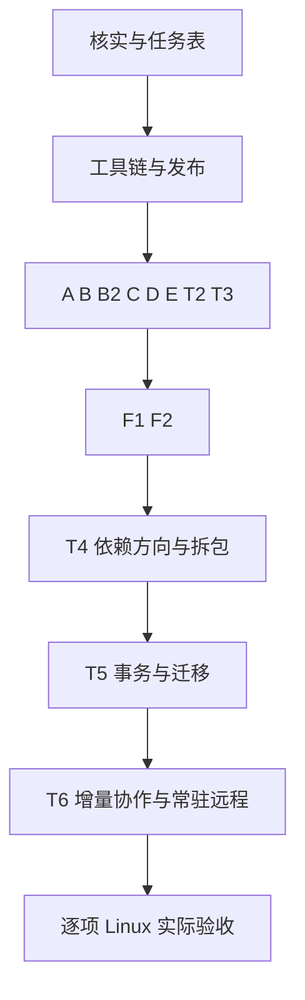

# Design and evidence

## Current architecture and risk

只有一个 workspace 包。单个模块的 import 图无环不等于可以直接搬目录成为无环包：browser/core、workflow/core、planning/session/provider 的双向边存在。现有分支树、CAS 状态写入、任务日志、远端作业派发栅栏均已实现；问题是事务权威和独立模块边界未完成，不能重造另一套执行器或任务系统。

起始工具链为 TypeScript 5.9.3、Vitest 0.34.6、Vite 5.4.21；实际 Undici 7.18.2 要求 Node >=20.18.1，和声明／CI 的 >=20.3.0 冲突。Node API 静态门不能代替依赖下限运行证据。TypeScript 编译器由 graph parser、language scanner、扩展转译和 post-mutation diagnostics 直接消费，移除运行时依赖会损坏产品。此条研究主张予以纠正，保留编译器依赖。

当前静态包 export 宣告 14 个非根入口，但 publisher 只保留 stable index，其余目录被清理。实际导入证实全部失败。公开 SDK／子路径和 CLI 需要共用一个 immutable generation，不能把每条入口独立打包而产生多份 WeakMap／单例。

## Reuse decisions

构建参考的相关决定是：在 TypeScript 类型检查后一次构建多个 ESM entry，共享 chunk；保留 SDK 路径，显式检查动态资源和 worker。采用 shared graph 与 asset 检查；保留本项目现有 build input digest、journal、immutable publication、launcher 和单文件 executable 边界。不照搬较高 Node floor 或参考命名。目标 Node 20.3；Vitest 3.2.7 与 Vite 6.4.6 满足声明下限，显式单 worker 取代旧环境变量约定。

静态检查使用直接依赖的工具和非修改式命令，先启用有实际缺陷检测价值的规则。格式工具可单独运行，批量机械排版不得混在本次行为修改里。门禁自身需要反例，不能只证明当前树“恰好通过”。

首次规则试跑发现 26 项，其中 cleanup finally 的显式未知结果覆盖和 Node 模块内名为 escape 的局部变量不是当前契约下的通用缺陷；这两条高误报规则不纳入首批阻断集，不为通过 lint 改写清理语义。生成器夹具里 throw 后的不可达 yield 删除，异常行为保持。保留重复键／case／参数、不可达语句、const 赋值及 constructor/super 检测；真实重复键反例验证门禁工作。规则集覆盖范围不等于全规则无告警。

存储参考的决定是：追加确认记录、失败 owner 失效、事件化编辑／书签、持久 outbox、连续序号和快照重置。采用其事务与恢复语义，同时保留本项目 fsync、原文件保护、未知派发不重放与单执行边界；不复制其另一语言 daemon。当前独立目录结构先保留，待统一日志契约和迁移器通过后再切换权威。

## Implementation order

核实已完成的任务无需重写，但其缺少的实际消费者或证据仍列入验收。每批实现先给具体契约与失败场景，再由主线程串行运行静态门、合并的定向测试、构建及适用 Linux native／真实模型验证。参考比较只记录决定；源码不跨仓复制、参考仓只读。

## Known remaining risks

消息／缓存增量必须保留原始声明位置，不只维持顶层 tools 不变。Patch 混合删除不能丢失 unsupported 覆盖。codemode 无法读取真实会话时不能静默落到全局内存。RPC 队列模式需修改活跃队列，不能只更改展示配置。阶梯费率必须按请求选档后持久化，不按聚合 usage 再选。异步 UI／遥测必须沿用捕获的 owner。

真实提供方支持受当前配置和服务端能力限制；不以自定义 capability 或 synthetic 应答冒充真实兼容。用户已允许 Linux 真实测试，执行使用已有配置模型；需要人工同意的登录验证如未发生，明确保留缺证据。

## Toolchain publication contract (2026-11-14)

公开入口与CLI由一次shared graph构建，元数据产生静态public.js，stable wrappers经唯一current.js共享运行时。别名由specifier和export name编码，新增入口不会重用旧别名；默认和live binding保留。manifest v3把全部wrapper、声明转发和pack规则绑定到输入与产物；journal v2记录旧字节/模式/不存在状态，兼容旧日志恢复。仅清理旧manifest记录且未被用户改动的managed files，不宽泛清目录。旧build保留在磁盘，dist/.npmignore仅打包当前代，防止安装包携带989代历史。声明目录复制原JSON资源，公开类型的Node依赖随包安装。

边界：静态聚合会提前求值所有公开入口；跨多个文件的导出形状变化无法对任意已运行直接importer原子可见，可能拒绝链接，不能混代或谎称恢复撤销了模块缓存。生产构建b57986b62aa3、本地打包/安装和Node20.3验收已完成；后续源码变化应重新绑定构建证据。首次pack fixture假定npm JSON为数组（npm12为名称对象），以及原生CLI fixture未建立HOME，已修fixture重验，不能作为产品失败或忽略失败。

## Approved patch inspection (2026-11-14)

写前判断复用原prepare/permission/bind/hook/authorize/consume路径，在普通批准后由patch owner重新规划所选组并核对确切revision，再封存完整write/delete目标及相应内容。选择一次设置且禁止重设，异常被hook吞掉也不能扩张授权；delete-only/noop同样需要参数身份。删除不虚构为空内容；supported写判断与unsupported缺口同时存在，unknown/block优先于unsupported，后者优先于ordinary allow。现有锁内原始字节检查仍是实际写入边界。匹配计数使用与实际匹配相同的长度剪枝，保持原始范围和歧义拒绝。
