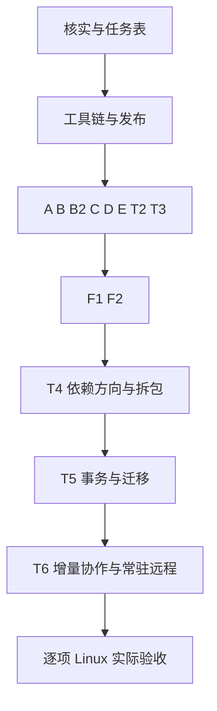

# Design and evidence

## Current architecture and risk

只有一个 workspace 包。单个模块的 import 图无环不等于可以直接搬目录成为无环包：browser/core、workflow/core、planning/session/provider 的双向边存在。现有分支树、CAS 状态写入、任务日志、远端作业派发栅栏均已实现；问题是事务权威和独立模块边界未完成，不能重造另一套执行器或任务系统。

起始工具链为 TypeScript 5.9.3、Vitest 0.34.6、Vite 5.4.21；实际 Undici 7.18.2 要求 Node >=20.18.1，和声明／CI 的 >=20.3.0 冲突。Node API 静态门不能代替依赖下限运行证据。TypeScript 编译器由 graph parser、language scanner、扩展转译和 post-mutation diagnostics 直接消费，移除运行时依赖会损坏产品。此条研究主张予以纠正，保留编译器依赖。

当前静态包 export 宣告 14 个非根入口，但 publisher 只保留 stable index，其余目录被清理。实际导入证实全部失败。公开 SDK／子路径和 CLI 需要共用一个 immutable generation，不能把每条入口独立打包而产生多份 WeakMap／单例。

## Reuse decisions

构建参考的相关决定是：在 TypeScript 类型检查后一次构建多个 ESM entry，共享 chunk；保留 SDK 路径，显式检查动态资源和 worker。采用 shared graph 与 asset 检查；保留本项目现有 build input digest、journal、immutable publication、launcher 和单文件 executable 边界。不照搬较高 Node floor 或参考命名。目标 Node 20.3；Vitest 3.2.7 与 Vite 6.4.6 满足声明下限，显式单 worker 取代旧环境变量约定。

静态检查使用直接依赖的工具和非修改式命令，先启用有实际缺陷检测价值的规则。格式工具可单独运行，批量机械排版不得混在本次行为修改里。门禁自身需要反例，不能只证明当前树“恰好通过”。

首次规则试跑发现 26 项，其中 cleanup finally 的显式未知结果覆盖和 Node 模块内名为 escape 的局部变量不是当前契约下的通用缺陷；这两条高误报规则不纳入首批阻断集，不为通过 lint 改写清理语义。生成器夹具里 throw 后的不可达 yield 删除，异常行为保持。保留重复键／case／参数、不可达语句、const 赋值及 constructor/super 检测；真实重复键反例验证门禁工作。规则集覆盖范围不等于全规则无告警。

存储参考的决定是：追加确认记录、失败 owner 失效、事件化编辑／书签、持久 outbox、连续序号和快照重置。采用其事务与恢复语义，同时保留本项目 fsync、原文件保护、未知派发不重放与单执行边界；不复制其另一语言 daemon。当前独立目录结构先保留，待统一日志契约和迁移器通过后再切换权威。

## Implementation order

核实已完成的任务无需重写，但其缺少的实际消费者或证据仍列入验收。每批实现先给具体契约与失败场景，再由主线程串行运行静态门、合并的定向测试、构建及适用 Linux native／真实模型验证。参考比较只记录决定；源码不跨仓复制、参考仓只读。

## Known remaining risks

消息／缓存增量必须保留原始声明位置，不只维持顶层 tools 不变。Patch 混合删除不能丢失 unsupported 覆盖。codemode 无法读取真实会话时不能静默落到全局内存。RPC 队列模式需修改活跃队列，不能只更改展示配置。阶梯费率必须按请求选档后持久化，不按聚合 usage 再选。异步 UI／遥测必须沿用捕获的 owner。

真实提供方支持受当前配置和服务端能力限制；不以自定义 capability 或 synthetic 应答冒充真实兼容。用户已允许 Linux 真实测试，执行使用已有配置模型；需要人工同意的登录验证如未发生，明确保留缺证据。

## Toolchain publication contract (2026-11-14)

公开入口与CLI由一次shared graph构建，元数据产生静态public.js，stable wrappers经唯一current.js共享运行时。别名由specifier和export name编码，新增入口不会重用旧别名；默认和live binding保留。manifest v3把全部wrapper、声明转发和pack规则绑定到输入与产物；journal v2记录旧字节/模式/不存在状态，兼容旧日志恢复。仅清理旧manifest记录且未被用户改动的managed files，不宽泛清目录。旧build保留在磁盘，dist/.npmignore仅打包当前代，防止安装包携带989代历史。声明目录复制原JSON资源，公开类型的Node依赖随包安装。

边界：静态聚合会提前求值所有公开入口；跨多个文件的导出形状变化无法对任意已运行直接importer原子可见，可能拒绝链接，不能混代或谎称恢复撤销了模块缓存。生产构建b57986b62aa3、本地打包/安装和Node20.3验收已完成；后续源码变化应重新绑定构建证据。首次pack fixture假定npm JSON为数组（npm12为名称对象），以及原生CLI fixture未建立HOME，已修fixture重验，不能作为产品失败或忽略失败。

## Approved patch inspection (2026-11-14)

写前判断复用原prepare/permission/bind/hook/authorize/consume路径，在普通批准后由patch owner重新规划所选组并核对确切revision，再封存完整write/delete目标及相应内容。选择一次设置且禁止重设，异常被hook吞掉也不能扩张授权；delete-only/noop同样需要参数身份。删除不虚构为空内容；supported写判断与unsupported缺口同时存在，unknown/block优先于unsupported，后者优先于ordinary allow。现有锁内原始字节检查仍是实际写入边界。匹配计数使用与实际匹配相同的长度剪枝，保持原始范围和歧义拒绝。

## Branch script storage (2026-11-14)

codemode复用已有会话state锁与transcript追加owner；没有新增全局或第二持久存储。读取真实保存会话失败立即拒绝，无会话的纯脚本可执行，但store写入明确unavailable。活动分支先校验保存的唯一root、ID和完整ancestry，再补齐未入树消息；锁内重读保留无关正规追加，写键CAS和当前预算拒绝冲突。capture保存原始字节长度与SHA256，current/before/confirmed及同一追加FD均重验前缀，避免inode未变却删改旧历史。append/fsync/readback/close后不能确定结果时报告unknown，不重试或伪装回滚。已await嵌套效果不会因后续store失败被擦除；无await调用的更广泛结算和确定性重放保留原独立任务。

## Terminal color admission (2026-11-14)

实际宿主在input-ready后查询OSC10/11/4，启动面adoption复用同一StdinBuffer。协议协商在其前发出并持有自己的DA1 fence，enhanced选择不能提前释放尚未收到的fence；250ms原截止回收匹配前缀，不刷新普通Escape/paste/appearance的独立预算。颜色查询100ms初始等待与晚到快照分离，16色按位置合并、冻结且去重；theme lease拒绝停止或替换后的答案，显式主题与preview优先，AppearanceReports独占DEC997亮暗选择。Linux PTY为真实OS流加受控协议应答；宿主regular/fullscreen生命周期由实际InteractiveMode集成fixture验证，未声称物理终端或真实模型验证。

## Foreground message conversion (2026-11-15)

convertToLlm在prepareRequest之后执行，普通无custom历史保留原身份路径；应用转换捕获有界inert raw与provider结果，持久化/路由保留raw，工具/图片/预算/发送使用provider投影。system文本统一加入请求system字段并参与systemDigest，非文本system明确拒绝。转换路径禁用不成立的raw-index前缀与opening测量证据，whole-request仍绑定raw可投字段摘要及最终wire摘要；该摘要不宣称custom.data等价。重试逐次准备但同raw复用capture，raw变化重新转换并换requestId。reference决定是上下文准备后转换、display与model content独立；本实现复用原loop和request owner，不另建运行时。

输入数组先descriptor检查，输出在Promise解析前捕获。异步合同接受普通native Promise并允许Node附属async context符号；constructor/then覆盖与Promise子类在观察前拒绝，native constructor/species描述符复查。受支持pending工作取消后仍观察迟到拒绝；无法安全观察的拒绝Promise形状由调用方负责，不谎称所有thenable均可处理。SDK追加限于完整run/observer/durable settlement后的idle，写入复用SessionManager。

证据目录为`.omx/artifacts/upgrade-messages-2026-11-14/`；conversion-delivery包含12套件391项、六静态门与build `48bafd6fec4c`，conversion-functions保留结构计数，conversion-native-wire.log为当前构建实际配置模型三次bodySent及重开/取消/复用的通过回执；conversion-native.json保留早期失败诊断。首次取消断言用了shell专属lifecycle.cancelled，新增真实terminal stop_state反例后补早取消分类；旧loop已取消fixture改为接受tool calls后取消，保留配对目标。诊断中跨root配置触发正常重载、global fetch遗漏Undici发送及错误私有符号属于夹具问题，最终通过实际请求onBodySent观察，所有失败日志保留。压缩和声明不在本批验收范围。

## Summary request capture (2026-11-15)

摘要使用相同有界converter叶，先解析summary目标，再转换raw，捕获完整system/history/body/url/shape并纯preflight。分段仍以raw的合法工具关系切分，budget读候选转换tokens；accepted handle被保留，实际send不会再次转换。候选增大、裁剪、merge可分别转换，非单调converter只保证发送已获准候选，不保证找到所有可行投影。prefix/merge独立capture，previousSummary仅第0段；512消息/64段/128发送上限保持。

complete serialized UTF-8限额在handle返回前检查，使工具文本能进入已有clamp；派发再复检。身份只摘要显式非秘密字段和实际body/url，headers不入identity。原compaction ledger追加preparedIdentity；同operation未知派发阻止changed capture绕过，旧含headers的operation不可安全映射，因此legacy unknown/无材料墓碑拒绝新capture，保持原证据和格式。manual/automatic/prefix及branch接通converter，branch复用navigation与connection取消信号，失败转换保持回退可用。

summary-final-suites保留18套件326项，summary-reviewed-gates-build为六静态门/build `5e1c8ee4afbb`，summary-native.json及summary-native-final.log为当前编译SDK配置模型三次actual bodySent、manual verified publication、branch和取消零派发。首次native计数预期单段而实际两段，失败回执单独保留。主请求threshold、候选wire缩小及C.6仍未验收。

## Complete caller compaction preparation (2026-11-15)

CompactionPolicy复用现有owner，加入请求局部prepare、estimateContextTokens及admission；不建立新ledger或全局capture缓存。先惰性捕获caller与operation.source，再准备完整caller决定阈值。stored raw仍决定legal cuts与summary；按caller重建checkpoint、精确tail及offset后准备candidate，统一比较完整estimatedBefore/After，force也不能发布变大的转换。preparedPolicy返回供既有commit与progress使用；async policies不加入旧pending join。

完整standard/custom应用字段均在descriptor-first有界snapshot后比较，storage id/timestamp除外；opening保留既有环境content后缀特例。候选与authority准入同时传给原commit。original prepare可能被owner重复调用，因此生产接线必须按完整inert raw值复用已获准capture，不能按array identity命中。

独立隔离批次`policy-isolated-final.log`为8套件160项、六静态门及build `c0a48b5abd86`；`compaction-source-head-red.log`为15失败/3通过反例。无原生主请求或完整C.3完成声明。未匹配到的segments.test.ts并未被Vitest运行，实际套件数按回执8计。

## Complete request capture (2026-11-15)

turn/context复用原step与attempt owner，提取route、转换结果、动态system/tool声明、图片归一化、closing、完整budget与serialized body。初始loop conversion直接复用；candidate由raw重新route后转换一次。accepted capture直接送出。same raw动态system/schema漂移最多refresh一次且沿用route与conversion；converter引用或purpose改动明确拒发。最终budget重计必须同步清掉旧overflow refusal，input byte拒绝仍独立保留。

purpose、agentMode、active provider/model与auxiliary sink在请求捕获时绑定；发送后的onRequestSent/stream callbacks不得把已发送usage重分到新owner。preflight/callback发生在attempt reservation之前；dispatch内freshness拒绝沿用原confirmUnsent。无新runtime/global capture cache/ledger。

`context-extraction-reviewed.log`为5套件199项、六静态门与build `0a240477cfd4`；限定独立复审CLEAR。该接口不是主请求threshold与candidate durable publication的完成证据。

## Converted foreground compaction admission (2026-11-15)

loop提供有界raw capture与live request owner；临时prepareRequest替换和外部streamStep无durable准入。完整caller capture复用deep value而非array identity，candidate用原prepare owner转换一次，budget／byte refusal和增长都先拒绝，再由原compaction authority提交。stored raw仍是切分和摘要权威，候选获准后同时替换loop与AgentCore当前历史；未建立新ledger或全局缓存。

overflow在生成候选前按下一步allowTools／purpose重建完整合同，消费时按实际调用再次核对，均保留原route与conversion。live fence覆盖声明refresh、reframe、candidate prepare的前后，并固定于step内部HTTP及effort fallback重试。持久writer不保存stopReason/errorMessage，因此authority明确排除这些瞬时字段，application metadata/origin等继续严格比较；applyCompaction补齐存储reader已有contextSummary marker以允许第二次压缩。manual从foreground实际prompt/tools/skills/thinking组装完整request，保留已解析serviceTier。

`context-wiring-reviewed.log`记录17套件446项、六静态门、函数上限及build `fed3b0f8c0d2`。`context-native.json`/`context-native-second.log`记录该编译产物Linux SDK配置模型7次actual bodySent，automatic候选、manual verified commit、实际rewind后重开和取消零派发通过，隐藏raw未送出。storage首次夹具使用不存在的constructor参数并遗漏实际prompt barrier，native首次转换规则误将历史自动prompt视为当前主请求，修正夹具后通过，失败日志保留。普通无converter/custom路径仍为早期policy，须下一批接通，不扩大本批CLEAR或Linux证据范围。

## Ordinary request preparation (2026-11-15)

完整准备能力由原StepFunction声明，handoff与delegated wrappers传递能力；普通请求也等到实际路由、system、schemas和最终body捕获后才决定压缩。候选raw归属由原RequestContextOwner接纳，providerMessages是否存在独立决定转换路径与测量对齐；goal closing不能因为sourceMessages存在而用空provider数组覆盖原history。

一次性compaction prepare与每次有效capture通知分离。native effort fallback可能再次route，latest bare capture必须到session recovery；原request owner在step内仍限制native prepare/refresh/dispatch。恢复时failed assistant的追加正常退休旧owner，因此不可把其fenced wrapper存为新恢复的准备源。恢复继续按显式next closing合同reframe，不重做相同raw转换。

`ordinary-retry-red.log`为两补充反例，`ordinary-delivery.log`为六静态门、16套件356项和build `c7e760063e80`；限定独立复核CLEAR。`ordinary-native-fifth.log`/`ordinary-native.json`为当前编译SDK配置模型6次actual bodySent、普通automatic verified commit和重开。首次6k窗口无法容纳系统开销、55s多段摘要截止及错误内部字段均保留诊断，最终只调整fixture数据与时限。两个tool discovery夹具在独立HEAD相同失败，full模式夹具提交`dae1b97`单列。C.6和完整C.3联合验收继续保留。

## Request declaration storage (2026-11-15)

声明由core/agent/declarations拥有版本1中立合同，完整function schema、provider/model/endpoint及非秘密64hex replayBinding和实际mapped effort；消息本身拥有ID／timestamp／顺序。仅空文本system载体允许声明，custom和错误role拒绝。复用既有inert snapshot，4MiB／100k nodes／depth40／4096 tools，显式undefined、访问器、proxy、serialization hook、循环、稀疏数组、非法schema或重复名称拒绝。双向message codec显式列出声明；reader把损坏声明判unreadable，不能静默去掉新字段。

声明沿用custom的append→metadata→state→live顺序，不新增writer。公开encode在序列化前捕获message，两种append在创建header／open前完成一次编码；实际写入后unknown错误保留原磁盘事实。直接入口三场景反例确实失败于`declarations-write-counterexample.log`，错误npm启动另保留`declarations-write-red.log`，不计测试执行。首轮两失败是旧createNew对象不跟随loadSession重新投影的夹具问题；改为实际当前manager对象并保留独立reopen／fork／顺序断言。最终`declarations-data-delivery.log`为六静态门、5套件93项和build `cd08cabeb2bf`，限定独立复核CLEAR。实际请求发布、协议历史投影和compaction spine属于后续批次，C.6仍部分。实际L，额外依赖1（公开append边界），结构复用既有storage及snapshot；无原生provider完成声明。

## Historical declaration projection (2026-11-15)

协议前carrier保留完整声明与id，普通system文本仍进入system prompt，声明不被system filter删除。converter可以多对多改变普通内容，但须每个声明恰好一次、原id／payload／role／空content和声明顺序一致；不能凭raw索引事后补位置，也不声称该检查能证明普通prose未跨边界移动。raw、provider reuse和converter output都在通用snapshot前严格捕获，step入口在preparation try内先capture再spread，避免undefined先被抹掉或getter先执行。raw digest保留旧无声明历史哈希，新增声明内容纳入身份；local fallback计量包含schema，最终完整wire重新估算涵盖原生controls。

native协议使用最后连续provider/model/endpoint/replayBinding段中的首个声明为固定tools baseline，随后相邻完整快照产生schema替换／删除／恢复增量。每个marker的工具／effort更新合并，协议先暂存到下一实际非空assistant或尾部；真实toChatMessages仅在工具结果未齐时跨过silent assistant，保留旧独立empty消息合同。不支持native的protocol忽略carrier。closing仅撤下当前schemas和工具control，raw/runtime不记removal；空baseline不发送deferred placeholder。没有原生auto reset的证据，active auto不发thinking／effort；历史含auto且当前explicit时回退当前numeric thinking，tools仍native，该转场不承诺缓存前缀稳定。

定向参考采用raw声明边界及pending到实际assistant两项决定；参考assistant metadata／尾部effort临时marker不满足本项目durable要求，因此不直接采用。`declarations-protocol-red.log`为7failed/1passed，`declarations-carrier-red.log`为9failed/6passed，`declarations-projection-review-red.log`为两补充失败／一已有拒绝。最终`declarations-protocol-delivery.log`为六静态门、13套件337项、build `2a1feaebbaa4`和函数上限0超限，限定独立复核CLEAR。前两次夹具未知端点名／固定conversation计数失败已保留。发送前发布与压缩spine按独立owner拆为下一两批，减少未提交范围；C.6仍部分，无实际provider完成声明。
