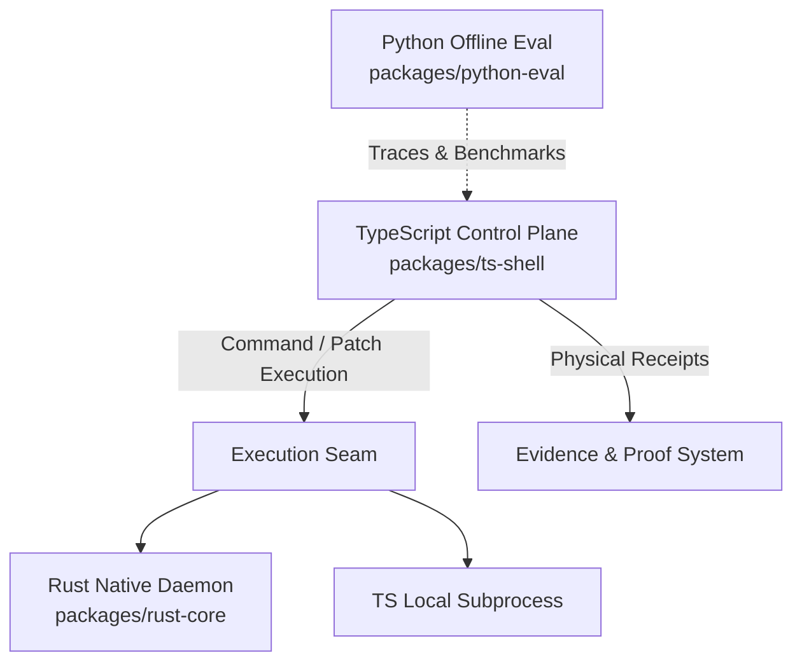

# Three-Layer Agent Architecture

The `coding-agents` system is structured into three distinct runtime layers to maximize flexibility, safety, and performance.

## Layer Breakdown

### 1. TypeScript Control Plane (`packages/ts-shell`)
TypeScript owns all high-level product responsibilities:
- Interactive CLI and shell surface
- [[evidence-and-proof-system|Evidence & Proof System]] ([Evidence & Proof System](../concepts/evidence-and-proof-system.md))
- Task execution loop (`QueryEngine`, stage transitions, route decisions)
- Context discovery and code acquisition
- Patch generation, reviewed workspace apply, and multi-hypothesis repair loops
- Session lifecycle, continuity compaction, and replay

### 2. Native Executor Candidate (`packages/rust-core`)
Rust is designated for low-level process guarantees:
- Daemon lifecycle and OS-level execution isolation
- Cancellation, timeouts, and process-tree management
- Sandbox preflight and security-sensitive command execution

### 3. Offline Evaluation (`packages/python-eval`)
Python is strictly isolated to offline evaluation:
- Benchmark harness (e.g. SWE-bench, synthetic evaluations)
- Run-trace analysis and metric scoring
- Does not own online agent lifecycle or production execution

## See Also

- [[evidence-and-proof-system|Evidence & Proof System]] ([Evidence & Proof System](../concepts/evidence-and-proof-system.md))
- [[normproof-structural-governance|NormProof Structural Governance]] ([NormProof Structural Governance](../topics/normproof-structural-governance.md))
- [[local-reference-repositories|Local Reference Repositories]] ([Local Reference Repositories](../references/local-reference-repositories.md))

## Sources

- [Coding Agents Architecture and Sprint Overview](../../raw/notes/2026-08-28-architecture-and-sprint-overview.md) — Layer separation and ownership rules
