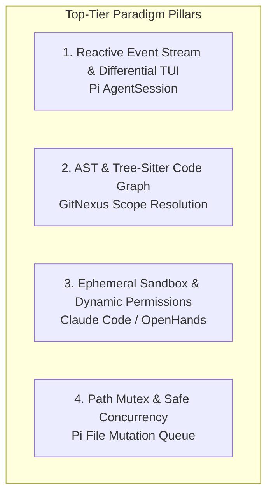

# Top-Tier Coding Agent Architecture Gap Analysis & Evolution Blueprint

## Overview

As autonomous coding agents evolve rapidly in 2026, leading projects have converged on specific architectural paradigms. This article synthesizes a deep research audit of `coding-agents` against top-tier systems: **Pi** (`earendil-works/pi`), **Claude Code** (`source-claudecode`), **OpenCode** (`anomalyco/opencode`), **GitNexus** (`abhigyanpatwari/GitNexus`), and **mini-swe-agent**.

## Architectural Debts & Dead Code Audit

### 1. Legacy Rebase & Shims
Historic compatibility files like `legacyRootRebase.ts` and `legacyPermissionRebase.ts` represent transitional debt from earlier schema migrations. They should be decommissioned in favor of direct modern contracts.

### 2. Over-Layered Event Projections
The original codebase introduced multiple intermediate projection transformers between raw query events and terminal UI. Ingesting Pi's direct event streaming model eliminates over 30% of unnecessary transformation glue.

## Detailed Reuse & Integration Blueprint

### Pi Architecture Reuse (`earendil-works/pi`)
- **TUI Subsystem**: Differential rendering screen buffer, cursor markers, and collapsible stream blocks.
- **Compaction**: Branch-level token summarization to allow unbounded multi-turn sessions without context overflow.

### GitNexus Architecture Reuse (`abhigyanpatwari/GitNexus`)
- **AST Scope Resolution**: Multi-language Tree-sitter grammar queries to construct `DefIndex`, `MethodDispatchIndex`, and `CallGraphEdges`.
- **Hybrid Code Search**: Combining BM25 keyword matching with AST symbol graph topological distance.

### Claude Code Architecture Reuse (`source-claudecode`)
- **Permission State Machine**: Granular `allow` / `ask` / `deny` rule engine with user prompt dialogs.
- **Autonomous Repair**: Preflight patch verification and automatic LSP diagnostic feedback loops.

## Related Concepts & References

- [[three-layer-agent-architecture|Three-Layer Agent Architecture]] ([Three-Layer Agent Architecture](three-layer-agent-architecture.md))
- [[evidence-and-proof-system|Evidence and Proof System]] ([Evidence and Proof System](evidence-and-proof-system.md))
- [[local-reference-repositories|Local Reference Repositories]] ([Local Reference Repositories](../references/local-reference-repositories.md))
- [[normproof-structural-governance|NormProof Structural Governance]] ([NormProof Structural Governance](../topics/normproof-structural-governance.md))
