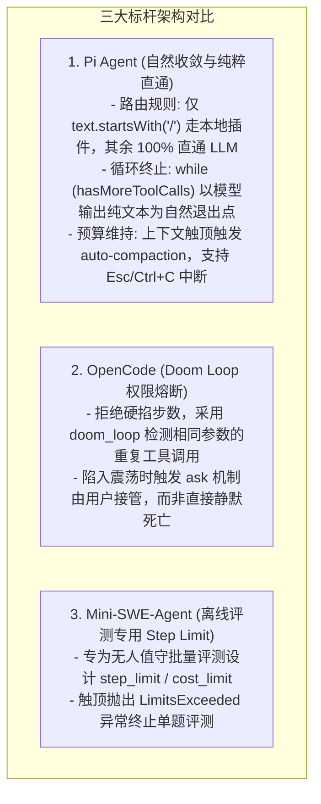
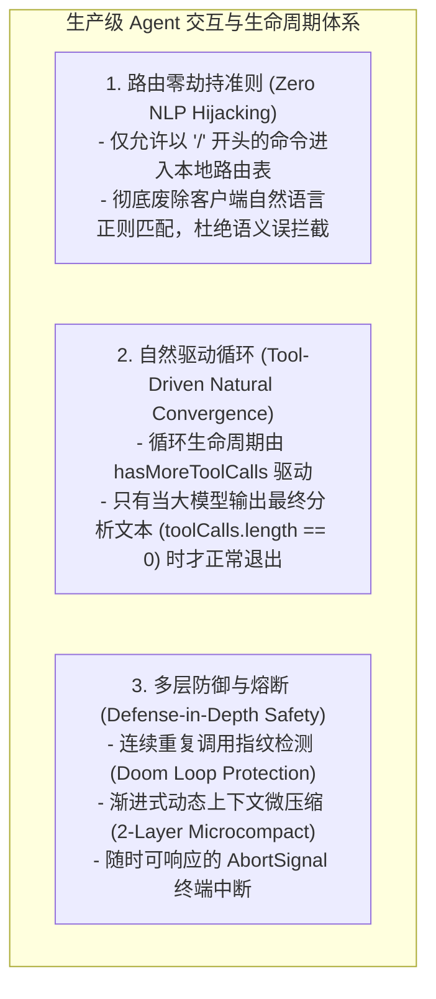

# SOTA AI Coding Agent 循环生命周期、交互路由与死循环防御演进

> **所属知识库**：`.wiki/wiki/theses/`  
> **关联模块**：`packages/ts-shell/src/core/query/agentLoop.ts`, `packages/ts-shell/src/cli/interactive/interactiveCommandRouter.ts`, `packages/ts-shell/src/entrypoints/cliWorkspaceModule.ts`  
> **更新时间**：2026-08-30  

---

## 摘要

在 AI Coding Agent 的工程化落地中，**客户端交互路由（Interactive Command Routing）**、**Agent 主执行循环（Agentic Execution Loop）** 与 **死循环安全防御（Doom Loop Protection）** 是决定用户体验与系统稳定性的核心枢纽。

早期实现或粗糙脚手架常常陷入两个典型陷阱：
1. **客户端过度正则拦截（Client-Side Prompt Hijacking）**：在客户端用模糊正则表达式拦截自然语言，导致用户正常的问答意图被误判为本地 Shell 命令并短路返回静态文本；
2. **硬编码低轮次截断（Premature MaxTurns Break）**：机械套用离线评测基准（如 SWE-bench）的 `step_limit`，在固定轮次强行中断循环，导致 Agent 深度调用多轮工具搜集完上下文后，未及生成最终回答便哑火退出。

本文深入解构了 **Pi (`pi`)**、**OpenCode (`opencode`)** 与 **Mini-SWE-Agent (`mini-swe-agent`)** 的真实源码实现，提炼出前沿 Agent 体系的设计准则，并建立了生产级循环生命周期规范。

---

## 一、 标杆项目设计模式横向深度解构



### 1. Pi Agent：纯粹的 Slash 前缀路由与模型自然收敛
在 `pi/packages/coding-agent/src/core/agent-session.ts` 中：
```typescript
// 严格的 Slash 前缀判定
if (expandPromptTemplates && text.startsWith("/")) {
    const handled = await this._tryExecuteExtensionCommand(text);
    if (handled) return;
}
// 任何自然语言文本，100% 原汁原味投递至大模型
```
在 `pi/packages/agent/src/agent-loop.ts` 中：
```typescript
// 循环由工具调用驱动，大模型不发工具调用时自然结束
while (hasMoreToolCalls || pendingMessages.length > 0) {
    const message = await streamAssistantResponse(...);
    const toolCalls = message.content.filter((c) => c.type === "toolCall");
    if (toolCalls.length > 0) {
        const executed = await executeToolCalls(...);
        hasMoreToolCalls = !executed.terminate;
    } else {
        hasMoreToolCalls = false; // 大模型输出了最终文本，自然退出
    }
}
```
**核心哲学**：不人为设置狭隘的硬性轮次中断。模型需要搜集多少次材料就让它搜集多少次，依靠上下文自动压缩（Auto-Compaction）控制内存与窗口，依靠用户中断（AbortSignal）控制随时叫停。

### 2. OpenCode：基于行为指纹的 `doom_loop` 智能防护
OpenCode 没有简单粗暴地限制“只能走 6 步”，而是通过跟踪工具调用历史识别真正的死循环：
- **`doom_loop` 规则**：*“Detect repeated tool calls with identical input”*；
- **防护机制**：当同一个工具（如 `grep` 或 `edit`）以完全相同的参数被连续调用 3 次以上且报错时，判定为陷入逻辑死锁，将权限从 `allow` 降级为 `ask`，提示用户：“检测到死循环，是否继续执行？”。

### 3. Mini-SWE-Agent：离线自动化评测的成本熔断
在 `mini-swe-agent` 中：
- `step_limit` 与 `cost_limit` 的存在是为了在无人值守运行几百道 SWE-bench 评测题目时，防止单道题因模型死循环而消耗几百美元 API 额度；
- **这种设计绝不能无脑套用到人类交互式 CLI 场景中**。

---

## 二、 生产级交互与循环生命周期架构准则



### 必须坚守的三大重构准则：

1. **路由纯洁性（Zero NLP Hijacking）**：
   - 彻底废除 `isWorkspaceInfoPromptStrict` 等客户端自然语言正则探测逻辑；
   - 客户端仅识别显式声明的 Slash 命令（`/cd`, `/log`, `/review`, `/model` 等）。
2. **模型自然收敛与文本交付保障（Delivery Guarantee）**：
   - 允许大模型根据任务复杂度自主决定工具调用次数；
   - 严禁在工具执行完毕后直接掐断循环；若触发外部安全阈值，必须强制保留一轮无工具的文本生成轮（Reporting Turn），确保大模型把探索事实组织成 Markdown 报告呈现给开发者。
3. **行为级死循环熔断（Behavior-Aware Loop Defense）**：
   - 废弃单纯基于静态轮数（`turn >= 6`）的粗暴截断；
   - 采用调用特征哈希（Tool Name + Arguments Hash）检测工具调用的震荡与停滞。
