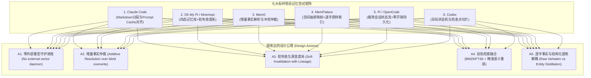
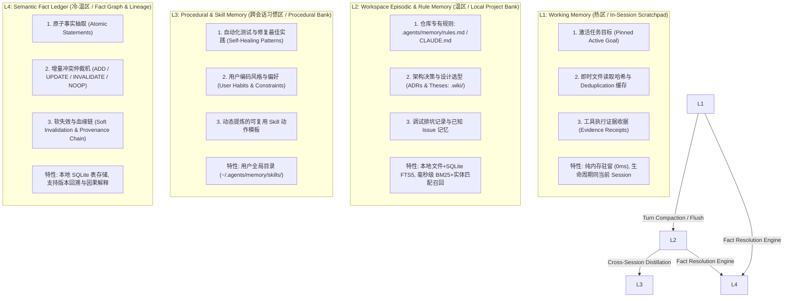
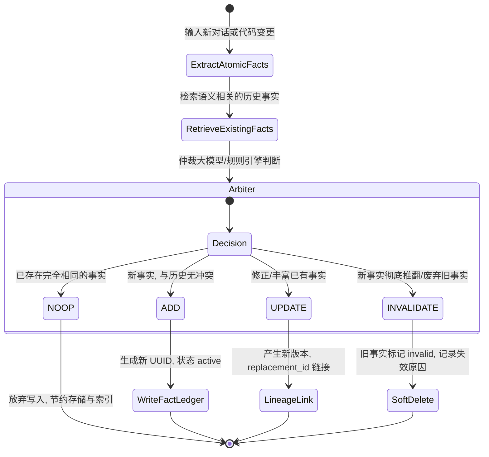
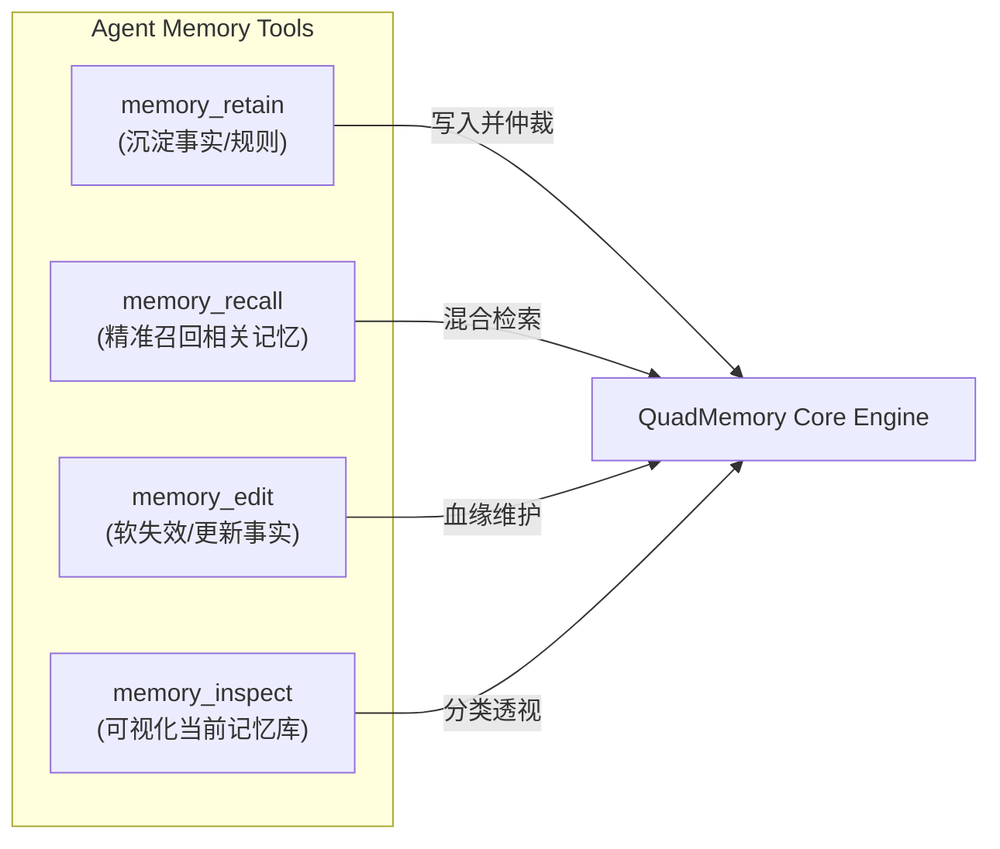

# 原生多层渐进式记忆架构 (Native Progressive Memory Architecture)

> **核心使命**：对标业界七大顶级 Agent 与 Memory 标杆（**Claude Code**、**Pi / Oh My Pi (Mnemopi)**、**OpenCode**、**Codex**、**DeepSeek-Harness**，以及专项记忆系统 **Mem0**、**MemPalace**），提炼各大系统的底层精髓，坚决拒绝无脑代码缝合与过度抽象，为当前 Coding Agent 打造一套高内聚、低开销、零外部重型依赖的原生四层渐进式记忆体系（**Native QuadMemory Architecture**）。

---

## 一、 七大顶尖项目记忆体系深度解构与横向矩阵



### 1.1 各项目核心设计精髓与痛点排查

| 项目 | 核心设计哲学 | 突出优势 (Absorb) | 缺陷/过度设计 (Avoid) |
| :--- | :--- | :--- | :--- |
| **Claude Code** | 分层 Markdown（`~/.claude/CLAUDE.md` + 局部 `CLAUDE.md` + 自动记忆 `/memory`） | 1. 纯文本人类可读可编；<br>2. 极佳的 Prompt Cache 命中率；<br>3. 会话压缩（Compaction）与内存同步机制。 | 缺乏结构化事实关系检索，记忆条目膨胀后难以精准剪裁，全量注入消耗上下文。 |
| **Oh My Pi (Mnemopi / Beam)** | 本地 SQLite + 四态分类（事实/工作/技能/偶发）+ 软失效链（`replacement_id`） | 1. 记忆版本化演进，保留决策历史溯源；<br>2. `retain`/`recall`/`reflect`/`memory_edit` 语义化工具集；<br>3. 本地嵌入与快速分词。 | 跨层级依赖较深，重度依赖复杂的向量后端抽象，冷启动索引构建较重。 |
| **Mem0** | 增量事实抽取（Additive Extraction）+ 状态仲裁机（ADD / UPDATE / DELETE / NOOP） | 1. 极其优雅的事实冲突仲裁算法；<br>2. 实体关系抽取与权重加成（Entity Boosting）；<br>3. 多租户范围隔离（User / Agent / Session）。 | 严重依赖昂贵的大模型多轮抽取与外部向量数据库集群（Qdrant/Pinecone/Milvus），对本地 CLI Agent 过重。 |
| **MemPalace** | 空间记忆宫殿（Wing $\rightarrow$ Room $\rightarrow$ Closet $\rightarrow$ Drawer）+ 纯逐字原样存储 | 1. “从不总结”（No summaries. Ever.），杜绝压缩幻觉与关键信息丢失；<br>2. 纯 SQLite FTS5 全文检索引擎，零外部依赖，毫秒级召回；<br>3. 主题通道（Hallways/Topic Tunnels）。 | 空间命名层级（Wing/Room）概念抽象对通用代码推理有心智负担，缺乏高维抽象事实的提纯能力。 |
| **Codex** | 状态机目标驱动（Goal Mode）与阶段快照 | 1. 记忆围绕“目标达成”组织；<br>2. 阶段性产物（Artifacts）作为持久化锚点。 | 跨任务（Cross-Session）长期经验迁移能力较弱。 |

---

## 二、 拒绝缝合：原生四层渐进式记忆架构 (Native QuadMemory)

结合 Coding Agent 的开发特性（高频文件操作、多轮调试、长期代码库规范、跨会话偏好），我们提出**四层渐进式记忆分层模型**：



---

## 三、 核心技术机制设计

### 3.1 增量事实抽取与冲突仲裁机 (Additive Resolution Engine)

借鉴 **Mem0** 的增量仲裁精髓与 **Mnemopi** 的软失效机制，当 Agent 触发事实沉淀时，不进行暴力覆盖，而是执行四状态仲裁：



#### 仲裁状态定义与数据结构 (TypeScript 原生定义)：
```typescript
export type FactStatus = "active" | "invalidated" | "superseded";

export interface MemoryFact {
  readonly id: string;               // 唯一事实 ID (fact_xxxx)
  readonly statement: string;        // 原子事实陈述 ("Project uses pnpm and vitest")
  readonly category: "architecture" | "preference" | "constraint" | "bugfix" | "convention";
  readonly scope: "project" | "global";
  readonly confidence: number;       // 置信度 (0.0 ~ 1.0)
  readonly sourceTurnId?: string;    // 来源会话 Turn
  readonly createdAt: number;
  readonly updatedAt: number;
  readonly status: FactStatus;
  readonly supersededBy?: string;    // 指向替代该事实的新 factId
  readonly invalidationReason?: string; // 废弃/失效原因
}
```

### 3.2 零依赖的双轨混合检索 (Dual-Track Hybrid Retrieval)

为了彻底摆脱外部向量数据库（如 Qdrant、Chroma、Milvus）守护进程的安装与内存占用痛点，采用**双轨混合检索引擎**：
1. **轨道 1 (BM25 / FTS5 快速词法召回)**：
   - 基于 SQLite 原生 `FTS5` 全文检索引擎，针对 `statement` 与 `category` 建立分词倒排索引。
   - 响应时间 $< 2\text{ms}$，极度擅长精确术语（如 `vitest`、`NormProof`、`BrowserSessionManager`）定位。
2. **轨道 2 (实体关系增强 Entity Boosting)**：
   - 提取查询中的代码实体（类名、函数名、模块路径、环境变量名）。
   - 若事实的实体匹配度高，给予 $\alpha \times \text{Score}_{\text{entity}}$ 权重提权。
3. **综合打分公式**：
   $$\text{FinalScore} = \text{Score}_{\text{BM25}} \cdot (1 + \beta \cdot \text{Confidence}) + \gamma \cdot \text{EntityMatchBonus} - \delta \cdot \text{AgeDecay}$$
   - 支持根据时间（`AgeDecay`）对陈旧、未被引用的记忆进行轻微衰减，确保新鲜度。

---

## 四、 极简且完备的内置 Memory 工具集

对齐 Agent 的日常感知与推理循环，提供 4 个高内聚工具：



1. **`memory_retain`**：
   - **输入**：`{ items: Array<{ statement: string, category: string, scope?: "project" | "global" }> }`
   - **语义**：将当前会话中确认的核心规范、技术选型或排坑经验提交到事实账本，触发增量仲裁。
2. **`memory_recall`**：
   - **输入**：`{ query: string, category?: string, limit?: number }`
   - **语义**：返回按相关度排序的活动（`active`）记忆，自动过滤已失效条目。
3. **`memory_edit`**：
   - **输入**：`{ id: string, op: "update" | "invalidate", replacement?: string, reason?: string }`
   - **语义**：显式更新或标记某条历史记忆失效，维护版本血缘。
4. **`memory_inspect`**：
   - **输入**：`{ scope?: "project" | "global" }`
   - **语义**：结构化展示当前记忆库统计（规则数、各分类条目数、失效历史）。

---

## 五、 工程落地与架构规范 (NormProof & Repo Alignment)

1. **零外部重型依赖**：纯 TypeScript 原生驱动 + SQLite 本地存储，轻量无感。
2. **单文件单一职责与上限约束**：
   - `core/memory/types.ts`：实体类型与仲裁接口定义。
   - `core/memory/memoryStore.ts`：SQLite 存储与 FTS5 检索适配。
   - `core/memory/factArbiter.ts`：增量事实解析与冲突仲裁机。
   - `core/memory/hybridRetriever.ts`：BM25 + 实体加权混合检索器。
   - `core/commands/memoryCommandRuntime.ts`：提供 `/memory` 交互式诊断与管理命令。
3. **与会话 Compaction 的无缝对接**：
   - 会话发生 Layer-2 Compaction（`/compact`）时，自动触发 Working Memory 中的关键事实沉淀至 L2/L4 账本，确保记忆永不随上下文裁剪而丢失。
