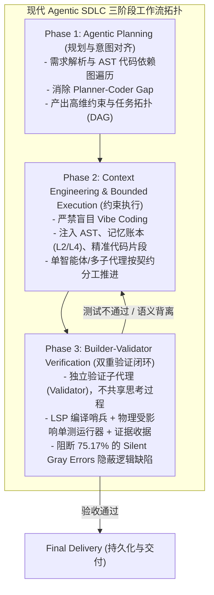
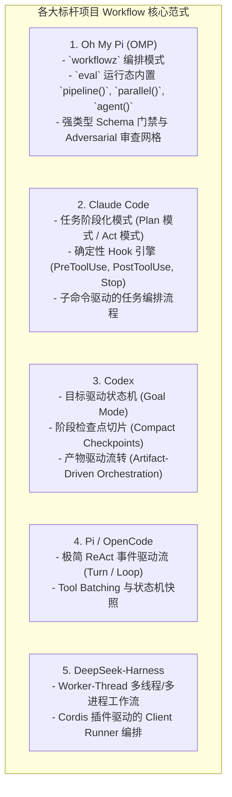

# AI Coding Agent 工作流（Workflow）全景理论与各大顶尖项目实现深度解构

> **前沿洞察**：根据 2026 年业界最新前沿研究（UC Berkeley MAST 研究、Galileo、TestQuality 及 MIT NANDA 报告），AI 编码进入 2026 年的最大转折点是**从“无约束直出代码（Vibe Coding）”全面转向“结构化、闭环验证的 Agent 工作流（Agentic Workflow / SDLC）”**。
>
> 统计表明：**75.3% 的多智能体失败源于“规划-编码断层（Planner-Coder Gap）”**，且 **75.17% 的缺陷属于隐蔽的语义/业务逻辑错误（Silent Gray Errors）**（即代码能编译、能通过静态检查，但在业务逻辑上完全走偏）。引入严密编排的工作流与构建者-验证者链（Builder-Validator Chain）可直接**降低 3.2 倍的失败率**，任务成功率绝对提升 **+15.6%**。

---

## 一、 核心概念：什么是 AI Coding Agent 的 Workflow？

在现代 Agent 架构中，**Workflow（工作流）** 指的是：**将原本模糊、单一的大模型自由生成过程，拆解为具有明确状态转移、上下文工程约束、多智能体协同与强物理验证闭环的确定性执行图（DAG / State Machine）**。

---

## 二、 各大顶尖项目如何实现 Workflow？横向全景解构

我们结合 **Serena MCP** 与源码深入排查了各个顶尖开源项目的实现机制：

### 2.1 各项目核心实现深度对比

| 顶级项目 | 架构模型 | 核心实现与文件位置 | 优势与设计精髓 |
| :--- | :--- | :--- | :--- |
| **Oh My Pi (OMP)** | **脚本化 DAG / 并行多 Subagent 编排网格** | `modes/workflow.ts` `modes/orchestrate.ts` `prompts/system/workflow-notice.md` | 1. 在 `eval` 环境原生注入 `parallel(thunks)`、`pipeline(items, ...stages)`、`agent(prompt, {schema})`； 2. 支持 **Adversarial Verification（对抗验证）**：先让审查代理提缺陷，再派验证代理反驳（Refute），确认无误才合并； 3. 强 Schema 驱动，分支基于结构化 JSON，杜绝文本解析偏差。 |
| **Claude Code** | **模式双轨制（Plan / Act）+ 生命周期 Hook 管道** | `QueryEngine.ts` `commands/compact.ts` `core/hooks/` | 1. 严格区分**只读 Plan 阶段**（禁止任何写操作，生成结构化步骤）与 **Act 执行阶段**； 2. 每次工具调用前后触发 Lifecycle Hook 形成严密把关； 3. 会话压缩（Compaction）自动保存阶段锚点。 |
| **Codex** | **Goal 模式状态机 + 产物锚点机制** | `codex-rs/core/tools/orchestrator.rs` `templates/agents/orchestrator.md` | 1. 将大型工作流建模为 **Goal 状态机**（`pending` $\rightarrow$ `in_progress` $\rightarrow$ `evaluating` $\rightarrow$ `completed`）； 2. 阶段性产物（Artifacts）作为状态流转的物理凭证。 |
| **DeepSeek-Harness** | **Worker-Thread / 多线程分布式流水线** | `packages/workflow/` `workflow-worker-thread/` `tool-workflow/` | 1. 采用多 Worker-Thread 隔离运行不同 Stage； 2. 适合高密集计算与多任务并发管道。 |
| **Pi / OpenCode** | **轻量事件循环 + Tool Batch 流水线** | `agent-session.ts` `toolBatchDispatch.ts` | 1. 极简轻量，单次 Turn 批量分发多个独立 Tool Call 并保证执行顺序； 2. 零外部黑盒，高度透明。 |

---

## 三、 本项目原生 Workflow 架构现状与演进规划

在我们本项目的 `packages/ts-shell/src/` 中，已经沉淀了扎实的工作流底座：
1. **意图与规划层**：`planning/workflowTaskPlan.ts`、`orchestration/workflowTaskPlanner.ts`（负责任务意图解析与任务拆解）；
2. **协调与状态机层**：`runtime/workflowExecutionCoordinator.ts`（负责状态机生命周期调度）；
3. **验证与 Hook 护栏**：`core/hooks/hookDispatcher.ts`、`postMutationLspGuard.ts`、`affectedUnitTestRunner.ts`、`evidenceReceiptCollector.ts`（负责编译、单测与物理证据收集）；
4. **工作流命令入口**：`/goal`（目标状态机）、`/loop`（自动修复回路）、`/todo`（任务清单）。

---

## 四、 提炼与总结：构建顶级 Coding Agent 工作流的核心准则

1. **消除规划-编码断层（Close the Planner-Coder Gap）**：在进入写代码阶段前，必须有独立的上下文工程与意图锚定（AST、依赖图、L2/L4 记忆），不写无约束代码；
2. **构建者-验证者分离（Builder-Validator Separation）**：负责写代码的 Agent 与负责测试/审查的 Agent 分离，杜绝“自己证明自己正确”导致的隐蔽逻辑漏洞；
3. **强类型数据流（Structured Artifacts over Prose）**：各 Stage 之间通过结构化 Schema / 状态对象传递上下文，而不是传递非结构化散文；
4. **确定性物理证据（Deterministic Evidence Receipts）**：只有真实通过的编译器检查、真实运行通过的测试用例、明确的 Git Diff 才能作为阶段完成的充要条件。
