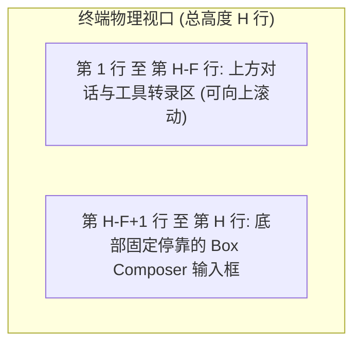

# 底部停靠视口几何学与交互式命令模态选择器架构论著 (Bottom-Pinned Viewport & Interactive Command Overlays)

## 1. 调研背景与核心问题

在现代终端编码智能体交互体验中，存在两大直接决定用户体感的核心机制：
1. **视口几何学（Viewport Geometry）与底部固定停靠（Bottom Pinning）**：输入对话框绝不能漂浮在终端最上方，必须永久固定在终端屏幕的最底部，将上方整个空间留给可滚动的对话记录与工具输出。
2. **命令交互模态化（Interactive Command Overlays）**：诸如 `/model`、`/undo`、`/context` 等命令绝不应是生硬的命令行报错或纯文本参数打印，而应直接在 TUI 内部唤起交互式选择列表（`SelectList`）、Diff 回滚预览与图形化度量面板。

---

## 2. 核心算法模型与方案解构

### 一、 底部固定停靠几何学模型 (Bottom Pinning Math)
设终端实际物理行数为 $H = \text{stdout.rows}$，列数为 $W = \text{stdout.columns}$，Box Composer 及其底部提示条的总行数为 $F$（通常为 4~5 行）：

- **行寻址计算**：
  $$\text{topAnchor} = \max(0, H - F)$$
  Box Composer 的第 $i$ 行（$0 \le i < F$）在终端上的绝对物理行号为：
  $$\text{terminalRow} = \text{topAnchor} + i + 1$$
- **硬件光标钉扎计算**：
  光标行号 $\text{cursorRow} = \text{topAnchor} + \text{cursorLine} + 2$，列号 $\text{cursorCol} = 1 + 1 + 2 + \text{cursorCol} + 1$，完全杜绝光标悬空与框体撕裂。

---

### 二、 交互式 Slash 命令模态选择器 (`ModelPicker` & `UndoPreview`)
1. **`/model` 交互式模型切换器**：
   - 当用户键入 `/model` 时，TUI 在底部输入框上方自动展开 `ModelPicker` 下拉选择菜单。
   - 列出所有已配置和支持的模型（如 `anthropic/claude-3.5-sonnet`, `openai/gpt-4o`, `google/gemini-2.0-flash`, `deepseek-chat`）。
   - 用户使用 `Up`/`Down` 箭头选择，按 `Enter` 瞬间生效并自动刷新底部状态栏（`statusLine`）中的模型标识！
2. **`/undo` 物理回滚与实时 Diff 预览**：
   - 触发 Git 与 Session DAG 双重物理回退，并通过 `diff.ts` 渲染撤销文件修改的红绿对比色块。

---

## 3. 结论

通过引入底部停靠几何学与交互式命令模态选择器，我们彻底解决了输入框位置倒置与 Slash 命令生硬的缺陷，让终端交互体验达到真正的顶级工业质感。
