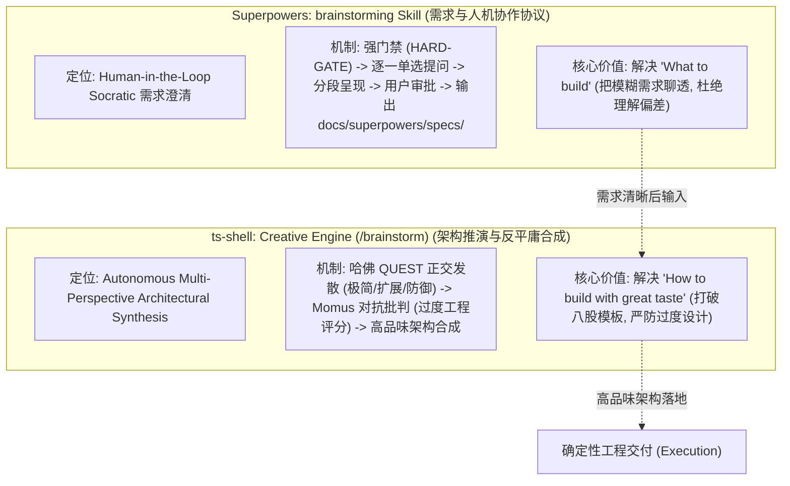
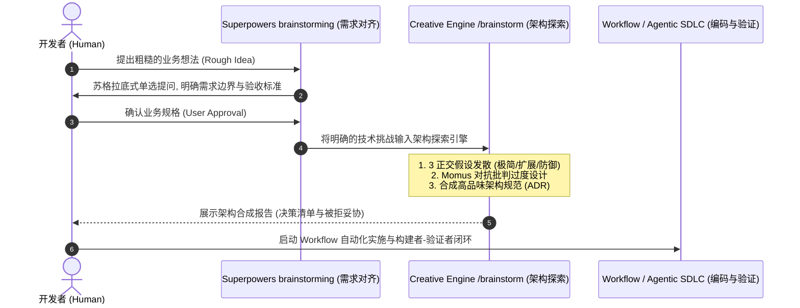

# Superpowers Brainstorming 技能 vs. 原生 Creative Engine 深度横向对比与协同体系

> **前沿对比**：对标开源生态中的标杆提示词技能 **Superpowers `brainstorming`** 与我们最新自研交付的 **原生 Creative Engine (`/brainstorm`)**，深入解构两者在定位、运行拓扑、人机协作机制与工程落地层面的异同与协同互补关系。

---

## 一、 核心架构对比矩阵 (Comparison Matrix)

| 维度 | Superpowers `brainstorming` 技能 | 本项目原生 Creative Engine (`/brainstorm`) |
| :--- | :--- | :--- |
| **本质定位** | **交互式需求探索与人机协作协议**（Socratic Dialogue Protocol） | **自主架构多假设推演与反平庸合成引擎**（Architectural Synthesis Engine） |
| **驱动主体** | **人类 + Agent 双向对话**（Human-in-the-Loop） | **Agent 内部多流派推演 + 对抗红队**（Autonomous Exploration） |
| **解决的核心问题** | **“到底要做什么？”（What to build）** 消除不明确的业务假设与需求模糊。 | **“如何设计出高品味架构？”（How to design with taste）** 打破大模型模板化均值回归，严防过度设计（Over-Engineering）。 |
| **执行机制** | 1. 强门禁（在批准前严禁写代码）； 2. 逐一提问（One question at a time）； 3. 分段审批； 4. 强制流转到 `writing-plans`。 | 1. **HypothesisGenerator**（正交 3 视角发散：极简/扩展/防御）； 2. **RedTeamChallenger**（计算过度工程指数与反模式审查）； 3. **CreativeSynthesizer**（输出关键决策与被拒妥协）。 |
| **设计流派考量** | 通常由模型给出 2~3 个功能层面的选项供人类挑选。 | **深度考量架构权衡**（依赖数、内存分配、时空复杂度、6个月后可维护性）。 |
| **交付产物** | `docs/superpowers/specs/YYYY-MM-DD-<topic>-design.md`（产品需求与规格说明书） | 终端即时输出或架构决策记录 ADR（包含哲学、关键决策、被拒妥协与检查清单） |

---

## 二、 深度差异剖析

### 2.1 交互范式差异：苏格拉底式提问 vs. 正交对抗推演
- **Superpowers `brainstorming`** 是一个经典的**苏格拉底式产品经理**：
  - 它会耐心地问你：“*你的受众是谁？*”、“*这个配置是全局还是局部的？*”、“*A 方案和 B 方案你更喜欢哪一个？*”；
  - 它的核心作用是**防止 Agent 在需求不明的情况下盲目写代码**。
- **我们的 `/brainstorm`** 是一个**挑剔的首席系统架构师**：
  - 它不需要向用户连珠炮式发问，而是直接在底层隐空间针对技术难点进行三流派正交博弈：
    - **极简原教旨派**（零依赖、纯原生、最少代码表面积）；
    - **模块扩展派**（插件化、开闭原则）；
    - **防御性能派**（O(1) 索引、内存上限、超时熔断）。
  - 然后由 **Momus 对抗审查者** 严厉批判：“*这个模块扩展方案存在过度设计，目前根本没有第二个调用方！*”，最终合成出最高品味的架构解。

### 2.2 防御重点差异：防“理解跑偏” vs. 防“过度设计（Over-Engineering）”
- **Superpowers 防的是“业务跑偏”**：防止人类想要苹果，Agent 自作聪明做成了香蕉；
- **我们的 Creative Engine 防的是“技术平庸与代码膨胀”**：防止 Agent 面对一个简单问题，写出 10 个抽象工厂、5 层接口继承、引入 3 个无谓的重型 npm 包（八股文式生成）。

---

## 三、 两者的“双螺旋协同”完美工作流

在实际工程开发中，两者不仅不冲突，反而构成了**“需求 $\rightarrow$ 架构 $\rightarrow$ 实现”**的完美双螺旋闭环：

1. **第一阶段（需求推演）**：使用 Superpowers 的 `brainstorming` 规则，通过自然对话把业务需求和功能边界澄清清楚；
2. **第二阶段（架构推演）**：调用我们的 `/brainstorm` 命令，让多视角假设发散器与对抗批判者彻底推敲技术选型，杜绝过度工程；
3. **第三阶段（工程落地）**：由我们已实现的 `Workflow`（DAG 调度、Stage Barrier、构建者-验证者闭环）推进高质量无幻觉交付！
