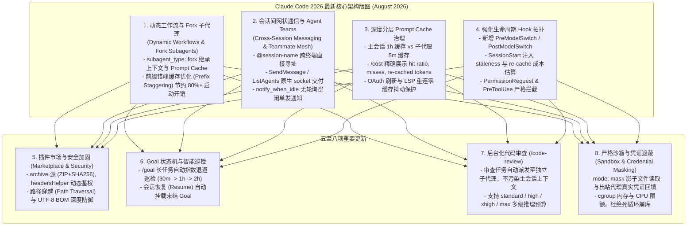

# 2026 年最新 Claude Code 架构全景演进与技术精髓深度解构

> **前沿时效**：基于 Anthropic 官方截至 **2026 年 8 月 28 日** 的最新 Claude Code 发布记录与技术文档，深度解构 Claude Code 在 2026 年下半年的重大架构升级、多智能体协同机制、动态工作流（Dynamic Workflows）、Prompt Cache 优化与生命周期 Hook 体系。

---

## 一、 2026 最新 Claude Code 八大杀手级架构演进

---

## 二、 核心机制深度剖析

### 2.1 动态工作流（Dynamic Workflows）与 Fork 子代理
1. **Fork 子代理继承体系**：
   - 传统子代理冷启动需要重新读取项目规则并构建 System Prompt，丢失前缀缓存。
   - 2026 最新引入 `subagent_type: "fork"`：**直接派生并继承父会话的完整历史与 Prompt Cache**，启动耗时降至毫秒级，且无需重复支付输入 Token 费用。
2. **前缀错峰并发（Prefix Staggering）**：
   - 当主智能体并发派发多个具有相同前缀的子代理时（如同时审查 5 个模块），引入 `CLAUDE_CODE_WORKFLOW_PREFIX_STAGGER_MS` 错峰延迟调度，确保后置子代理 100% 命中首个代理刚刚写入的 Prompt Cache 块。

### 2.2 跨会话网状消息总线（Cross-Session Mesh）
1. **会话级 Socket 总线**：
   - 开发者在不同 tmux 窗格或不同终端打开的会话拥有全局唯一名称。
   - 在输入框键入 `@<session-name>` 即可直接调用 `SendMessage` 发起会话间跨进程通信。
2. **`notify_when_idle` 一次性通知**：
   - A 会话向正在运行庞大构建任务的 B 会话发送协作请求，附带 `notify_when_idle` 标志；
   - B 会话完成任务变为空闲（Idle）时，由内部事件总线主动向 A 会话投递完成通知，彻底取代低效轮询。

### 2.3 双 TTL 渐进式 Prompt Cache
- **主会话（Main Loop）**：设置 `promptCacheTtl: "1h"`，保证开发者在思考、查阅资料的长间隔后提交下一轮 Prompt 依然命中热缓存；
- **子代理（Subagents）**：设置 `subagentPromptCacheTtl: "5m"`，短生命周期执行完毕后立即释放内存，兼顾极速执行与堆内存控制。

### 2.4 全生命周期 Hook 矩阵扩展
最新 Claude Code 支持从会话启停到模型热切换的完整事件图谱：
- **`SessionStart` / `SessionEnd`**：会话启动与恢复，支持传入 session staleness 与缓存重建预估成本；
- **`PreModelSwitch` / `PostModelSwitch`**：模型热切换前后触发，允许拦截高成本模型切换或记录合规审计；
- **`PreToolUse` / `PostToolUse` / `PostToolUseFailure`**：工具调用的前后守卫；
- **`Stop` / `Notification`**：执行中断与系统通知。

---

## 三、 对本项目（Coding-Agents）的直接借鉴与落地指导

| Claude Code 2026 最新特性 | 本项目已有基础 | 进化落地路径 |
| :--- | :--- | :--- |
| **Pre/PostModelSwitch Hook** | 已有 `core/hooks/hookDispatcher.ts` | 将模型切换钩子无缝挂载至 `/model` 命令与 `hookDispatcher`。 |
| **Prompt Cache 区分统计** | 已有 `contextAnalysis.ts` 与 `/cost` | 在 `/cost` 中引入 Warm/Cold Cache 命中率与 Re-cached 状态透视。 |
| **后台化独立审查** | 已有 `/review` 与 `task` 派发能力 | 将 `/review` 默认迁移至后台 Subagent 运行，避免主对话历史被长 diff 占满。 |
| **动态插件市场与 ZIP 安装** | 已有 `marketplaceCommandRuntime.ts` 与 `pluginCommandRuntime.ts` | 增加直接从 GitHub Release / ZIP archive 安装插件的能力与安全校验。 |
