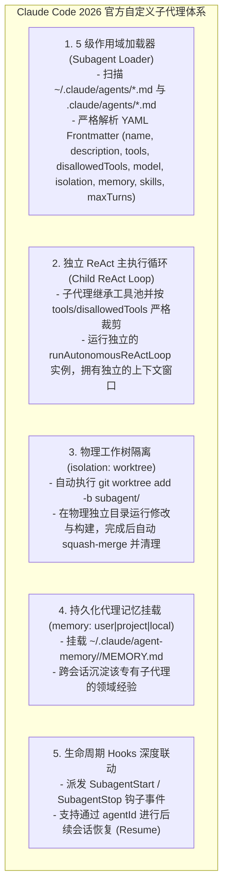
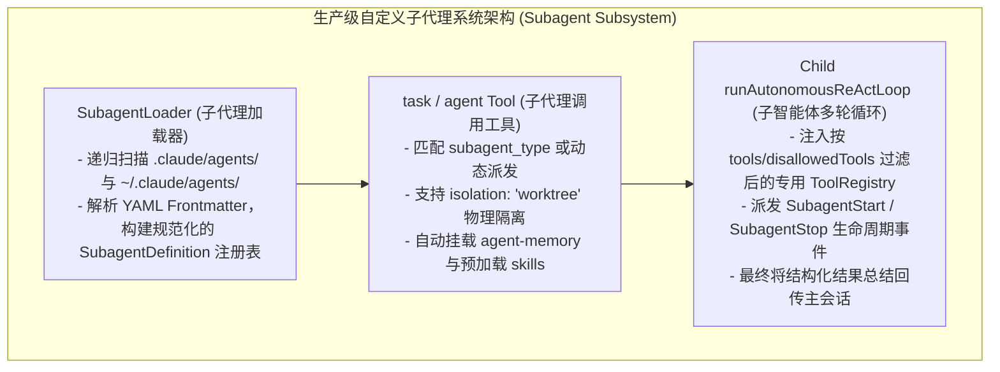
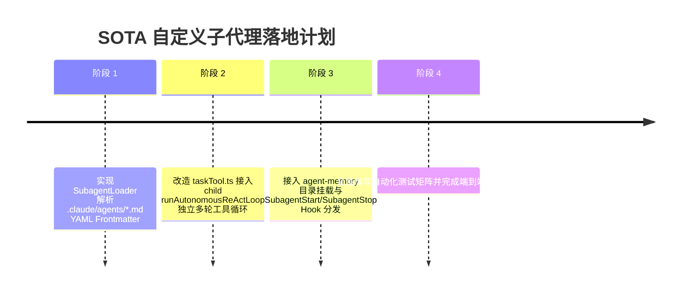

# 对标 Claude Code 2026 官方子代理架构规范深度审计与落地设计方案

> **所属知识库**：`.wiki/wiki/theses/`  
> **权威信源**：通过 TinyFish MCP 检索并解析 Anthropic 官方最新规范（`https://code.claude.com/docs/en/sub-agents`）  
> **更新时间**：2026-08-30  
> **核心目标**：彻底消灭单轮 fetch 假子代理，完整实现 `.claude/agents/*.md` 自定义子代理加载器、多轮 ReAct 工具循环、物理工作区隔离、持久化 Agent 记忆挂载与生命周期 Hooks 联动。

---

## 目录
1. [Claude Code 2026 官方子代理核心规范解构](#一-claude-code-2026-官方子代理核心规范解构)
2. [当前项目对比官方规范的四大关键差距](#二-当前项目对比官方规范的四大关键差距)
3. [SOTA 生产级自定义子代理系统架构设计](#三-sota-生产级自定义子代理系统架构设计)
4. [实施路线图与实施计划](#四-实施路线图与实施计划)

---

## 一、 Claude Code 2026 官方子代理核心规范解构



---

## 二、 当前项目对比官方规范的四大关键差距

| 序号 | 官方 2026 规范标准 | 当前项目现状（严重短板） | 差距定性与影响 |
| :---: | :--- | :--- | :--- |
| **1** | 支持从 `.claude/agents/*.md` 与 `~/.claude/agents/*.md` 加载自定义子代理声明与 Frontmatter | **完全缺失加载器**，系统内无任何扫描和解析 `.claude/agents/` 目录的机制 | **无法支持用户自定义的专职智能体**（如 `code-reviewer`, `security-auditor`） |
| **2** | 子代理执行完整的独立多轮 ReAct 循环（具备 `read`, `write`, `grep`, `bash`, `lsp` 等工具） | `taskTool.ts` 目前仅发起单次单轮无工具的直接 fetch 问答 | **子代理沦为纯问答模型，无法真正读写文件或运行代码** |
| **3** | 支持持久化代理记忆（`memory: project\|user`）挂载与 `skills` 预加载 | 缺失 `agent-memory/<name>/` 目录挂载机制，未实现技能预注入 | **子代理无法跨会话积累领域经验，技能无法自动生效** |
| **4** | 完整分发 `SubagentStart` 与 `SubagentStop` 生命周期 Hooks，支持按 `agentId` 恢复会话 | `taskTool.ts` 内部未调用 `hookDispatcher.dispatch`，无 `agentId` 记忆恢复 | **破坏了 2026 官方生命周期监控链条，无法追踪子代理轨迹** |

---

## 三、 SOTA 生产级自定义子代理系统架构设计



### 1. 子代理加载器 (`SubagentLoader`)
- **文件路径**：`packages/ts-shell/src/core/subagents/subagentLoader.ts`
- **功能**：
  - 扫描 `.claude/agents/*.md`（项目级）与 `~/.claude/agents/*.md`（用户级）；
  - 解析 YAML Frontmatter：
    ```yaml
    ---
    name: code-reviewer
    description: Expert code reviewer. Proactively reviews code for quality and security.
    tools: Read, Grep, Glob, Bash
    model: inherit
    isolation: worktree
    memory: project
    ---
    System prompt body...
    ```

### 2. 真实多轮 ReAct 子代理执行器
- 升级 `taskTool.ts`：
  - 实例化独立的 `runAutonomousReActLoop`；
  - 根据子代理声明挂载 `GitWorktreeManager` 隔离工作树；
  - 自动读取 `~/.claude/agent-memory/<name>/MEMORY.md` 注入上下文；
  - 完整分发 `SubagentStart` 与 `SubagentStop` 生命周期事件。

---

## 四、 实施路线图与实施计划


