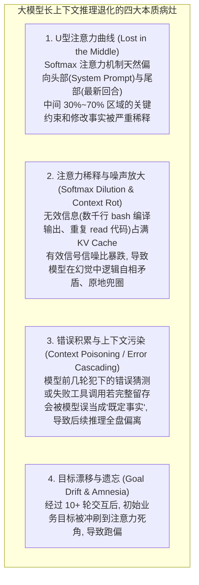
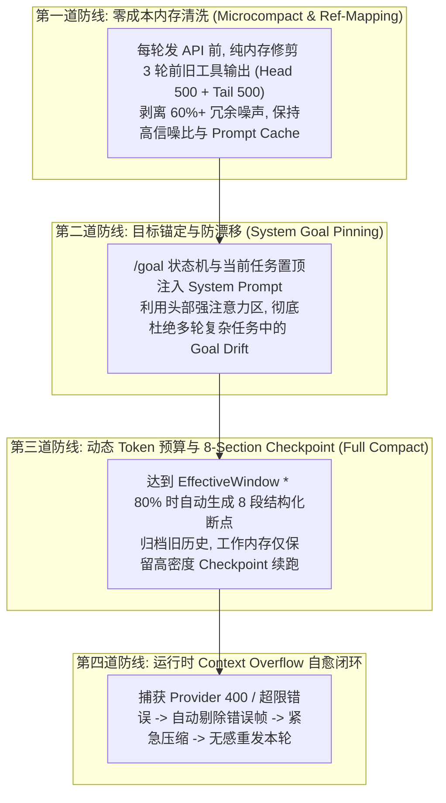

# Context 治理与长上下文推理退化（Lost in the Middle / Context Rot）深度研究报告

- **日期**：2026-08-30
- **研究对象**：`Pi`、`OpenCode`、`Claude Code`、`Codex` 以及学术前沿论文与业界治理实践
- **归档目标**：解决大模型长上下文注意力稀释、自我逻辑矛盾与上下文污染问题，构建本项目生产级 Context 治理体系。

---

## 一、 大模型长上下文退化的科学机理分析（The Root Causes）

通过对 Stanford 经典论文《Lost in the Middle: How Language Models Use Long Contexts》（Liu et al.）、近期强化学习上下文策展论文《Active Context Curation for LLM Agents》（arXiv:2604.11462）以及 Redis/Mem0 2026 年针对“Context Rot”的技术解构，大模型在长上下文中的推理劣化根源为以下四大效应：

---

## 二、 四大顶尖项目 Context 治理策略深度横向解构

| 治理维度 | **Claude Code** | **Pi Agent** | **OpenCode** | **Codex** |
| :--- | :--- | :--- | :--- | :--- |
| **1. 实时信噪比维护 (In-flight Pruning)** | **Microcompact (微压缩)**：在发给 API 前，对 3 轮前的旧工具输出原地修剪为标记，**0 额外延迟且不破坏 Prompt Cache**。 | 针对大输出在工具层做 `truncateHead` / `truncateTail`。 | **Part 级修剪**：单条工具输出超 2,000 字符打 `[truncated]`。 | Item 级流式裁剪。 |
| **2. 上下文透视与治理诊断** | **`contextAnalysis` & `contextSuggestions`**：实时计算 Token 分布，检测重复文件读取、超大工具输出膨胀并提出建议。 | 统计 `UsageTotals` 与 `SessionStats`。 | 计算 Token 分类统计。 | 计算 `TurnUsage` 与 `CachedTokens`。 |
| **3. 历史断点归档 (Checkpoint)** | **`compact_boundary`**：截断历史，注入 8 段结构化总结，旧消息落盘。 | **`branch_summary`**：从历史提取 `readFiles` 与 `modifiedFiles` 文件集。 | 提取近期 N 轮并压缩历史。 | Thread 层持久化与恢复。 |
| **4. 目标防漂移机制 (Anti-Drift)** | 动态注入 `SystemPrompt` 与 `Rules`。 | 保持会话树根节点一致。 | System 提示词维护。 | Thread 首帧系统目标对齐。 |
| **5. 运行时溢出自愈 (Self-Healing)** | 连续 3 次失败断路器（Circuit Breaker）熔断。 | **剔除失败消息 $\rightarrow$ 紧急压缩 $\rightarrow$ 自动重试当前轮**（用户无感）。 | 捕获 overflow 标记。 | 抛出 ThreadError 事件。 |

---

## 三、 为我们项目量身定制的 Context 治理全景方案

结合四大标杆与学术界最新实践，本项目在 `agentLoop.ts` 与 `core/context/` 构建 **“四道防线” 递进式 Context 治理架构**：

---

## 四、 关键结论与治理原则

1. **“Context Window 是内存，不是硬盘”**（*Context is RAM, not Hard Drive*）：长上下文并不意味着可以无底线乱塞数据。保持上下文简练高信噪比，模型推理能力提升数倍。
2. **“前缀不变保缓存，尾部精炼保注意”**：利用 Microcompact 原地保留头尾，既不打碎各大模型的 KV Cache 加速，又保证模型注意力始终聚焦在当前核心问题上。
3. **“结构化提炼胜过机械丢弃”**：压缩时必须使用严谨的 8-Section Schema（包含目标、概念、已改文件、错误与下一步），保证上下文虽然被压缩，但关键业务与架构事实 100% 不丢失。
