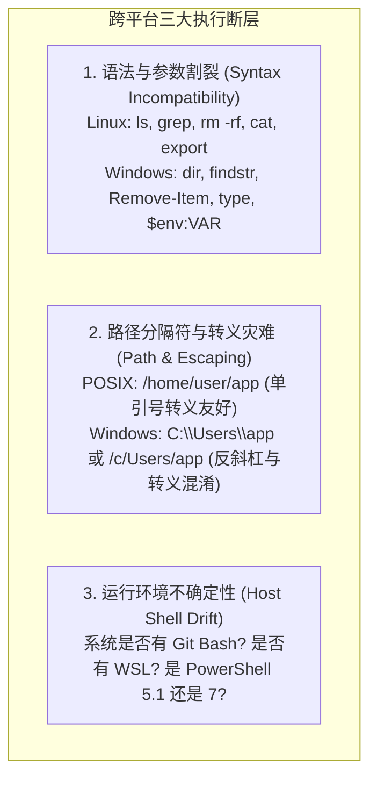
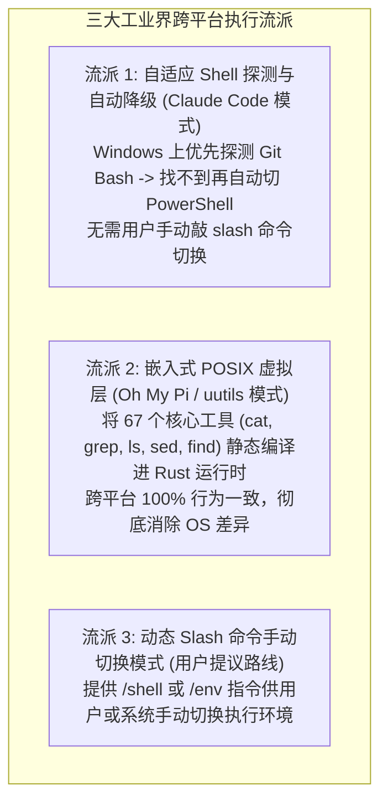
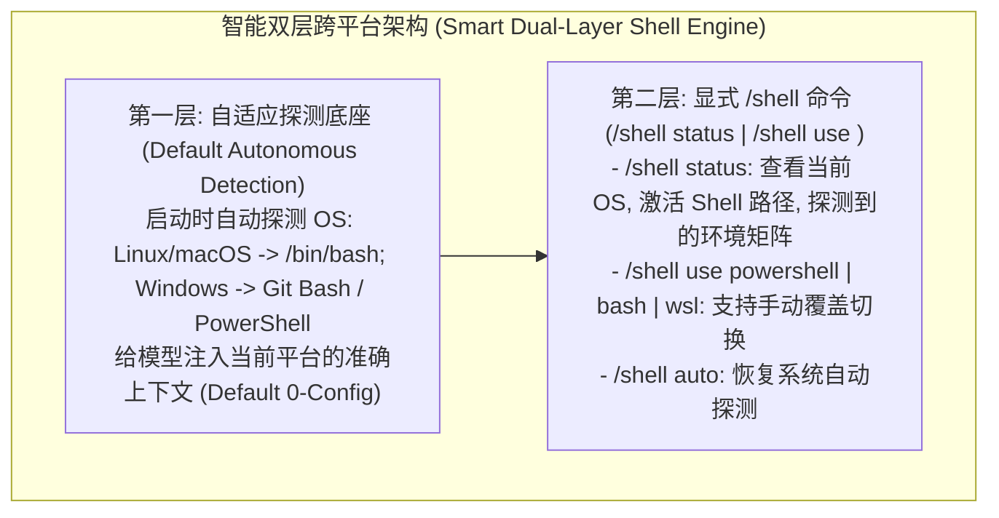

# 跨操作系统适配与命令执行体系深度调研与架构可行性评估

> **命题思考**：针对 Linux、macOS 与 Windows 在底层命令工具与 Shell 环境（POSIX vs. PowerShell vs. CMD）的天然差异，评估是否需要设计一个 `/shell` 或 `/platform` slash 命令来动态切换 Agent 内置的命令工具集与执行后端。

---

## 一、 行业现状与真实痛点解构

在跨平台执行中，AI Coding Agent 普遍面临以下 3 大核心痛点：

大模型经过数十亿 Token 训练，其大脑中最擅长、最熟悉、生成准确率最高的是 **POSIX/Bash 语法（`grep`, `find`, `cat`, `curl`, `git`）**；当大模型在 Windows 原生 PowerShell 下尝试写管道或组合命令时，往往会写出具有语法隐患的代码（例如把 `echo "hello" > file` 输出为带 BOM 的 UTF-16LE 文件，或者误用 Linux 参数如 `rm -r` 导致 PowerShell 报错）。

---

## 二、 标杆项目是如何解决这个问题的？（主流设计范式）

通过深入调研 **Claude Code**、**Oh My Pi (OMP)** 以及 **OpenCode**，我们发现目前工业界存在三种主流流派：

### 2.1 Claude Code 的做法：**自适应检测与透明自愈（Zero-Friction Detection）**
- **机制**：
  - 在 Linux / macOS 上：直接调用系统的 `/bin/bash` 或 `/bin/zsh`；
  - 在 Windows 上：
    - 启动时自动探测 `C:\Program Files\Git\bin\bash.exe`（Git Bash）；
    - 若安装了 Git for Windows，`bash` 工具透明路由到 Git Bash，模型继续使用最熟悉的 Linux 命令，体验完全平滑；
    - 若没有 Git Bash，自动降级为 `PowerShell` 工具，并在 System Prompt 中注入适配提示；
  - **用户视角**：完全透明无感，不需要用户每次换机器都要输入一个 slash 命令去切换。

### 2.2 Oh My Pi (OMP) 的做法：**内置纯 Rust POSIX 虚拟工具箱（uutils built-in）**
- **机制**：
  - 在 Rust 底层（`crates/pi-builtins`）静态引入了 67 个基于 Rust `uutils/coreutils` 实现的原生指令（`cat`, `ls`, `grep`, `head`, `tail`, `wc`, `sed`, `find` 等）；
  - 无论跑在 Windows、macOS 还是 Linux 上，这些基础文件查询与文本过滤命令全都在进程内直接由 Rust 执行，速度 $< 1\text{ms}$，且跨平台输出格式 100% 相同。

---

## 三、 对“设计 slash 命令动态切换工具集”的可行性与价值评估

基于上述研究，我们对“设计一个专门用于切换工具集的 slash 命令”进行客观、中立的价值与利弊权衡：

### 3.1 它的核心价值（Pros）
1. **显式调试与确定性控制（Explicit Control & Debuggability）**：
   - 当开发者在特定 Windows 机器上确实需要强制使用 PowerShell（例如需要执行特定的 `.ps1` 脚本或调用 Windows SDK 原生 cmdlet），或者需要临时切换到 WSL 执行环境时，`/shell powershell` 或 `/shell bash` 提供了**显式的确定性控制权**。
2. **环境诊断与透明可见（Environment Transparency）**：
   - 命令不仅能切换，还能作为诊断工具：输入 `/shell status` 可以清晰打印当前操作系统、检测到的 Shell（Bash / Git Bash / PowerShell / WSL）路径与版本，避免盲目猜测。

### 3.2 它的潜在缺陷与反模式风险（Cons & Traps）
1. **违背“开箱即用（Zero-Config）”原则**：
   - 优秀的 Coding Agent 应该**默认自动探测并选择最优环境**，而不是要求用户每次启动都要先敲一个 `/shell switch-to-linux` 才能正常工作。如果必须由用户手动切换，说明系统的自适应能力存在缺陷。
2. **状态漂移（State Drift）与 System Prompt 缓存失效**：
   - 如果在会话中途动态切换底层 Shell（如从 Bash 切换到 PowerShell），模型的 System Prompt 和 Tool Definitions 需要重新改写，这会**彻底破坏 Prompt Cache**，导致后续回合首 Token 延迟与费用激增。

---

## 四、 最佳工程落地方案：自适应探测底座 + `/shell` 显式控制

结合两者的长处，我们得出最优雅、最高品味的工程实现架构：

1. **底层默认做“自动探测与平滑路由”**：
   - 自动检测 Windows 下的 Git Bash (`bash.exe`)、WSL 和 PowerShell，默认选择大模型最擅长的 POSIX/Bash 环境；
2. **上层暴露统一的 `/shell` 命令（兼具诊断与覆盖控制）**：
   - `/shell` / `/shell status`：打印当前运行宿主平台、激活的 Shell 模式、环境变量与路径；
   - `/shell use <bash|powershell|wsl>`：允许开发者在特定场景下显式锁定执行后端；
   - `/shell auto`：重置回自适应探测模式。

这样既满足了普通用户“开箱即用、完全无感”的平滑体验，又为高级用户与复杂跨平台场景提供了显式切换与诊断的能力！
