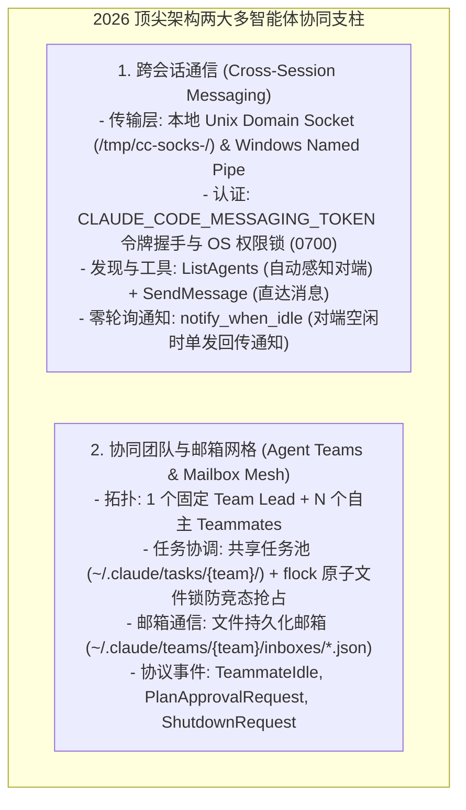
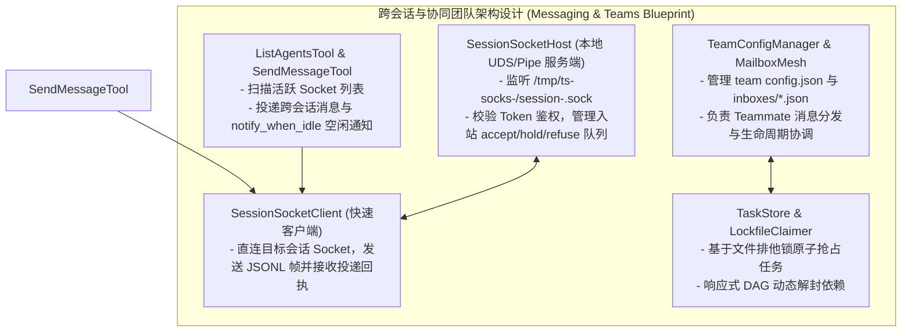
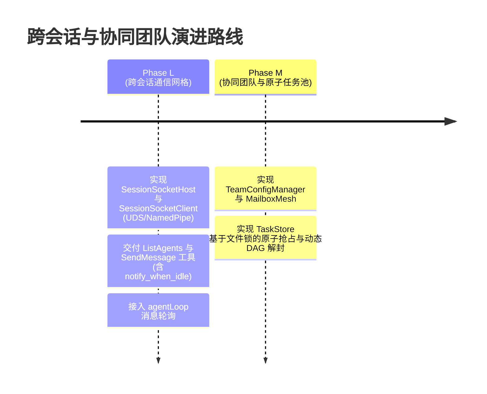

# SOTA 跨会话通信网格（Cross-Session Mesh）与协同团队（Agent Teams）架构研究与设计方案

> **所属知识库**：`.wiki/wiki/theses/`  
> **对比标杆**：`Claude Code (2026 官方最新规范)` (UDS Sockets, Named Pipes, SendMessage, ListAgents, Agent Teams, Mailbox Mesh, Task Locking), `Oh-My-Pi` (`hub` IPC Mesh 与任务调度), `OpenCode` (跨进程事件总线)  
> **更新时间**：2026-08-30  
> **核心目标**：深入解构 2026 顶尖 AI Agent 系统的**跨会话通信（Cross-Session Messaging）** 与 **多智能体协同团队（Agent Teams）** 架构，为本项目制定具备高可靠、零死锁、原子任务抢占与本地 UDS/Named Pipe 通信的生产级落地蓝图。

---

## 目录
1. [2026 最新标杆架构深度剖析](#一-2026-最新标杆架构深度剖析)
2. [当前项目核心差距与短板剖析](#二-当前项目核心差距与短板剖析)
3. [SOTA 跨会话通信与协同团队架构设计方案](#三-sota-跨会话通信与协同团队架构设计方案)
4. [落地演进路线规划 (Phase L ~ M)](#四-落地演进路线规划-phase-l--m)

---

## 一、 2026 最新标杆架构深度剖析

### 1. 跨会话通信（Cross-Session Messaging）核心机制
- **本地 UDS / Named Pipe 传输**：
  - 会话启动时自动在 `/tmp/ts-socks-<uid>/session-<sessionId>.sock`（Windows 下为 `\\.\pipe\coding-agents-<sid>`）建立本地服务端；
  - 导出 `CODING_AGENTS_MESSAGING_SOCKET` 与 `CODING_AGENTS_MESSAGING_TOKEN` 环境变量，供子进程和外部会话连接。
- **动态发现与非阻塞投递 (`ListAgents` & `SendMessage`)**：
  - `ListAgents` 扫描本地 Socket 目录，返回活跃会话列表与 `@-mention` 别名；
  - `SendMessage` 在活动 Turn 的工具调用间隙安全插入消息，若对端处于 Idle 空闲态则直接触发新 Turn。
- **`notify_when_idle` 一次性单发通知**：
  - 彻底抛弃低效轮询。A 会话向 B 会话注册单次空闲监听，B 会话完成长任务变为空闲时，主动向 A 的 Socket 投递 `{ type: "idle_notice" }` 事件。

### 2. 协同团队与邮箱网格（Agent Teams & Mailbox Mesh）核心机制
- **会话派生团队 ID**：基于主会话自动派生 `session-${sessionId.slice(0, 8)}`；
- **原子任务抢占（Atomic Task Claiming via File Lock）**：
  - 在 `~/.coding-agents/tasks/{team-id}/` 下维护各任务 JSON 文件；
  - Teammate 认领任务时，利用 `open(O_CREAT | O_EXCL)` 或 `.lock` 文件锁，彻底杜绝并发死锁与重复认领（TOCTOU 竞态）；
- **响应式 DAG 动态解封（Dynamic DAG Unblocking）**：
  - 摒弃传统的批次阻塞式执行，当任一前置任务变为 `completed` 时，依赖引擎立即动态解封下游就绪任务，由空闲 Teammates 自主并发认领。

---

## 二、 当前项目核心差距与短板剖析

| 架构维度 | 当前项目现状（差距与短板） | 标杆 SOTA 架构标准 |
| :--- | :--- | :--- |
| **会话间 IPC 传输** | 守护进程目前仅用于 Cargo 本地执行，**完全没有会话间通信 Socket 服务器** | **UDS (`/tmp/ts-socks-<uid>/`) 与 Windows 命名管道服务**，具备 Token 安全鉴权 |
| **会话发现与工具** | 仅支持 `.claude/agents/*.md` 静态子代理文件发现，无法感知正在运行的其它终端会话 | **`ListAgents` 工具** + 动态 Socket 扫描 + 实时 `@-mention` 会话补全 |
| **点对点直连通信** | 仅支持父子层级单向派发，子任务之间无法互相通信 | **`SendMessage` 工具** + 突发限流防护 + 进程安全校验 |
| **任务池与原子抢占** | `ParallelDispatcher` 与 `DAGResolver` 仅支持静态拓扑批处理，任务间无通信 | **共享任务池 + 文件排他锁（flock）**，空闲智能体自主并发抢占未阻塞任务 |
| **智能体邮箱网格** | 无持久化邮箱目录，消息丢失不可恢复 | **`MailboxMesh`**（`~/.coding-agents/teams/{team}/inboxes/*.json`），支持防毒化校验与投递凭证 |

---

## 三、 SOTA 跨会话通信与协同团队架构设计方案

---

## 四、 落地演进路线规划 (Phase L ~ M)

