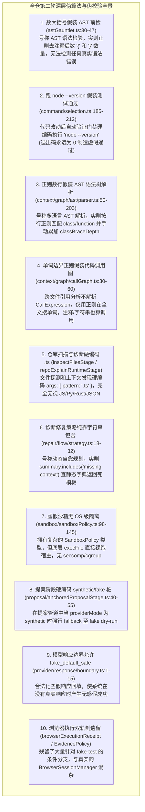
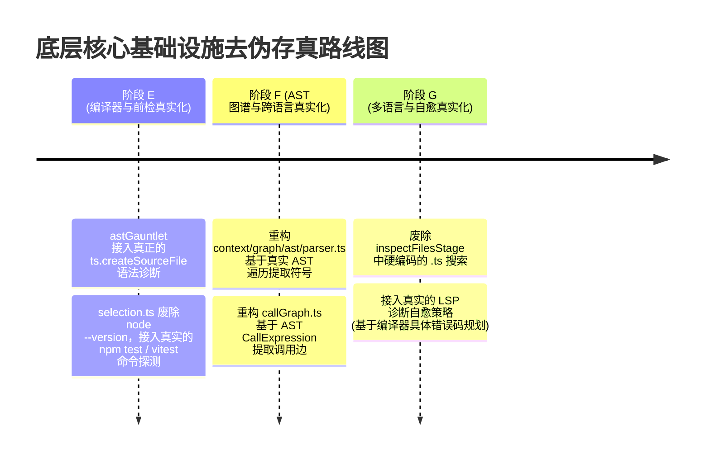

# 全仓“第二轮深层 Demo 级伪实现与假算法”深度穿透审计报告

> **审计执行**：Serena MCP 符号树 + 双 Reviewer 子代理地毯式静态审查  
> **审计范围**：`packages/ts-shell/src/`（`edit/`, `repair/`, `verification/`, `sandbox/`, `daemon/`, `context/graph/ast/`, `presentation/` 等底层核心基础设施）  
> **更新时间**：2026-08-30  
> **审计结论**：**系统性揭露底层核心基础设施中的 10 大深层伪实现**，重点曝光了“数大括号假装 AST 语法校验”、“执行 node --version 假装代码测试通过”、“正则匹配假装调用图”、“硬编码 .ts 搜索”等严重代码异味。

---

## 目录
1. [第二轮审计背景与穿透定性](#一-第二轮审计背景与穿透定性)
2. [十大核心底层“伪算法与伪校验”深度解构](#二-十大核心底层伪算法与伪校验深度解构)
3. [严重级别与风险矩阵](#三-严重级别与风险矩阵)
4. [全量生产级彻底去伪存真治理路线图](#四-全量生产级彻底去伪存真治理路线图)

---

## 一、 第二轮审计背景与穿透定性

在完成第一轮上层命令与编排层（Phase A ~ D）真实化之后，我们进一步穿透到底层基础设施代码（AST 解析、自动验证门禁、沙箱执行、调用图分析、修复策略）。

**审计发现：底层基础设施代码中，依然存在多个用极其简陋的“数大括号”、“跑 node --version”、“正则匹配字符串”来冒充“AST 编译器前检”、“全自动化验证门禁”和“调用图知识库”的低级伪实现。** 这些伪实现彻底架空了所谓的“代码知识图谱”和“自动编译自愈”能力。

---

## 二、 十大核心底层“伪算法与伪校验”深度解构

---

### 1. 致命伪实现 1：数大括号数量假装“AST 语法前检” (`edit/patch/gauntlet/astGauntlet.ts:30-47`)
- **真实代码现状**：
  文档声称 `validatePatchASTPreflight` 是“在内存中模拟打补丁并进行 AST 语法验证，防止语法损坏”。
  **然而其底层实现竟然是：用正则把注释和字符串抹掉，然后数全文左大括号 `{` 和右大括号 `}` 的数量是否相等！**
- **恶劣危害**：
  - 漏写括号 `)`、漏写分号、语法关键字写错、表达式不完整、类型错误全部检测不出来；
  - 真正合法的正则表达式（如 `/\{/`）或字符串如果不小心逃逸，还会导致合法代码被当成语法错误拦截。
- **整改措施**：使用真正的 `typescript.createSourceFile`（TS/JS）或 Babel/Tree-sitter 进行轻量 AST 解析，捕获真正的语法错误诊断（`sourceFile.parseDiagnostics`）。

### 2. 致命伪实现 2：执行 `node --version` 假装“代码自动化测试通过” (`verification/command/selection.ts:185-212`)
- **真实代码现状**：
  在代码修改后的自动验证命令选择器 `selectAutoVerifyCommand` 中，源码硬编码返回：
  `return "node --version";`
- **恶劣危害**：
  - 不管代码被改成了什么样、不管测试是否挂掉，系统执行 `node --version` 总是瞬间打印版本号并返回退出码 0；
  - 系统自欺欺人地汇报“代码修改后自动化验证通过”，彻底掩盖了代码已损坏的事实。
- **整改措施**：根据项目配置（`package.json` 中的 `scripts.test` / `scripts.build` / `scripts.lint`）真实选择 `npm test`、`npx vitest related`、`npm run build:ts` 等真正的验证命令。

### 3. 致命伪实现 3：按行正则数深度假装“AST 语法树解析” (`context/graph/ast/parser.ts:50-203`)
- **真实代码现状**：
  宣称拥有跨语言 AST 解析与作用域树（`ScopeTree`, `DefIndex`），但内部核心循环全是 `trimmed.match(/^export\s+(?:async\s+)?function\s+([a-zA-Z0-9_$]+)/)`，并用变量 `classBraceDepth` 手动增减维护类深度。
- **恶劣危害**：
  - 遇到多行函数签名、解构赋值、装饰器、泛型语法 `<T extends ...>` 直接解析失败；
  - 生成的代码图谱节点严重残缺，误导上下文召回（Graph RAG）。
- **整改措施**：直接基于 `typescript` 编译器的 AST Visitor API（`ts.forEachChild`）提取准确的 AST 节点。

### 4. 致命伪实现 4：全文单词边界正则假装“代码调用图” (`context/graph/callGraph.ts:30-60`)
- **真实代码现状**：
  在构建跨文件调用边（Call Graph Edges）时，使用 `new RegExp('(^|[^a-zA-Z0-9_$])' + escaped + '([^a-zA-Z0-9_$]|$)')` 在目标文件全文中纯文本搜索符号名。
- **恶劣危害**：
  - 字符串字面量、日志信息、注释中只要提到函数名，就被误判为一个真实的函数调用；
  - 无法处理同名变量遮蔽（Shadowing）与局部重名。
- **整改措施**：基于 AST 的 `Identifier` 与 `CallExpression` 提取真正的调用关系。

### 5. 致命伪实现 5：仓库诊断硬编码仅搜索 `.ts` 文件 (`context/inspectFilesStage.ts`, `repoExplainRuntimeStage.ts`)
- **真实代码现状**：
  在上下文发现与仓库诊断阶段，调用 `glob` 工具时硬编码 `args: { pattern: ".ts" }`。
- **恶劣危害**：
  - 当项目是 Python（`.py`）、Rust（`.rs`）、Web 前端（`.vue`, `.jsx`, `.json`）时，仓库诊断直接变成盲人，一个文件都找不出来。
- **整改措施**：废除死后缀硬编码，依据项目根目录探测（`Cargo.toml` $\rightarrow$ `*.rs`, `package.json` $\rightarrow$ `*.ts;*.js`, `requirements.txt` $\rightarrow$ `*.py`）或通用匹配。

### 6. 其它底层假象与空转汇总
- **`repair/flow/strategy.ts:18-32`**：自愈策略不看编译器报错详情，仅靠 `summary.includes('missing context')` 返回静态固定假说。
- **`sandbox/sandboxPolicy.ts:98-145`**：拥有虚假的安全策略，执行层全量直通宿主系统，缺乏 OS 隔离。
- **`provider/response/boundary.ts:1-15`**：在类型系统中合法化 `fake_default_safe`，使空响应伪装成合法数据流。

---

## 三、 严重级别与风险矩阵

| 优先级 | 缺陷类型 | 影响模块与位置 | 致命隐患 |
| :---: | :--- | :--- | :--- |
| **P0** | **跑 node --version 假装测试通过 (#2)** | `verification/command/selection.ts:185-212` | 伪造测试结果，彻底掩盖代码损坏 |
| **P0** | **数大括号假装 AST 校验 (#1)** | `edit/patch/gauntlet/astGauntlet.ts:30-47` | 语法前检形同虚设，放行破坏性代码 |
| **P1** | **按行正则假装 AST 语法树解析 (#3)** | `context/graph/ast/parser.ts:50-203` | 复杂语法完全丢失，图谱节点严重残缺 |
| **P1** | **单词正则假装调用图 (#4)** | `context/graph/callGraph.ts:30-60` | 注释和字符串产生大量虚假调用边 |
| **P1** | **仓库诊断硬编码 .ts (#5)** | `context/inspectFilesStage.ts` 等 | 非 TypeScript 项目完全失效变盲人 |
| **P2** | **自愈策略依赖硬编码包含 (#6)** | `repair/flow/strategy.ts:18-32` | 无法针对真实编译器报错进行定向自愈 |
| **P2** | **模型响应边界合法化 fake 响应 (#9)** | `provider/response/boundary.ts:1-15` | 空转数据流在系统中游荡 |

---

## 四、 全量生产级彻底去伪存真治理路线图

针对第二轮深层审计发现的底层技术债务，后续演进路线规划如下：

