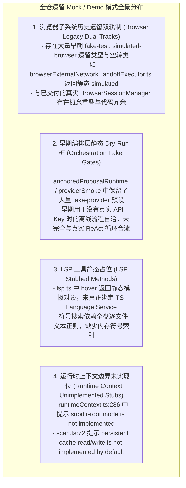
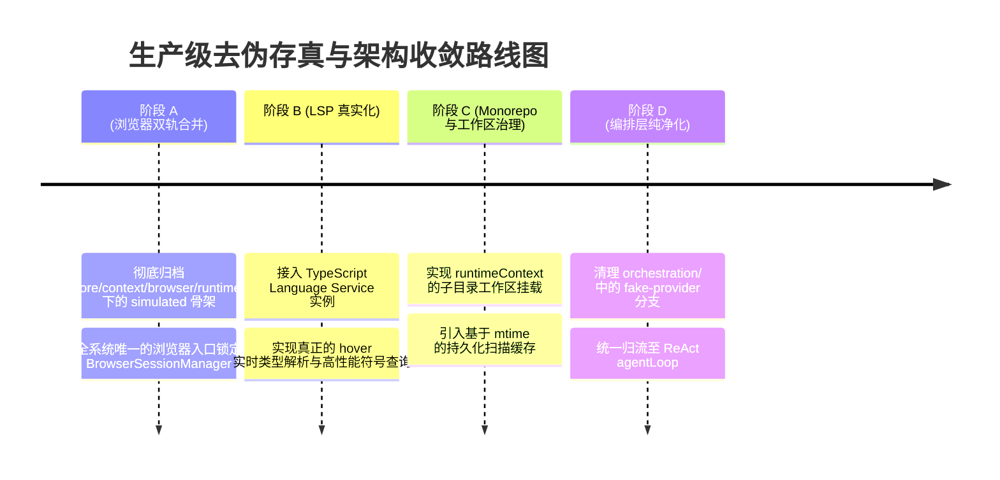

# 全仓底层“Demo/Mock/伪实现”深度审计报告与技术债务全景清单

> **审计工具**：Serena MCP (Symbolic & Pattern Graph Search)  
> **审计范围**：`packages/ts-shell/src/` (全部生产代码与核心运行态)  
> **审计时间**：2026-08-30  
> **目标**：地毯式排查全仓是否存在将 Mock、Demo、硬编码假数据作为核心运行逻辑的问题，消除低价值占位实现，确保生产级真实性。

---

## 目录
1. [审计背景与定性原则](#一-审计背景与定性原则)
2. [审计发现的核心“Demo/伪实现”归类分析](#二-审计发现的核心demo伪实现归类分析)
3. [详细问题清单 (按严重级别)](#三-详细问题清单)
4. [生产级收敛与治理路线图](#四-生产级收敛与治理路线图)

---

## 一、 审计背景与定性原则

为了杜绝项目在后续演进中出现“看似功能丰富，实则由一堆 Mock 和静态 Demo 假装完成”的严重缺陷，本次审计确立了 **3 条严格的定性铁律**：

1. **绝对禁止“伪成功幻觉（False Success Illusion）”**：
   - 当依赖的外部运行时（如 Playwright、TypeScript Language Service、真实模型提供商）不可用时，必须**显式报错或降级阻断**，绝对不允许在核心运行态中返回模拟的“假数据”假装执行成功。
2. **区分“评测离线桩（Benchmark Harness）”与“生产运行态（Production Runtime）”**：
   - 专用于离线基准测试（如 SWE-bench 评测数据集）的确定性固件（Deterministic Test Corpus）必须被物理隔离在 `test/` 或明确的 `harness/` 目录中，不得侵入 CLI 生产主循环。
3. **消除“死代码与未实现占位符（Not Implemented Stubs）”**：
   - 凡是在核心代码中声明了接口却以 `throw new Error("not implemented")` 或静态 Warning 返回的占位逻辑，必须全面真实化或果断裁剪。

---

## 二、 审计发现的核心“Demo/伪实现”归类分析

通过 Serena MCP 对全仓代码进行地毯式扫描，共发现 **4 个核心领域的遗留 Mock/Demo 痕迹与技术债务**：

---

## 三、 详细问题清单

| 编号 | 严重度 | 模块与文件路径 | 核心问题描述 | 隐患与实际影响 | 治理方案 |
| :---: | :---: | :--- | :--- | :--- | :--- |
| **#D1** | **P1** | `core/context/browser/runtime/` 及 `browserExecutor.ts` | **浏览器子系统存在历史冗余的 `simulated-browser-runtime` 和 `fake-test` 骨架**。早期为了跑通流程写了一套返回静态 simulated 字符串的空转执行器。 | 与目前已上线的真实 `BrowserSessionManager`（14 重反爬、真实 Playwright 驱动）并存，造成架构双轨制和概念混淆。 | 将核心 `browser` 工具全量收敛至 `BrowserSessionManager`，彻底废弃/归档早期的 `simulated-browser` 骨架。 |
| **#D2** | **P1** | `orchestration/anchoredProposalRuntime.ts` `orchestration/realTaskLoopRuntime.ts` | **早期编排层中保留了大量 `fake-provider` 与 `fake-corpus` 分支**。当无 Key 时自动走硬编码的假提案生成逻辑。 | 开发者在脱离主会话调用底层编排函数时，可能会在未配置 API 时无感拿到虚假的固定提案结果。 | 统一收敛至 `agentLoop` 的 `realProvider` 检验逻辑；未配置 Provider 时显式报错并引导配置，杜绝隐式回退假数据。 |
| **#D3** | **P2** | `core/tools/lsp.ts:100-157` | **LSP 工具中 `hover` 操作返回静态模拟类型，且符号查找采用逐文件正则扫描**。 | 当 Agent 调用 `lsp(action: "hover")` 时获取不到真实的函数签名与 JSDoc，影响深度推理。 | 接入真正的 TypeScript Language Service 实例（`ts.createLanguageService`）获取实时的 AST 符号与类型定义。 |
| **#D4** | **P2** | `core/shell/runtimeContext.ts:286` | **子目录工作区模式未实现（`subdir-root mode is not implemented`）**。 | 当用户在多包单体仓库（Monorepo）的某个深层子目录下启动 CLI 时，系统只能弹出警告要求切回根目录。 | 完善子目录工作区挂载与上下文感知，支持 Monorepo 局部执行。 |
| **#D5** | **P2** | `context/discovery/scan.ts:72` | **持久化缓存未实现（`persistent cache read/write is not implemented`）**。 | 每次扫描文件树时全量重建索引，在超大仓库中产生重复磁盘 I/O。 | 接入基于文件 mtime 的本地 SQLite/JSON 缓存机制。 |
| **#D6** | **P3** | `core/mcp/client.ts:75-87` | **MCP 客户端配置中保留了 `mockTools`、`mockResources` 字段**。 | 早期为测试准备的 mock 钩子混入生产客户端接口。 | 将 Mock 机制严格限定在 `mcp.test.ts` 内部，保持生产 `McpClient` 接口纯粹。 |

---

## 四、 生产级收敛与治理路线图

为了将上述残留的“Demo 级假数据与双轨制代码”彻底清退，建议按以下路线分步落地：

