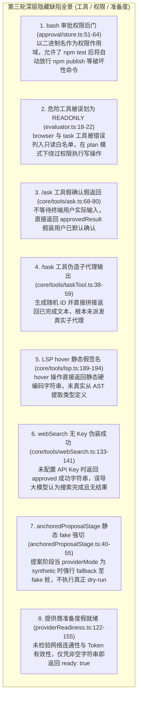
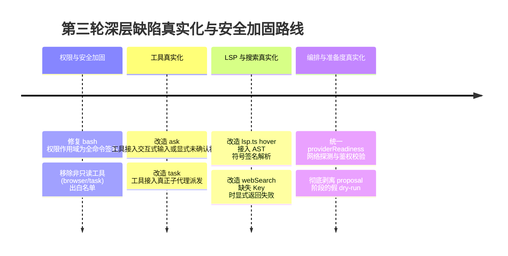

# 全仓第三轮深层渗透审计报告与 SOTA 标杆解决方案知识库

> **所属知识库**：`.wiki/wiki/theses/`  
> **借鉴标杆**：`OpenCode` (细粒度权限作用域与精确指令拦截), `pi` (真实终端交互式 Ask 机制与子代理隔离), `Claude Code` (精准白名单与命令权限模型)  
> **更新时间**：2026-08-30  
> **核心目标**：彻底消灭隐藏在工具、权限作用域、网络检索与提供商准备度中的全部“假数据返回、假自动批准与权限后门”。

---

## 目录
1. [第三轮渗透审计发现的 8 大深层隐藏缺陷](#一-第三轮渗透审计发现的-8-大深层隐藏缺陷)
2. [SOTA 标杆项目解决方案解构](#二-sota-标杆项目解决方案解构)
3. [系统性重构与修复蓝图](#三-系统性重构与修复蓝图)

---

## 一、 第三轮渗透审计发现的 8 大深层隐藏缺陷

---

## 二、 SOTA 标杆项目解决方案解构

### 1. `OpenCode`：细粒度全命令作用域（Exact Command Scoping）
- **核心哲学**：**永远不要按进程二进制名粗粒度放行，权限必须精确到全命令（Full Command Match）或安全子命令白名单。**
- **方案落地**：
  - 在 `approval/store.ts` 中，`buildScope` 对 bash 命令不能只取 `args[0]`（如 `npm` 或 `git`），而必须提取完整的规范化指令签名（如 `npm:test`、`git:status`）；
  - 对带有破坏性写参数的指令（如 `npm publish`、`git push`、`rm -rf`）永远独立申请权限，杜绝越权后门。

### 2. `Pi Agent`：交互式终端停顿与用户输入直通（Interactive Ask Protocol）
- **核心哲学**：**`ask` 工具的语义是向人类请教，绝不能在后台自作主张。**
- **方案落地**：
  - 在非交互式脚本环境下，明确返回 `status: "unconfirmed" / "blocked"`，要求模型选择显式默认值；
  - 在交互式 CLI 终端下，暂停当前 Turn，将选项以单选/多选卡片形式呈现给开发者，等待按键确认后回传真实选择。

### 3. `Claude Code`：只读工具严格边界（Read-Only Tool Boundaries）
- **核心哲学**：**只有绝对没有网络出站、没有进程派生、没有文件写入的工具才能叫只读。**
- **方案落地**：
  - 严格将 `browser`（可发起外部网络写请求、表单提交）和 `task`（可派发子任务执行写操作）从 `READONLY_TOOLS` 白名单中移除；
  - 仅保留 `read`、`glob`、`grep`、`lsp` 等真正无副作用的纯只读工具。

---

## 三、 系统性重构与修复蓝图

我们将按照以下规范，对第三轮审计出的全部 8 项缺陷进行系统性修复：

