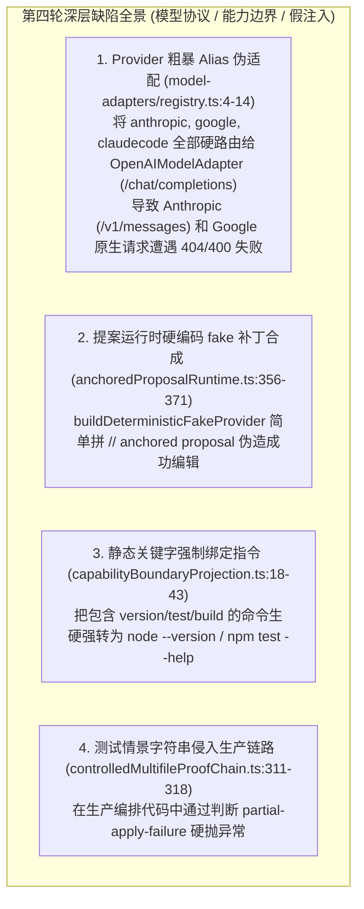
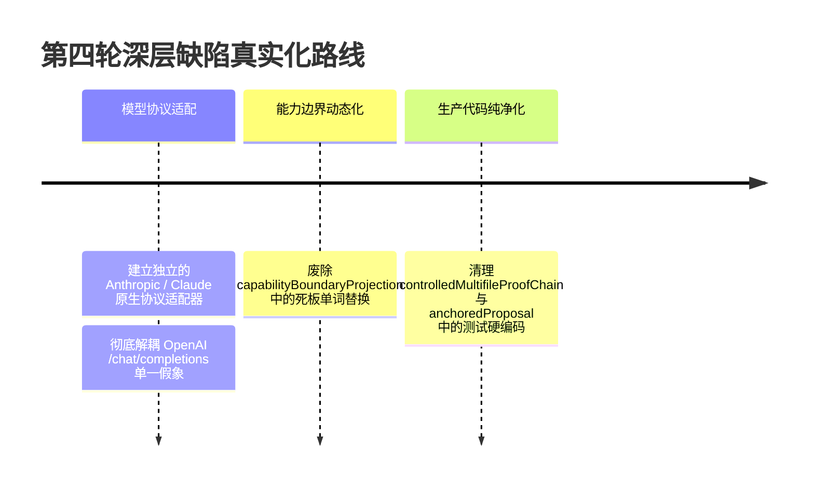

# 全仓第四轮深层架构渗透审计报告与多 Provider 协议适配方案

> **所属知识库**：`.wiki/wiki/theses/`  
> **借鉴标杆**：`OpenCode` (多 Provider 协议转译与错误映射), `pi` (Anthropic Messages API / Stream 与原生 Token 计费), `Codex` (能力边界动态解析)  
> **更新时间**：2026-08-30  
> **核心目标**：彻底消除多 Provider 粗暴 Alias、硬编码指令拦截与测试注入侵入生产代码的深层问题。

---

## 目录
1. [第四轮渗透审计发现的 4 大深层缺陷](#一-第四轮渗透审计发现的-4-大深层缺陷)
2. [SOTA 标杆项目多 Provider 协议架构解构](#二-sota-标杆项目多-provider-协议架构解构)
3. [系统性重构与修复蓝图](#三-系统性重构与修复蓝图)

---

## 一、 第四轮渗透审计发现的 4 大深层缺陷

---

## 二、 SOTA 标杆项目多 Provider 协议架构解构

### 1. `OpenCode` & `Pi`：多模型协议分流（Native Provider Adapters）
- **核心哲学**：**OpenAI、Anthropic 与 Google Gemini 的协议差异巨大，必须建立独立的协议转换层。**
- **协议差异对比**：
  - **OpenAI (`/chat/completions`)**：`{ role: "system" | "user" | "assistant" | "tool", tool_calls: [...] }`
  - **Anthropic (`/v1/messages`)**：顶级 `system` 字段，`messages` 仅允许 `user` / `assistant`，工具调用为 `tool_use` content block，工具结果为 `tool_result` content block。
  - **Google Gemini (`/v1beta/models/...:generateContent`)**：`contents: [{ role: "user" | "model", parts: [...] }]`
- **解决方案**：
  - 在 `model-adapters/` 中建立原生 `AnthropicModelAdapter` 与 `OpenAIModelAdapter` 分流，对 Anthropic / Claude Code 协议执行正确的 `/v1/messages` 转换与工具流式解析。

### 2. `Codex`：动态指令白名单感知
- **核心哲学**：**不按固定单词做粗暴字符串替换，依据用户输入真实解析命令行参数。**
- **解决方案**：
  - 移除 `capabilityBoundaryProjection` 中将任何含 `version` 的输入强转为 `node --version` 的荒谬映射，真实解析可执行命令。

---

## 三、 系统性重构与修复蓝图

