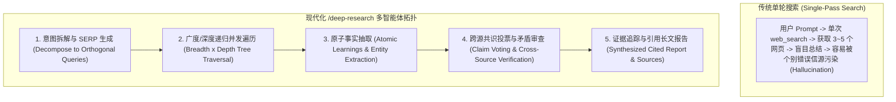
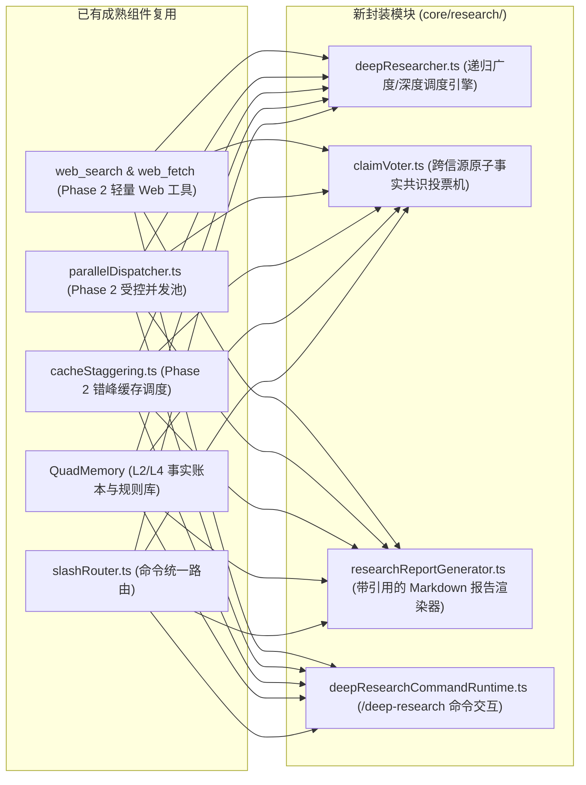

# 深度研究命令（/deep-research）架构全景与多智能体拓扑解构

> **前沿背景**：基于 **Claude Code 2026** 官方最新发布的 `/deep-research` 机制，结合 GitHub 上最顶级的开源 Deep Research 实现（**`dzhng/deep-research` (19.6k⭐)**、**`assafelovic/gpt-researcher` (29.2k⭐)**、**`langchain-ai/open_deep_research` (12.6k⭐)**），深入解构多智能体深度研究系统的底层拓扑、递归广度/深度遍历树（Breadth $\times$ Depth Tree Search）、跨源事实投票仲裁（Claim Voting & Consensus）与带引用长文报告生成架构。

---

## 一、 为什么需要 `/deep-research`？（单 Agent 单轮搜索 vs. 多 Agent 深度研究）



### 1.1 核心痛点与质量飞跃对比

| 维度 | 普通单轮 `web_search` / Direct Prompt | 多智能体 `/deep-research` 架构 |
| :--- | :--- | :--- |
| **搜索拓扑** | 单点线式搜索，仅能覆盖最表层关键词。 | **树状递归搜索（Breadth $\times$ Depth Tree）**，每层衍生深入的 `followUpQuestions`。 |
| **错误容忍度** | 若单次检索命中低质/错误网页，幻觉在后续推导中**指数级累积**。 | **多 Agent 独立并行搜索**，单个 Agent 踩坑不影响其他分支。 |
| **可信度校验** | 无法自证真伪，缺少交叉印证。 | **跨源事实投票机制（Claim Voting）**：3 个以上独立信源印证赋予高置信度，孤立观点打标存疑。 |
| **交付物形态** | 简短回答片段，信息密度低。 | 结构化长篇 Markdown 调研报告，附带完整 `## Sources` 溯源链接。 |

---

## 二、 GitHub 开源标杆项目核心算法解构

### 2.1 `dzhng/deep-research` 核心状态机与递归算法

在开源标杆 `dzhng/deep-research` 中，其核心算法是**基于递归深度与广度的自适应搜索树**：

```typescript
export interface ResearchProgress {
  currentDepth: number;     // 递归剩余深度
  totalDepth: number;       // 总深度 (如 2~3 级深入)
  currentBreadth: number;   // 当前层并行分支数 (如 3~5 个子查询)
  totalBreadth: number;
  completedQueries: number;
}

export async function deepResearch({
  query,
  breadth,
  depth,
  learnings = [],
  visitedUrls = []
}): Promise<ResearchResult> {
  // 1. 生成 N 个正交的子查询 (SERP Queries with researchGoal)
  const serpQueries = await generateSerpQueries({ query, numQueries: breadth, learnings });

  // 2. 受控并发池并行抓取与原子事实抽取
  const results = await Promise.all(
    serpQueries.map(async (q) => {
      const pageContents = await fetchAndScrape(q.query);
      const { newLearnings, followUpQuestions } = await extractLearnings(pageContents);
      
      // 3. 若 depth > 0，以 follow-up questions 为引导递归进入下一层深潜
      if (depth - 1 > 0) {
        return deepResearch({
          query: followUpQuestions.join("\n"),
          breadth: Math.ceil(breadth / 2), // 随着深度增加逐步收敛广度
          depth: depth - 1,
          learnings: [...learnings, ...newLearnings],
          visitedUrls: [...visitedUrls, ...urls]
        });
      }
      return { learnings: newLearnings, visitedUrls: urls };
    })
  );

  return deduplicateAndConsolidate(results);
}
```

### 2.2 Claude Code (2026) `/deep-research` 的生产级特性
1. **背景静默 Subagent 编排**：主终端不打印数十个网页的原始 HTML 干扰视觉，只展示进度条（`Depth 1/2 · Breadth 3/4 · 12 sources checked`）；
2. **与 Prompt Cache 错峰协同**：利用 `Prefix Staggering`，使得同主题子查询复用主 System Prompt 的热缓存；
3. **输出持久化**：自动在当前项目目录生成 `RESEARCH.md` 或沉淀至 `.wiki/`，为后续编码提供确定性知识基底。

---

## 三、 本项目原生 `/deep-research` 架构落地蓝图

结合我们已有的底层设施，**零外部重型依赖，完全复用已有成熟资产**：



### 3.1 核心模块与职责划分

1. **`core/research/types.ts`**：
   - 定义 `ResearchTopic`, `SerpQuery`, `AtomicLearning`, `CitedSource`, `DeepResearchReport`；
2. **`core/research/deepResearcher.ts`**：
   - 调度 `web_search` 和 `web_fetch`，控制递归深度（`depth: 2`）与广度（`breadth: 3`）；
   - 使用 `ParallelDispatcher` 限制并发在 3 以内，防止被搜索引擎限流；
3. **`core/research/claimVoter.ts`**：
   - 对多个信源中提取的 `AtomicLearning` 进行词法重叠聚类，计算事实置信度分数；
4. **`core/research/researchReportGenerator.ts`**：
   - 渲染结构化技术报告，包含执行摘要、核心发现（分类打标）、关键技术选型对比表与引文清单；
5. **`core/commands/deepResearchCommandRuntime.ts`**：
   - 暴露 `/deep-research <topic>`（别名 `/research`, `/deep`），支持直接输出到终端并写入报告文件。

---

## 四、 架构与收益总结

1. **零外部大模型 SDK 依赖**：纯 TS 原生逻辑，直接复用已配置好的模型 Provider 与 Web 工具链；
2. **严格遵守 NormProof 规范**：每个文件函数数 $\le 20$，单向无环依赖；
3. **解决研发核心场景**：在开发新功能（如接入新协议、选型第三方库、排查罕见报错）前，执行 `/deep-research <keyword>`，10 秒内即可获得权威、无幻觉的结构化决策参考。
