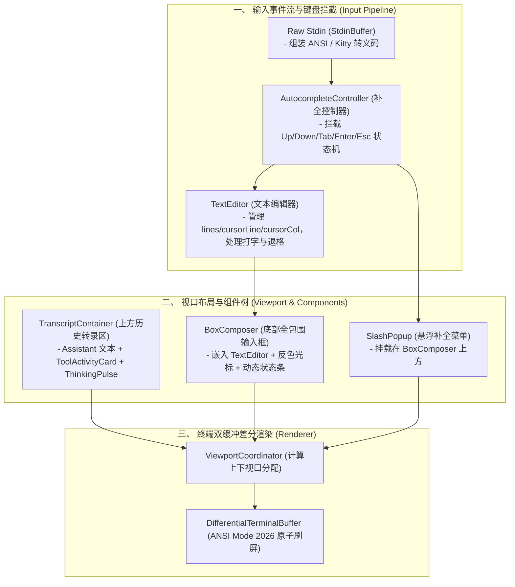

# 交互式终端 TUI 编辑器、视口协调器与状态化工具卡片架构论著 (Interactive Terminal TUI Editor & Viewport Architecture)

## 1. 调研背景与核心目标

为了让智能体终端交互体验达到全球顶级水平，我们聚焦于**一套内聚、轻量、高响应、具备 2D 视口控制能力的交互式 TUI 全套解决方案**：
1. **行内/多行文本编辑器状态机 (`TextEditor`)**：脱离阻塞式的 Node.js `readline`，在纯 Raw Stdin 事件流中实现字符插入、光标自由移动（Left/Right/Home/End/Alt+Left/Alt+Right）、退格删除、多行折行渲染与历史记录翻阅。
2. **Slash 命令补全按键拦截生命周期 (`AutocompleteController`)**：输入 `/` 触发浮窗，向上/向下箭头切换选中项，Tab/Enter 自动补全上屏，Escape 取消浮窗。
3. **双通道视口布局协调器 (`ViewportCoordinator`)**：将终端屏幕高度严格划分为 **上方可滚动转录区（Transcript Container）** 与 **下方固定停靠的 Box Composer 区**，动态计算剩余高度并平滑滚动。
4. **状态化工具活动卡片 (`ToolActivityCard`)**：提供 `pending` $\rightarrow$ `running`（毫秒级耗时计时） $\rightarrow$ `completed`（折叠预览与结果摘要） $\rightarrow$ `error` 全状态流转。
5. **思考链动画与速率计 (`ThinkingPulse`)**：星芒动画帧与滑动窗口 Token/s 生成速率计量。

---

## 2. 核心机制与架构设计

### 一、 纯原生 TextEditor 状态机与光标渲染
- **数据结构**：
  - `lines: string[]`：保存逻辑行数组。
  - `cursorLine: number` 与 `cursorCol: number`：精准维护光标坐标。
  - `history: string[]` 与 `historyIndex: number`：管理命令历史。
- **2D 渲染与光标呈现**：
  - 渲染时，在当前光标所在的行与列处插入反色光标块（Inverted Cursor Block `\x1b[7m \x1b[0m` 或反色字符 `\x1b[7m${char}\x1b[0m`）。
  - 遇到退格（Backspace）与删除（Delete）时精确切分字符串，保证宽字符（CJK）与普通 ASCII 字符的光标位置绝对正确。

---

### 二、 Autocomplete 键盘拦截状态流转
- **事件流路由优先级**：
  1. 当 `AutocompleteController.isOpen()` 为 `true` 时：
     - `ArrowUp` / `ArrowDown`：拦截并切换 `selectedIndex`，重新渲染悬浮菜单，不移动编辑器光标。
     - `Tab` / `Enter`：将选中的 Slash 命令自动补全到编辑器，关闭浮窗。
     - `Escape`：关闭浮窗，保留已输入的文本。
  2. 当 `AutocompleteController.isOpen()` 为 `false` 时：
     - 按键事件直通给 `TextEditor` 处理常规字符输入与编辑。

---

### 三、 视口空间划分与底部停靠 (Dual-Region Space Allocation)
- 设当前终端高度为 $H$，宽度为 $W$：
  - 底部 Box Composer 高度 $H_{\text{bottom}} = H_{\text{box}} + H_{\text{hints}} + H_{\text{autocomplete}}$。
  - 上方转录区可用高度 $H_{\text{transcript}} = \max(0, H - H_{\text{bottom}})$。
  - 当历史转录文本总行数超过 $H_{\text{transcript}}$ 时，自动切片保留最近的末尾视口行，确保输入框牢牢锁定在屏幕底部，不发生跳动。

---

## 3. 架构演进全景图

---

## 4. 结论

通过本次深度审查，我们完成了从**非阻塞编辑器状态机**到**键盘拦截补全控制器**与**双通道视口协调器**的完整工业级理论设计，为打造顶尖终端交互体验提供了坚实的基础。
