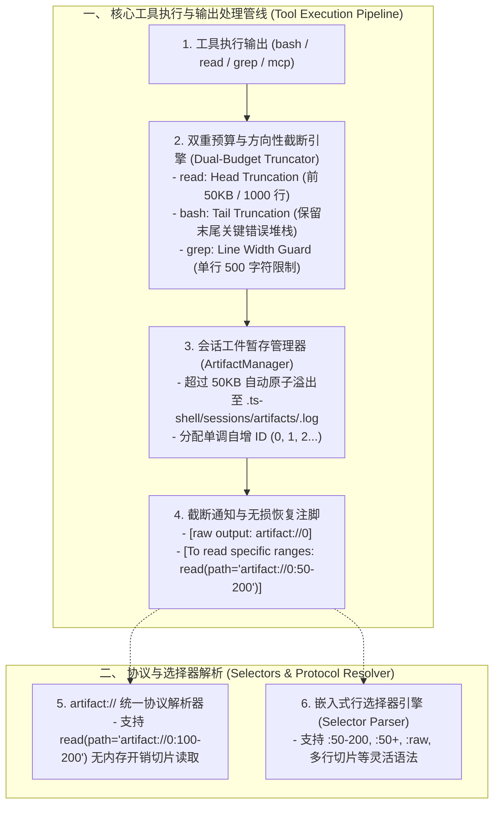

# AI Coding Agent 大输出溢出外溢、行选择器与结构化折叠深度审查与方案设计 (SOTA Architectural Thesis)

## 1. 调研背景与核心问题空间

在 LLM Coding Harness 架构演进中，**工具输出溢出（Tool Output Overflow）**与**大文件结构感知（Structural Code Folding）**直接决定了系统的 Token 经济学模型与推理鲁棒性。

当执行 `bash`（如长编译报错、海量单测日志、npm 安装追踪）、`grep`（匹配到打包压缩文件）或 `read`（读取上千行复杂源码）时，系统面临三大核心挑战：
1. **上下文瞬时爆炸与缓存击穿**：未经节制的 100KB ~ 10MB `stdout` 一次性灌入对话上下文，不仅瞬间消耗完 Prompt Cache 预算并导致 Token 超限报错，还会严重污染模型的注意力机制。
2. **错误截断导致关键尾部诊断丢失**：简单的头部截断（Head Truncation）会导致 `bash` 最后的 Exit Code、Panic Traceback 与 Summary 丢失，使模型陷入瞎猜与死循环。
3. **缺少高维源码结构感知与精准行选择器**：传统 `read` 仅支持硬编码的 `offset/limit` 参数，不支持形如 `src/app.ts:50-200`、`:raw`、`:50+100` 的原生路径嵌入式选择器，更缺少对长代码文件的 AST 骨架折叠（保留导出类型、类与函数签名，折叠函数体并提供精准恢复注脚）。

---

## 2. 横向标杆深度解构 (Pi / Oh-My-Pi / Claude Code / Codex)

### 一、 输出截断方向性与双重预算收敛 (Directional Dual-Budget Clamping)
- **Oh-My-Pi (`output-meta.ts`) 与 Pi (`truncate.ts`) 实践**：
  - **方向性截断（Directional Truncation）**：
    - `read` / `grep` 使用 **Head Truncation**（保留前 $N$ 行，确保开头结构和头部匹配可见）。
    - `bash` / `command` 使用 **Tail Truncation**（保留最后 $N$ 行，确保捕获最后的错误输出、退出状态与堆栈底部）。
    - 超长流式输出采用 **Middle Elision**（保留开头 100 行 + 结尾 100 行，中间显示 `[... Omitted X lines / Y KB ...]`）。
  - **双重阈值收敛（Dual Budget）**：
    - 同时计算行数上限（如 2,000 行）与字节上限（如 50KB），任意一项达到阈值即在完整 UTF-8 行边界处优雅截断。
  - **单行长度熔断（Line Width Guard）**：
    - 对 `grep` 和 `cat` 输出施加单行 500 字符硬约束，防止压缩后的 minified 单行巨型文件击穿上下文。

---

### 二、 会话级工件暂存与 `artifact://` 统一协议解析 (In-Session Spilling & Artifact Protocol)
- **Oh-My-Pi (`artifacts.ts`, `artifact-protocol.ts`) 与 Claude Code (`toolResultStorage.ts`) 实践**：
  - **原子暂存（Atomic Spilling）**：当工具输出超出 50KB / 2000 行安全阈值时，自动将完整未截断的 Raw 输出保存至 `.ts-shell/sessions/<sessionId>/artifacts/<id>.<tool>.log`（采用 `.tmp` + 原子 `rename`）。
  - **回显注脚与无损恢复**：给模型注入带有工件引用的截断注脚：
    ```text
    [Showing lines 1-150 of 4200 (50KB of 1.4MB). Full raw output saved: artifact://2]
    [To read specific ranges: read(path="artifact://2:151-500")]
    ```
  - **`artifact://<id>` 原生协议支持**：`read`、`grep` 工具原生支持解析 `artifact://<id>`，模型无需重新运行费时费钱的构建命令，即可直接定向读取暂存工件的任意行区间（如 `read(path="artifact://2:300-500")`）。

---

### 三、 嵌入式行选择器与 AST 结构化折叠 (Embedded Selectors & Code Folding)
- **Oh-My-Pi (`read-selector.ts`, `read-summary.ts`) 与 Codex 实践**：
  - **嵌入式选择器解析器（Selector Parser）**：
    - 范围区间：`path/file.ts:50-200`（第 50 行至 200 行）
    - 偏移量：`path/file.ts:50+100` 或 `path/file.ts:50-`
    - 多区间：`path/file.ts:5-20,100-120`
    - 原生修饰符：`path/file.ts:raw`（绕过 AST 折叠直接读取原始内容）
  - **AST 结构化骨架折叠（Structural Summary）**：
    - 当读取超过一定长度的源码文件且未指定 `:raw` 时，自动解析 AST，将超长函数体折叠为 `/* … */` 或 `{ … }`，保留类定义、接口、函数签名与关键导出。
    - 末尾附带严格恢复注脚：
      `[Summary footer names elided ranges: :50-120, :300-450 — re-issue ONLY those ranges]`

---

## 3. 本项目落地演进架构设计



---

## 4. 结论与工程规划

通过本次对标，我们完成了对 **大输出外溢拦截、`artifact://` 统一暂存协议、方向性双预算截断与嵌入式行选择器** 的全套架构设计。这为彻底消除大模型上下文爆炸、提供轻量级无损回溯能力奠定了最坚实的前沿工程基础。
