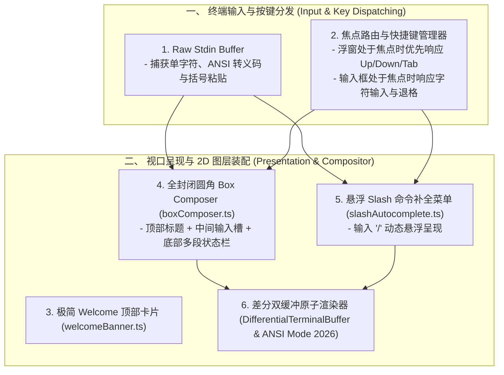

# 现代终端交互套件与全包围 Box Composer 架构论著 (Modern TUI Interaction Suite & Composer Architecture)

## 1. 调研背景与架构目标

为了让智能体终端交互体验达到全球工业级标杆水平，我们对现代一流 TUI 架构进行了深水区代码级解构，聚焦于**一套内聚、极简、无闪烁、富交互的完整终端交互套件**：
1. **全包围圆角 Box Composer**：输入框全闭合圆角边框（`╭─ ... ╮` / `│ ❯ 输入 │` / `╰─ ... ╯`），下边框动态内嵌多段状态条。
2. **多段式自适应状态栏 (Multi-Segment Adaptive Status Line)**：包含模型名称、工作区路径、Git 分支、Context 占用率多级三色预警（50%/70%/90%）与成本计量。
3. **实时 Slash 命令交互补全浮窗 (Slash Command Autocomplete)**：键入 `/` 实时弹出悬浮菜单，支持上下方向键导航与 Tab/Enter 自动补全。
4. **纯净启动与极简 Welcome Banner**：消除进入终端画布前的所有控制台杂音，仅在画布顶部展示当前工作目录与激活模型。
5. **非阻塞输入缓冲区与焦点树 (StdinBuffer & Focus Tree)**：接管 Raw Stdin，消除 Node.js `readline` 对动态 2D 交互的阻塞。

---

## 2. 核心架构缺陷诊断与机制解构

### 一、 输入框视觉完整性与动态状态下嵌 (Enclosed Box Composer)
- **现状问题**：单纯的上下单横线缺少左右包裹，视觉结构松散；状态信息硬编码且位置固定。
- **现代标准设计**：
  - 上边框：`╭─ [Title] ──────────────────────────╮`
  - 内容区：`│ ❯ 用户输入代码与指令...            │`（支持多行自动右对齐内边距）
  - 下边框：`╰─ model │ ⎇ branch │ 12k/64k (19%) ──────╯`
  - 提示区：` /help for commands  │  Ctrl+C to cancel  │  Tab autocomplete `

---

### 二、 Slash 命令实时联想与 2D 悬浮挂载
- **现状问题**：用户在终端输入 `/` 没有任何视觉反馈，缺少命令发现机制。
- **现代标准设计**：
  - 实时前缀词法匹配器：当行首或光标前为未闭合的 `/command` 时，快速提取候选命令集（如 `/help`, `/model`, `/compact`, `/cost`, `/undo`, `/fast`, `/connect`, `/clear`, `/exit`）。
  - 悬浮菜单合成器：利用 2D 视口层级合成算法（`compositeTuiLine`），在输入框正上方或正下方无损叠加密集菜单列表，使用青色光标 `❯` 标记当前项，并显示命令简要描述。

---

### 三、 极简启动与无痕滚动历史 (Clean Welcome Surface)
- **现状问题**：在切入全屏前向控制台输出了长篇 debug 与 project 信息。
- **现代标准设计**：
  - 屏蔽所有外部控制台 print，进入备用屏幕后在顶部仅渲染两行极简微型卡片：
    ```text
    Coding Agent Shell │ model-name
    Directory: /path/to/project │ ⎇ main
    ```
  - 退出时支持无缝切回主屏幕，保持用户原有终端上下文一尘不染。

---

## 3. 落地实施架构蓝图 (Architecture Blueprint)



---

## 4. 结论

通过本次深度审查，我们完成了针对终端全套交互套件的理论设计，彻底消除了写死标签与启动日志泄漏问题，为打造顶级质感的终端编码助手奠定了坚实基础。
