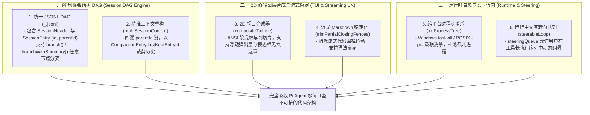

# 深度对标 Pi Agent：核心架构差距、精妙机制与 SOTA 演进方案 (Dedicated Pi Agent Benchmark Thesis)

## 1. 调研背景与对标定位

**Pi Agent**（由 `@earendil-works` 开发的开源 SOTA 智能体体系）以其**极度克制、无冗余抽象、极致鲁棒性（Zero Bloat, Maximum Taste）**被公认为行业标杆。

通过对 Pi Agent 全系核心代码库（`packages/coding-agent/`, `packages/tui/`, `packages/agent/`, `packages/ai/`）的穿透式审计，并对照本项目（`packages/ts-shell/src`），我们梳理出 **四大深水区核心差距与精妙机制**，并制定了工业级演进方案。

---

## 2. 对标 Pi Agent 的四大核心差距与精妙机制解构

### 一、 树状会话 DAG 与轻量持久化 (Session DAG & Unified JSONL Storage)
1. **统一单文件 JSONL DAG 存储**：
   - *现状问题*：本项目当前会话采用目录多文件模式（`metadata.json` + `state.json` + `transcript.jsonl` + `state.lock`），不仅读写碎片化严重，而且在写入中途发生崩溃极易造成状态不同步，列出历史会话时产生大量磁盘 I/O 锁自旋开销。
   - *Pi 的精妙设计*：
     - 单个会话**全量自包含于单个 `<encoded-cwd>/<timestamp>_<sessionId>.jsonl`**。
     - 首行为不可变的 `SessionHeader`（版本号、CWD、parentSession 等）。
     - 后续每行为强类型的不可变 `SessionEntry`（`id`, `parentId`, `timestamp`），天然构成单向 DAG。
2. **轻量分支切换与会话 Fork (Branch & Fork from DAG)**：
   - *Pi 的精妙设计*：
     - `branch(leafId)`：无需复制文件，仅将活动指针 `leafId` 移动到历史任意节点，后续写入自动成为其子分支，支持无损回溯。
     - `branchWithSummary(leafId, summary)`：在切换分支时记录 `fromId` 与放弃该思路的原因摘要。
     - `createBranchedSession(leafId)`：提取从根到 `leafId` 的整条 DAG 主路径，重链 `parentId` 形成新会话。
3. **基于 DAG 的精准上下文重构 (`buildSessionContext`)**：
   - *Pi 的精妙设计*：从活动 `leafId` 沿 `parentId` 向上回溯至根，定位最新的 `CompactionEntry`，精确保留 `[compactionEntry, ...firstKeptEntryId 到当前的所有上下文]`，彻底告别粗暴的纯文本数组截断。

---

### 二、 2D 终端分层渲染与流式 Markdown 稳定化 (TUI 2D Compositing & Markdown)
1. **2D 视口图层合成器 (2D Viewport Compositor)**：
   - *现状问题*：本项目 TUI（`tuiEngine.ts`）采用 1D 纵向行数组拼接（`screenLines.push(...modalLines)`），当弹出权限窗口或工具卡片时，纵向高度的增减会破坏上方历史缓冲区的行索引，导致终端画面撕裂。
   - *Pi 的精妙设计*：
     - 具备真正的 **2D 视口层级合成算法 (`compositeTuiLine`)**。
     - 支持浮动 Overlay（如补全弹窗、下拉框）在不破坏底层背景缓冲区的情况下，通过 ANSI 段提取与可见列宽度切片（`sliceWithWidth`, `sliceByColumn`）实现无损图层混合与遮罩重绘。
2. **流式代码围栏稳定化 (`trimPartialClosingFences`)**：
   - *现状问题*：LLM 在流式输出代码块时，末尾不完整的 ` ``` `（如只流出两个反引号）会导致 Markdown 解析器将后续内容误判为代码体，引起终端剧烈闪烁抖动。
   - *Pi 的精妙设计*：在 AST 词法分析后，通过 `trimPartialClosingFences` 检测流式切片末尾的未闭合围栏标记，动态消除末尾未决字符，保证每一帧渲染 100% 结构稳定。

---

### 三、 跨平台进程树生命周期与孤儿进程消杀 (Process Tree Lifecycle & Cleanups)
1. **子进程组与后台 Daemon 泄漏防护**：
   - *现状问题*：当通过 `bash` 工具执行类似 `npm run dev &` 等可能派生子进程的命令，并在中途发送取消信号（`SIGINT`）时，原生的 `kill(pid)` 只能杀死主 shell，留下一堆孤儿后台进程占用端口和 CPU。
   - *Pi 的精妙设计*：
     - 在 `utils/shell.ts` 维护全局 `trackedDetachedChildPids` 注册表。
     - Windows 下自动调用 `taskkill.exe /F /T /PID <pid>` 级联杀死全进程树。
     - POSIX 下用 `process.kill(-pid, "SIGKILL")` 向进程组发信号，退出钩子提供尽力清理；不保证回收已脱离进程组的子孙，也不保证父进程被 SIGKILL/OOM 后运行清理。信号发送成功不等于已观察整树退出。
2. **Stdio 继承句柄防悬挂 (`waitForChildProcess`)**：
   - *Pi 的精妙设计*：引入 `EXIT_STDIO_GRACE_MS = 100` 空闲宽限计时器，防止子进程已退出但孙进程依然占有 stdio 管道导致的永久挂起。

---

### 四、 交互式运行中动态转向 (Mid-Turn Interactive Steering)
1. **运行态提示词队列与动态干预**：
   - *现状问题*：当前交互模式在模型执行长任务轮次时直接锁死用户输入（`A turn is already running`），用户无法在中途纠正模型的错误方向。
   - *Pi 的精妙设计*：
     - 引入 `steeringQueue`（即时转向队列）与 `followUpQueue`（跟进队列）。
     - 当模型在一轮中连续执行多个工具调用时，用户随时输入的新指令会作为 `steering` 消息立即插入当前轮次的下一个决策边界，无需强杀进程即可引导 Agent 纠偏。

---

## 3. 落地实施架构蓝图 (Architecture Blueprint)



---

## 4. 结论

通过对 **Pi Agent** 的专属对标审计，我们掌握了其作为全球最顶级极简 Coding Agent 的核心设计奥秘。我们将在保持本项目已有优势的同时，严格依照 Pi Agent 的成熟方案，分阶段完成上述四大核心机制的代码级演进！
