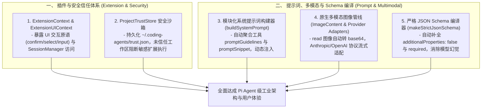

# 深度对标 Pi Agent 第二轮：插件生命周期、模块化系统提示词、多模态管道与严格 Schema 架构论著 (SOTA Evolution Thesis Round 2)

## 1. 调研背景与深化对标范围

在完成树状会话 DAG、2D 视口合成与网络弹性重试等底层基石对标后，本轮我们进一步切入 Pi Agent 的两大高阶工业级子系统：
1. **可插拔扩展与插件生命周期系统 (Extension & Plugin Lifecycle)**：`ExtensionContext`、`ExtensionUIContext`、Tool Wrapping、动态 Jiti 模块加载、项目信任安全沙箱 (`ProjectTrustStore`)。
2. **提示词工程、多模态引擎与严格 Schema (Prompt Architecture, Multimodal & Strict Schema)**：模块化 `buildSystemPrompt`、`ImageContent` 原生多模态管道、`makeStrictJsonSchema` 约束采样、Anthropic 4 阶与 OpenAI 24h 缓存优化。

---

## 2. 核心架构差距（Gaps）与机制解构

### 一、 扩展与插件生态生命周期 (Extension & Plugin Lifecycle)
1. **上下文能力暴露不全**：
   - *现状*：本项目现有 Hook 系统（`hookDispatcher.ts`）仅为静态决策钩子，无法在扩展中操纵 UI（如调用 `select`、`confirm`、`input`、`custom` 渲染）、无法检索会话树（`SessionManager`）、无法动态调整模型与思考预算。
   - *Pi 的精妙设计*：向插件暴露全功能的 `ExtensionContext` 与 `ExtensionUIContext`，允许扩展动态注入工具、自定义命令、自定义消息渲染器（`CustomMessage`）与事件订阅。
2. **工具包装与自定义渲染器 (Tool Wrapping & Renderers)**：
   - *现状*：工具返回固定字符串，前端仅做纯文本展示。
   - *Pi 的精妙设计*：`ToolDefinition` 支持 `renderCall` 与 `renderResult`，允许在 TUI 中渲染丰富的折叠卡片、交互式状态条与图表组件。
3. **工作区项目信任安全沙箱 (Project Trust Gate)**：
   - *现状*：自动执行工作区配置，缺乏未信任仓库的安全隔离。
   - *Pi 的精妙设计*：`ProjectTrustStore`（持久化 `~/.pi/agent/trust.json`）在打开未信任代码库时强制弹出信任决策，在未授权前严格禁用本地扩展与敏感提示词覆写。

---

### 二、 模块化提示词架构、多模态与严格 Schema 校验
1. **模块化分层系统提示词 (`buildSystemPrompt`)**：
   - *现状*：`agentLoop.ts` 采用静态字面量拼接，无法根据当前注册工具动态收集工具指南（`promptGuidelines`）与工具摘要（`promptSnippet`）。
   - *Pi 的精妙设计*：按 `Base Identity -> Tool Catalog (promptSnippet) -> Deduplicated Guidelines -> Project Context (AGENTS.md / CLAUDE.md) -> Skills Catalog -> Dynamic CWD` 动态流水线装配，工具变更时自动触发 `_rebuildSystemPrompt`。
2. **原生图片多模态管线 (Native Multimodal Image Pipeline)**：
   - *现状*：消息接口 (`NormalizedMessage.content`) 与工具执行均受限于纯文本 `string`，读取图像文件会因编码问题损坏二进制数据。
   - *Pi 的精妙设计*：
     - 定义统一的 `ImageContent`（`{ type: "image", data: base64, mimeType }`）。
     - `read` 工具自动识别图像 MIME 并输出 `ImageContent`。
     - Multi-Provider 协议层自动分流（Anthropic `image` 块、OpenAI `image_url`、Gemini `inlineData`），非视觉模型自动降级为 `[Image: ...]占位符`。
3. **严格 JSON Schema 编译与约束采样 (Strict Schema & Constrained Sampling)**：
   - *现状*：`buildOpenAITools` 直传原始 Schema，未做严格化修补。
   - *Pi 的精妙设计*：`makeStrictJsonSchema` 自动递归补全 `additionalProperties: false`、所有字段纳入 `required`、可选字段映射为 `anyOf: [schema, { type: "null" }]`，并剥离 meta 关键词，确保大模型 100% 结构化输出。
4. **提示词缓存深度优化 (4-Breakpoint Prompt Caching)**：
   - *Pi 的精妙设计*：
     - Anthropic 对齐 4 个缓存点：`System Block`、`Last Tool Definition`、`倒数第二条 User Message（锁定历史对话）` 与 `长会话工具边界`。
     - OpenAI 注入 `prompt_cache_key`（截断至 64 字符）与 `prompt_cache_retention: "24h"`，配合会话亲和性头部 (`session_id`) 极大提升命中率。

---

## 3. 落地实施架构蓝图 (Architecture Blueprint)

---

## 4. 结论

通过本轮对标，我们完成了对 **插件完整生命周期、项目信任沙箱、模块化提示词流水线、原生图片多模态与严格 Schema 约束采样** 的全套理论设计与算法解构。
