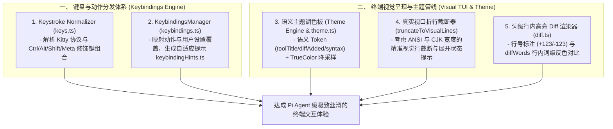

# 深度对标 Pi Agent 第三轮：键盘快捷键引擎、可视化截断与语义 Diff 渲染管线 (SOTA Evolution Thesis Round 3)

## 1. 调研背景与深化对标范围

在完成树状会话 DAG、2D 视口合成、扩展上下文与多模态架构后，本轮我们将焦点全面对准 **Pi Agent 极其精湛的终端人机交互（TUI & Interactive UX）核心**：
1. **键盘快捷键与按键解构引擎 (Keybindings & Keystroke Normalizer)**：Kitty 键盘协议、修饰键规范化（Ctrl/Alt/Meta/Shift）、冲突检测、可配置用户覆盖层与动态快捷键提示（`keybinding-hints`）。
2. **可视化行截断与交互式工具卡片 (Visual Line Truncation & Interactive Tool Cards)**：基于真实终端宽度的折行计算（`truncateToVisualLines`）、折叠与展开状态机（`[... (X earlier lines, Ctrl+O to expand)]`）。
3. **语义主题系统与行内词级 Diff 渲染 (Theme System & Intra-Line Word Diff)**：40+ 语义颜色 Token、24-bit TrueColor/256 颜色降采样、单行修改行内词级反色差异高亮（`renderDiff` / `diffWords`）。

---

## 2. 核心架构差距（Gaps）与机制解构

### 一、 键盘快捷键与修饰键规范化 (Keybindings & Key Normalization)
1. **原生 Readline 的按键歧义与修饰键丢失**：
   - *现状*：本项目依赖 Node 原生 `readline.emitKeypressEvents`，无法区分 `Alt+Enter` 与 `Esc` 后跟 `Enter`，无法识别 Kitty 协议高级按键（如 `Ctrl+Shift+P`、`Ctrl+-`），且双击 Escape 取消硬编码为 3 秒计时器。
   - *Pi 的精妙设计*：
     - 构建专用的 `keys.ts` 词法解析器，支持 Kitty 键盘协议、ANSI CSI/SS3 序列及非拉丁键盘布局对齐。
     - 构建 `KeybindingsManager`，允许用户在 `settings.json` 中随意覆盖核心动作（如 `app.tools.expand`, `app.thinking.toggle`, `app.interrupt`），并提供快捷键冲突检测。
2. **动态平台自适应快捷键提示 (`keybinding-hints`)**：
   - *Pi 的精妙设计*：根据操作系统自动格式化按键名称（如 macOS 显示 `Opt` / `Option`，Windows 显示 `Alt`），并生成自适应高亮提示符。

---

### 二、 可视化真实行截断与交互式折叠 (Visual Line Truncation)
1. **字符级截断 vs 终端视口真实折行截断**：
   - *现状*：现有 `truncation.ts` 仅按 `\n` 切分行或按字节截断，一行 1000 字符在 80 列终端会折叠为 13 个视觉行，彻底破坏 TUI 的视口高度预算。
   - *Pi 的精妙设计*：`truncateToVisualLines` 结合实际终端列宽 `width`，在考虑 ANSI 转义码与 CJK 双字符宽度的前提下计算真实视觉折行，并在折叠状态下提供平滑的末尾预览与已跳过行数提示。

---

### 三、 语义主题调色板与行内词级 Diff (Semantic Theme & Word-Level Diff)
1. **散落的硬编码 ANSI 转义序列**：
   - *现状*：代码中充斥大量 `\x1b[32m`、`\x1b[90m` 硬编码颜色，无法适配浅色主题或 256 色/基础 16 色终端。
   - *Pi 的精妙设计*：
     - 构建基于语义 Token 的 `Theme` 抽象类（`toolDiffAdded`, `toolDiffRemoved`, `toolPendingBg`, `syntaxKeyword`）。
     - 支持从 24-bit TrueColor 向 256-color 颜色立方体/灰度梯阶的欧几里得距离感知降采样。
2. **无行号与无词级差异的可视化 Diff**：
   - *现状*：编辑工具仅输出成功或失败，终端没有统一的差异高亮组件。
   - *Pi 的精妙设计*：`renderDiff` 对比行级增删，并对单行修改调用 `diffWords` 执行词级反色（`theme.inverse`）高亮，保留缩进的同时清晰标出变更词。

---

## 3. 落地实施架构蓝图 (Architecture Blueprint)

---

## 4. 结论

通过本轮对标，我们完成了对 **按键解构、用户按键自定义、真实视口折行截断、语义主题系统与行内词级 Diff 渲染** 的全套架构设计。
