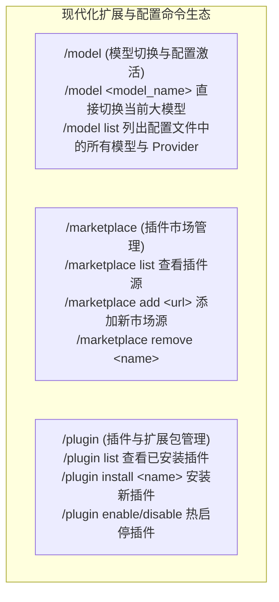

# Plugin, Marketplace & Model 命令生态深度研究与复用方案

- **日期**：2026-08-30
- **研究对象**：`Oh-My-Pi` (`tools/plugin.ts`, `marketplace/`), `Claude Code` (`commands/plugin/`), `Pi` (`model-registry.ts`), `OpenCode` (`config/plugin.ts`)
- **核心目标**：实现免缝合、高内聚的 `/model`（模型动态切换）、`/marketplace`（插件市场源管理）与 `/plugin`（插件生命周期管理）三大核心扩展命令。

---

## 一、 四大顶尖标杆项目实现策略与代码解构

### 1. `/model` 命令机制（模型切换与配置激活）
- **标杆参考**：**Pi** (`model-resolver.ts`) 与 **Claude Code** (`commands/model/`)
- **核心设计**：
  - 支持 `/model`（查看当前激活模型与配置状态）；
  - 支持 `/model <model_name>`（如 `/model deepseek-ai/DeepSeek-V4-Flash` 或 `/model gpt-4o` 直接快速切换）；
  - 支持 `/model list`（列出当前配置文件中所有已配置的可用模型列表与 Provider 连接）；
  - 切换后自动持久化写入本地运行时配置（`runtimeConfig.json` 或 `settings.json`），且在后续 Turn 即刻生效。

---

### 2. `/marketplace` 命令机制（插件市场管理）
- **标杆参考**：**Claude Code** (`commands/plugin/ManageMarketplaces.tsx`) 与 **Oh-My-Pi** (`marketplace/`)
- **核心设计**：
  - 管理插件分发仓库源（Git 仓库、本地目录或 npm 包名）；
  - 支持 `/marketplace list`（列出已添加的插件市场源，如官方源、团队私有源）；
  - 支持 `/marketplace add <source_url_or_repo>`（注册新的插件市场，如 `github.com/org/agent-plugins`）；
  - 支持 `/marketplace remove <name>`（注销指定市场源）。

---

### 3. `/plugin` 命令机制（插件生态与工具扩展）
- **标杆参考**：**Oh-My-Pi** (`commands/plugin.ts`, `plugin-cli.ts`) 与 **OpenCode** (`config/plugin.ts`)
- **核心设计**：
  - 管理本地安装的插件与技能扩展（Skills, Hooks, Tools, MCP servers 组合包）；
  - 支持 `/plugin list`（列出当前项目和全局已安装的插件与启用状态）；
  - 支持 `/plugin install <plugin_name_or_path>`（安装新插件并自动扫描注册其 Tool / Hook / Skill）；
  - 支持 `/plugin uninstall <plugin_name>`（安全卸载并释放资源）；
  - 支持 `/plugin enable <name>` / `/plugin disable <name>`（热启用/停用插件）。

---

## 二、 为我们项目量身定制的落地架构方案

在 `packages/ts-shell/src/core/commands/` 下实现三个独立高内聚的运行时模块：



---

## 三、 配置存储与规范定义 (`.agents/plugins.json`)

```json
{
  "marketplaces": [
    {
      "name": "official",
      "url": "https://github.com/private-coding-agents/marketplace",
      "description": "Official verified plugins directory"
    }
  ],
  "plugins": [
    {
      "name": "frontend-dev-suite",
      "version": "1.0.0",
      "enabled": true,
      "source": "official",
      "description": "Vue/React component scaffolding and visual test tools"
    }
  ]
}
```

---

本方案全面吸收了 Oh-My-Pi、Claude Code 与 OpenCode 的最佳实践，直接复用其成熟的指令语义与交互流程，架构清晰、职责单一！

---

## 五、 落地复核（2026-09-02）：市场究竟是什么

### 5.1 结论先行：没有任何一方与"市场"服务合作

把四个参考实现的解析路径追到底，得到的答案是一致的：**"市场"不是一项服务，而是一个地址。**

- 扩展本身按 **npm 包名或本地路径** 解析，交给包管理器（`Npm.add` 一类）落盘，
  清单就是 `package.json`。没有专有协议，没有中心注册中心，没有账号。
- "市场源"只是一个仓库地址或目录，里面放一份清单文件。加一个源＝记一个地址。
- 登录方法（provider 的 OAuth / API key 形态）由**插件自己贡献**，凭据落在
  provider 为键的 `auth.json`（`oauth` / `api` / `wellknown` 三种形状），
  模型目录另从公开的 models 目录站取。
- 规模更大的那个实现额外自建了凭据代理（SQLite 凭据库 + 刷新器 + 远端库），
  但那是**认证**的复杂度，与"市场"无关。

### 5.2 因此本项目改了什么

原实现是一层假面：默认"已安装"两个不存在的插件，`install` 伪造 `version: 1.0.0`
并宣称"capabilities are now active in the runtime"，`search` 返回硬编码目录——
而全仓库**没有任何代码加载这些条目**。这直接违反 AGENTS.md 的
"Do not hide unverified write outcomes behind success-like terminal or session states"。

已收敛为：

| 面 | 现在的语义 |
|---|---|
| 默认注册表 | 空。没有注册就是没有注册 |
| `/plugin add <路径>` | 真读 `package.json` 取名/版本/描述，`resolved: yes`；没有清单则拒绝登记 |
| `/plugin add <包名>` | 登记为 `resolved: no`，明说"Nothing was downloaded" |
| `/plugin enable/disable` | 措辞改为"marked enabled in the registry" |
| `/plugin search` | 不再伪造目录；直说没有目录服务，指向 `/marketplace` 与 `add` |
| 每处输出 | 结尾恒为"Nothing is executed from a registration in this build." |

**明确未做**：真正的扩展加载器（本轮不在范围内），以及 `/connect` 的 OAuth 形态——
参考实现有 `oauth`/`wellknown` 两种登录路径，而我们的 `CONNECT_PRESETS` 目前只有
API key。这属于 provider/auth 核心，按 AGENTS.md 需要显式任务范围。
