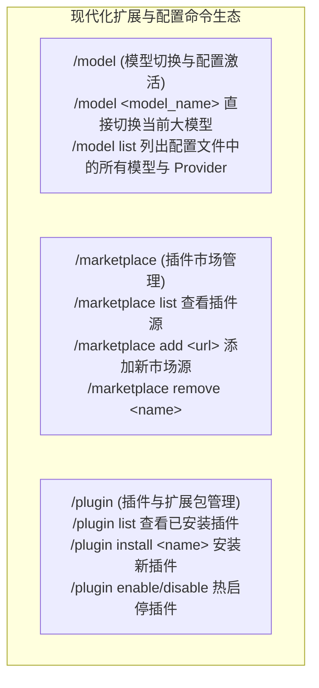

# Plugin, Marketplace & Model 命令生态深度研究与复用方案

- **日期**：2026-08-30
- **研究对象**：`Oh-My-Pi` (`tools/plugin.ts`, `marketplace/`), `Claude Code` (`commands/plugin/`), `Pi` (`model-registry.ts`), `OpenCode` (`config/plugin.ts`)
- **核心目标**：实现免缝合、高内聚的 `/model`（模型动态切换）、`/marketplace`（插件市场源管理）与 `/plugin`（插件生命周期管理）三大核心扩展命令。

---

## 一、 四大顶尖标杆项目实现策略与代码解构

### 1. `/model` 命令机制（模型切换与配置激活）
- **标杆参考**：**Pi** (`model-resolver.ts`) 与 **Claude Code** (`commands/model/`)
- **核心设计**：
  - 支持 `/model`（查看当前激活模型与配置状态）；
  - 支持 `/model <model_name>`（如 `/model deepseek-ai/DeepSeek-V4-Flash` 或 `/model gpt-4o` 直接快速切换）；
  - 支持 `/model list`（列出当前配置文件中所有已配置的可用模型列表与 Provider 连接）；
  - 切换后自动持久化写入本地运行时配置（`runtimeConfig.json` 或 `settings.json`），且在后续 Turn 即刻生效。

---

### 2. `/marketplace` 命令机制（插件市场管理）
- **标杆参考**：**Claude Code** (`commands/plugin/ManageMarketplaces.tsx`) 与 **Oh-My-Pi** (`marketplace/`)
- **核心设计**：
  - 管理插件分发仓库源（Git 仓库、本地目录或 npm 包名）；
  - 支持 `/marketplace list`（列出已添加的插件市场源，如官方源、团队私有源）；
  - 支持 `/marketplace add <source_url_or_repo>`（注册新的插件市场，如 `github.com/org/agent-plugins`）；
  - 支持 `/marketplace remove <name>`（注销指定市场源）。

---

### 3. `/plugin` 命令机制（插件生态与工具扩展）
- **标杆参考**：**Oh-My-Pi** (`commands/plugin.ts`, `plugin-cli.ts`) 与 **OpenCode** (`config/plugin.ts`)
- **核心设计**：
  - 管理本地安装的插件与技能扩展（Skills, Hooks, Tools, MCP servers 组合包）；
  - 支持 `/plugin list`（列出当前项目和全局已安装的插件与启用状态）；
  - 支持 `/plugin install <plugin_name_or_path>`（安装新插件并自动扫描注册其 Tool / Hook / Skill）；
  - 支持 `/plugin uninstall <plugin_name>`（安全卸载并释放资源）；
  - 支持 `/plugin enable <name>` / `/plugin disable <name>`（热启用/停用插件）。

---

## 二、 为我们项目量身定制的落地架构方案

在 `packages/ts-shell/src/core/commands/` 下实现三个独立高内聚的运行时模块：



---

## 三、 配置存储与规范定义 (`.agents/plugins.json`)

```json
{
  "marketplaces": [
    {
      "name": "official",
      "url": "https://github.com/private-coding-agents/marketplace",
      "description": "Official verified plugins directory"
    }
  ],
  "plugins": [
    {
      "name": "frontend-dev-suite",
      "version": "1.0.0",
      "enabled": true,
      "source": "official",
      "description": "Vue/React component scaffolding and visual test tools"
    }
  ]
}
```

---

本方案全面吸收了 Oh-My-Pi、Claude Code 与 OpenCode 的最佳实践，直接复用其成熟的指令语义与交互流程，架构清晰、职责单一！
