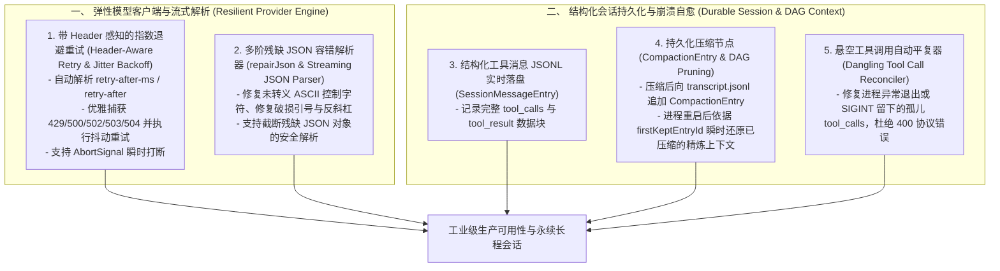

# AI Coding Agent 会话持久化与模型弹性重试架构深度审查报告 (Session Durability & Provider Resilience Thesis)

## 1. 调研与审查背景与范围

为了确保本项目（`packages/ts-shell`）在面对网络抖动、模型服务限流（HTTP 429 / 503）、进程异常崩溃（SIGINT / OOM）以及多轮长程开发时具备工业级可靠性，我们对标了业界标杆项目：
- **`source-claudecode`**（`sessionStorage.ts`、`outputLimits.ts`）
- **`pi` Agent**（`agent-loop.ts`、`provider-retry.ts`、`json-parse.ts`、`session-manager.ts`）
- **`opencode`**（`tool-stream.ts`、`processor.ts`）
- **`oh-my-pi`**（`turn-recovery.ts`）

---

## 2. 核心架构缺陷（Gaps Discovered）

### 一、 大模型网络弹性与重试流式机制 (Provider Resilience & Streaming)
1. **网络调用缺乏抖动指数退避与 Header 感知重试**：
   - *现状*：`agentLoop.ts` 对 LLM API 发起直接 `fetch()`，遭遇 HTTP 429（Rate Limit）或 503（Service Unavailable）时直接抛错中断，缺乏对 `retry-after-ms` / `retry-after` 的解析与指数退避重试。
   - *对标*：Pi Agent (`provider-retry.ts`) 具备完备的重试分类器（区分 429/500/503 与不可重试的 401/403/Quota 耗尽），支持向下解相关抖动算法（Downward Decorrelated Jitter），且可通过 `AbortSignal` 随时响应用户取消操作。
2. **流式与残缺 JSON 容错能力缺失**：
   - *现状*：依赖单次静态 `JSON.parse`，若大模型在输出工具参数时遇到未转义的控制字符（如 `\n` 未转义、双引号未闭合），直接报错崩溃。
   - *对标*：Pi (`json-parse.ts`) 具备 5 阶智能修复管线（`repairJson` 修复 ASCII 控制字符与未闭合引号 + `partialParse` 修复不完整对象结构）。
3. **Token 截断时的上下文污染与孤儿工具调用**：
   - *现状*：当模型生成被 `max_tokens` 截断（`finish_reason === "length"`）时，生成的非完整 `tool_calls` 会残留在上下文历史中，导致后续轮次因缺乏配对的 `tool_result` 而触发 OpenAI / Anthropic 协议 400 校验错误。
   - *对标*：Pi Agent 在 `failToolCallsFromTruncatedMessage` 中对截断轮次的工具调用全部生成合成错误提示，保持上下文严格交替闭环。

---

### 二、 会话持久化、崩溃回放与压缩落盘 (Session Durability & Replay)
1. **结构化工具调用未持久化至 Transcript JSONL**：
   - *现状*：`SessionMessage` 仅记录了纯文本的 `user` / `assistant` 内容，`agentLoop` 执行过程中的所有 `tool_calls` 与 `tool_result` 均未持久化，一旦重启进程，历史工具调用完全丢失。
   - *对标*：`source-claudecode` 与 `pi` 将完整的结构化消息链（`tool_use`、`tool_result`、`uuid`、`parentId`）以不可变追加写入 `<sessionId>/transcript.jsonl`。
2. **长会话压缩（Compaction）仅停留在内存**：
   - *现状*：`agentLoop.ts` 在超限触发 `executeFullCompaction()` 后，仅修改了内存中的 `messages` 数组，未向磁盘写入 `CompactionEntry`。下次会话加载时，依然需要加载全部未压缩的历史或退化为粗略的字符串提示。
   - *对标*：`pi`（`session-manager.ts`）在压缩完成后向 JSONL 追加 `CompactionEntry`（记录 `summary` 与 `firstKeptEntryId`），并在后续加载时依据 DAG 自动裁剪过期前缀。
3. **崩溃恢复缺乏悬空工具调用自动平复 (Dangling Tool Reconciliation)**：
   - *现状*：若用户在模型生成工具调用后、工具执行前强制中断（Ctrl+C），重启会话时上下文留存了未得到结果的工具调用，直接导致大模型接口报错。
   - *对标*：`source-claudecode` 在加载时执行 `reconcileDanglingToolCalls`，为所有悬空的 `tool_call_id` 自动填补 `Tool call interrupted` 结果。

---

## 3. 落地演进架构设计

---

## 4. 结论与后续规划

通过本次对标，我们完成了对 **大模型网络调用弹性重试、残缺 JSON 修复、结构化工具日志落盘与崩溃平复恢复** 的全方位顶层设计，为打造工业级永续运行的 Agent Harness 提供了完整技术路线。
