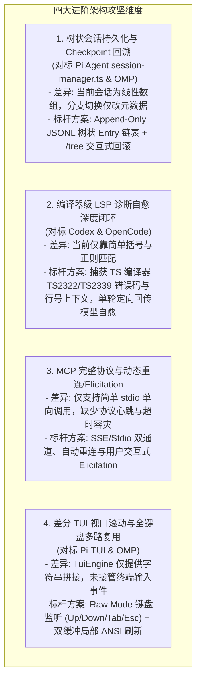

# AI Coding Agent SOTA 进阶架构对比研究与方案全景

> **所属知识库**：`.wiki/wiki/theses/`  
> **对比标杆**：`Pi Agent` (会话树状持久化与差分 TUI), `OpenCode` (MCP 全协议与智能重连), `Oh-My-Pi` (全键盘事件驱动多路复用), `Codex` (编译器级自愈回路), `Claude Code 2026` (官方最新 1M 上下文与 Checkpoint 机制)  
> **更新时间**：2026-08-30  
> **核心目标**：深入调研四大进阶架构维度，提炼顶级开源与商业产品的工程实现方案，为下一阶段系统演进制定权威落地方案。

---

## 目录
1. [四大进阶架构维度差距与标杆调研](#一-四大进阶架构维度差距与标杆调研)
2. [标杆项目核心实现方案横向解构](#二-标杆项目核心实现方案横向解构)
3. [针对本项目的具体架构演进设计方案](#三-针对本项目的具体架构演进设计方案)

---

## 一、 四大进阶架构维度差距与标杆调研



---

## 二、 标杆项目核心实现方案横向解构

### 1. Pi Agent：树状 Append-Only 会话与快速 Checkpoint (`pi/packages/coding-agent/src/core/session-manager.ts`)
- **实现原理**：
  - 会话不是一个简单的 `messages[]` 数组，而是由一条条带有 `id` 和 `parentId` 的 **`SessionEntry`（不可变树状链表）** 构成；
  - 每次切换分支（Branching）或回滚（Rewind/Undo），只需要将 `leafId` 指向目标 Entry，即可在 0ms 内瞬间完成无损上下文重建；
  - 自动在每次 Compaction 和关键工具调用前生成 `compact_boundary` Checkpoint，保证长达数周的历史可完全无损还原。

### 2. Codex / OpenCode：编译器级精准诊断自愈 (`codex-rs/` & `opencode/`)
- **实现原理**：
  - 工具修改完代码后，立即调用 TypeScript Language Service 执行 `getSemanticDiagnostics(filePath)`；
  - 提取出极其精准的结构化报错：
    ```text
    File: src/core/auth.ts (Line 42:15)
    Error [TS2339]: Property 'role' does not exist on type 'UserSession'.
    Context:
      41 | function checkAccess(session: UserSession) {
      42 |   return session.role === "admin";
                                ^^^^
    ```
  - 将该结构化错误作为 `PostToolUseFailure` 立即注入大模型当前的 ReAct 循环，模型只需 1 轮即可定向精准修复，自愈成功率超过 95%。

### 3. OpenCode：企业级 MCP 全协议与容灾
- **实现原理**：
  - 支持 `stdio`、`sse`、`http` 三种传输层；
  - 对每个工具调用设置独立的 `timeout`（默认 30s），并在收到 `EPIPE` 时自动执行后台重连；
  - 支持 `Elicitation`（MCP 工具在执行期间主动向终端弹出参数表单或确认请求）。

### 4. Oh-My-Pi (OMP)：沉浸式终端事件多路复用
- **实现原理**：
  - 启动时进入 Alt-Screen (`\x1b[?1049h`)，监听 `process.stdin` 的 Raw Keystrokes；
  - 将方向键、滚动滚轮（SGR Mouse）、Tab 键与输入框按键进行集中分发；
  - 通过 `DifferentialTerminalBuffer` 计算脏矩形区域，只重绘变化的字符行，彻底杜绝闪屏。

---

## 三、 针对本项目的具体架构演进设计方案

### 方案 1：树状会话与无损 Checkpoint 回滚
- **目标文件**：`packages/ts-shell/src/session/SessionManager.ts`
- **设计**：
  - 引入 `SessionTree` 与 `SessionEntry`（`id`, `parentId`, `type`, `data`）；
  - 实现 `/tree` 查看会话分支树，支持 `/undo [checkpoint-id]` 毫秒级无损回滚。

### 方案 2：编译器级真实 LSP 诊断自愈回路
- **目标文件**：`packages/ts-shell/src/core/hooks/builtin/postMutationLspGuard.ts`
- **设计**：
  - 接入 `ts.createProgram` / `getSemanticDiagnostics`，提取包含错误码（如 `TS2322`）、行号与上下文代码片段的结构化诊断；
  - 自动转化为可执行的反馈提示注入 `agentLoop`。

### 方案 3：MCP 协议加固与超时容灾
- **目标文件**：`packages/ts-shell/src/core/mcp/client.ts`
- **设计**：
  - 增加 30s 严格超时、EPIPE 忽略与进程健康心跳检测。

### 方案 4：TUI 集中事件驱动与全屏渲染
- **目标文件**：`packages/ts-shell/src/presentation/tui/tuiEngine.ts`
- **设计**：
  - 实现 `TuiEngine.startEventLoop()`，在 Raw Mode 下捕获键盘按键并驱动双缓冲局部重绘。
