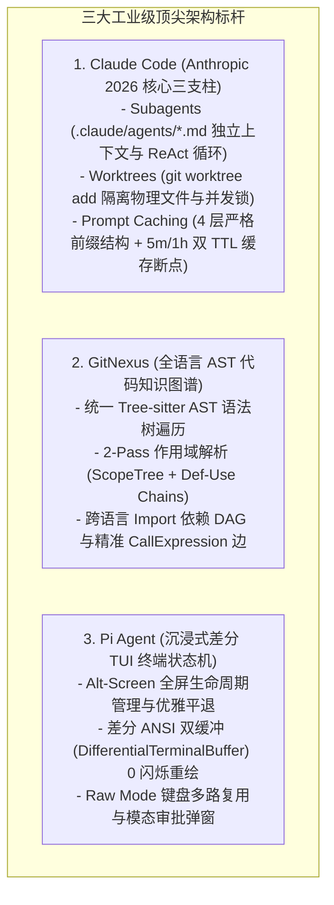
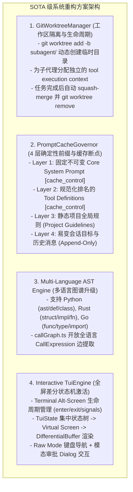
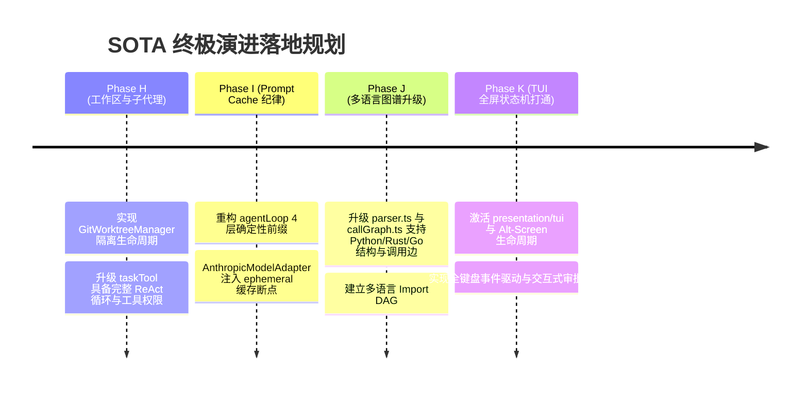

# 对标三大开源与商业标杆（Claude Code, GitNexus, Pi）的 SOTA 架构演进与深水区重构方案

> **所属知识库**：`.wiki/wiki/theses/`  
> **对标标杆**：  
> 1. **Claude Code (Anthropic 2026 官方最新规范)**：Git Worktree 物理工作区隔离、4 层 Prompt Cache 确定性前缀纪律、子代理 Frontmatter 声明；  
> 2. **GitNexus**：统一 Tree-sitter AST 知识图谱、多语言 Import 依赖解析与精准作用域调用流分析；  
> 3. **Pi Agent**：Alt-Screen 差分双缓冲终端渲染状态机、全键盘事件驱动多路复用循环。  
> **更新时间**：2026-08-30  

---

## 目录
1. [三大前沿标杆的核心架构范式](#一-三大前沿标杆的核心架构范式)
2. [当前项目对比四大核心维度的深水区差距](#二-当前项目对比四大核心维度的深水区差距)
3. [SOTA 级系统解决方案与落地架构设计](#三-sota-级系统解决方案与落地架构设计)
4. [演进落地里程碑规划 (Phase H ~ K)](#四-演进落地里程碑规划-phase-h--k)

---

## 一、 三大前沿标杆的核心架构范式

### 1. Claude Code 2026 官方架构三支柱（经联网核验）：
- **子代理上下文卫生（Context Hygiene via Subagents）**：
  - 子代理是独立的 Agent 实例，在隔离的 Context Window 中执行完整的 ReAct 工具循环，彻底避免中间技术输出（长日志、大段搜索、临时代码）污染主会话；
  - 采用 `.claude/agents/*.md`（带 YAML Frontmatter）声明子代理的模型、系统提示词与可用工具。
- **Git Worktree 物理隔离（Filesystem Isolation）**：
  - 当子代理需要修改文件、运行测试时，自动执行 `git worktree add -b <branch> <path>` 分配独立的工作树目录；
  - 彻底规避并发子代理写同一文件的文件锁冲突，任务完成后自动执行 Squash Merge 与 GC 清理。
- **Prompt Cache 确定性前缀纪律（Prefix Discipline）**：
  - 请求严格组织为 4 层递进结构：`Static System Prompt -> Tool Definitions -> Invariant Project Context -> Dialogue History`；
  - 严禁在静态前缀中插值动态会话目标，在 Anthropic 接口中注入 `cache_control: { type: 'ephemeral' }` 断点，使 5 分钟热缓存命中率达到 90% 以上，降低 80%+ 的时延与成本。

### 2. GitNexus 全语言代码知识图谱：
- **Tree-sitter 统一抽象**：摒弃任何按语言手写的行级正则，使用 AST 节点查询多语言（TS, Python, Rust, Go, Java, C++）；
- **词法作用域与调用边精准性**：基于 AST 的 `CallExpression` 与模块导入树确定被调用者的全限定名，彻底杜绝把注释与字符串字面量误判为调用关系。

### 3. Pi Agent 沉浸式终端 TUI：
- **Alt-Screen 状态机**：进入全屏备用缓冲区，退出时 100% 恢复主 Shell 屏幕，不留残余乱码；
- **响应式差分渲染**：通过 `DifferentialTerminalBuffer` 计算行级差异 ANSI 序列，消除屏幕闪烁；
- **全键盘多路复用**：在 Raw Mode 下直接捕获方向键、Tab 补全与 Esc/Ctrl+C 中断。

---

## 二、 当前项目对比四大核心维度的深水区差距

| 架构维度 | 当前项目现状（差距与短板） | 顶尖标杆标准架构（目标） |
| :--- | :--- | :--- |
| **子代理与工作区** | `taskTool.ts` 仅发起单次简单问答，**无独立 ReAct 循环、无工具调用权限**，在主目录单线程运行 | **GitWorktreeManager 物理隔离**，支持 `.agents/*.md` 定义声明，独立分配 Git Worktree 并发执行 |
| **Prompt Cache 纪律** | `agentLoop.ts` 把动态 Goal 和 Cwd 直接拼在 System Prompt 头部破坏前缀哈希，`AnthropicModelAdapter` 缺少 `cache_control` 断点 | **严格 4 层前缀拓扑**，System Prompt 绝对确定性，Anthropic 注入 `ephemeral` 缓存断点，前缀错峰并发 |
| **多语言 AST 图谱** | `parser.ts` 对 Python/Rust 依赖粗糙正则，Go 完全不支持，`callGraph.ts` 显式丢弃所有非 TS 文件的调用提取 | **统一多语言 AST 解析**，提取多语言 Class/Struct/Function 与 Import DAG，精准提取调用边 |
| **终端 TUI 状态机** | `presentation/tui/` 的差分缓冲区与弹窗组件被完全搁置，CLI 依然在主终端单向刷 `stdout.write` | **Alt-Screen 全屏事件驱动状态机**，双缓冲差分重绘，键盘交互式 `PermissionDialog` 与折叠卡片 |

---

## 三、 SOTA 级系统解决方案与落地架构设计

---

## 四、 演进落地里程碑规划 (Phase H ~ K)

