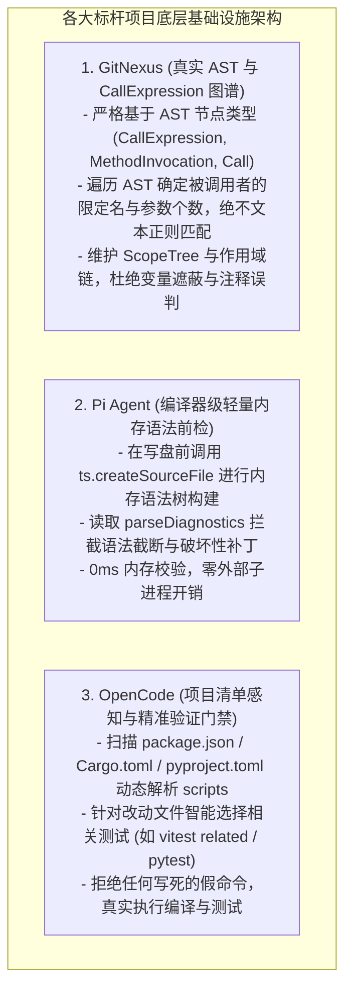
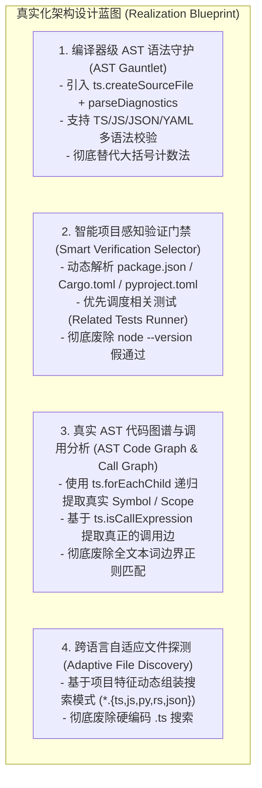
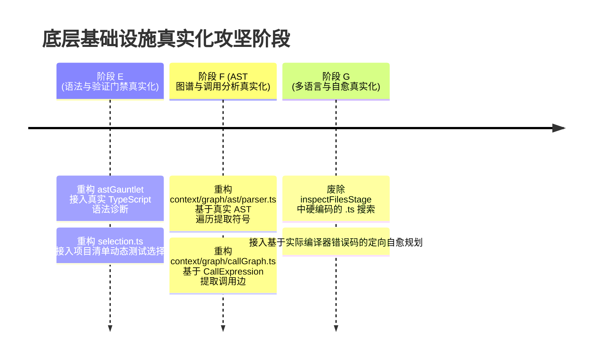

# SOTA 编译器级 AST 前检、动态验证门禁与真实代码图谱架构演进

> **所属知识库**：`.wiki/wiki/theses/`  
> **借鉴标杆**：`GitNexus` (AST 知识图谱与调用流分析), `pi` (轻量语法解析与会话隔离), `opencode` (动态验证门禁与多语言感知), `Codex` (编译器级自愈回路)  
> **更新时间**：2026-08-30  
> **核心目标**：彻底淘汰数大括号、跑 `node --version`、正则匹配调用边等 Demo 级伪算法，建立生产级编译器级 AST 语法前检、智能测试选择与精确语法树调用图。

---

## 目录
1. [标杆项目核心实现深度解构](#一-标杆项目核心实现深度解构)
2. [三大底层基础设施的真实化设计蓝图](#二-三大底层基础设施的真实化设计蓝图)
3. [落地实施路线与防退化规范](#三-落地实施路线与防退化规范)

---

## 一、 标杆项目核心实现深度解构



### 1. GitNexus：精确 AST 遍历与调用流抽取（`GitNexus/gitnexus/src/core/ingestion/`）
- **核心哲学**：**代码图谱必须建立在真正的语法树之上，字符串正则不等于代码分析。**
- **调用边抽取机制**：
  - GitNexus 在 `call-analysis.ts` 中明确定义了全语言的调用节点类型集合：
    ```typescript
    export const CALL_EXPRESSION_TYPES = new Set([
      'call_expression',               // TS/JS/C/C++/Go/Rust
      'method_invocation',             // Java
      'member_call_expression',        // PHP
      'nullsafe_member_call_expression',
      'call',                          // Python/Ruby
      'invocation_expression',         // C#
    ]);
    ```
  - 只有当 AST 遍历器到达实际的调用节点、且被调用方表达式（Callee Expression）能够解析出有效标识符时，才会建立 `(Caller) -[:CALLS]-> (Callee)` 的调用图边。
  - 彻底规避了注释、字符串字面量、日志信息对调用图造成的严重污染。

### 2. Pi Agent / TypeScript 编译器：轻量内存 AST 前检（Memory Preflight）
- **核心哲学**：**在修改实际文件前，进行 0 磁盘 I/O、0 子进程的内存语法树构建。**
- **语法校验机制**：
  ```typescript
  import ts from "typescript";

  export function validateSourceSyntax(code: string, fileName: string = "memory.ts"): { isValid: boolean; errors: string[] } {
    const sourceFile = ts.createSourceFile(
      fileName,
      code,
      ts.ScriptTarget.Latest,
      true, // setParentNodes
      fileName.endsWith(".ts") || fileName.endsWith(".tsx") ? ts.ScriptKind.TS : ts.ScriptKind.JS
    );

    // 获取语法解析期捕获的真实语法诊断
    const parseDiagnostics = (sourceFile as any).parseDiagnostics ?? [];
    if (parseDiagnostics.length > 0) {
      const errors = parseDiagnostics.map((d: ts.Diagnostic) => {
        const message = ts.flattenDiagnosticMessageText(d.messageText, "\n");
        return `Syntax error at line ${(d.start ?? 0)}: ${message}`;
      });
      return { isValid: false, errors };
    }

    return { isValid: true, errors: [] };
  }
  ```
- **质的飞跃**：彻底取代“数大括号 `{` 和 `}` 数量”的荒谬逻辑，真正捕获括号缺失、未闭合模板字符串、语法关键字写错、表达式不完整等致命破坏性错误。

### 3. OpenCode / Codex：多语言项目清单驱动的动态验证门禁
- **核心哲学**：**验证命令绝不能写死，必须由当前仓库的工程配置（Manifest）动态决定。**
- **智能探测与生成阶梯**：
  1. **Node.js / Web 项目 (`package.json`)**：
     - 若包含 `scripts.test` $\rightarrow$ 执行 `npm test`；
     - 若包含 `scripts.typecheck` 或 `scripts["build:ts"]` $\rightarrow$ 执行 `npm run typecheck` / `npm run build:ts`；
     - 若安装了 `vitest` $\rightarrow$ 优先执行 `npx vitest run --related <changed-files>`（仅跑改动相关单测，毫秒级自愈）；
  2. **Rust 项目 (`Cargo.toml`)**：
     - 优先执行 `cargo check`，深度验证执行 `cargo test`；
  3. **Python 项目 (`pyproject.toml` / `pytest.ini`)**：
     - 优先执行 `pytest <changed-files>`；
  4. **全语言通用回退**：
     - 扫描 Git 暂存区语法合法性，若未探测到任何已知构建系统，明确告知用户无法自动选择测试命令，**绝不通过执行 `node --version` 假装通过测试**。

---

## 二、 三大底层基础设施的真实化设计蓝图



---

## 三、 落地实施路线图


