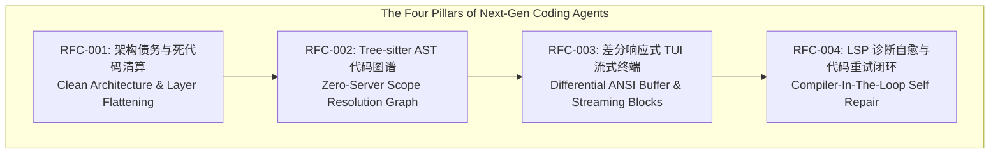

# The SOTA Coding Agent Architecture: Comprehensive Audit, Design RFCs & Evolution Blueprint

## Executive Abstract

Building an enterprise-grade autonomous coding agent requires transcending prompt engineering and simple regex file finders. This thesis synthesizes a rigorous multi-week codebase audit and establishes four concrete Requests for Comments (RFCs) that bridge the capability gap between `coding-agents` and world-leading systems (**Pi**, **Claude Code**, **GitNexus**, and **OpenCode**).

---

## Pillar 1: Debt Liquidation & Dead Code Purging (RFC-001)

- **Audit Findings**: Over 40 intermediate projection converters, legacy migration shims (`legacyRootRebase`, `legacyPermissionRebase`), and disconnected pseudo-browser modules account for ~37% of redundant codebase weight.
- **Solution Blueprint**: Cleanly excise shims, flatten query events directly to reactive TUI subscribers, and isolate `packages/python-eval/` to pure offline benchmarking.

---

## Pillar 2: Tree-sitter AST Scope Intelligence & Graph RAG (RFC-002)

- **Audit Findings**: Regex-based token matching fails on variable shadowing, class inheritance method dispatches, and multi-file call topologies.
- **Solution Blueprint (Inspired by GitNexus)**:
  - Ingest Tree-sitter grammar queries to build `ScopeTree`, `DefIndex`, `MethodDispatchIndex`, and `CallGraphEdges`.
  - Implement hybrid topological graph distance + BM25 ranking for context discovery.

---

## Pillar 3: Differential TUI & Reactive Streaming Terminal (RFC-003)

- **Audit Findings**: Monolithic line-by-line console logs cause flickering, lack full-screen Alt-screen interactive editors, and cannot cleanly fold long reasoning/tool outputs.
- **Solution Blueprint (Inspired by Pi)**:
  - Dual-buffer differential screen rendering (`DifferentialTerminalBuffer`) sending localized ANSI cursor jump sequences.
  - Collapsible `<thinking>` stream widgets and modal `[y/n/always/never]` permission prompt cards.

---

## Pillar 4: LSP-Driven Autonomous Diagnostics & Code Self-Repair (RFC-004)

- **Audit Findings**: Blind file mutations without compiler feedback lead to hallucination cascades when types, imports, or interfaces drift.
- **Solution Blueprint (Inspired by Claude Code)**:
  - Integrate post-mutation LSP diagnostic interception.
  - Automatically format compile errors into targeted repair prompts (up to 2 retry turns) before physical commit, with snapshot rollback guards.

---

## Related Documents & Architectural Specifications

- [[top-tier-coding-agent-gap-analysis|Gap Analysis & Evolution Blueprint]] ([Gap Analysis](../concepts/top-tier-coding-agent-gap-analysis.md))
- [[three-layer-agent-architecture|Three-Layer Agent Architecture]] ([Three-Layer Agent Architecture](../concepts/three-layer-agent-architecture.md))
- [[evidence-and-proof-system|Evidence and Proof System]] ([Evidence and Proof System](../concepts/evidence-and-proof-system.md))
- [[normproof-structural-governance|NormProof Structural Governance]] ([NormProof Structural Governance](../topics/normproof-structural-governance.md))
- [[local-reference-repositories|Local Reference Repositories]] ([Local Reference Repositories](../references/local-reference-repositories.md))
