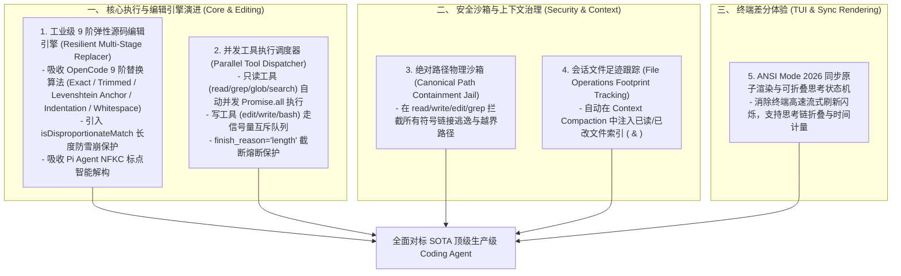

# AI Coding Agent 全仓深度审查与顶尖标杆横向对标研究报告 (SOTA Architectural Thesis)

## 1. 调研与审查背景与范围

为了推动本项目（`packages/ts-shell`）向全球最顶尖的 AI Coding Agent 架构标杆（**Pi Agent**、**OpenCode**、**Oh-My-Pi (OMP)**、**Claude Code 2026** 以及 **Codex**）看齐，我们组织了双并发专家子代理矩阵，结合 **Serena MCP** 符号级穿透与 **TinyFish** 前沿检索，对全仓核心架构进行了无死角的全景审查与深水区横向对标。

---

## 2. 核心架构差距（Gaps）与问题清单

### 一、 工具执行与流式生命周期 (Tool Execution & Streaming)
1. **工具执行缺少并发与预检解耦**：
   - *现状*：`agentLoop.ts` 采用线性 `for...of` 循环单线程顺序执行工具调用。
   - *标杆对比*：Pi Agent (`agent-loop.ts`) 与 OpenCode (`session/processor.ts`) 对只读工具（`read`, `grep`, `glob`, `web_search`）实施 `Promise.all` 高并发并发派发；对写工具则使用文件级信号量（Semaphore）锁进行顺序化保证。
2. **截断响应缺乏熔断保护 (Truncation Stop Reason Guard)**：
   - *现状*：当 LLM 因达到 `max_tokens` 被截断输出时，可能会生成残缺的 JSON 参数，现有逻辑尝试解析并可能执行非预期的脏指令。
   - *标杆对比*：Pi Agent 在检测到 `stopReason === "length"` 时，立刻在 `failToolCallsFromTruncatedMessage` 中将该轮所有未闭合的工具调用标记为截断失败，拒绝执行并提示模型在下轮重新续写。

---

### 二、 源码编辑与补丁替换引擎 (File Editing & Patching Engine)
1. **现有 `edit` 工具依赖全量文本重写或硬编码匹配**：
   - *现状*：`registry.ts` 中的 `edit` 工具仅是全量文件覆写或严格全字符匹配，一旦大模型输出缩进差异或微小标点偏差即报错失败；`discoveryEditPlanner.ts` 甚至显式拦截了 fuzzy 编辑。
   - *标杆对比*：
     - **OpenCode (`tool/edit.ts`)** 拥有工业级 9 阶弹性替换管线（Exact -> LineTrimmed -> BlockAnchor (Levenshtein) -> WhitespaceNormalized -> IndentationFlexible -> EscapeNormalized -> TrimmedBoundary -> ContextAware -> MultiOccurrence），并配备 `isDisproportionateMatch` 防雪崩长度保护。
     - **Pi Agent (`edit-diff.ts`)** 具备 NFKC Unicode 规范化、智能引号/破折号替换、行跨度精确保留（`applyReplacementsPreservingUnchangedLines`）。

---

### 三、 上下文治理与会话 DAG 追溯 (Context Governance & Session Tree)
1. **文件操作足迹跟踪缺失**：
   - *现状*：会话压缩时仅对对话文本进行摘要，模型在压缩后丢失了当前会话已经 `read` 和 `modified` 过哪些文件的感知。
   - *标杆对比*：Pi Agent 在压缩产物中注入结构化 `<read-files>` 与 `<modified-files>` XML 区块，确保长会话跨越压缩界限后依然保持对工程文件树修改状态的绝对一致性。
2. **动态 Token 预算与安全余量计算**：
   - *现状*：使用字符粗略估算（`chars / 3.5`）。
   - *标杆对比*：OpenCode 与 Pi 实时计算 `usableContext = contextWindow - reserveTokens - preserveRecentBudget`，严格保证最近 25% 的活跃对话不受破坏。

---

### 四、 终端交互与 TUI 双缓冲差分渲染 (TUI & Interactive UX)
1. **全屏差分渲染缺少终端同步更新序列 (Sync Output)**：
   - *现状*：`buffer.ts` 逐行对比并输出 ANSI 清屏与移动指令，高频刷新下可能存在局部撕裂。
   - *标杆对比*：Pi Agent (`tui.ts`) 使用 ANSI Mode 2026 同步更新序列（`\x1b[?2026h` ... `\x1b[?2026l`），确保 GPU/终端在单帧完成双缓冲原子切换。
2. **思考组件（Thinking Widget）缺乏折叠与流式缓存**：
   - *现状*：仅计算粗略 Token 并在终端展示 spinner，无法交互式展开/折叠长思考链。
   - *标杆对比*：OpenCode (`context/thinking.ts`) 支持 `Ctrl+T` 交互式切换思考链透明度与折叠状态，并记录毫秒级推理耗时。

---

### 五、 安全沙箱与路径越界防护 (Security & Path Jail)
1. **缺少路径穿透与软链接沙箱硬隔离 (Canonical Path Containment)**：
   - *现状*：工具执行直接信任传入的路径，缺乏绝对路径与软链接（Symlink）逃逸检测。
   - *标杆对比*：Pi Agent 与 Claude Code 在所有底层工具层强制执行 `resolveAndVerifyContainment(targetPath, workspaceRoot)`，拒绝任何指向工作区外部或穿透到敏感根目录的读写操作。

---

## 3. 对标顶尖标杆的优化与重构方案制定

针对上述 5 大核心深水区缺陷，我们制定了清晰的演进蓝图：

---

## 4. 总结与后续落地规划

通过本次深水区审查，我们不仅明确了与世界顶尖开源 Coding Agent 之间的具象化差距，而且已经从源码级别掌握了它们的解决方案。所有调研成果与算法实现策略已完整记录于知识库，为后续代码演进提供了坚实的理论与工程基石。
