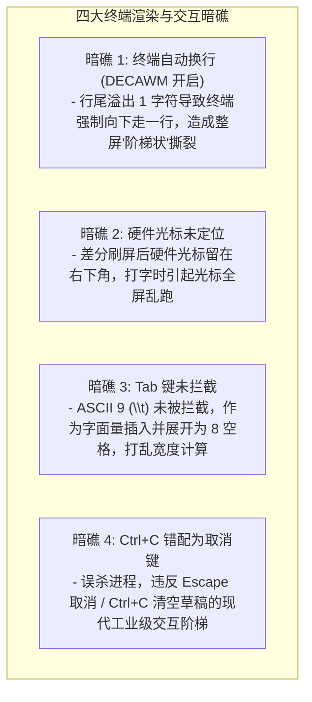
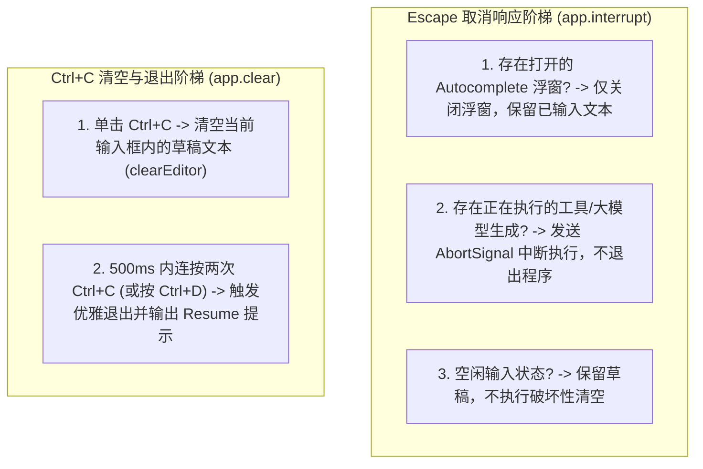

# 终端光标精准定位、DECAWM 防撕裂、Escape 取消与 Tab 补全架构论著 (Terminal Cursor, Escape Interrupt & Tab Autocomplete Architecture)

## 1. 调研背景与问题根因

在终端交互（TUI）体系中，光标漂移、框体被破坏、Tab 键插入空白字符以及快捷键职责倒置是终端应用最常见的四大体验暗礁：

---

## 2. 核心机制与算法模型

### 一、 硬件光标绝对定位与 DECAWM 防撕裂刷屏框架
每次差分绘制必须在严密的终端协议帧保护下执行：
1. **`PAINT_START` (`\x1b[?25l\x1b[?2026h\x1b[?7l`)**：
   - `\x1b[?25l`：隐藏硬件光标，防止重绘期间光标闪烁。
   - `\x1b[?2026h`：开启 DEC 2026 同步输出，通知终端仿真器原子缓冲。
   - `\x1b[?7l`：**关键核心！禁用终端自动折行（DECAWM Disable）**，即使写入满列字符也不会触发隐式换行。
2. **绝对行重写**：每行以 `\x1b[${row};1H\x1b[2K${line}` 绝对行寻址重绘，不依赖相对换行 `\n`。
3. **`PAINT_END` 与硬件光标钉扎**：
   - 提取输入框在当前视口中的绝对物理坐标 `(cursorRow, cursorCol)`。
   - 发送 `\x1b[?7h\x1b[?2026l` 恢复自动换行与结束同步。
   - 发送 `\x1b[${cursorRow};${cursorCol}H\x1b[?25h` **将硬件光标精准钉在框内输入点**，并恢复可见。

---

## 3. Escape vs Ctrl+C 阶梯响应模型

---

## 4. Tab 自动补全拦截与字符净化

1. **绝对禁绝 `\t` 录入**：
   - 在按键捕获流中，`\t`（ASCII 9）作为保留功能键拦截。
   - 在粘贴流中，所有 `\t` 自动展开为 2 个标准空格，保证 `visibleWidth` 几何列宽 100% 恒定。
2. **Tab 补全流转**：
   - 当 Slash 浮窗可见时：按 `Tab` 选中高亮项并完成自动补全上屏。
   - 当 Slash 浮窗关闭且文本以 `/` 开头时：按 `Tab` 强制呼出建议浮窗。
