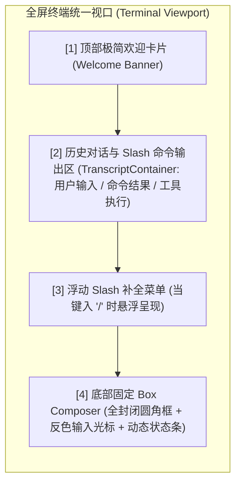

# 终端转录容器、命令自覆盖消除与两通道视口架构专著 (Transcript Container & Unified TUI Engine Architecture)

## 1. 核心架构缺陷诊断

### 一、 Slash 命令结果被瞬间抹除的根本原因
- 提交 Slash 命令后，底层虽然生成了内容并输出到标准流，但 `finally` 中的 `redrawTui()` 立即使用绝对行定位覆盖了底部行，**将刚刚输出的文本直接抹除覆盖**。
- **根本解法**：建立 `TranscriptContainer`，将命令输出直接存入历史转录块中统一渲染。

### 二、 终端输出从最底下冒出并冲毁输入框的根本原因
- 直接向 `stdout` 输出时，终端默认光标在最底行，写入文本触发了终端隐式上滚（Scroll-up），导致物理行号错位，把绝对坐标绘制的 Box 边框打得粉碎。
- **根本解法**：严禁在 TUI 运行期间直接 `process.stdout.write`。所有输出统一汇聚入 `TranscriptContainer`，由 `TUI` 统一计算布局后一次性差分刷新！

---

## 2. 统一转录与底部停靠输入架构图

---

## 3. 落地实施路线

1. **构建原生 `TranscriptContainer`**：
   - 管理历史消息数组（`items: Array<{ type: "user" | "command" | "assistant" | "tool", content: string }>`）。
   - 保证所有 `/help`, `/model`, `/cost`, `/context`, `/undo`, `/compact` 的输出以及用户的 Prompt 都以结构化块形式存在上方，无论怎么刷新都清晰可见。
2. **重写 `InteractiveTuiSession`**：
   - 每次重绘时：
     1. 上方渲染 `TranscriptContainer` 中的全部历史记录；
     2. 如果有 Slash 补全，中间渲染 `selectList`；
     3. 最下方紧接着渲染 `boxComposer`（输入框与状态栏）；
     4. 刷屏结束时，将物理硬件光标钉死在输入框的光标位置！
3. **彻底收敛 `interactiveLoop.ts`**：
   - 移除所有对底层流的裸写，全部通过 `session.appendMessage` / `session.appendCommandResult` 驱动，彻底消除闪烁、自覆盖和撕裂。
