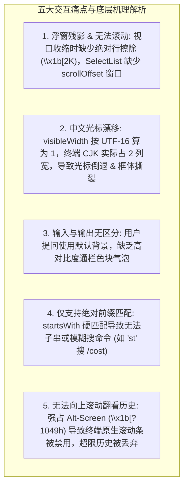

# 终端 CJK 列宽测算、模糊命令补全、用户消息色块与原生滚动条架构专著 (TUI CJK Width, Fuzzy Autocomplete & Native Scrollback Architecture)

## 1. 调研背景与五大核心痛点根因

通过对终端底层渲染机制与东亚字符标准（Unicode UAX #11）的深入解构，我们对五个核心痛点进行了全方位的理论与工程级解剖：



---

## 2. 核心算法模型与重构方案

### 一、 Unicode East Asian Width (CJK 2 列宽测算)
- **物理终端法则**：ASCII 字符占 1 列，CJK 汉字（`0x4E00 - 0x9FFF`）、全角符号（`0xFF01 - 0xFF60`）与图形 Emoji 占 2 列。
- **算法实现**：
  ```typescript
  export function getCodePointWidth(code: number): number {
    if (code < 32 || (code >= 0x7f && code < 0xa0)) return 0; // 控制字符
    // CJK 表意文字、全角形式与常见 Emoji 范围
    if (
      (code >= 0x1100 && code <= 0x115f) || // Hangul Jamo
      (code >= 0x2e80 && code <= 0xa4cf) || // CJK Radicals / Ideographs
      (code >= 0xac00 && code <= 0xd7a3) || // Hangul Syllables
      (code >= 0xf900 && code <= 0xfaff) || // CJK Compatibility
      (code >= 0xfe10 && code <= 0xfe19) || // Vertical Forms
      (code >= 0xfe30 && code <= 0xfe6f) || // CJK Compatibility Forms
      (code >= 0xff00 && code <= 0xff60) || // Fullwidth Forms
      (code >= 0xffe0 && code <= 0xffe6) || // Fullwidth Symbols
      (code >= 0x1f300 && code <= 0x1f64f) || // Misc Symbols & Pictographs
      (code >= 0x1f900 && code <= 0x1f9ff)    // Supplemental Symbols
    ) {
      return 2;
    }
    return 1;
  }
  ```

---

### 二、 视口收缩行清除与 SelectList 滚动窗口
1. **差分行擦除保证**：
   记录上一帧物理行范围 `[prevTopAnchor, prevTopAnchor + prevLen)`。在新一帧重绘时，若新范围小于旧范围，对溢出旧行逐行发送 `\x1b[${row};1H\x1b[2K`，彻底消灭残影！
2. **SelectList 滚动窗口**：
   引入 `scrollOffset`，支持多于 6 个命令时窗口随光标平滑滑动，并显示 `↑ N more` / `↓ M more`。

---

### 三、 用户消息色块气泡 (User Message Shading)
- 引入 `userMessageBg`（深色背景色块 `\x1b[48;5;236m`）。
- 用户消息通栏铺满终端列宽：`\x1b[48;5;236m  ❯ ${text} ...padding...  \x1b[0m`，模型输出保持默认透明背景，形成极其清晰的层次区分。

---

### 四、 分级模糊匹配打分引擎 (Tiered Fuzzy Matcher)
- 提取命令名与输入 token，计算四阶打分：
  - 阶梯 1：全字精准匹配（Score 1000）
  - 阶梯 2：前缀匹配（Score 900）
  - 阶梯 3：子串匹配（Score 700，例如 `st` 匹配 `/cost`）
  - 阶梯 4：子序列模糊匹配（Score 500 - 字符间隙罚分）
  - 阶梯 5：描述关键词匹配（Score 300）
- 按得分降序排序，大幅提升交互体验。

---

### 五、 原生滚动条通道架构 (Native Scrollback Architecture)
- 默认在 **主屏幕** 中运行交互会话，仅在全屏模态选择器时借用 Alt-Screen。
- 当历史对话超出上方可用高度时，已完成的历史块通过 `HistoryBatch` 提交给终端标准流并进入系统原生滚动条，支持鼠标滚轮随时向上翻看所有历史记录！
