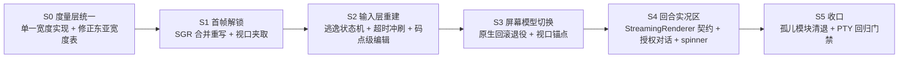
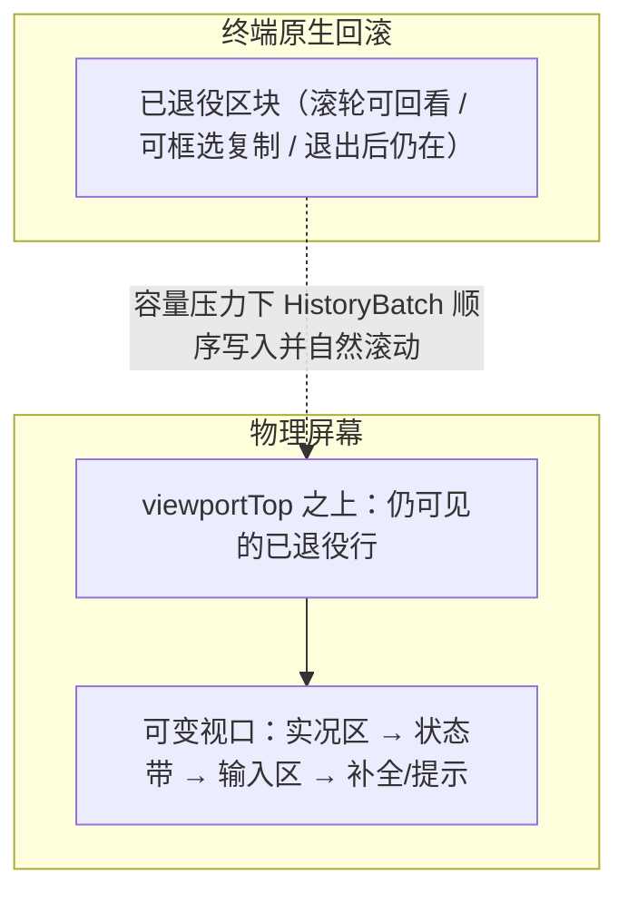

# TUI 实况链路缺陷审计与修复方案

## 1. 取证方法

此前各轮 TUI 工作均以单元测试为唯一证据，而单元测试覆盖的多数模块**不在实况链路上**。
本轮改用真实 PTY 驱动：`pty.fork()` 启动 `dist/cli.js`，注入窗口尺寸与按键，捕获原始字节流。

首次取证结果（100×30 PTY，2.5 秒）——**全程仅 95 字节输出**：

```
ESC[?1049h ESC[2J ESC[H ESC[?2004h ESC[?25h      <- altScreen.enter()
ESC[?1006l ... ESC[?1000l ESC[?2004l ESC[?1049l  <- altScreen.leave()（异常兜底）
```

结论：**从未渲染任何一帧**。进入备用屏后立刻被 `uncaughtException` 兜底钩子退出。

## 2. 阻断级缺陷（实况链路不可用）

### D1 首帧渲染必然抛错 — `utils.ts` SGR 合并函数入参错位

```
TypeError: full.slice is not a function
  at coalesceAdjacentSgr (presentation/tui/utils.js:29)
  at TUI.emitPlanFrame (presentation/tui/tui.js:97)
```

正则 `/\x1b\[([0-9;]*)m(?=\x1b\[([0-9;]*)m)/g` 含**两个**捕获组（第二个在前瞻里），
`String.replace` 回调实参因此是 `(match, p1, p2, offset, whole)`；
代码却按 `(match, p1, offset, whole)` 声明，`full` 实际拿到的是数字 `offset`。

首帧即抛 → `altScreen` 的 `process.once("uncaughtException")` 触发 `leave()` → 屏幕空白。

### D2 智能体回合必然报错 — 捕获式 renderer 不满足 `StreamingRenderer` 契约

`interactiveMode.handleSubmit` 构造的 `capturingRenderer` 只实现 `renderLine` / `render`，
而流式链路 `sessionEventSurface.ts:133` 调用的是 `renderer.renderChunk(delta)`，
`flush()` / `clearLine()` 同样缺失。首个 token 即抛 `TypeError`，被 router 的 `catch` 转成
`Error: input.renderer.renderChunk is not a function` 写进转写区——用户永远看不到回答。

### D3 任何需要授权的工具都会崩溃 — `dummyRl` 缺 `question`

`cliApprovalModule.askReadline(rl, question)` 在 `rl` 非空时调用 `rl.question(...)`。
`interactiveMode` 注入的 `dummyRl` 只有 `close/prompt/pause/resume`，因此
`rl.question is not a function`。交互式授权路径整体不可达。

### D4 Escape 键永不触发 — `StdinBuffer` 无逃逸超时冲刷

`pending === "\x1b"` 时直接 `break`，孤立 ESC 永远滞留缓冲区。
"Esc 取消运行 / 关闭补全" 全链路失效；必须引入超时冲刷 + 部分序列保持策略。

### D5 CSI `~` 族按键被当成明文插入

序列匹配正则终结符限定 `[a-zA-Z]`，不含 `~`。于是
`Delete(\x1b[3~)`、`PageUp/Down`、`Home(\x1b[1~)`、`End(\x1b[4~)`、`Insert`、`F5..F12`
全部落到"单字符"分支，把 `[`、`3`、`~` 逐个插进编辑器。
`keyId: "delete"` 被 `InputController` 引用但解析器从未产生。

### D6 星体平面字符被撕成孤立代理对

`StdinBuffer.process` 与 `Editor` 全部按 UTF-16 码元索引。Emoji（代理对）被拆成两次
插入事件；`moveLeft/backspace` 步进 1 码元会把字符切半。

## 3. 架构级缺陷

### D7 备用屏与历史批次通道互斥，且两者都只连了一半

`altScreen.enter()` 抹掉了终端原生回滚缓冲，而 `TerminalFramePlan.history`
（本应把已定稿区块写入原生回滚）从未被填充——`pendingHistoryBatch` 只被读、从不被写。
结果：整份转写每帧全量重排，只保留末 N 行，滚出屏幕的内容永久丢失，且无法用滚轮回看。

参考实现的模型是：**不进备用屏**；已定稿区块在容量压力下退役进终端原生回滚，
`providerViewportTop` 追踪可变视口起点，几何稳定且无历史追加时才走纯差分快路径。
备用屏只在 resize 事务与模态帧中被"临时借用"。

### D8 宽度度量三份实现且互相矛盾

| 实现 | 语义 | 使用方 |
|---|---|---|
| `measure.ts` | 码点级 + 东亚宽度 | `utils.ts` → `tui.ts`、`selectList`、`slashAutocomplete` |
| `compositor.ts` | `stripAnsi().length`（CJK 盲） | `statusLine`、`boxComposer`、`visualTruncate`、`composerLayout` |

状态行/边框走的是 CJK 盲版本 → 中文路径或 emoji 一出现，框线立刻错位。

附带两处度量错误：
- `sliceWithWidth` 的 ANSI 扫描只在 `m` / BEL / `\` 终止；遇到 `\x1b[2K`、`\x1b[K`、
  光标移动等序列会把其后全部内容吞进转义缓冲，整行被截空。
- `getCodePointWidth` 把 `U+2600..U+27BF` 整段判成 2 列。转写区与提示符正在用的
  `❯ U+276F`、`✔ U+2714`、`✗ U+2717` 全部误判 → 光标漂移 + 框线错位。
  同时缺少组合记号 / ZWJ / 变体选择符的零宽处理。

### D9 转写区渲染丢失宽度

`renderFrame` 调用 `this.transcript.render()` 不传宽度，落到默认 80 列，
与终端实际宽度无关。

### D10 无流式实况区

回合期间无 spinner、无耗时、无 token 计数、无中断提示；
助手文本与工具活动被缓冲到回合结束才一次性落盘。

### D11 无软换行

`truncateToWidth` 直接以 `…` 截断超宽行并丢弃尾部；转写区超宽行在 DECAWM 关闭下被终端裁掉。

### D12 补全是第二套不一致实现

`renderFrame` 内联 `startsWith` 过滤一份硬编码 11 条命令表，其中
`/compact`、`/doctor` 在真实注册表（39 条）中**不存在**；
而已写好的分层模糊匹配 `getSlashCommandSuggestions` 在实况链路里是死代码。

### D13 `renderFrame` 带副作用

渲染期间改写 `selectList` / `inputController` 状态并自增历史批次 id；
`flushHistoryBeforeStop` 在退出时连调 10 次 `renderFrame`。

### D14 状态行数据为假

`usedTokens: 0` 硬编码；无成本、无耗时；模型名取值路径可能为空而退化成 `default-model`。

### D15 视口越界无夹取

小终端叠加长补全菜单时 `viewport.length > rows`，超出行被写到屏幕外行号，终端夹取后画面错乱。

### D16 约十二个孤儿模块从未进入实况链路

`buffer.ts`、`tuiEngine.ts`、`compositor.ts`、`composerLayout.ts`、`interactiveTuiSession.ts`、
`viewportCoordinator.ts`、`autocompleteController.ts`、`modelPicker.ts`、`toolActivityCard.ts`、
`textEditor.ts`、`killRing.ts`、`components/{permissionDialog,toolCard,thinkingWidget}.ts`
以及 `presentation/index.ts`、`presentation/tui/index.ts` 两个桶文件——
**没有任何生产代码引用**，其绿色测试对已发布行为零证明力。

## 4. 修复顺序



## 5. 交付结果

### 5.1 屏幕模型：原生回滚 + 底部锚定

备用屏被彻底移除。渲染引擎在普通屏上维护单一可变视口，`viewportTop` 之上的行归终端所有：



三条不变式保证退役安全：
1. **顺序性**：只有 frontier 处的区块可以退役，且严格按序。
2. **不可变性**：未定稿区块永不退役——已进入回滚的行无法收回。
3. **单帧交接**：批次被提供的同一帧即离开可变视口（`liveStart()` 跳过待确认批次），因此永不重绘两次。

几何稳定且无历史追加时走纯行差分快路径；宽度变化落定后重建（清屏 + 清回滚 + 重放账本），高度变化仅强制重绘。

### 5.2 模块结构

```text
presentation/tui/
├── text/          width(UAX#11 表) · ansi(转义扫描) · measure(度量/切片) · layout(截断/换行) · sgr(SGR 合并) · motion(簇/词步进)
├── render/        frame(帧契约) · paint(序列构造) · engine(差分渲染引擎)
├── input/         escape(逃逸边界状态机) · keys(按键规范化) · stdinBuffer(重组器)
├── chrome/        band(状态带) · composer(输入区) · hints(提示行) · suggestions(补全) · welcome(会话开场)
├── transcript/    blocks(区块渲染) · container(退役容器) · live(实况行) · markdown · diff
├── editor.ts      多行编辑器（簇级光标 / 软换行 / kill-ring / 历史召回）
├── terminal.ts    终端驱动（TerminalDevice 接口 / 模式恢复电池 / 积压计量）
└── terminalCapabilities.ts
```

`cli/interactive/`：`frameSurface`(帧组装) · `keymap`(按键路由) · `turnSink`(回合输出路由) · `questionBridge`(readline 替身) · `sessionFacts`(状态带事实) · `slashSuggestions`(注册表驱动补全) · `interactiveMode`(会话宿主)。

### 5.3 缺陷收敛对照

| 编号 | 处置 |
|---|---|
| D1 | `text/sgr.ts` 字符级扫描器重写；含截断扩展色的拒绝合并规则 |
| D2 | `StreamingRenderer` 引入 `RendererSink`，宿主装载 sink 而非临时对象；`captured` 供上游抑制自绘 chrome |
| D3 | `QuestionBridge` 实现真实 `question()`：问题作为区块发布，下一次提交即为答案 |
| D4 | `stdinBuffer` 部分序列保持 + 超时冲刷；孤立 ESC 成为 Escape 键 |
| D5 | `keys.ts` 完整 CSI（`~` 族 / 修饰参数 / 字母终结符）+ SS3 + CSI-u + 遗留 meta 链 |
| D6 | `escape.ts` 标量步进 + `Intl.Segmenter` 簇级编辑，代理对与组合序列不再被撕开 |
| D7 | 备用屏移除；`Transcript` 退役契约落地（见 5.1） |
| D8 | 度量收敛为 `text/` 单一实现；转义扫描覆盖全部 CSI 终结符与字符串族 |
| D9 | 帧组装以真实终端宽度渲染全部区块 |
| D10 | `transcript/live.ts` 实况行：spinner + 耗时 + token 估算（带 `~` 标注）+ 中断提示 |
| D11 | `text/layout.ts` 软换行贯穿编辑器、区块、Markdown、状态带 |
| D12 | 补全候选来自 `listSlashCommands()`；分层评分收敛在 `chrome/suggestions.ts` |
| D13 | `renderFrame` 只读组装；补全状态由按键路由维护 |
| D14 | 状态带只呈现真实事实；`lastPromptTokens` 使上下文表成为真实占用而非累计和 |
| D15 | 引擎 `clampToHeight` + 组装期容量预留 |
| D16 | 孤儿模块清退，有价值能力（工具卡片 / 授权对话 / kill-ring / 视觉截断 / 流式围栏稳定）并入实况链路 |

### 5.4 待办（明确未做）

- **多路复用器 resize 锚点探测**：参考实现用备用屏借用 + CPR 往返在 tmux 下精确恢复锚点。本实现改用「宽度变化即重建」，语义正确但会重写回滚。
- **内联图像 / OSC 66**：未实现。
- ~~**Markdown 表格**~~、~~**鼠标拖拽**~~：见第 6 节，本轮已落地。

## 6. 命令表面与复制链路（第二轮）

### 6.1 会话入口收敛

`/sessions` 的每种参数形态并入 `/resume`：`resumeCommandRuntime.ts` 把首个参数分派为
`panel | list | current | switch | help`，不匹配时按会话引用处理。`sessions`/`session`
保留为**别名**而非删除——`slashRouter` 把 hidden 命令当作未知命令，直接删除会让 12 项
根绑定与会话指针诊断失去入口。用户可见文案全部改为 `/resume`。

### 6.2 展示层：命令输出即 Markdown

命令区块过去把 `##`、表格、围栏原样打印。现在 `blocks.ts` 的命令/错误区块走
`renderMarkdown`，并在此之上补了两件事：

- `markdown.ts` 支持表格：内容定宽 → 超宽按比例挤压，因此 `/context`、`/plugin`
  的表在窄终端仍是对齐的列而不是溢出的竖线。
- `turnSink.ts` 的 `splitFencedDiff` 把 ```` ```diff ```` 围栏从正文剥离并挂到
  `block.diff`，交给 `renderDiff` 做逐行着色与行内强调。`/undo` 因此只需产出标准
  unified diff，不再自己上色。

`/restore` 的输出重排为「状态先行」：`### Restore — preview | executed | not executed`，
preview 绝不借用完成态的词汇，被阻断的记录把原因附在路径上而不是折叠成计数。

### 6.3 选择器：按命令选形态

| 命令 | 形态 | 选中后的动作 |
|---|---|---|
| `/resume` | 全屏模态 | 切换会话 |
| `/mcp`、`/connect` | 内嵌面板 | 刷新服务器 / 激活连接 |
| `/model`、`/permissions`、`/plugin`、`/statusline` | 内嵌面板 | 就地生效 |
| `/marketplace` | 内嵌面板 | 移除源，或**起草** `/marketplace add ` |
| `/restore` | 内嵌面板（多选） | **起草** `/restore preview --records …` |
| `/copy` | 内嵌面板 | 复制区块，或开关拖拽复制 |

`PickerOutcome { note?, draft? }` 是这里的关键：需要密钥或需要显式写授权的下一步，
选择器不代劳，而是把完整命令连同光标交回输入框。`/restore` 因此永远不写工作区——
它只能把 `--records` 填好，`--execute` 仍要用户自己敲。

### 6.4 复制：多行文本为什么带空格，以及如何解决

原因有两层，分别处理：

1. **我们自己补的尾部空格**。整行反色需要把每行填满宽度，那些填充在拖选时会被终端
   一并交出。已改为逐行 `\x1b[K` 擦除 + 取消尾部填充，输入区与用户回显都不再补格。
2. **左侧缩进是真实单元格**。终端复制的是单元格，缩进无法在复制时被剔除——除非拖拽
   由我们自己接管。

于是 `input/mouse.ts` 解码 SGR/X10 鼠标报告，`cli/interactive/selection.ts` 接管拖拽：
按下记锚点，松开取终点，从**我们自己画出的行**重建文本，然后剥掉转义、去掉尾部单元格、
去掉所有选中行共有的那一段缩进、去掉提示回显的导轨字符。落地经 OSC 52 + 平台剪贴板。

被选中的行来自 `TUI.screenRows()`：视口之上仍在屏幕内的行属于终端且不可回读，因此由
`Transcript.retiredTail()` 用产出它们的区块重新渲染——区块定案后渲染是确定性的，
所以这与当初写进回滚的字节一致。

代价是明确的：请求鼠标报告就等于把滚轮从终端手里拿走，而这个界面整个建立在原生回滚
之上。所以默认关闭，`/copy` 里一行开关，写入 `tui.mouseCopy`；开启后 Shift+拖拽仍是
终端自己的选择。

## 7. 命令表面、权限轴与输入链路（第三轮）

### 7.1 两个真实的输入缺陷

**多行粘贴逐行提交**。`StdinBuffer` 一直会解析括号粘贴，但驱动**从未发送 `\x1b[?2004h`**——
只在退出时恢复 `2004l`。于是粘贴以普通按键抵达，每个 `\r` 都读作回车：五行粘贴跑四个回合，
最后一行留在输入框。一行修复。

**补全提示打错后不再回来**。`backspace` 落到 `syncSuggestions(opensSuggestions(event))`，
而 `opensSuggestions` 要求 `event.text` 非空——退格没有文本，于是 `mayOpen=false`，
而关闭的列表在 `mayOpen=false` 时直接返回。改为：草稿仍可能成为命令时，任何编辑都可以重开列表。
同时把「是不是命令」收紧成 `^/[A-Za-z0-9-]*$`——`/usr/local/bin` 是路径，不该弹命令菜单。

### 7.2 权限是一条独立的轴

`shift+tab` 继续切 plan/build（推理姿态），`alt+p` 切 `ask → accept-edits → allow-all`
（写入权限），两者各占状态带一格，`allow-all` 用报错色。不合并成一个循环是刻意的：
把写入权限折进「模式」循环，用户会在只想换推理方式的时候，两次按键后进入无人过问的写入。

`accept-edits` 只覆盖 `read/write/delete`，不覆盖进程启动与网络——「接受编辑」是关于文件的
陈述，把它读成可以随意执行命令是对最窄措辞的最宽解释。作用点在升级审批处理器：scope 给出答案
时走 `decisionSource: session-scope:<scope>`，审计明确记为**由 scope 回答**而非由用户回答，
且永不产生持久授权。

### 7.3 OS 级隔离补在工具参数层之后

原有沙箱在工具参数层默认拒绝（工作区外读写、网络、spawn）并带升级审批与审计——这层是对的，
但它跟不进已经启动的进程。`sandbox/osSandbox.ts` 补上操作系统那一半：Linux 用 `bwrap`，
macOS 用 `sandbox-exec`，规则来自 `.agents/sandbox.json` 或 `~/.private-agents/sandbox.json`。

三种结果刻意分开：`off`（没开）、`isolated`（真的隔离了）、`unavailable`（开了但启动器不在）。
第三种**每条命令都会说自己没被隔离**——静默降级到无隔离是唯一没人能据此行动的结果。同理，
配了域名白名单时会明说两个启动器都不做按主机过滤，因此网络实际是全开的。默认关闭。

### 7.4 长粘贴占位与 Ctrl+O

`PasteStore` 把足够长的粘贴（≥320 字符或 >6 行）留在旁边，草稿里只放
`[#1 pasted 1.2k chars, 14 lines]`。占位符是草稿里真实的字符，这才让光标诚实：
移过它需要看起来那么多次按键，删掉它删掉整段而不是一半。发送时 `getSubmission()` 展开；
提示历史存的是草稿原样，所以召回回来的是短短一行而不是整个文件。

`Ctrl+O` 借备用屏打开全屏编辑视图，编辑的是**光标处那段粘贴**（没有则整份草稿）。
它复用输入框那同一个 `Editor`，所以下面能用的移动、删除、撤销在上面一样能用，没有第二个
编辑器要保持同步。`ctrl+s` 保留，`esc` 丢弃。

### 7.5 键位表只有一份

`presentation/tui/chrome/keys.ts` 是唯一的键位清单，`/hotkey` 从它生成，并按终端是否协商成功
标注哪些和弦这台终端根本送不到。一条测试断言 keymap 实际派发的每个 key id 都在表里——
写这条测试当场就抓到六个已绑定但从未被宣告的键（`ctrl+b/f`、`ctrl+left/right`、`alt+b/f`）。

### 7.6 目录、退出、以及别人的目录名

`/model` 与 `/connect` 背后是一份 provider→模型的目录：仓库内置快照（20 个 provider，离线可用）
→ 显式刷新写入的缓存 → 用户自己的 `~/.private-agents/models.json`。用户那层最后，因为那是
唯一由他控制的一层，刷新不得覆盖他写的东西。模型一律按 `provider/model` 寻址——同一个模型名被
好几个 provider 提供，光有名字指不到任何东西。

退出时的重叠是绝对定位加残留：现在窗口就地擦除、退役尾部写在原位，然后从光标处 `\x1b[J`
擦到屏幕底——shell 马上要在那个光标处打印提示符，它右边和下面任何残留都会被编进提示符里。
剪贴板的 OSC 52 也从直写 stdout 改为走渲染器的设备。

最后，代码里曾有 13 处写入或读取另一个产品的目录（`~/.claude/teams`、`~/.claude/agents`、
`~/.claude/agent-memory`…）与 12 处产品标签。目录迁到 `~/.private-agents/` 与 `.agents/`——
这既是命名要求，也本来就是 bug：我们不该把自己的状态写进别人的配置目录。忽略列表与敏感资源
判定改成按**形状**匹配（点目录下的 `extensions`/`agents`/`skills`/`hooks`），
而不是枚举产品名——枚举在下一个工具出现时就是错的。

## 8. 会话生命周期、流式输出与回溯（第四轮）

### 8.1 为什么每次启动都在同一个 session 里

`bootstrap` 在没有 `--session-id` 时会**读取 current-session 指针并 resume 它**。于是每次启动
都踏进上一次的会话：id 从不变化，历史无限增长，两天的工作分不开。

改为：一次运行拿一个自己的会话。指针降级为**建议**——`/resume` 与 `/continue` 的回退目标——
而不是默默踏进去的东西。

### 8.2 为什么 resume 到任何会话都报"not recoverable"

`/resume <id>` 走的是 `runtime-recovery` 模式，而该模式的第一条规则是
`status !== "interrupted" && status !== "error"` 即不可恢复。也就是说：**一个正常结束的会话，
因为"没出错"而被拒绝打开**——包括用户此刻正坐在里面的那个。

这是两件事被折成了一件：

- **打开一个会话**（让它成为当前会话、恢复上下文）——用户说 resume 时 95% 指这个。
- **恢复一次被中断的运行**（自动续跑挂起的 prompt）——这才是 recovery 门要守的。

现在 `/resume` 走 `continuity-only`（无论会话以什么状态结束都能打开），`/continue` 保留
`runtime-recovery` 门。resume 到当前会话不再报错，而是一句
"Already in session …，用 /resume list 换一个"。

### 8.3 只用 slash 命令的会话不留痕迹

`SessionReentrySummary` 增加 `hasConversation`：会话里是否真有过 user/assistant 的发言。
`saveTerminated` 之后调用 `discardIfEmpty`——没有对话的会话被**删除**而不是终结，指针一并清掉。
退出提示因此也只在会话存活时给出。实测：只跑 `/help` 再退出，会话目录数不变，不给 resume id。

### 8.4 回到会话要看得见之前的对话

`cli/interactive/history.ts` 从会话记录的 `turns` 重建转写区。只重建**发言**——工具卡片与
diff 能从实时运行推导，但不能从存储消息推导，凭空造出来会在屏幕上放一些从未以那种形状发生过
的东西。上限 60 条，超出的说明省略了多少。

### 8.5 `/clear` 是会话边界，不是清屏

原实现自己写清屏序列然后**返回一行输出**——于是刚清干净的屏幕上留着 `▌ /clear` 回显和那行输出，
而且会话不变，下次打开这个会话历史又回来了。现在 `/clear` 是一个 shell action，宿主接管三件事：
新会话、空转写区、什么都没有的屏幕。命令本身不输出任何东西，因为任何输出都会成为残留。

### 8.6 流式输出

请求里**从来没有 `stream: true`**，响应用 `res.json()` 一次读完。所以模型回复必然一次性出现——
不是 provider 不支持，是我们没要。

`core/query/streamCompletion.ts` 读 SSE：事件按空行切分，跨网络块的半个事件留在缓冲里；
文本增量逐块 yield；tool call 的参数按 **index** 而不是 id 累积（provider 分块下发且只带 index），
到流末才组装——半截参数字符串不是合法 JSON，绝不能传下去。最后重组成与非流式响应**完全同形**的
对象，所以工具调用、DSML 提取、消息历史全部不变。provider 忽略 `stream: true` 时回退读 JSON。

一个细节：DSML 工具调用是从正文里剥出来的，所以剥完的文本可能与已经流出去的增量不同。这时发
`message.replace` 改写该块，而不是追加——追加会把答案显示两遍。

### 8.7 连击 Escape 回溯，与 `/undo` 的分工

Escape 的解绑梯子是：关补全 → 中断运行 → 空提示下的第二次按键打开回溯面板。**Escape 永不丢弃草稿**
（Ctrl+C 才是干那个的键，把打了一半的东西输给一个"取消"手势是最坏的交易），代价是回溯只在空提示
下可达——而那也正是人在想问什么而不是在写的时候。

回溯面板列出**问过的问题**（最新在前），选一条就丢掉它之后的所有回合，并把那句话放回输入框重新问。
**文件不动**：重新考虑问题和撤销已写入的东西是两个决定，用一个手势同时做掉，会让破坏性的那个
无法被拒绝。`/undo` 是另一个决定，走已审计的 `/restore` 路径。

### 8.8 长输出进自己的视图

`presentation/tui/chrome/pager.ts`：超过 18 行的**命令输出**移进借用备用屏的全屏可滚动视图，
转写区只留一行摘要，Esc 关闭。可上下滚动、可输入过滤、显示 `1–13 of 61` 这样的位置。
只有命令输出会进——助手的回答是对话本身，多长都属于对话；命令的回答是报告，读一次。
