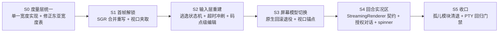
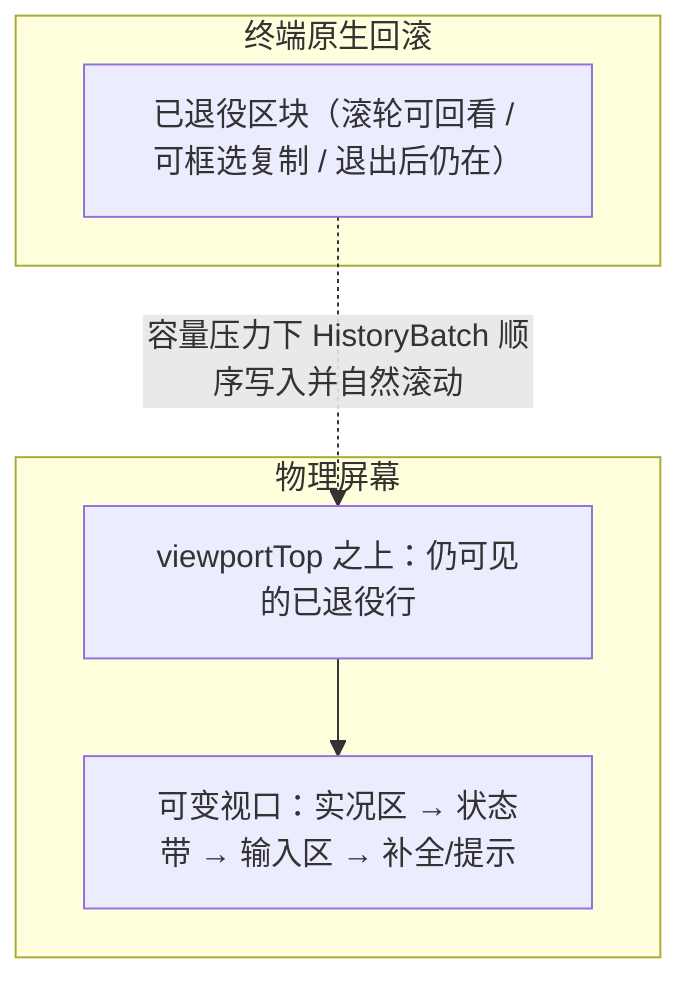

# TUI 实况链路缺陷审计与修复方案

## 1. 取证方法

此前各轮 TUI 工作均以单元测试为唯一证据，而单元测试覆盖的多数模块**不在实况链路上**。
本轮改用真实 PTY 驱动：`pty.fork()` 启动 `dist/cli.js`，注入窗口尺寸与按键，捕获原始字节流。

首次取证结果（100×30 PTY，2.5 秒）——**全程仅 95 字节输出**：

```
ESC[?1049h ESC[2J ESC[H ESC[?2004h ESC[?25h      <- altScreen.enter()
ESC[?1006l ... ESC[?1000l ESC[?2004l ESC[?1049l  <- altScreen.leave()（异常兜底）
```

结论：**从未渲染任何一帧**。进入备用屏后立刻被 `uncaughtException` 兜底钩子退出。

## 2. 阻断级缺陷（实况链路不可用）

### D1 首帧渲染必然抛错 — `utils.ts` SGR 合并函数入参错位

```
TypeError: full.slice is not a function
  at coalesceAdjacentSgr (presentation/tui/utils.js:29)
  at TUI.emitPlanFrame (presentation/tui/tui.js:97)
```

正则 `/\x1b\[([0-9;]*)m(?=\x1b\[([0-9;]*)m)/g` 含**两个**捕获组（第二个在前瞻里），
`String.replace` 回调实参因此是 `(match, p1, p2, offset, whole)`；
代码却按 `(match, p1, offset, whole)` 声明，`full` 实际拿到的是数字 `offset`。

首帧即抛 → `altScreen` 的 `process.once("uncaughtException")` 触发 `leave()` → 屏幕空白。

### D2 智能体回合必然报错 — 捕获式 renderer 不满足 `StreamingRenderer` 契约

`interactiveMode.handleSubmit` 构造的 `capturingRenderer` 只实现 `renderLine` / `render`，
而流式链路 `sessionEventSurface.ts:133` 调用的是 `renderer.renderChunk(delta)`，
`flush()` / `clearLine()` 同样缺失。首个 token 即抛 `TypeError`，被 router 的 `catch` 转成
`Error: input.renderer.renderChunk is not a function` 写进转写区——用户永远看不到回答。

### D3 任何需要授权的工具都会崩溃 — `dummyRl` 缺 `question`

`cliApprovalModule.askReadline(rl, question)` 在 `rl` 非空时调用 `rl.question(...)`。
`interactiveMode` 注入的 `dummyRl` 只有 `close/prompt/pause/resume`，因此
`rl.question is not a function`。交互式授权路径整体不可达。

### D4 Escape 键永不触发 — `StdinBuffer` 无逃逸超时冲刷

`pending === "\x1b"` 时直接 `break`，孤立 ESC 永远滞留缓冲区。
"Esc 取消运行 / 关闭补全" 全链路失效；必须引入超时冲刷 + 部分序列保持策略。

### D5 CSI `~` 族按键被当成明文插入

序列匹配正则终结符限定 `[a-zA-Z]`，不含 `~`。于是
`Delete(\x1b[3~)`、`PageUp/Down`、`Home(\x1b[1~)`、`End(\x1b[4~)`、`Insert`、`F5..F12`
全部落到"单字符"分支，把 `[`、`3`、`~` 逐个插进编辑器。
`keyId: "delete"` 被 `InputController` 引用但解析器从未产生。

### D6 星体平面字符被撕成孤立代理对

`StdinBuffer.process` 与 `Editor` 全部按 UTF-16 码元索引。Emoji（代理对）被拆成两次
插入事件；`moveLeft/backspace` 步进 1 码元会把字符切半。

## 3. 架构级缺陷

### D7 备用屏与历史批次通道互斥，且两者都只连了一半

`altScreen.enter()` 抹掉了终端原生回滚缓冲，而 `TerminalFramePlan.history`
（本应把已定稿区块写入原生回滚）从未被填充——`pendingHistoryBatch` 只被读、从不被写。
结果：整份转写每帧全量重排，只保留末 N 行，滚出屏幕的内容永久丢失，且无法用滚轮回看。

参考实现的模型是：**不进备用屏**；已定稿区块在容量压力下退役进终端原生回滚，
`providerViewportTop` 追踪可变视口起点，几何稳定且无历史追加时才走纯差分快路径。
备用屏只在 resize 事务与模态帧中被"临时借用"。

### D8 宽度度量三份实现且互相矛盾

| 实现 | 语义 | 使用方 |
|---|---|---|
| `measure.ts` | 码点级 + 东亚宽度 | `utils.ts` → `tui.ts`、`selectList`、`slashAutocomplete` |
| `compositor.ts` | `stripAnsi().length`（CJK 盲） | `statusLine`、`boxComposer`、`visualTruncate`、`composerLayout` |

状态行/边框走的是 CJK 盲版本 → 中文路径或 emoji 一出现，框线立刻错位。

附带两处度量错误：
- `sliceWithWidth` 的 ANSI 扫描只在 `m` / BEL / `\` 终止；遇到 `\x1b[2K`、`\x1b[K`、
  光标移动等序列会把其后全部内容吞进转义缓冲，整行被截空。
- `getCodePointWidth` 把 `U+2600..U+27BF` 整段判成 2 列。转写区与提示符正在用的
  `❯ U+276F`、`✔ U+2714`、`✗ U+2717` 全部误判 → 光标漂移 + 框线错位。
  同时缺少组合记号 / ZWJ / 变体选择符的零宽处理。

### D9 转写区渲染丢失宽度

`renderFrame` 调用 `this.transcript.render()` 不传宽度，落到默认 80 列，
与终端实际宽度无关。

### D10 无流式实况区

回合期间无 spinner、无耗时、无 token 计数、无中断提示；
助手文本与工具活动被缓冲到回合结束才一次性落盘。

### D11 无软换行

`truncateToWidth` 直接以 `…` 截断超宽行并丢弃尾部；转写区超宽行在 DECAWM 关闭下被终端裁掉。

### D12 补全是第二套不一致实现

`renderFrame` 内联 `startsWith` 过滤一份硬编码 11 条命令表，其中
`/compact`、`/doctor` 在真实注册表（39 条）中**不存在**；
而已写好的分层模糊匹配 `getSlashCommandSuggestions` 在实况链路里是死代码。

### D13 `renderFrame` 带副作用

渲染期间改写 `selectList` / `inputController` 状态并自增历史批次 id；
`flushHistoryBeforeStop` 在退出时连调 10 次 `renderFrame`。

### D14 状态行数据为假

`usedTokens: 0` 硬编码；无成本、无耗时；模型名取值路径可能为空而退化成 `default-model`。

### D15 视口越界无夹取

小终端叠加长补全菜单时 `viewport.length > rows`，超出行被写到屏幕外行号，终端夹取后画面错乱。

### D16 约十二个孤儿模块从未进入实况链路

`buffer.ts`、`tuiEngine.ts`、`compositor.ts`、`composerLayout.ts`、`interactiveTuiSession.ts`、
`viewportCoordinator.ts`、`autocompleteController.ts`、`modelPicker.ts`、`toolActivityCard.ts`、
`textEditor.ts`、`killRing.ts`、`components/{permissionDialog,toolCard,thinkingWidget}.ts`
以及 `presentation/index.ts`、`presentation/tui/index.ts` 两个桶文件——
**没有任何生产代码引用**，其绿色测试对已发布行为零证明力。

## 4. 修复顺序



## 5. 交付结果

### 5.1 屏幕模型：原生回滚 + 底部锚定

备用屏被彻底移除。渲染引擎在普通屏上维护单一可变视口，`viewportTop` 之上的行归终端所有：



三条不变式保证退役安全：
1. **顺序性**：只有 frontier 处的区块可以退役，且严格按序。
2. **不可变性**：未定稿区块永不退役——已进入回滚的行无法收回。
3. **单帧交接**：批次被提供的同一帧即离开可变视口（`liveStart()` 跳过待确认批次），因此永不重绘两次。

几何稳定且无历史追加时走纯行差分快路径；宽度变化落定后重建（清屏 + 清回滚 + 重放账本），高度变化仅强制重绘。

### 5.2 模块结构

```text
presentation/tui/
├── text/          width(UAX#11 表) · ansi(转义扫描) · measure(度量/切片) · layout(截断/换行) · sgr(SGR 合并) · motion(簇/词步进)
├── render/        frame(帧契约) · paint(序列构造) · engine(差分渲染引擎)
├── input/         escape(逃逸边界状态机) · keys(按键规范化) · stdinBuffer(重组器)
├── chrome/        band(状态带) · composer(输入区) · hints(提示行) · suggestions(补全) · welcome(会话开场)
├── transcript/    blocks(区块渲染) · container(退役容器) · live(实况行) · markdown · diff
├── editor.ts      多行编辑器（簇级光标 / 软换行 / kill-ring / 历史召回）
├── terminal.ts    终端驱动（TerminalDevice 接口 / 模式恢复电池 / 积压计量）
└── terminalCapabilities.ts
```

`cli/interactive/`：`frameSurface`(帧组装) · `keymap`(按键路由) · `turnSink`(回合输出路由) · `questionBridge`(readline 替身) · `sessionFacts`(状态带事实) · `slashSuggestions`(注册表驱动补全) · `interactiveMode`(会话宿主)。

### 5.3 缺陷收敛对照

| 编号 | 处置 |
|---|---|
| D1 | `text/sgr.ts` 字符级扫描器重写；含截断扩展色的拒绝合并规则 |
| D2 | `StreamingRenderer` 引入 `RendererSink`，宿主装载 sink 而非临时对象；`captured` 供上游抑制自绘 chrome |
| D3 | `QuestionBridge` 实现真实 `question()`：问题作为区块发布，下一次提交即为答案 |
| D4 | `stdinBuffer` 部分序列保持 + 超时冲刷；孤立 ESC 成为 Escape 键 |
| D5 | `keys.ts` 完整 CSI（`~` 族 / 修饰参数 / 字母终结符）+ SS3 + CSI-u + 遗留 meta 链 |
| D6 | `escape.ts` 标量步进 + `Intl.Segmenter` 簇级编辑，代理对与组合序列不再被撕开 |
| D7 | 备用屏移除；`Transcript` 退役契约落地（见 5.1） |
| D8 | 度量收敛为 `text/` 单一实现；转义扫描覆盖全部 CSI 终结符与字符串族 |
| D9 | 帧组装以真实终端宽度渲染全部区块 |
| D10 | `transcript/live.ts` 实况行：spinner + 耗时 + token 估算（带 `~` 标注）+ 中断提示 |
| D11 | `text/layout.ts` 软换行贯穿编辑器、区块、Markdown、状态带 |
| D12 | 补全候选来自 `listSlashCommands()`；分层评分收敛在 `chrome/suggestions.ts` |
| D13 | `renderFrame` 只读组装；补全状态由按键路由维护 |
| D14 | 状态带只呈现真实事实；`lastPromptTokens` 使上下文表成为真实占用而非累计和 |
| D15 | 引擎 `clampToHeight` + 组装期容量预留 |
| D16 | 孤儿模块清退，有价值能力（工具卡片 / 授权对话 / kill-ring / 视觉截断 / 流式围栏稳定）并入实况链路 |

### 5.4 待办（明确未做）

- **多路复用器 resize 锚点探测**：参考实现用备用屏借用 + CPR 往返在 tmux 下精确恢复锚点。本实现改用「宽度变化即重建」，语义正确但会重写回滚。
- **内联图像 / OSC 66 / 鼠标滚轮**：未实现；原生回滚已提供滚轮回看，故鼠标协议非必需。
- **Markdown 表格与嵌套列表**：`transcript/markdown.ts` 覆盖标题、列表、引用、行内、围栏；表格与深层嵌套仍按纯文本呈现。
