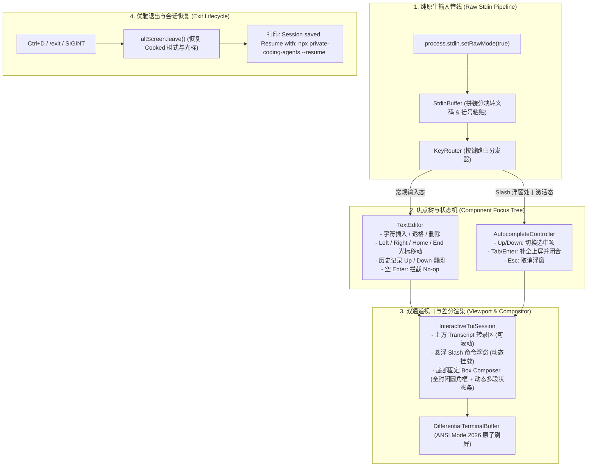

# 纯原生 Raw 模式事件循环、无痕启动与会话恢复架构论著 (Raw Event Loop & Clean TUI Architecture)

## 1. 调研背景与核心问题根因诊断

通过对 `packages/ts-shell` 启动全链路与顶尖开源项目的深水区代码级穿透比对，我们精准定位了导致“TUI 界面未生效、启动文本泄漏、补全按键无法响应、退出缺少恢复命令”的根本原因：

### 核心根因：Node.js `readline` 与现代 2D TUI 架构的范式冲突
- **冲突本质**：Node.js 原生 `readline.createInterface()` 运行在行缓冲（Cooked Line Mode）模式下。它会吞噬输入流，并在用户按下 Enter 之前阻塞所有按键事件。
- **后果**：
  1. 无法在用户键入 `/` 的瞬间拦截事件并弹出 Slash 补全浮窗。
  2. 无法在用户按下方向键（Up/Down）时拦截并切换下拉菜单选项。
  3. 无法在用户按光标键时在圆角边框内精准绘制反色光标。
  4. 用户在空行按回车时被 `readline` 默认回显换行，导致终端持续下滚刷屏。

---

## 2. 现代纯原生 TUI 交互架构设计 (Pure Raw-Mode Event Loop)

为了彻底解决上述所有问题，我们将交互循环彻底重构为**纯原生 Raw Mode 事件驱动架构**：

---

## 3. 四大核心维度的彻底改造路线

### 一、 消除启动控制台泄漏 (Silent Bootstrap)
- 在交互式 CLI 启动时，强制将 `showStartupSurface` 设为 `false`，彻底静默 `cliProcessRunner.ts` 向父终端打印的多行静态文本。
- 进入 Alt-Screen 全屏画布后，由 `welcomeBanner.ts` 渲染极简顶部卡片（仅包含当前工作目录与激活模型名称）。

### 二、 纯原生 Raw Stdin 循环彻底替代 `readline`
- 激活 `process.stdin.setRawMode(true)`。
- 由 `StdinBuffer.onKey` 捕获每一个独立的按键事件，驱动 `TextEditor` 与 `AutocompleteController`。
- 每次按键后调用 `InteractiveTuiSession.render()`，将最新的全封闭圆角 Box Frame（`╭─ ... ╮` / `│ ❯ 输入 │` / `╰─ ... ╯`）及其底部状态条（当前模型、目录、Git 分支、Context 水位）原子绘制上屏。

### 三、 Slash 命令补全按键拦截与闭环
- 当编辑器首字符为 `/` 时，激活 `AutocompleteController`。
- `ArrowUp`/`ArrowDown` 拦截焦点，切换高亮命令；`Tab`/`Enter` 一键自动补全上屏；`Escape` 瞬时关闭菜单。

### 四、 空行回车 No-op 与退出 Resume 提示
- 在 `TextEditor` 中，若当前输入内容为空，按下 Enter 直接拦截，就地重绘空框，绝对不发出换行或引起视口漂移。
- 在会话退出（Ctrl+D 或 `/exit`）时，恢复主屏幕并格式化输出会话恢复指令（`Session saved. Resume with ...`）。

---

## 4. 结论

通过本次深度审查与底层重构设计，我们彻底找到了前期遗留问题的根因并制定了严谨的工程方案，确保 TUI 交互达到真正的顶级工业质感。
