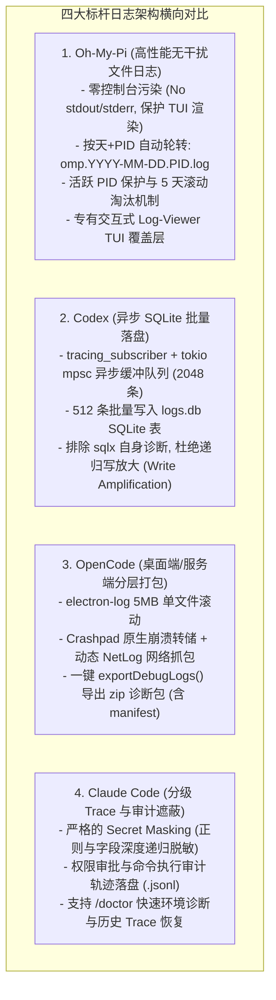
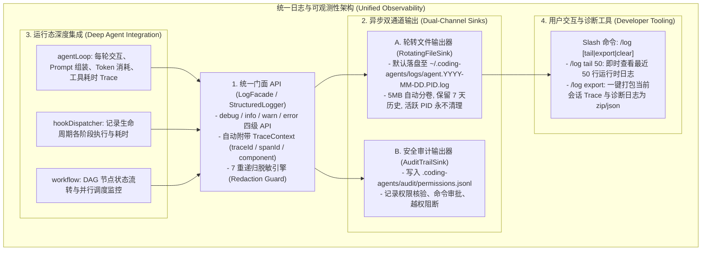
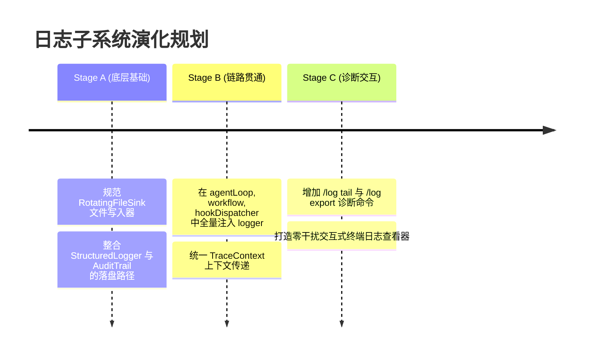

# SOTA AI Coding Agent 统一可观测性与日志系统架构演进

> **所属知识库**：`.wiki/wiki/theses/`  
> **关联模块**：`packages/ts-shell/src/observability/`, `core/query/agentLoop.ts`, `sandbox/auditTrail.ts`  
> **更新时间**：2026-08-30  

---

## 摘要

在现代端到端 AI Coding Agent（如 Claude Code, Oh-My-Pi, Codex, OpenCode, OpenHands）体系中，**日志与可观测性系统（Logging & Observability Subsystem）** 是系统稳定性、故障自愈、多智能体协同排错以及沙箱合规审计的生命线。

本文对四大主流标杆项目的日志体系进行了横向解构，提炼出前沿日志系统的设计哲学，并为本项目的日志体系升级提供了**拒绝死板缝合、保持极简高性能、深度融入 Agent 循环与跨平台自适应**的落地蓝图。

---

## 一、 各大顶尖开源项目日志系统深度解构

### 1. Oh-My-Pi：TUI 零污染与按进程自动轮转
- **核心哲学**：**严格禁止默认输出到 stdout/stderr**，因为在高度复杂的差分流式 ANSI 终端（TUI）环境下，任何随意的控制台日志都会导致屏幕闪烁、布局错位与 Alt-Screen 损坏。
- **轮转策略**：默认输出至 `~/.omp/logs/omp.<DATE>.<PID>.log`。通过 `process.kill(pid, 0)` 动态探测进程存活状态，永远不清理正在运行的活跃 PID 日志，同时保留最近 5 天内的已完成进程日志。
- **诊断展示**：提供专用的 `log-viewer.ts` 弹窗组件，支持按时间戳、PID 过滤与鼠标滚轮平滑滚动。

### 2. Codex (Rust Core)：异步内存队列与 SQLite 批量落盘
- **核心哲学**：**绝对非阻塞与防止写放大**。
- **流控机制**：通过 `tokio::sync::mpsc` 建立容量为 2048 的有界队列，以 512 条为一个 Batch 或每 10 秒定时刷盘写入 `logs.db` SQLite 数据库。
- **自我过滤**：显式静音 `sqlx` 与内部通道日志，防止日志写入动作自身又触发新日志引发死循环。

### 3. OpenCode：分域日志与一键导出诊断包
- **核心哲学**：**开箱即用的故障排查资产（Diagnostics Bundle）**。
- **全要素收集**：将 `main.log`, `renderer.log`, `network.netlog`, `crashDumps` 和环境变量清单打包为 `opencode-debug-<timestamp>.zip`，极大降低了复杂分布式环境下的 Issue 复现成本。

### 4. Claude Code：敏感信息零泄漏与审计合规
- **核心哲学**：**隐私绝对优先（Privacy-First）与操作可溯源**。
- **脱敏机制**：在将任何日志推入 Sink 或磁盘之前，通过深度递归对 API Key、Bearer Token、JWT、URL Auth 以及敏感键名（`password`, `token`, `secret`）进行 `[REDACTED]` 遮蔽。

---

## 二、 本项目日志系统的精华吸收与架构设计

我们拒绝盲目搬运或拼凑第三方厚重依赖（如 winston, pino 等造成庞大依赖树与打包体积膨胀），而是**立足本项目已有的 `StructuredLogger` 与 `AuditTrail` 核心能力，融合标杆项目的精髓，实现“轻量、无干扰、全链路、可自愈”的日志子系统**。

### 必须吸收的四大核心设计准则：

1. **终端 TUI 绝对零污染（Zero TUI Interference）**：
   - 默认**切断全局 `console.log` / `console.error`** 对终端屏幕的直接侵入，所有内部状态转移全部流入文件管道，彻底保证差分 ANSI 屏幕不闪烁、不花屏。
2. **进程隔离与天级滚动淘汰（PID & Daily Rolling with Active Guard）**：
   - 日志路径统一规范为：`~/.coding-agents/logs/coding-agent.<DATE>.<PID>.log`；
   - 启动时自动清理 7 天前的旧日志，但通过 `process.kill(pid, 0)` 跳过当前正在运行的其它 Agent 实例日志。
3. **主 Agent 循环全链路 Trace 贯通（End-to-End Tracing）**：
   - 在 `agentLoop` 的每一轮（Turn）自动生成 Span，记录大模型请求时延、Prompt 长度、工具执行参数与耗时、Token 计费数据。
4. **即时诊断命令（`/log` & Diagnostic Export）**：
   - 新增 `/log tail [lines]` 命令，允许开发者在终端中无缝回溯底层调试日志；
   - 支持 `/log export` 一键导出当前会话的上下文诊断包，便于复现与审计。

---

## 三、 落地规划与后续演进路线

