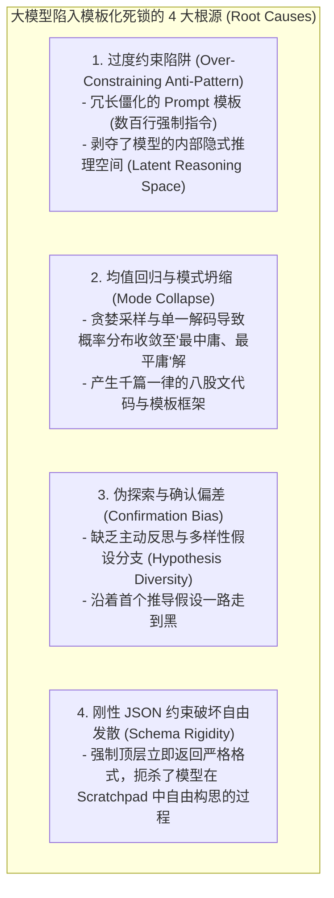
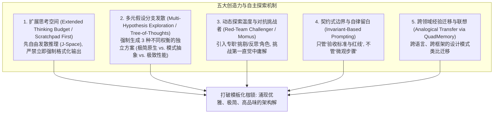

# 激发大模型自主创造力与打破模板化限制的技术架构深度解构

> **前沿核心命题**：在 2026 年的 AI Coding Agent 设计中，最常见的瓶颈之一是**“模型创造力被过度模板化的 Prompt、刻板的少样本示例（Few-Shot）、机械的 JSON 约束以及僵化的思维链限制死，导致输出千篇一律、缺乏自主探索与创新解题潜能”**。
>
> 结合 **Anthropic 官方核心研究**（*Building Effective AI Agents*、*Global Workspace in LLMs*）、**哈佛大学 2026 年最新突破**（*QUEST: Inducing Sustained Creativity and Diversity in LLMs*）以及 **Claude Code 的自主探索机制**，系统性拆解如何打破模板化枷锁，释放大模型的自主探索能力与深层创新潜能。

---

## 一、 核心痛点：为什么大模型在 Coding Agent 中会陷入“模板化平庸”？

### 1.1 模板化生成的危害
1. **千人一面（Lack of Diversity）**：无论面对什么样的复杂架构问题，总是产出最基础的 CRUD 模板；
2. **缺乏全局架构品味（Loss of Architectural Taste）**：无法针对当前代码库的特定约束，设计出优雅、极简、无冗余抽象的原生方案；
3. **遇到非标问题直接卡死**：一旦问题超出固定模板的边界，模型便会在无效的重复修补中打转。

---

## 二、 破局理论与前沿学术方案

### 2.1 哈佛大学 QUEST (2026)：持续多样性与创造力诱导解码
哈佛大学 2026 年论文《*Inducing Sustained Creativity and Diversity in Large Language Models*》指出：单纯提高 `temperature` 会引入语法噪声与幻觉，无法真正激发创造力。其提出的 **QUEST 算法** 核心在于：
- **正交语义惩罚（Orthogonal Semantic Penalty）**：在生成多个方案或探索分支时，惩罚与已有候选方案高度相似的语义向量，强制模型在隐空间中检索正交解空间（Orthogonal Subspaces）。
- **异构解题范式激活（Heterodox Activation）**：通过提示词激活模型内在的正统（Orthodox）与非传统（Heterodox）知识库，鼓励反直觉但数学/工程上成立的替代方案。

### 2.2 Anthropic 核心工程法则：从“微观管理”转向“目标与边界契约”
Anthropic 在 *Building Effective AI Agents* 与 Claude Code 的实践中明确指出了激发 Agent 自主性的黄金准则：
- **“Contract-Style System Prompt”（契约式提示，而非脚本化死板流程）**：
  - **错误做法（微观管理）**：详细规定“第 1 步必须调 glob，第 2 步必须按格式输出 A，第 3 步必须先写 interface…”——这完全抹杀了模型的推理弹性；
  - **正确做法（边界契约）**：只定义**不可违背的安全与架构底线（Inviolable Invariants）**（如：函数 $\le 20$、无循环依赖、必须有物理单测验证），给模型留出广阔的推理自由度（Latent Freedom）。

---

## 三、 激发 Coding Agent 创造力的五大系统级架构方案

### 3.1 机制 1：思维留白与“先发散后收敛”双阶段生成（Extended Thinking & Scratchpad）
- **痛点**：若要求模型直接输出最终 JSON 或代码，模型往往选择概率最高的模板。
- **解法**：在调用模型时，必须给予充足的 **Thinking Budget**（扩展思考预算），或在 Prompt 中明确划分 **`<reasoning>` / `<exploration>` 热身发散区** 与 **最终提交区**。
- **效果**：模型在隐式思考空间中先推演 3~4 种架构流派、自我推翻平庸解，最终沉淀出最具品味的代码。

### 3.2 机制 2：多视角假设网格（Hypothesis Matrix / Tree-of-Thoughts）
在面对重大设计决策时，系统自动调度并发子代理从 3 个正交视角生成方案：
1. **极简原教旨主义方案（The Boring / Zero-Dependency Approach）**：拒绝任何第三方重型库，用最纯粹的原生语言特性与极简逻辑实现；
2. **高弹性扩展方案（The Extensible Architecture）**：考虑 6 个月后的演进与插件化；
3. **极致性能与安全方案（The High-Performance / Defensive Approach）**：关注内存分配、时间复杂度与权限边界。
由主智能体或评判裁决者综合三大方案的长处进行综合（Synthesis），彻底打破单一模板。

### 3.3 机制 3：引入批判者（Momus / Red-Team Challenger）
对标顶级团队设计实践：
- 在方案确定前，派发一个专门的 **Challenger Agent（挑剔反思者）**；
- 提问：“这个方案是不是在重复造轮子？”、“是不是存在不必要的抽象？”、“有没有更短更漂亮的写法？”；
- 倒逼模型跳出第一直觉的死板模式。

### 3.4 机制 4：契约式 System Prompt 治理（Contract over Scripting）
重构系统提示词，彻底废弃“每一步应该怎么做”的过程微观管理，代之以高品味的工程哲学：
- **Taste & Minimalism（工程品味）**：*“Delete weightless code, refuse needless abstractions, prefer boring and robust solutions.”*
- **Invariants（绝对不变量）**：*“Never allocate avoidably, preserve clean cutover, maintain zero proof gap.”*

---

## 四、 本项目落地总结与长期指引

通过在本项目中落实上述 5 大机制：
1. 在架构设计前自动触发多元方案发散与反思；
2. 在 System Prompt 中坚守契约式边界，给大模型留出充分的自由推理空间；
3. 结合 `QuadMemory` 与多代理对抗验证，实现从“机械死板生成”向“具有资深架构师品味的高质量自主探索”全面跃迁！
