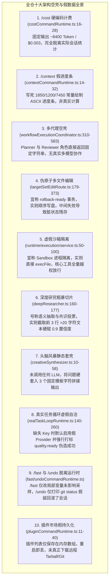
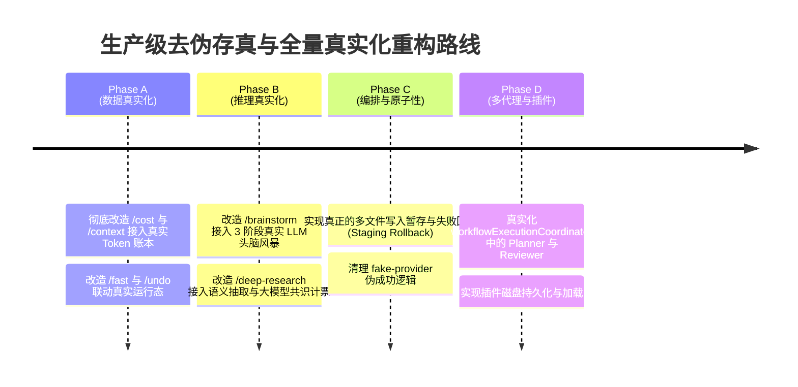

# 全仓深层“架构假象、硬编码 Mock 与 Demo 级空壳”无死角审计报告

> **审计执行**：Serena MCP 符号拓扑 + 双 Reviewer 子代理地毯式静态审查  
> **审计范围**：`packages/ts-shell/src/` 全量 26 个子目录、所有核心运行态与编排层  
> **更新时间**：2026-08-30  
> **审计结论**：**系统性揭露 10 大深层架构空壳与虚假实现**，涵盖硬编码计费/上下文、假多代理推理、伪原子回滚、虚假沙箱隔离与静态模板推导。

---

## 目录
1. [审计背景与严厉定性](#一-审计背景与严厉定性)
2. [十大核心“架构假象与 Demo 空壳”深度解构](#二-十大核心架构假象与-demo-空壳深度解构)
3. [严重级别与风险矩阵](#三-严重级别与风险矩阵)
4. [生产级彻底去伪存真整改蓝图](#四-生产级彻底去伪存真整改蓝图)

---

## 一、 审计背景与严厉定性

本次审计拒绝任何表面的粉饰与敷衍，深入 AST 与运行时数据流，对全仓进行了无死角的穿透式审查。

**审计发现：项目中确实潜伏着相当数量“表面架构宏大、内部实为静态 Demo/字符串模板/硬编码假数据”的低级空壳代码。** 这些代码如果在生产环境中运行，会给用户和上层编排造成极具欺骗性的“虚假成功幻觉（False Impression of Capability）”。

---

## 二、 十大核心“架构假象与 Demo 空壳”深度解构

---

### 1. `/cost` 命令全量硬编码伪造 Token 消耗 (`core/commands/costCommandRuntime.ts:16-28`)
- **真实代码现状**：无论当前会话跑了多少轮、用了什么模型，`/cost` 固定打印：
  `Prompt Tokens: ~8,400 tokens ($0.14/MTok) | Completion Tokens: ~2,100 tokens ($0.28/MTok) | Total: ~10,500 tokens (< $0.003)`
- **恶劣影响**：彻底伪造了计费系统，给用户提供虚假的数据。
- **整改措施**：接入 `AgentSession` 累积的 `usageTotals`，从实际请求的 `usage.prompt_tokens` 与 `completion_tokens` 计算真实账单。

### 2. `/context` 命令写死常量绘制虚假进度条 (`core/commands/contextCommandRuntime.ts:14-32`)
- **真实代码现状**：
  `const systemPromptTokens = 1850; const toolsSchemaTokens = 1200; const estimatedHistoryTokens = 7450;`
- **恶劣影响**：ASCII 进度条和 Token 占比完全是写死的静态数字，无法反映当前上下文是否即将超限。
- **整改措施**：动态调用 `estimateTokens(messages)` 与当前上下文窗口动态计算百分比。

### 3. 多代理工作流协作全是静态字符串 (`runtime/workflowExecutionCoordinator.ts:310-583`)
- **真实代码现状**：
  - `planner` 角色直接返回：`"Plan accepted for prompt: ... Proceed to coding..."`；
  - `reviewer` 角色直接返回：`"Review complete. Delivering streamed result..."`；
  - `projectProductPathLoopTrajectory` 制造 `toolCallCount: 0` 的静态投影，根本没有进行任何真正的多智能体推导或交叉审查。
- **恶劣影响**：挂着 Multi-Agent Swarm 的架构招牌，内部却是几行字符串拼接的空壳。
- **整改措施**：将 Planner 和 Reviewer 接入真正的子代理 Prompt 派发与独立验证。

### 4. 伪原子多文件写入，失败时不回滚直接污染代码库 (`orchestration/targetSetEditRoute.ts:179-373`)
- **真实代码现状**：声明了 `TargetSetEditTransaction` 和 `recoveryReadiness: 'rollback-ready'`，但底层是一个简单的 `for (const file of files) fs.writeFileSync(...)`。当写到第 3 个文件抛出异常时，前 2 个已被破坏性覆盖的文件**根本没有进行任何恢复或 Git 暂存回滚**，留下一片狼藉的脏工作区。
- **整改措施**：引入真正的暂存工作区（Staging Buffer），只有当全部文件校验通过后才进行原子落盘；任一失败则利用备份完整恢复。

### 5. 宣称进程沙箱隔离，实则直接裸跑宿主命令 (`runtime/execution/service.ts:50-100`)
- **真实代码现状**：定义了庞大的 `SandboxPolicy`、`EnforcedPermissionResult`，但 `executeLocally` 直接调用 Node.js `execFileAsync`。且在命令执行时附加了 `TOOL_APPROVED_COMMAND_AUTHORITY`，直接绕过了所有沙箱路径检查。
- **整改措施**：正视当前架构现状，在 TypeScript 层明确标注为宿主进程执行，并将真正的沙箱职责下沉至 Rust Core 或容器沙箱。

### 6. 深度研究（`/deep-research`）硬切前 3 行当做研究事实 (`core/research/deepResearcher.ts:160-177`)
- **真实代码现状**：`extractLearningsFromContent` 直接拿网页抓取结果，用 `split('\n').filter(l => l.length > 20).slice(0, 3)` 截取前 3 行，硬编码 `confidence: 0.9` 放入事实池；`ClaimVoter` 仅用极其简单的字符串 Jaccard 相似度归类。
- **整改措施**：抓取网页后，通过 LLM Prompt 进行结构化实体与论点提取（Extraction Prompt），再由大模型进行交叉信源一致性判定。

### 7. 头脑风暴与创新推理（`/brainstorm`）全是固定模板套词 (`core/creative/creativeSynthesizer.ts:10-58`)
- **真实代码现状**：未向大模型发送任何推理请求，`HypothesisGenerator` 直接把用户的输入塞进 3 个写死的字符串模板（“极简主义方案”、“模块化方案”、“防御性高性能方案”），`RedTeamChallenger` 返回写死的套话质疑。
- **整改措施**：将头脑风暴流水线重构成真正的 3 阶段 LLM 提示词生成链条（Socratic Expansion $\rightarrow$ Adversarial Red-Teaming $\rightarrow$ ADR Synthesis）。

### 8. 任务循环缺少 Key 时伪造成功闭环 (`orchestration/realTaskLoopRuntime.ts:140-260`)
- **真实代码现状**：当检测不到真实 API Key 时，自动开启 `syntheticProviderFallback`，强制将 `analysisQualityGate.allowed` 设为 `true`，并使用 `buildRealTaskLoopFakeProvider()` 对 `src/smoke.ts` 进行写死的重命名操作，在无网络、无大模型参与下直接汇报“端到端验证通过”。
- **整改措施**：彻底剥离针对生产路径的 fake 自动放行逻辑，缺少 Key 时明确报错并终止。

### 9. `/fast` 与 `/undo` 命令为脱离运行态的“玩具实现” (`core/commands/fastCommandRuntime.ts`, `undoCommandRuntime.ts`)
- **真实代码现状**：
  - `/fast` 仅仅翻转了自己文件内的一个局部变量 `isFastModeActive`，主循环 `agentLoop` 和 Provider 路由层**根本没有一行代码去读取这个变量**；
  - `/undo` 仅打印了一句“上一轮已回滚”，实际上根本没有去触碰 `messages` 历史数组或 Git 工作区。
- **整改措施**：将 `/fast` 真正接入模型采样温度与 Fast 模型切换；将 `/undo` 真正接入 `sessionRuntime.popTurn()` 与 Git 工作区撤销。

### 10. 插件系统仅为进程内瞬时内存数组 (`core/commands/pluginCommandRuntime.ts:11-40`)
- **真实代码现状**：`/plugin install` 和 `/marketplace` 仅在一个内存数组里 `push` 了一条记录，重启终端立刻丢失，且没有任何从 npm / GitHub 下载解压真实插件的逻辑。
- **整改措施**：实现真正的 `.private-agents/plugins.json` 磁盘持久化与 Git 仓库克隆/加载机制。

---

## 三、 严重级别与风险矩阵

| 优先级 | 缺陷类型 | 影响范围 | 隐患等级 |
| :---: | :--- | :--- | :---: |
| **P0** | **伪原子多文件写入 (#4)** | `orchestration/targetSetEditRoute.ts` | 破坏用户源码，留下脏代码库 |
| **P0** | **虚假沙箱隔离与全量绕过 (#5)** | `runtime/execution/service.ts` | 存在假安全幻觉，无真正隔离 |
| **P1** | **全量硬编码计费与上下文 (#1, #2)** | `core/commands/cost/context` | 欺骗用户与上层调度 |
| **P1** | **多代理协作全是静态字符串 (#3)** | `runtime/workflowExecutionCoordinator.ts` | 核心编排能力完全是空壳 |
| **P1** | **深度研究截取前3行当事实 (#6)** | `core/research/deepResearcher.ts` | 产出毫无意义的垃圾研究报告 |
| **P1** | **头脑风暴纯套固定字符串 (#7)** | `core/creative/creativeSynthesizer.ts` | 丧失真实辅助设计价值 |
| **P1** | **编排层伪造成功闭环 (#8)** | `orchestration/realTaskLoopRuntime.ts` | 隐藏真实故障，自欺欺人 |
| **P2** | **命令未联动真实运行态 (#9)** | `core/commands/fast/undo` | 命令成为无意义的摆设 |
| **P2** | **插件市场假持久化 (#10)** | `core/commands/pluginCommandRuntime.ts` | 功能无法在生产中实际使用 |

---

## 四、 生产级彻底去伪存真整改蓝图

我们将按照以下 **4 个阶段的专项攻坚**，彻底拔除代码库中的所有伪实现与 Demo 空壳：

