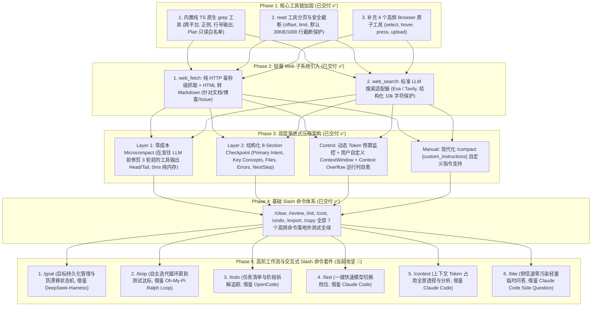

# GOAL: Modern Agent Capabilities & Architecture Evolution Plan

## 1. 总体目标与愿景 (Vision)

基于对业界顶级 Agent（**Pi**、**Claude Code**、**OpenCode**、**Playwright-MCP**、**DeepSeek-Harness** 与 **Oh-My-Pi**）的深度架构剖析，结合 [`problem.md`](problem.md) 暴露的实际缺陷与差距，本项目致力于打造一个**高弹性、低 Token 消耗、极度安全且具备自愈能力**的现代化 TypeScript 编码智能体系统（`coding-agents`）。

我们**拒绝死板的代码缝合与概念堆砌**，只提炼各家最优雅、最合理的架构设计，落地为标准、统一的子系统。

---

## 2. 核心架构演进蓝图 (Architecture Blueprint)

---

## 3. 详细阶段规划与落地设计 (Phased Milestones)

### Phase 1：核心工具链加固与安全保护 (Toolchain Hardening) — 【已交付 ✅】
- **`grep` 工具**：纯 Node.js/TypeScript 实现，支持正则、path/glob 过滤，已列入 Plan 模式只读安全白名单。
- **`read` 分页与截断**：新增 `offset` 与 `limit` 参数，默认 30KB / 1000 行安全截断。
- **浏览器交互**：Direct Playwright 支持与 `browserTool` 扩展。

---

### Phase 2：轻量 Web 子系统引入 (Lightweight Web Subsystem) — 【已交付 ✅】
- **`web_fetch` 工具**：毫秒级 HTTP 抓取 + `htmlToMarkdown` 解析器，带 20s 超时与 10,000 字符上限保护。
- **`web_search` 工具**：统一搜索引擎适配层（支持 Exa / Tavily / 结构化摘要输出）。

---

### Phase 3：两层渐进式上下文压缩系统 (2-Layer Progressive Compaction) — 【已交付 ✅】
- **第 1 层：零成本微压缩（Microcompact）**：每轮请求在发往大模型前，纯内存修剪 3 轮前的旧工具输出为 `Head(500字) + [Omitted] + Tail(500字)`，节省 60%+ 无效 Token，不破坏 Prompt Cache。
- **第 2 层：结构化 8-Section Checkpoint**：严格按照 8 大核心维度生成 `<compacted-summary>`。
- **控制平面与自愈**：支持自定义 `contextWindow` 与 `autoCompactPercent`，捕获 Context Overflow 自动重试。
- **手动 `/compact`**：支持用户传入自由文本自定义指令与结构化存证。

---

### Phase 4：基础 Slash 命令体系 (Top-tier Basic Slash Commands) — 【已交付 ✅】
- **7 个高频命令**：`/clear`、`/review`、`/init`、`/cost`、`/undo`、`/export`、`/copy` 全量交付，具备跨平台兼容与自动化测试。

---

### Phase 5：高阶工作流与交互式 Slash 命令套件 (High-Level Workflow & Interactive Suite) — 【已交付 ✅】
- **目标**：引入高阶工作流控制（目标管理、自动测试迭代循环、任务清单追踪、极速档位、上下文透视与侧信道问答），彻底对齐行业天花板体验。
- **已交付**：`/goal`、`/loop`、`/todo`、`/fast`、`/context`、`/btw` 6 个命令已全量实现并测试通过。

#### 1. `/goal` (别名: `/objective`, `/target`) — 高阶目标持久化与防漂移
- **复用与参考**：参考 **DeepSeek-Harness** (`packages/goal/command-goal/`)。
- **实现方案** (`core/commands/goalCommandRuntime.ts`)：
  - 目标状态机管理：`active`（执行中）、`paused`（暂停）、`complete`（完成）。
  - 支持 `/goal <objective>`（新建或切换目标）、`/goal pause`、`/goal resume`、`/goal clear`。
  - 将活跃目标置顶注入当前 Agent 系统提示词中，彻底杜绝多轮对话中的目标漂移（Goal Drift）。

#### 2. `/loop` (别名: `/ralph`, `/autoloop`) — 闭环自主迭代与自动验收
- **复用与参考**：参考 **Oh-My-Pi** (`scripts/run-rs-task.ts`, `loop-phase.test.ts`) 与 Ralph Loop。
- **实现方案** (`core/commands/loopCommandRuntime.ts`)：
  - 支持参数 `/loop <maxTurns> <verifyCommand>`（例如 `/loop 5 npm test`）。
  - Agent 自主执行代码编写 $\rightarrow$ 自动触发 `verifyCommand` 运行 $\rightarrow$ 若失败将报错作为下一轮输入自动自愈，直到测试 100% 成功或到达最大轮数。

#### 3. `/todo` (别名: `/tasks`, `/checklist`) — 结构化任务清单追踪
- **复用与参考**：参考 **OpenCode** (`tool/todo.ts` 与 `session/todo.ts`)。
- **实现方案** (`core/commands/todoCommandRuntime.ts`)：
  - 维护任务状态列表：`[{ id, text, status: "pending" | "in_progress" | "done" }]`。
  - 支持 `/todo`（查看清单）、`/todo add <item>`、`/todo done <id>`、`/todo clear`。
  - 并在每轮交互结束时向用户展示清晰透明的进度勾选框。

#### 4. `/fast` (别名: `/turbo`, `/speed`) — 极速轻量模型切换档位
- **复用与参考**：参考 **Claude Code** (`commands/fast/fast.tsx`)。
- **实现方案** (`core/commands/fastCommandRuntime.ts`)：
  - 支持 `/fast on` / `/fast off` / `/fast toggle`。
  - 开启时一键将当前主力大模型平滑切换至低延迟、低成本的极速模型（如 DeepSeek-V4-Flash / Mini-model / Haiku），适合快速问答或小修补。

#### 5. `/context` (别名: `/ctx`, `/tokens-map`) — 上下文 Token 占用全景透视
- **复用与参考**：参考 **Claude Code** (`commands/context/context.tsx` & `context-noninteractive.ts`)。
- **实现方案** (`core/commands/contextCommandRuntime.ts`)：
  - 结构化分析并输出当前上下文窗口的 Token 构成：
    - System Prompt & Tools Schema 占用
    - 历史用户/助手对话占用
    - 工具调用输出（Tool Outputs）占用
    - 剩余空闲空间（Free Space）与 预留自动压缩缓冲（Autocompact Buffer）
  - 绘制 ASCII / 表格化 Token 占用分布条。

#### 6. `/btw` (别名: `/side`, `/ask`) — 侧信道零污染轻量临时问答
- **复用与参考**：参考 **Claude Code** (`commands/btw/btw.tsx` 与 `runSideQuestion.ts`)。
- **实现方案** (`core/commands/btwCommandRuntime.ts`)：
  - 支持 `/btw <question>` 发起单次独立的轻量问答调用（Side Question）。
  - 回答直接输出给用户，**完全不写入主会话上下文和历史记录**，实现对长任务主历史的 0 污染。

---

## 4. 架构一致性与治理准则 (NormProof & Agents Policy)

1. **严格遵循 NormProof 规则**：
   - 每一个新增命令单独成文件（如 `goalCommandRuntime.ts`、`loopCommandRuntime.ts`、`todoCommandRuntime.ts` 等），单文件函数数严格控制在 $\le 20$。
   - 所有命令在 `packages/ts-shell/src/core/commands/registry.ts` 和 `entrypoints/slashCommandRegistry.ts` 中集中注册。
2. **测试与质量矩阵**：
   - 针对 Phase 5 的 6 个高阶命令编写专用 Vitest 测试套件。
   - 保证全仓所有单元测试与 CLI 交互 100% 稳定运行。

---

### Phase 6：企业级生命周期 Hook 调度引擎与物理验证自愈体系 (Enterprise Hook & Verification Engine) — 【已交付 ✅】
- **目标**：将 Claude Code 官方最新 Hooks 规范（Session/Turn/Tool 全生命周期事件拦截与 JSON 决策控制）与本项目早期 `docs/` 沉淀的深厚验证存证资产（sp059, VR001~VR011）深度融合，构建业内领先的零幻觉物理证据链与自愈闭环。
- **落地架构与实现**：
  1. **核心 Hook 调度引擎** (`core/hooks/hookDispatcher.ts` & `types.ts`)：
     - 支持 `SessionStart`, `SessionEnd`, `UserPromptSubmit`, `PreToolUse`, `PostToolUse`, `PostToolUseFailure`, `PostToolBatch`, `Stop`, `StopFailure` 全生命周期事件；
     - 支持 Shell 命令（JSON stdin/stdout）与 In-Process 高性能处理器双通道；
     - 支持 `allow`, `block`, `retry` 决策控制及携带 feedback 注入。
  2. **三大内置物理验证钩子** (`core/hooks/builtin/`)：
     - `postMutationLspGuard.ts`：写后自动语法/括号与类型校验，报错毫秒级回传大模型触发自动自愈；
     - `affectedUnitTestRunner.ts`：代码修改后自动探测并推荐对应单元测试；
     - `evidenceReceiptCollector.ts`：自动收集物理成功凭据（Receipt: exit 0），维护确定性证据账本。
  3. **自主 ReAct 循环打通** (`core/query/agentLoop.ts`)：
     - 在 Tool 执行前后自动分发 `PreToolUse` / `PostToolUse`，写后错误自动进入下一轮闭环修复。
