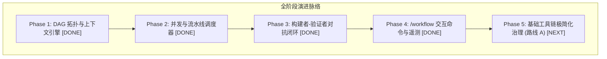

# 现代化工作流编排与基础工具链极简化治理目标 (GOAL.md)

> **版本**：2026.08.30-v3  
> **核心使命**：
> 1. **工作流子系统（Workflow & Agentic SDLC）**：基于 **Oh My Pi (OMP)**、**Claude Code (2026 最新版)**、**Codex**、**DeepSeek-Harness**、**Pi / OpenCode** 五大标杆项目成果，落地 DAG 拓扑、Pipeline 屏障、受控并发、错峰缓存与构建者-验证者对抗闭环（已完成）。
> 2. **基础工具链极简化治理（Lean Toolchain Consolidation - 路线 A）**：坚守 Unix 哲学与顶尖实践（Pi & Claude Code），收敛消除低价值专用工具（如独立的 `git_status` / `git_diff`），统一交由通用 `bash` 执行；配合 **只读命令智能分类器（Read-Only Command Classifier）** 与 **输出安全截断**，消除每轮 System Prompt 永久 Token 税与分裂式 Git UX。
> 
> **架构红线**：坚守 `AGENTS.md` 规范与 NormProof 架构约束（单文件函数 $\le 20$，严格单向无环依赖），**坚决拒绝重复造轮子**，最大化复用已有成熟基础设施（`ts-shell` 状态机、`hookDispatcher`、`approval/evaluator.ts`、`microCompact`、`QuadMemory`）。

---

## 一、 核心理论与演进路线图 (Evolution Roadmap)

---

## 二、 Phase 5 专项：基础工具链极简化治理（路线 A 方案设计）

### 2.1 核心设计考量与架构价值
1. **消除永久 Token 税（Token Overhead）**：
   - 专用工具的 JSON Schema 和参数定义会在每一轮对话的 System Prompt 中全量发送。
   - 移除独立的 `git_status` / `git_diff`，可直接降低静态上下文 Token 开销，让注意力更加聚焦于核心读写工具。
2. **解决分裂的 Git 工作流（Unified Git Experience）**：
   - 避免“查看状态调特定工具，提交代码/推分支又切回 `bash`”的双轨心智负担，统一将 Git 视为宿主 OS 提供的 CLI 能力。
3. **只读命令智能分类与安全放行（Read-Only Auto-Approval）**：
   - 在 `core/shell/approval/evaluator.ts` 中增强对 Git 常用只读子命令的静态分析；
   - `git status`, `git diff`, `git log`, `git branch`, `git show`, `git rev-parse` 等无害只读指令在 Plan 模式及普通模式下实现 **自动安全放行（Auto-Approved）**；
   - 对破坏性命令（`git reset --hard`, `git push --force`, `git clean -fd`）维持最高级别确认与拦截。
4. **输出安全截断与上下文防爆（Context Blowup Protection）**：
   - 确保 `bash` 工具执行 `git diff` 等潜在海量输出命令时，复用 `30KB / 1000行` 安全截断防护与分页指引。

---

## 三、 Phase 5 具体实施任务拆解 (Phase 5 Task Breakdown)

- [ ] **5.1 增强 Shell 审批分类器 (`core/shell/approval/evaluator.ts`)**
  - 新增针对 Git 只读命令的静态识别规则与白名单解析；
  - 精准识别带参数的只读子命令（如 `git diff HEAD~1`, `git status -s`, `git log -n 5`）；
  - 在 Plan 模式下将其映射为只读安全白名单指令（Read-Only Safe）。
- [ ] **5.2 统一工具目录并安全移除独立 Git 工具 (`core/tools/` & Tool Registry)**
  - 检查并移除独立的 `git_status` / `git_diff` 专用工具定义；
  - 确保基础工具集收敛为精简高效的 6 大标准内置工具（`read`, `write`, `edit`, `grep`, `glob`, `bash`）；
  - 完善 `bash` 工具说明，明确指导大模型通过 `bash` 自由执行全量 Git 指令。
- [ ] **5.3 完善 `bash` 输出安全截断与防爆保护**
  - 确保 `bash` 执行超长输出（如巨型 diff、构建日志）时安全截断在 30KB / 1000 行，并生成清晰的截断提示与针对性查询引导。
- [ ] **5.4 迁移并更新关联测试套件与 CLI 实测**
  - 更新 `highValueTools.test.ts`、`evaluator.test.ts` 及工具调度相关测试；
  - 运行全量 `npm run build:ts` 与 Vitest 测试矩阵（保持 100% PASS）；
  - 运行 `normproof judge` 验证架构无环与单文件函数上限规范。

---

## 四、 交付验收标准 (Acceptance Criteria)

1. **工具链精简性**：
   - 基础工具集精简高内聚，无冗余的单功能包装工具；
   - System Prompt 中的 Tool Definitions 长度显著精简。
2. **命令安全性与流畅度**：
   - Plan 模式与受限模式下，`git status`、`git diff` 等只读命令无需频繁弹窗审批，秒级直接执行；
   - 破坏性 Git 指令（`git reset --hard`、`git checkout -f` 等）严格受控；
   - 巨型 Git Diff 输出触发安全截断，不溢出 Context Window。
3. **全仓健康度**：
   - 20 个测试套件全量 PASS，NormProof 判定 SATISFIED，0 阻断项。
